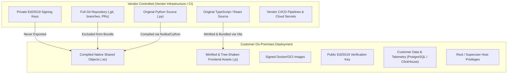

# Monitorix Enterprise — Intellectual Property Protection Model
**Document Version:** 1.0.0  
**Classification:** Technical Architecture & Security Policy  
**Date:** October 29, 2026  
**Auditor:** Principal Software & Security Architecture Team  

---

## 1. Foundational Security Principles & Non-Claims

In enterprise software architecture, intellectual property (IP) protection must be grounded in mathematical reality and honest threat modeling. When delivering on-premises software into customer-controlled environments (bare-metal, virtualization, or private cloud), **the customer's system administrators possess physical and root-level control over the execution environment.**

Therefore, Monitorix explicitly asserts the following engineering axioms:

> [!CAUTION]
> ### Critical Axioms & Explicit Non-Claims
> 1. **No Absolute Immunity**: We do **NOT** claim that compiled Python code is mathematically impossible to reverse engineer.
> 2. **Obfuscation is an Economic Barrier, Not Encryption**: We do **NOT** claim that JavaScript minification or binary obfuscation makes reverse engineering impossible.
> 3. **AI Capabilities Acknowledged**: We do **NOT** claim that AI, automated decompilers, or disassemblers cannot analyze compiled Monitorix binaries.
> 4. **Physical Reality**: Any binary executed on hardware controlled by a third party can technically be inspected via memory debuggers (`gdb`), system call tracers (`strace`), network sniffers, and disassemblers given sufficient time, skill, and resources.

The goal of the Monitorix IP Protection Model is **Defense-in-Depth and Economic Asymmetry**:
- Eliminate trivial source code leakage (e.g. browsing plaintext `.py` or `.tsx` files).
- Substantially raise the economic, temporal, and technical cost of reverse engineering.
- Enforce strict cryptographic controls where mathematical guarantees **do** exist (e.g., asymmetric digital signatures, tamper-evident licensing).
- Ensure that vendor private keys never ship to customer environments.

---

## 2. What Is Protected vs. What Is Not Protected



### 2.1. What Is Protected
1. **Source Code Distribution**:
   - The customer production package contains **zero** `.py` files, **zero** `.tsx` / `.jsx` development files, and **zero** `.git` repositories.
   - Internal comments, architectural notes, unreleased feature prototypes, and test files are completely stripped.
2. **Proprietary Algorithms (Crown Jewels)**:
   - Correlation logic, Sigma evaluation engines, risk scoring formulas, and autonomous containment decision trees are translated into C code and compiled to native machine code (`.so`) with stripped symbols.
3. **Cryptographic Authority**:
   - Customer-specific licenses are signed using Ed25519 asymmetric cryptography.
   - The **private signing key NEVER ships to customer premises**. Even with full root access on the deployment server, a customer administrator cannot generate or forge a valid signed license.
4. **Transport & Data Sovereignty**:
   - Customer security telemetry (events, logs, process data, network flows) remains 100% inside the customer's database instances. No telemetry is sent externally by default.

### 2.2. What Is Not Protected (Technical Boundaries)
1. **Public API Contract**:
   - HTTP request and response structures (JSON schemas) sent over `localhost:8000` or intercepted in the browser network tab can be observed by any user with browser developer tools.
2. **Database Schemas & Data**:
   - The PostgreSQL tables (e.g. `Agents`, `CommercialLicense`) and ClickHouse telemetry tables are stored on customer disks. A customer DBA with `postgres` credentials can read and query tables directly.
3. **System Calls & Native Execution**:
   - A customer administrator with root privileges can attach `strace`, `ltrace`, or `gdb` to running processes. While variable names are gone, system calls (`connect`, `write`, `read`) and standard C library invocations can be observed.
4. **Network Traffic Between Local Microservices**:
   - Traffic between internal Docker containers on `watch-sec-network` (e.g. backend to Redis, backend to PostgreSQL) can be captured via `tcpdump` on the host Docker bridge.

---

## 3. Why Source Code Is Not Distributed

In enterprise software licensing, distributing raw source code to on-premises customers introduces severe business and security vulnerabilities:
1. **Uncontrolled Redistribution**: Plaintext source code can be copied, shared, or leaked to unauthorized competitors with trivial ease.
2. **Unsupported Modifications**: Customers modifying `.py` files locally create undocumented drift, corrupt database schemas, and introduce catastrophic stability failures that invalidate vendor SLAs.
3. **Audit & Compliance Integrity**: Compliance frameworks (SOC 2 Type II, ISO 27001, Common Criteria) require that the software running in production matches verified, tamper-evident cryptographic checksums produced by vendor release pipelines.
4. **License Quota Circumvention**: In a plaintext source distribution, a customer could bypass endpoint limits by simply altering a single line in `local_entitlement_engine.py` (e.g. changing `return False` to `return True`). Compiling to native binary code prevents trivial text-editor tampering.

---

## 4. How Artifacts Are Protected & Signed

### 4.1. Cryptographic Hash Tree (SHA-256)
Every production release bundle includes a `checksums/SHA256SUMS.txt` manifest recording the SHA-256 digest of every individual artifact:
```text
3fa8b12...  images/monitorix-backend.tar
9e74c10...  images/monitorix-web.tar
8d12e44...  installer/install.sh
...
```

### 4.2. Asymmetric Digital Signature (Ed25519)
The entire `SHA256SUMS.txt` manifest is signed using the vendor's offline release signing key, creating `checksums/SHA256SUMS.sig`:
```bash
# Vendor signing during CI:
openssl dgst -sha256 -sign vendor_release_private.pem -out SHA256SUMS.sig SHA256SUMS.txt

# Customer verification during installer execution:
openssl dgst -sha256 -verify vendor_release_public.pem -signature SHA256SUMS.sig SHA256SUMS.txt
```
If a customer, intermediary, or attacker alters any file in the bundle (even a single byte in `install.sh` or an image tarball), the digital signature verification **fails immediately, aborting the installation**.

---

## 5. What Customer Administrators Can Technically Access

To maintain transparency with enterprise CISOs and IT directors, we document what customer administrators have technical access to:

| Layer | Customer Access Level | Technical Visibility | Vendor Safeguards |
|---|---|---|---|
| **Host Operating System** | Full Root (`sudo`) | Can inspect Docker storage, container processes, open ports, and memory. | Native binaries, memory protection, unprivileged container users (`uid 1001`). |
| **Database Engines** | Full Admin (`sentinel_user`) | Direct SQL queries to PostgreSQL, ClickHouse, Redis, and MongoDB. | Sensitive cloud credentials encrypted via AES-256-GCM envelope encryption (`vault_encryption.py`). |
| **Frontend Assets** | Full Browser Access | Minified JavaScript bundles, CSS stylesheets, images, HTML. | Source maps suppressed (`sourcemap: false`), console logging dropped, no embedded secrets. |
| **Backend Binaries** | Read-Only Container Images | Native shared objects (`.so`) and stripped machine code. | No `.py` source code, stripped symbols, C-API compiled wrappers. |
| **License Validation** | Local Verification Only | Can read `customer-license.json` and public verification key. | Signature cannot be forged without vendor private key. Tampering invalidates signature. |

---

## 6. Limitations of On-Premises Deployment

When deploying on-premises compared to multi-tenant SaaS:
1. **Key Custody**: While vendor private signing keys are never shipped, the customer is responsible for safeguarding their own local TLS private keys (`server.key`) and database credentials (`monitorix.env`).
2. **Patch Management**: Security patches cannot be automatically pushed over the cloud in air-gapped environments. Customers must apply vendor-signed offline update bundles through their internal change-management processes.
3. **Hardware Responsibility**: Compute, storage, high-availability replication, and disaster recovery hardware are the operational responsibility of the customer organization.
