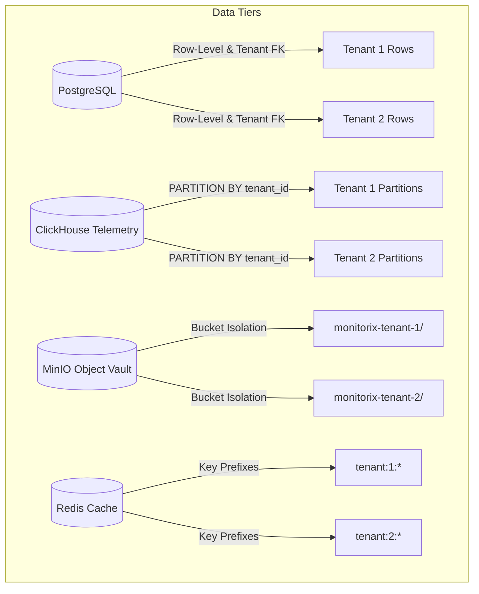

# Monitorix Sovereign Enterprise — Organization-Based Installation Guide

## 1. Overview & Architecture Models

Monitorix supports two distinct operational modes for enterprise deployments:

| Mode | Target Deployment | Tenancy Model | Data Isolation Boundary | Administrative Governance |
|---|---|---|---|---|
| **Mode A: Single-Enterprise Sovereign** | Large Enterprise, Defense, Critical Infrastructure | Dedicated Single-Tenant | Dedicated physical or virtual server cluster | Enterprise SecOps Lead / CISO |
| **Mode B: Multi-Organization Provider / MSSP** | MSSPs, MSPs, Holding Companies, Shared Datacenters | Multi-Tenant Partitioned | Cryptographic & database-level isolation per organization | SuperAdmin / Tenant Admins |

---

## 2. Multi-Tenant Architectural Isolation Model

In Multi-Organization installations, Monitorix guarantees strict multi-tenant data boundaries across all storage tiers:



1. **Relational Core (PostgreSQL)**: All business models (`Users`, `Agents`, `Incidents`, `Policies`, `Quotas`) enforce strict `TenantId` indexing and foreign key constraints. Queries outside SuperAdmin scope automatically apply tenant filters.
2. **High-Throughput Telemetry (ClickHouse)**: Tables (`process_events`, `network_flows`, `file_events`, `security_logs`) partition by `tenant_id`, ensuring cross-tenant queries cannot accidentally scan other organizations' disks.
3. **Forensic Vault (MinIO)**: Screenshots, memory dumps, and PCAP captures are written into dedicated tenant prefixes (`monitorix-tenant-<id>/`).
4. **Fast Cache & Sessions (Redis)**: Session tokens, WebSocket pub/sub channels, and rate-limiters are namespaced per organization (`tenant:<id>:rate_limits`).

---

## 3. Mode A: Single-Enterprise Dedicated Installation

Use this mode for standalone on-premises deployments dedicated to a single corporate entity.

### Step 1: Pre-Installation Configuration
```bash
# 1. Unpack sovereign deployment package
tar -xzf monitorix-enterprise-19.1.0-dep-enterprise-001.tar.gz
cd monitorix-enterprise

# 2. Configure enterprise environment
cp config/monitorix.env.template deployment/monitorix.env
```

Set the following single-tenant parameters in `deployment/monitorix.env`:
```ini
MONITORIX_ENV=production
DEPLOYMENT_MODE=SINGLE_TENANT
ORGANIZATION_NAME="Acme Global Corporation"
ORGANIZATION_DOMAIN="acme.internal"
AGENT_LIMIT=5000
AIR_GAPPED_MODE=false
DEFAULT_ADMIN_EMAIL=admin@acme.internal
```

### Step 2: Execute Pre-Flight Dry Run
```bash
sudo ./installer/install.sh --dry-run
```
Expected output:
```
[INFO] Pre-flight dry-run completed successfully.
[INFO] System is fully certified for installation.
```

### Step 3: Run Sovereign Installation
```bash
sudo ./installer/install.sh
```

### Step 4: First-Run Wizard
Open `https://<server-ip>:8085/setup` and complete the 12-step configuration wizard.

---

## 4. Mode B: Multi-Organization / MSSP Shared Installation

Use this mode for Managed Service Providers (MSPs) hosting multiple independent enterprise clients on a shared cluster.

### Step 1: Multi-Tenant Environment Configuration
Set in `deployment/monitorix.env`:
```ini
MONITORIX_ENV=production
DEPLOYMENT_MODE=MULTI_TENANT
SUPERADMIN_ORG_NAME="MSSP Global SOC Operations"
SUPERADMIN_EMAIL=soc-admin@mssp-partner.com
ENABLE_ORGANIZATION_PARTITIONING=true
DEFAULT_TENANT_AGENT_LIMIT=500
MAX_TENANTS=100
```

### Step 2: Install Base Multi-Tenant Cluster
```bash
sudo ./installer/install.sh
```

### Step 3: Provision Client Organizations via API or CLI

#### Provisioning via CLI:
```bash
docker exec -it watch-sec-backend python -c "
from app.db.session import SessionLocal
from app.db.models import Tenant
import secrets

db = SessionLocal()
tenant = Tenant(
    Name='First National Healthcare',
    ApiKey='api_' + secrets.token_hex(16),
    Plan='enterprise',
    AgentLimit=2500,
    Status='ACTIVE',
    Region='us-east-1'
)
db.add(tenant)
db.commit()
print(f'Created Tenant: ID={tenant.Id}, ApiKey={tenant.ApiKey}')
"
```

#### Provisioning via Admin Portal UI:
1. Log in as SuperAdmin at `https://<server-ip>:8085/login`.
2. Navigate to `/admin/organizations` → **"+ New Organization"**.
3. Specify Organization Name, Quota Limit (Endpoints), and Security Engines (EDR, NDR, SIEM).
4. System provisions organization workspace and generates the initial Tenant Admin invitation.

---

## 5. Organization-Specific Agent Enrollment

Each organization maintains independent agent enrollment tokens:

```bash
# Issue ephemeral enrollment token for Tenant 2
curl -X POST https://<server-ip>:8085/api/v2/tokens/enrollment \
  -H "Authorization: Bearer <SUPERADMIN_OR_ORGADMIN_JWT>" \
  -H "Content-Type: application/json" \
  -d '{
    "tenant_id": 2,
    "ttl_hours": 24,
    "max_uses": 500,
    "tags": ["healthcare", "windows", "hq"]
  }'
```

Response:
```json
{
  "token": "enr_8a7b9c1d2e3f4a5b6c7d8e9f0a1b2c3d",
  "tenant_id": 2,
  "expires_at": "2026-10-30T14:00:00Z",
  "max_uses": 500
}
```

Deploy to client endpoints:
```bash
# Linux
curl -sSL https://<server-ip>:8085/agent.sh | sudo bash -s -- --token enr_8a7b9c1d2e3f4a5b6c7d8e9f0a1b2c3d

# Windows (PowerShell)
Invoke-WebRequest -Uri "https://<server-ip>:8085/agent.ps1" -OutFile "$env:TEMP\agent.ps1"; & "$env:TEMP\agent.ps1" -Token "enr_8a7b9c1d2e3f4a5b6c7d8e9f0a1b2c3d"
```

---

## 6. Multi-Organization Role-Based Access Control (RBAC) Matrix

| Role | Scope | Tenant Management | Security Incident Triage | Policy Configuration | Live Terminal / Isolation | Audit Logs |
|---|---|---|---|---|---|---|
| **SuperAdmin** | Global Cluster | Create / Suspend / Delete | Cross-tenant visibility | Global & Tenant | Yes | Full Platform |
| **OrgAdmin** | Single Tenant | User management only | Full Tenant visibility | Tenant-specific only | Yes | Tenant Only |
| **SecOpsLead** | Single Tenant | View users | Investigate & escalate | Edit detection rules | Yes | Tenant Only |
| **SOCAnalyst** | Single Tenant | Read-only | Investigate & comment | View rules only | Approval Required | Read Only |
| **Auditor** | Single Tenant | None | Read-only historical | None | No | Read Only |
