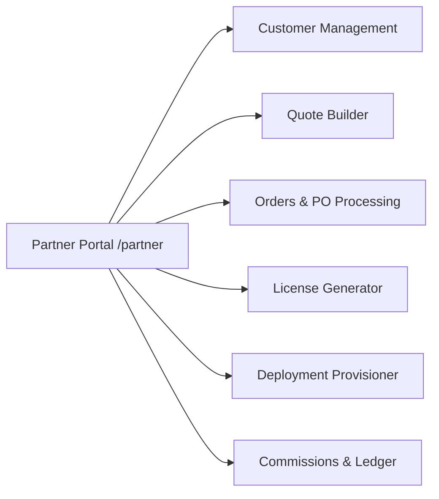

# Monitorix Sovereign Enterprise — Partner & Reseller Operational Guide

## 1. Executive Summary & Partner Program Overview

The **Monitorix Sovereign Partner Network (SPN)** enables Managed Service Providers (MSPs), Managed Detection and Response (MDR/MSSP) partners, Value-Added Resellers (VARs), and System Integrators to distribute, deploy, and co-manage Monitorix Sovereign XDR/SIEM platforms for enterprise clients across on-premises, private cloud, and air-gapped enclaves.

Unlike traditional cloud-hosted SaaS models where customer data is centralized on vendor servers, Monitorix provides a **Federated Multi-Tenant Architecture**:
- Each client organization receives an entirely sovereign deployment or a cryptographically isolated tenant enclave.
- Zero customer telemetry leaves the client perimeter.
- Partners retain complete commercial relationship ownership, recurring billing margins, and co-managed SOC escalation capabilities.

---

## 2. Partner Tier Architecture & Margin Schedule

| Partner Tier | Minimum Annual Commit | Baseline Hardware Margin | Software Subscription Margin | Support SLA Escalation | Dedicated SE Support |
|---|---|---|---|---|---|
| **Authorized Silver** | $25,000 ARR | 12% | 15% | 8x5 Next-Business-Day | Shared Community |
| **Premier Gold** | $100,000 ARR | 18% | 25% | 24x7x365 4-Hour Response | Assigned Partner Engineer |
| **Elite Platinum MSSP** | $500,000 ARR | 25% | 35% | 24x7x365 15-Minute Critical | Named Principal Architect |

---

## 3. Reseller Portal Workflow (`/partner`)

Partners access their dedicated administrative suite via `https://<domain>/partner`:

### Step-by-Step Partner Setup Workflow

### Step 1: Partner Authentication & Identity Verification
1. Navigate to your Sovereign Partner Portal (e.g., `https://partner.monitorix.internal/login` or your designated cluster URL).
2. Enter your Partner Operator ID and cryptographic security key.
3. Access the Partner Commercial Suite at `/partner/dashboard`.
4. Verify your active partner tier, accrued commission ledger, and active client deployment counts.

### Step 2: Onboard a New Customer Organization
1. From `/partner/customers`, click **"+ Provision Client Organization"**.
2. Input the legal organization details:
   - **Legal Entity Name**: e.g., `Acme Financial Services`
   - **Industry Vertical**: Banking / Healthcare / Defense / Critical Infrastructure
   - **Primary Administrative Contact**: `secops-admin@acme-bank.internal`
   - **Deployment Model**:
     - `ON_PREMISE` (Client local data center)
     - `PRIVATE_CLOUD` (Client dedicated AWS/Azure/GCP VPC)
     - `AIR_GAPPED` (Classified / Zero external connectivity)
3. Assign initial endpoint quotas and licensed security modules (EDR, NDR, SIEM, SOAR, EASM, ITDR).
4. System automatically assigns an immutable `TenantId` and cryptographic isolation namespace.

### Step 3: Build Quote & Generate Commercial Order
1. Navigate to `/partner/quotes` → **"Create Commercial Quote"**.
2. Select target customer and subscription plan:
   - **Standard Enterprise**: $45 / endpoint / year
   - **Advanced Sovereign**: $75 / endpoint / year
   - **Government Air-Gapped**: $110 / endpoint / year
3. The platform automatically calculates partner discount according to tier (e.g., Gold 25% margin applied at checkout).
4. Generate digital PDF Quote with cryptographic verification hash.
5. Once client issues Purchase Order (PO), upload PO document and click **"Authorize Order"**.

### Step 4: Generate Customer Cryptographic License
1. Navigate to `/partner/licenses` → **"Issue Deployment License"**.
2. Select target customer and deployment ID.
3. Define license parameters:
   - **Endpoint Limit**: e.g., `5,000` endpoints
   - **Validity Period**: `365 Days` (1 Year) or `1095 Days` (3 Years)
   - **Air-Gapped Flag**: `true` / `false`
   - **Enabled Feature Flags**: `["edr", "ndr", "xdr", "ueba", "soar", "sandbox", "itdr", "cnapp", "dspm"]`
4. The Partner Suite calls the Sovereign Control Plane to sign the license using RFC 8032 Ed25519 asymmetric cryptography.
5. Download signed `customer-license.json` containing only the vendor verification public key.

### Step 5: Deliver Deployment Package to Customer
1. Navigate to `/partner/deployments` → select target deployment ID.
2. Click **"Generate Dynamic Deployment Package"**.
3. The packaging engine compiles:
   - Clean compiled Python bytecode (`.pyc`) with zero `.py` source code.
   - Native Rust agent binaries (`monitorix-agent-linux`, `monitorix-agent-windows.exe`, `monitorix-agent-macos`).
   - Hardened `docker-compose.enterprise.yml` with host volume bounds.
   - Pre-installed `customer-license.json`.
   - Pre-flight automated installer `install.sh`.
4. Download the signed archive `monitorix-enterprise-<version>-<dep-id>.tar.gz` and SHA-256 checksum manifest.
5. Transmit archive to customer via secure physical media (for air-gapped sites) or encrypted SFTP.

---

## 4. Co-Managed MSSP Operations & Delegation

For partners operating a Security Operations Center (SOC) on behalf of multiple clients:

### MSSP Multi-Tenant Federation
- **Global Analyst Console** (`/soc`): Partners can view multi-client telemetry with single-pane-of-glass triage while preserving absolute data isolation.
- **Tenant Context Switching**: SOC analysts can pivot between tenant contexts (`Tenant: Acme Bank` → `Tenant: Global Healthcare`) with zero cross-tenant memory leakage.
- **Role-Based Incident Escalation**:
  - `Tier 1 Triage`: Partner SOC identifies and investigates alerts.
  - `Customer Notification`: Partner sends encrypted incident handover notes.
  - `Tier 2 Containment`: Partner triggers automated isolation playbooks (e.g., network isolate host, revoke Kerberos tickets) with client approval.

---

## 5. Partner Commission Tracking & Financial Settlement

1. Navigate to `/partner/commissions`.
2. Inspect the real-time billing ledger:
   - **Gross Billings**: Total client invoices issued.
   - **Cost of Goods Sold (COGS)**: Wholesale software subscription fee owed to Monitorix.
   - **Net Partner Commission**: Retained margin payable on net-30 terms.
3. Export detailed financial audit reports for quarterly accounting reconciliation.
