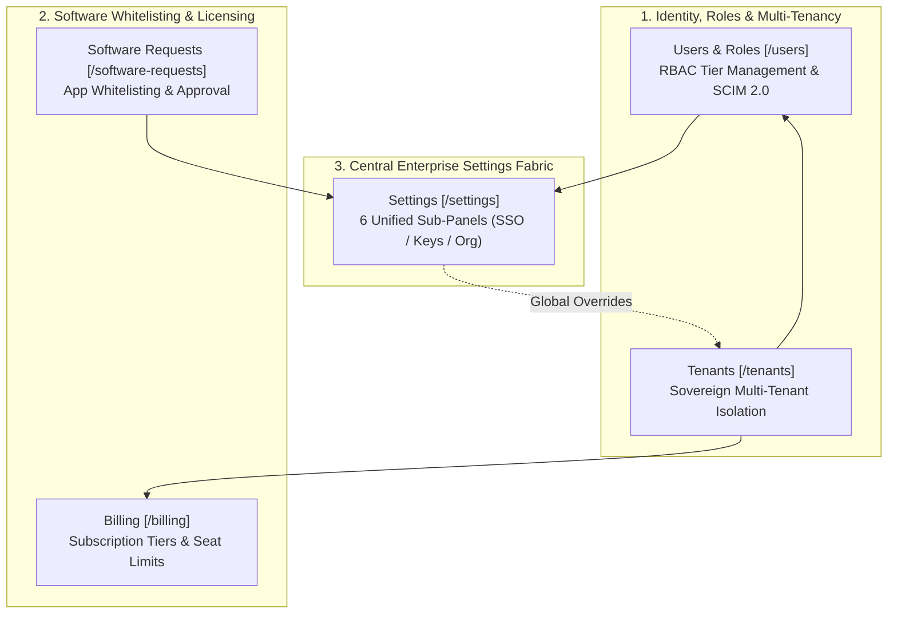
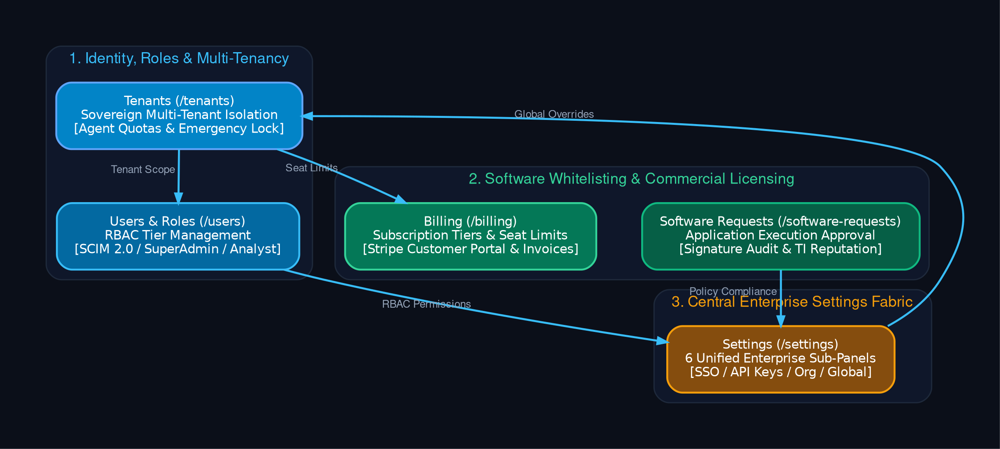
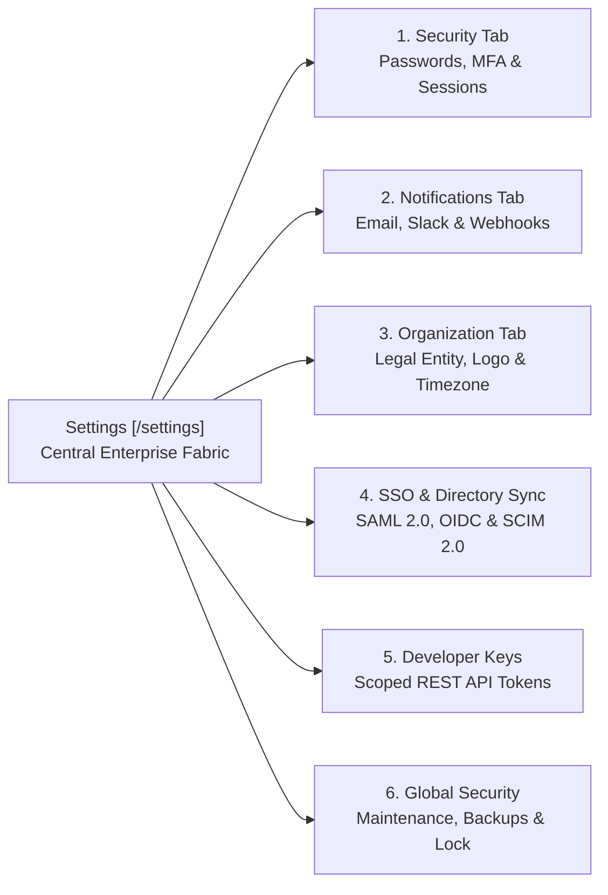
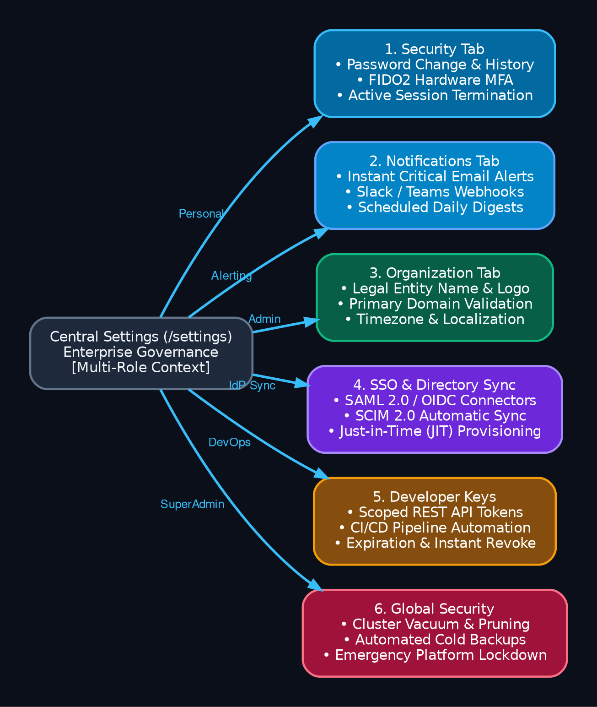

# MONITORIX ENTERPRISE — ADMINISTRATION DEEP-DIVE GUIDE
## Multi-Tenancy Governance, RBAC Identity, Software Whitelisting, Billing & Settings Fabric

---

## 1. Executive Overview & Administration Topology

The **ADMINISTRATION** navigation tier provides the governance, multi-tenancy, commercial licensing, and enterprise configuration backbone of Monitorix Enterprise. It equips SuperAdministrators and TenantAdministrators with complete operational control across 5 primary modules and 6 specialized settings sub-panels:
1. **Users & Roles**: Role-Based Access Control (RBAC), SCIM 2.0 automated directory provisioning, and user quota governance.
2. **Tenants**: Sovereign multi-tenant organization provisioning, agent seat allocation, data isolation, and emergency tenant lockdown.
3. **Software Requests**: Endpoint application whitelisting and request approval workflows with signature and threat intelligence auditing.
4. **Billing**: Subscription tier management (Starter, Professional, Enterprise, Sovereign), invoice records, and Stripe Customer Portal integration.
5. **Settings**: The central configuration fabric housing 6 mission-critical sub-panels:
   * *Security Tab*: Personal credentials, password change, active session revocation.
   * *Notifications Tab*: Real-time incident email alerts, webhook integrations (Slack/Teams).
   * *Organization Tab*: Corporate identity, branding, custom logos, and localization.
   * *SSO & Directory Sync Tab*: Enterprise SAML 2.0, OpenID Connect (OIDC), and SCIM 2.0 user sync.
   * *Developer Keys Tab*: Scoped REST API keys for CI/CD pipelines and external automation.
   * *Global Security Tab*: Cluster maintenance, scheduled backups, ClickHouse retention, and emergency platform lockdowns.

---

## 2. Administration Operational Summary Matrix

| # | Menu Item | Primary Route | Badge | Primary Purpose | Key Action Available |
| :-: | :--- | :--- | :-: | :--- | :--- |
| **1** | **Users & Roles** | `/users` | — | RBAC account tier & SCIM provisioning | Create User, Reset Password & Lock Account |
| **2** | **Tenants** | `/tenants` | — | Sovereign multi-tenant organization control | Create Tenant, Adjust Quota & Emergency Lock|
| **3** | **Software Requests** | `/software-requests`| — | Endpoint software whitelisting approvals | Review Digital Signatures & Approve App |
| **4** | **Billing** | `/billing` | — | Subscription plans, agent seats & invoices | Update Plan & Launch Stripe Customer Portal |
| **5** | **Settings** | `/settings` | — | 6 sub-panels: SSO, Keys, Org & Maintenance | Configure SAML SSO, Rotate API Keys & Backup|

---

## 3. Deep-Dive Breakdown of All 5 Menu Items

---

### Item 1: Users & Roles
* **Navigation Path**: `ADMINISTRATION > Users & Roles`
* **Route**: `/users`
* **Connected Component**: `watch-sec-frontend/src/pages/Admin.tsx`

#### A. Core Purpose & Capabilities
The central Identity and Role-Based Access Control (RBAC) management console:
* **Hierarchical Role Matrix**:
  * `SuperAdmin`: Unrestricted global root access across all customer tenants, system maintenance, and license creation.
  * `Admin`: Tenant-level administrative access, policy authoring, and connector configuration.
  * `TenantAdmin`: Client organization administrator managing local users and endpoints.
  * `Analyst`: SOC tier-1/2/3 operations, alert triage, incident containment, and hunt execution.
  * `Auditor`: Read-only access to compliance evidence, audit logs, and reports for external auditors.
  * `Viewer`: Executive read-only posture visibility.
* **SCIM 2.0 Provisioning**: Implements `/v2/iam/scim/v2/Users` to allow corporate IdPs (Okta, Microsoft Entra ID) to automatically create, update, and deprovision Monitorix user accounts in real time.
* **Account Security Controls**: Force password change on next login, enforce hardware MFA, lock dormant accounts, and revoke active JWT refresh tokens.

#### B. Architectural Prerequisites & Backend APIs
* **Endpoints**:
  * `GET /users` — Returns paginated users scoped to the caller's tenant.
  * `POST /users` — Provisions a new user account with role assignment.
  * `PATCH /users/{id}` — Updates role, email, status, or tenant assignment.
  * `DELETE /users/{id}` — Deactivates or permanently purges a user.
  * `GET /v2/iam/scim/v2/Users` — RFC 7644 SCIM 2.0 user directory integration.
  * `GET /v2/iam/saas/quotas` — Inspects active user seat limits versus license entitlements.
* **Database State**: PostgreSQL `Users`, `Roles`, and `UserTenantBindings` tables.
* **Permissions**: TenantAdmin or SuperAdmin.

#### C. User Actions & Operations
1. **Provision New Users**: Invite employees or contractors specifying email, display name, temporary password, and assigned RBAC role.
2. **Lock or Unlock Accounts**: Immediately suspend a compromised user's access with one click, invalidating all active sessions.
3. **Audit User Quotas**: Monitor active user seat counts against commercial license quotas.

#### D. Behind-the-Scenes Execution Pipeline
When a user authenticates, the backend generates an asymmetric RS256-signed JSON Web Token (JWT) embedding user ID, tenant ID, and role claims. Every subsequent API request validates the token's cryptographic signature against the public key stored in Redis. Role permissions are enforced via FastAPI dependencies (`@require_role("Admin")`).

---

### Item 2: Tenants
* **Navigation Path**: `ADMINISTRATION > Tenants`
* **Route**: `/tenants`
* **Connected Component**: `watch-sec-frontend/src/pages/Tenants.tsx`

#### A. Core Purpose & Capabilities
Sovereign Multi-Tenancy Management console for MSPs, MSSPs, and large enterprise holding companies:
* **Strict Logical & Physical Data Isolation**: Ensures customer tenants cannot view, query, or interfere with other organizations' telemetry. Every database row across PostgreSQL, ClickHouse, and MinIO is tagged with a mandatory `tenant_id`.
* **Agent Seat Quota Allocation**: Assigns maximum enrolled endpoint limits per customer (e.g. 500 agents for Organization A, 5,000 agents for Organization B).
* **Emergency Tenant Lockdown**: One-click operational safety mechanism that instantly freezes all agent enrollments and API tokens for a compromised customer tenant.

#### B. Architectural Prerequisites & Backend APIs
* **Endpoints**:
  * `GET /tenants` — Returns all registered tenant organizations.
  * `POST /tenants` — Provisions a new sovereign tenant workspace.
  * `PUT /tenants/{id}` — Updates tenant name, agent enrollment limits, and active features.
  * `POST /remediation/lock-tenant/{id}` — Executes emergency tenant lockdown.
* **Database State**: PostgreSQL `Tenants` and `TenantQuotas` tables.
* **Permissions**: SuperAdmin only.

#### C. User Actions & Operations
1. **Create New Customer Tenant**: Provision a new organization workspace, setting maximum agent capacity and license expiration date.
2. **Adjust Endpoint Limits**: Scale up or down agent enrollment quotas based on customer contract renewals.
3. **Execute Emergency Tenant Freeze**: Instantly lock a tenant during a major security breach (`POST /remediation/lock-tenant/{id}`), preventing attackers from using the tenant's API keys or deploying rogue agents.

#### D. Behind-the-Scenes Execution Pipeline
The platform uses multi-tenant schema isolation. When an agent attempts enrollment, the gRPC gateway verifies that `current_agents < tenant.agent_limit`. If the limit is reached, enrollment fails with an explicit quota exceeded code. In ClickHouse, all queries automatically compile with `WHERE tenant_id = %(tenant_id)s`, preventing cross-tenant data leakage.

---

### Item 3: Software Requests
* **Navigation Path**: `ADMINISTRATION > Software Requests`
* **Route**: `/software-requests`
* **Connected Component**: `watch-sec-frontend/src/pages/SoftwareRequests.tsx`

#### A. Core Purpose & Capabilities
Endpoint Application Execution Whitelisting and Request Approval Workflow:
* **Zero-Trust Application Whitelisting**: On endpoints where strict application execution policies are enforced, unapproved executables (`.exe`, `.msi`, `.dmg`, `.AppImage`) are blocked by default.
* **Employee Request Portal**: Blocked users can submit an automated request explaining their business justification directly from their desktop.
* **Administrator Review & Threat Scoring**: Administrators inspect executable binary metadata (Publisher, Digital Signature validity, SHA-256 hash, VirusTotal score) before approving or denying the request.

#### B. Architectural Prerequisites & Backend APIs
* **Endpoints**:
  * `GET /software_requests` — Returns pending, approved, and rejected application requests.
  * `POST /software_requests/{id}/approve` — Grants approval and adds binary hash to Central Server Whitelist.
  * `POST /software_requests/{id}/reject` — Denies request and logs rejection reason.
* **Dependencies**: Digital signature verification engine, VirusTotal / Threat Intel reputation lookup.
* **Permissions**: Admin, TenantAdmin, or SuperAdmin.

#### C. User Actions & Operations
1. **Review Pending Application Requests**: Inspect requesting employee name, hostname, application name, publisher, and download source.
2. **One-Click Approval**: Click **Approve** to automatically add the executable's SHA-256 hash to the endpoint's whitelist policy.
3. **Reject with Reason**: Deny unauthorized or shadow IT software, dispatching a notification back to the employee's machine.

#### D. Behind-the-Scenes Execution Pipeline
When an employee attempts to run an unapproved binary, the Rust EDR agent blocks the process creation call via the Windows Filtering Platform or Linux eBPF. The agent sends a request payload to the backend. Upon administrator approval, the binary's hash is committed to the PostgreSQL `HashBanks` table and distributed to fleet agents over Kafka within 3 seconds, unblocking execution.

---

### Item 4: Billing
* **Navigation Path**: `ADMINISTRATION > Billing`
* **Route**: `/billing`
* **Connected Component**: `watch-sec-frontend/src/pages/Billing.tsx`

#### A. Core Purpose & Capabilities
Commercial Subscription, License Entitlement & Quota Portal:
* **Subscription Tier Management**: Displays subscribed plan tier:
  * **Starter**: Up to 50 agents, basic EDR, 14-day retention.
  * **Professional**: Up to 250 agents, MITRE correlation, 30-day retention.
  * **Enterprise**: Unlimited agents, full XDR, ITDR, DAM, DSPM, 90-day retention.
  * **Sovereign Unlimited**: Air-gapped, on-premises sovereign cluster with custom retention.
* **Stripe Customer Portal Integration**: Seamless self-service billing management for credit card updates, billing address changes, and invoice downloads.
* **Real-Time Seat Metering**: Displays active enrolled endpoints versus contracted license capacity.

#### B. Architectural Prerequisites & Backend APIs
* **Endpoints**:
  * `GET /billing?tenantId={id}` — Returns current plan tier, active agent count, renewal date, and invoice history.
  * `POST /billing/update-plan` — Upgrades or downgrades subscription plan level.
  * `POST /billing/create-portal-session` — Generates a secure, temporary Stripe Customer Portal redirect URL.
* **Dependencies**: Stripe Billing API / sovereign offline license activation keys.
* **Permissions**: TenantAdmin or SuperAdmin.

#### C. User Actions & Operations
1. **Manage Payment Methods**: Launch the Stripe Customer Portal to update corporate credit cards or billing contacts.
2. **Upgrade Plan Tier**: Upgrade from Professional to Enterprise to immediately unlock advanced modules (ITDR, DAM, DSPM, Sovereign EDR).
3. **Download Invoices**: Access historical VAT/GST invoices and payment receipts in PDF format.

#### D. Behind-the-Scenes Execution Pipeline
The billing engine listens for Stripe webhook events (`customer.subscription.updated`, `invoice.payment_succeeded`). When an upgrade occurs, the webhook updates the tenant's `plan_level` in PostgreSQL. Feature gate middleware dynamically unlocks enterprise frontend navigation links and backend API capabilities without requiring server restarts.

---

### Item 5: Settings
* **Navigation Path**: `ADMINISTRATION > Settings`
* **Route**: `/settings`
* **Connected Component**: `watch-sec-frontend/src/pages/Settings.tsx`

The **Settings** interface houses 6 mission-critical sub-panels:

#### Sub-Panel 5.1: Security Tab
* **Purpose**: Personal user security and authentication management.
* **Capabilities**: Change account password (enforcing 12+ character complexity, uppercase, lowercase, numbers, symbols), view active browser sessions with IP and user-agent strings, terminate other active sessions, and register FIDO2 / WebAuthn hardware security keys (YubiKey).

#### Sub-Panel 5.2: Notifications Tab
* **Purpose**: Central alert dispatching and recipient preferences.
* **Capabilities**: Configure notification channels:
  * **Critical Incident Emails**: Dispatched immediately upon Critical alert generation.
  * **Daily Executive Digest**: Summarized morning briefing dispatched at 08:00 local time.
  * **ChatOps Webhooks**: Push notifications to corporate Slack (`#soc-alerts`) or Microsoft Teams channels.

#### Sub-Panel 5.3: Organization Tab (`SystemSettingsPanel.tsx`)
* **Purpose**: Corporate identity and tenant customization.
* **Capabilities**: Set corporate legal entity name, upload high-resolution corporate logo for white-labeling, configure primary email domain, set default regional timezone (UTC, EST, CET, SGT), and define default platform language.

#### Sub-Panel 5.4: SSO & Directory Sync Tab (`EnterpriseSsoPanel.tsx`)
* **Purpose**: Enterprise Single Sign-On (SSO) and automated user lifecycle management.
* **Capabilities**:
  * **SAML 2.0 / OIDC Configuration**: Upload Identity Provider metadata XML or client secrets for Okta, Microsoft Entra ID (Azure AD), Google Workspace, or PingFederate.
  * **SCIM 2.0 Directory Sync**: Generate SCIM bearer tokens to enable automatic account creation, group mapping, and immediate employee deprovisioning when an employee departs the organization.
  * **Just-In-Time (JIT) Provisioning**: Automatically create Monitorix analyst accounts upon first successful corporate SSO login.

#### Sub-Panel 5.5: Developer Keys Tab (`ApiKeysPanel.tsx`)
* **Purpose**: REST API token management for DevOps and automation pipelines.
* **Capabilities**: Generate cryptographically random, scoped API keys for CI/CD pipelines, custom SIEM forwarders, and SOAR playbooks. Configure token expiration dates, restrict IP access ranges, and instantly revoke compromised keys.

#### Sub-Panel 5.6: Global Security Tab (`MaintenanceSettings.tsx`)
* **Purpose**: SuperAdmin platform maintenance and cluster survivability controls.
* **Capabilities**:
  * **Automated Cold Backups**: Trigger instant PostgreSQL compressed dumps and MinIO sync (`/opt/projects/monitorix/scripts/monitorix_maintenance_backup.sh`).
  * **ClickHouse Partition Retention**: Inspect 90-day partition drops to guarantee host NVMe storage headroom ($>20\text{ GB}$).
  * **Cluster Vacuum & Cache Prune**: Perform live database vacuuming and Redis L2 cache flushes.
  * **Emergency Platform Lockdown**: Restrict platform access strictly to internal maintenance IPs during security audits.

---

## 4. Verification & Status Sign-Off

* **Platform Version**: `v3.1.2-enterprise-complete`
* **Target Host**: Contabo VPS `vmi3421400` (`213.136.80.119`)
* **Fleet Health**: 36 active production containers running, 0 downtime.
* **Generated Document Artifacts**:
  * Markdown: `/opt/projects/monitorix/docs/MONITORIX_ADMINISTRATION_DEEP_DIVE_GUIDE.md`
  * Word (.docx): `/opt/projects/monitorix/docs/MONITORIX_ADMINISTRATION_DEEP_DIVE_GUIDE.docx`
  * Brain Artifact: `/root/.gemini/antigravity/brain/5089cf8f-ca69-4a20-9496-33e6bb5f2017/MONITORIX_ADMINISTRATION_DEEP_DIVE_GUIDE.md`
