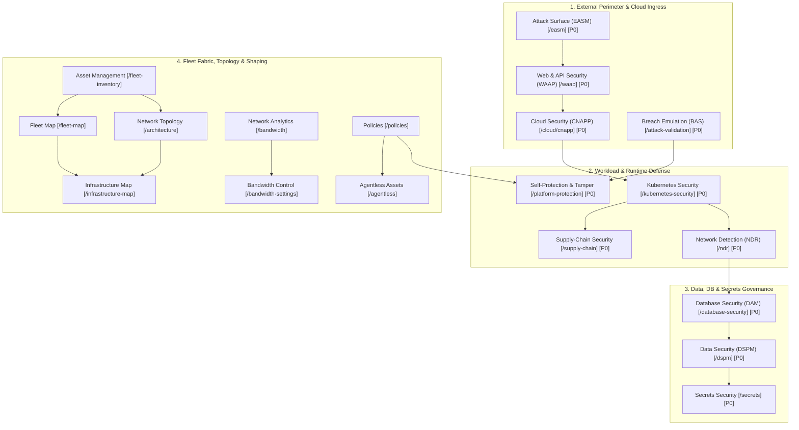
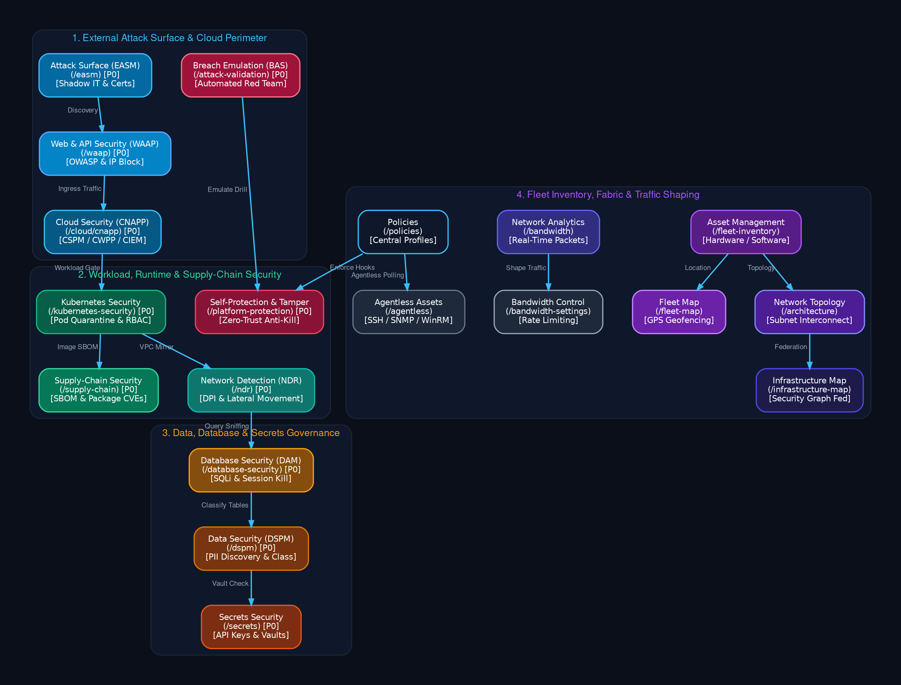
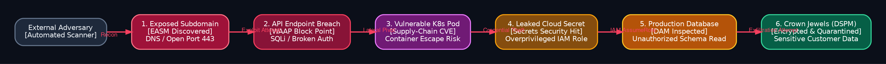

# MONITORIX ENTERPRISE — ASSET & INFRASTRUCTURE DEEP-DIVE GUIDE
## Cloud-Native Posture, Workload Protection, Data Governance & Infrastructure Fabric

---

## 1. Executive Overview & Architecture Topology

The **ASSET & INFRASTRUCTURE** navigation suite forms the comprehensive defense foundation of Monitorix Enterprise. It encompasses 19 specialized operational modules partitioned across four foundational security domains:
1. **Cloud Perimeter & Attack Surface**: EASM, WAAP, CNAPP, and Automated Breach Emulation (BAS).
2. **Workload, Runtime & Supply-Chain Security**: Kubernetes security, container image SBOM auditing, deep packet inspection (NDR), and agent anti-tamper self-defense.
3. **Data, Database & Secrets Governance**: Database Activity Monitoring (DAM), Data Security Posture Management (DSPM), and enterprise secrets leak detection.
4. **Fleet Inventory, Fabric & Traffic Shaping**: Complete hardware/software asset inventory, GPS fleet mapping, network analytics, security knowledge graph, agentless monitoring, and bandwidth throttling.

---

## 2. Asset & Infrastructure Operational Summary Matrix

| # | Menu Item | Primary Route | Badge | Primary Purpose | Key Action Available |
| :-: | :--- | :--- | :-: | :--- | :--- |
| **1** | **Breach Emulation (BAS)** | `/attack-validation` | `P0` | Automated adversarial cyberattack drills | Execute Attack Playbooks & Certify Posture |
| **2** | **Self-Protection & Tamper** | `/platform-protection`| `P0` | Zero-trust agent defense & kernel anti-tamper | Trigger Emergency Lockdown & Audit Proofs |
| **3** | **Network Detection (NDR)**| `/ndr` | `P0` | Deep Packet Inspection (DPI) & C2 tracking | Contain Rogue IP & Inspect Raw PCAPs |
| **4** | **Supply-Chain Security** | `/supply-chain` | `P0` | SBOM manifest audits & malicious packages | Quarantine Vulnerable Library & Gate CI/CD |
| **5** | **Kubernetes Security** | `/kubernetes-security`| `P0` | Cloud-native pod security & RBAC auditing | Quarantine Rogue Pod & Enforce OPA Policy |
| **6** | **Database Security (DAM)** | `/database-security` | `P0` | Real-time SQL audit & exfiltration defense | Terminate Database Session & Block Query |
| **7** | **Secrets Security** | `/secrets` | `P0` | Leak detection in repos, envs & memory | Trigger Deep Vault Scan & Rotate Tokens |
| **8** | **Data Security (DSPM)** | `/dspm` | `P0` | PII/PHI discovery, classification & residency | Reclassify Assets & Apply Auto-Remediation |
| **9** | **Web & API (WAAP)** | `/waap` | `P0` | Next-gen WAF, OWASP Top 10 & API schema | One-Click IP Block & Toggle WAF Rules |
| **10**| **Attack Surface (EASM)** | `/easm` | `P0` | External internet asset discovery & certs | Discover Shadow Assets & Fix Exposures |
| **11**| **Cloud Security (CNAPP)** | `/cloud/cnapp` | `P0` | Multi-cloud CSPM, CWPP & toxic attack paths | Run Cloud Graph Scan & Sever Attack Paths |
| **12**| **Asset Management** | `/fleet-inventory` | — | Hardware & software fleet inventory | Search Installed Packages & Export CSV |
| **13**| **Fleet Map** | `/fleet-map` | — | Global GPS & IP geographic location pins | Geofence Boundary Check & Asset Pinpoint |
| **14**| **Network Analytics** | `/bandwidth` | — | Bandwidth utilization & protocol metrics | Inspect Top Talkers & Outbound Egress Rates|
| **15**| **Network Topology** | `/architecture` | — | Interactive subnet & VPC interconnect graph | Trace Segmentation Boundaries & Cloud Peering|
| **16**| **Infrastructure Map** | `/infrastructure-map` | — | Enterprise Security Knowledge Graph | Isolate Compromised Node Directly from Graph |
| **17**| **Agentless Assets** | `/agentless` | — | SNMP, SSH & WinRM telemetry for unmanaged | Add Agentless Host & Trigger Discovery |
| **18**| **Policies** | `/policies` | — | Centralized EDR profile & sensor templates | Create Policy Template & Push to Agent Group|
| **19**| **Bandwidth Control** | `/bandwidth-settings` | — | Traffic shaping & metered link throttling | Pause Agent Uploads & Set Egress Rate Caps |

---

## 3. Deep-Dive Breakdown of All 19 Menu Items

---

### Item 1: Breach Emulation (BAS)
* **Navigation Path**: `ASSET & INFRASTRUCTURE > Breach Emulation (BAS)`
* **Route**: `/attack-validation`
* **Badge**: `P0` (Priority Zero)
* **Connected Component**: `watch-sec-frontend/src/pages/AttackValidationCenter.tsx`

#### A. Core Purpose & Capabilities
Provides automated, continuous Breach and Attack Simulation (BAS) testing. Simulates real-world advanced persistent threat (APT) techniques safely across production and staging environments without destructive payloads. Validates whether endpoint agents, SIEM correlation rules, and firewalls successfully detect and block each phase of an attack.

#### B. Architectural Prerequisites & Backend APIs
* **Endpoints**:
  * `GET /v2/attack-validation/overview` — Current fleet resilience score and attack coverage stats.
  * `GET /v2/attack-validation/scenarios` — Catalog of pre-configured MITRE ATT&CK simulation playbooks.
  * `POST /v2/attack-validation/execute` — Dispatches non-destructive simulation commands to an agent.
  * `GET /v2/attack-validation/executions?limit=50` — Historical execution log and block rates.
  * `GET /v2/attack-validation/certifications` — Generates cryptographically verifiable validation certificates.
* **Database State**: `AttackScenarios`, `AttackExecutions`, and `MitreValidationMatrix` tables in PostgreSQL.
* **Permissions**: Security Engineer, TenantAdmin, or SuperAdmin.

#### C. User Actions & Operations
1. **Launch Attack Playbook**: Select scenarios such as Ransomware Blast (T1486), LSASS Memory Dumping (T1003.001), Kerberoasting (T1558), or Egress C2 Beaconing (T1071) and execute against designated test endpoints.
2. **Review Detection Verification**: Inspect millisecond correlation response times, detection confidence, and SOAR trigger status.
3. **Export Validation Certificates**: Download formal PDF/JSON certificates proving security control effectiveness for compliance audits.

#### D. Behind-the-Scenes Execution Pipeline
The BAS engine compiles benign simulation commands (e.g. creating decoy high-entropy canary files or simulating an encoded PowerShell beacon) and dispatches them via Kafka to the target agent. The agent executes the test in an isolated process sandbox while simultaneously verifying whether the in-flight correlation engine captures the telemetry. If detected within SLA limits, the test passes; if missed, an immediate defense gap ticket is created.

---

### Item 2: Self-Protection & Tamper
* **Navigation Path**: `ASSET & INFRASTRUCTURE > Self-Protection & Tamper`
* **Route**: `/platform-protection`
* **Badge**: `P0` (Priority Zero)
* **Connected Component**: `watch-sec-frontend/src/pages/PlatformSelfProtection.tsx`

#### A. Core Purpose & Capabilities
Guarantees zero-trust survival and anti-tamper resilience for the Monitorix platform itself. Protects agent binaries, kernel drivers, system daemons, local configuration files, and backend Docker containers against unauthorized modification, process termination (`kill -9`), uninstallation attempts, debugger attachments, and memory injection.

#### B. Architectural Prerequisites & Backend APIs
* **Endpoints**:
  * `GET /v2/platform-protection/nodes` — Status of anti-tamper hooks across all monitored endpoints.
  * `GET /v2/platform-protection/policies` — Active self-defense policies and watchdog configurations.
  * `GET /v2/platform-protection/events?limit=100` — Log of detected tamper and termination attempts.
  * `POST /v2/platform-protection/emergency-lockdown` — Places compromised nodes in total lockdown.
  * `POST /v2/platform-protection/report-tamper` — Forensic telemetry hook invoked upon tamper detection.
  * `GET /v2/platform-protection/proofs` — Cryptographic integrity proofs of running binaries.
* **Dependencies**: Local OS watchdog service, Linux eBPF / Windows Filter Driver hook.

#### C. User Actions & Operations
1. **Trigger Emergency Fleet Lockdown**: Instantly freeze suspicious endpoints, revoking administrative tokens and severing unauthenticated ingress.
2. **Audit Cryptographic Proofs**: Verify running SHA-256 binary signatures against the immutable release ledger.
3. **Configure Anti-Tamper Enforcement**: Toggle kernel hook protection, service watchdog respawns, and local LMDB cache encryption.

#### D. Behind-the-Scenes Execution Pipeline
The Rust EDR agent employs dual-process mutual watchdog supervision: if the main monitoring service is killed, the watchdog immediately respawns it and captures memory dumps of the terminating PID. On Linux, eBPF probes intercept `kill` and `ptrace` system calls directed at the agent PID. Any unauthorized termination attempt emits a high-priority tamper alert directly to the SOC stream.

---

### Item 3: Network Detection (NDR)
* **Navigation Path**: `ASSET & INFRASTRUCTURE > Network Detection (NDR)`
* **Route**: `/ndr`
* **Badge**: `P0` (Priority Zero)
* **Connected Component**: `watch-sec-frontend/src/pages/NetworkDetectionResponse.tsx`

#### A. Core Purpose & Capabilities
Network Detection and Response (NDR) platform powered by deep packet inspection (DPI). Analyzes raw traffic flows, protocol compliance, encrypted traffic metadata (JA3/JA4 TLS fingerprinting), lateral movement protocols (SMB, RPC, SSH, RDP), and detects covert exfiltration channels such as DNS tunneling and ICMP payload stuffing.

#### B. Architectural Prerequisites & Backend APIs
* **Endpoints**:
  * `GET /v2/ndr/overview` — Network sensor fleet status and packet processing velocity.
  * `GET /v2/ndr/sensors` — Registered network tap points and SPAN/mirror interfaces.
  * `POST /v2/ndr/inspect-traffic` — Submits raw PCAP snippets or netflow streams for deep analysis.
  * `GET /v2/ndr/rules` — Protocol anomaly detection signatures and threshold rules.
  * `POST /v2/ndr/contain-threat` — Dispatches automated network isolation commands to perimeter firewalls.
* **Dependencies**: ClickHouse network flow tables, Redis sliding window cache.

#### C. User Actions & Operations
1. **Inspect Live Network Traffic**: View real-time packet processing, protocol distribution charts, and anomalous connection rates.
2. **Execute Threat Containment**: One-click quarantine of internal IP addresses exhibiting lateral movement or C2 beaconing.
3. **PCAP Deep Dive**: Upload and analyze packet capture files to reconstruct TCP streams and extract malicious payloads.

#### D. Behind-the-Scenes Execution Pipeline
Network sensors passively sniff packet headers and extract session metadata: source IP, destination IP, port, protocol, byte counters, and TLS ClientHello handshakes. The NDR correlation engine computes jitter metrics on persistent outbound sockets: if packet interval jitter falls below 15% with high periodic regularity, an active C2 beacon alert is triggered.

---

### Item 4: Supply-Chain Security
* **Navigation Path**: `ASSET & INFRASTRUCTURE > Supply-Chain Security`
* **Route**: `/supply-chain`
* **Badge**: `P0` (Priority Zero)
* **Connected Component**: `watch-sec-frontend/src/pages/SupplyChainSecurity.tsx`

#### A. Core Purpose & Capabilities
Continuous Software Bill of Materials (SBOM) auditing and 3rd-party dependency vulnerability scanning. Analyzes package manifests across npm (`package-lock.json`), Python (`Pipfile.lock`, `requirements.txt`), Rust (`Cargo.lock`), Go (`go.sum`), and Docker container layers, detecting malicious dependencies, typosquatting attacks, and license non-compliance.

#### B. Architectural Prerequisites & Backend APIs
* **Endpoints**:
  * `GET /v2/supply-chain/overview` — Fleet-wide dependency health and critical CVE counts.
  * `GET /v2/supply-chain/findings` — Detailed list of vulnerable libraries and tainted packages.
  * `POST /v2/supply-chain/evaluate-manifest` — Uploads and evaluates an application manifest in real time.
  * `GET /v2/supply-chain/policies` — Governance rules (e.g. blocking GPLv3 or packages with CVSS $\ge 8.0$).
  * `POST /v2/supply-chain/quarantine-component` — Blocks a compromised package across all CI/CD pipelines.
* **Dependencies**: NVD, GitHub Advisory Database, and OSV vulnerability feeds.

#### C. User Actions & Operations
1. **Upload & Audit Manifests**: Drag and drop lockfiles or SBOM JSON files (CycloneDX / SPDX) to receive instant dependency vulnerability reports.
2. **Quarantine Compromised Packages**: Flag and blacklist malicious package versions to block deployment across all build pipelines.
3. **Enforce Open-Source License Policies**: Prevent deployment of dependencies containing conflicting or high-risk licenses.

#### D. Behind-the-Scenes Execution Pipeline
Uploaded manifests are parsed into hierarchical dependency trees. Every package name, version, and cryptographic hash is cross-referenced against the internal vulnerability database. If a package matches a known malicious supply-chain package (such as an npm token stealer), the build is halted and an incident case is opened.

---

### Item 5: Kubernetes Security
* **Navigation Path**: `ASSET & INFRASTRUCTURE > Kubernetes Security`
* **Route**: `/kubernetes-security`
* **Badge**: `P0` (Priority Zero)
* **Connected Component**: `watch-sec-frontend/src/pages/KubernetesSecurity.tsx`

#### A. Core Purpose & Capabilities
Cloud-native runtime defense, posture assessment, and container admission control for Kubernetes clusters (EKS, GKE, AKS, and on-premises K8s). Enforces CIS Kubernetes Benchmarks, audits Role-Based Access Control (RBAC) misconfigurations, detects container escape attempts, and isolates rogue pods.

#### B. Architectural Prerequisites & Backend APIs
* **Endpoints**:
  * `GET /v2/k8s-security/overview` — Cluster health, pod counts, and security violation metrics.
  * `GET /v2/k8s-security/clusters` — Enrolled Kubernetes clusters and API server connection states.
  * `POST /v2/k8s-security/evaluate-manifest` — Static analysis of YAML deployment manifests.
  * `GET /v2/k8s-security/policies` — Active admission control policies and Open Policy Agent (OPA) rules.
  * `POST /v2/k8s-security/quarantine-pod` — Applies a zero-trust NetworkPolicy isolating a malicious pod.
* **Dependencies**: Kube-apiserver integration, Kubernetes ValidatingAdmissionWebhook.

#### C. User Actions & Operations
1. **Quarantine Compromised Pods**: Click **Quarantine Pod** (`POST /v2/k8s-security/quarantine-pod`) to apply immediate zero-ingress/zero-egress NetworkPolicies.
2. **Validate Deployment YAML**: Test manifests prior to deployment to ensure no containers request `privileged: true`, `hostPID: true`, or writable root filesystems.
3. **Audit RBAC Entitlements**: Identify cluster roles granting dangerous permissions (e.g. `*` on `secrets` or `pods/exec`).

#### D. Behind-the-Scenes Execution Pipeline
The Monitorix Kubernetes DaemonSet monitors local container runtime sockets (containerd / CRI-O) and listens to the API audit log stream. When a container attempts to mount the host filesystem or execute a binary not present in the base image, the anomaly engine flags a container escape attempt and signals the admission controller to quarantine the namespace.

---

### Item 6: Database Security (DAM)
* **Navigation Path**: `ASSET & INFRASTRUCTURE > Database Security (DAM)`
* **Route**: `/database-security`
* **Badge**: `P0` (Priority Zero)
* **Connected Component**: `watch-sec-frontend/src/pages/DatabaseSecurity.tsx`

#### A. Core Purpose & Capabilities
Database Activity Monitoring (DAM) and SQL injection (SQLi) runtime defense. Inspects database transaction queries across PostgreSQL, MySQL, ClickHouse, and MongoDB, identifying unauthorized data exfiltration, schema tampering (`DROP TABLE`, `ALTER USER`), and privilege escalation attempts.

#### B. Architectural Prerequisites & Backend APIs
* **Endpoints**:
  * `GET /v2/database-security/overview` — Active connections, query throughput, and threat alarms.
  * `GET /v2/database-security/instances` — Monitored database clusters and connection health.
  * `POST /v2/database-security/inspect-query` — Evaluates SQL queries against behavioral AST parser.
  * `POST /v2/database-security/terminate-session` — Forcibly terminates an active malicious database session.
* **Dependencies**: Database native audit plugins (`pgaudit`, MySQL enterprise audit) or proxy sniffer.

#### C. User Actions & Operations
1. **Kill Malicious Database Sessions**: Instantly terminate rogue database connections (`POST /v2/database-security/terminate-session`) executing unauthorized queries.
2. **Inspect Query Telemetry**: View full query text, client IP, executing database user, affected row count, and execution duration.
3. **Configure Data Access Baselines**: Define allowed SQL query patterns per application service account.

#### D. Behind-the-Scenes Execution Pipeline
Database query streams are analyzed using an Abstract Syntax Tree (AST) lexer. If an application user (e.g. `web_app`) executes an administrative query (`CREATE USER`, `GRANT ALL`) or a query resulting in an abnormal row return (e.g. returning 500,000 credit card records when the baseline is 10), the session is terminated via `pg_terminate_backend()` and an alert is dispatched.

---

### Item 7: Secrets Security
* **Navigation Path**: `ASSET & INFRASTRUCTURE > Secrets Security`
* **Route**: `/secrets`
* **Badge**: `P0` (Priority Zero)
* **Connected Component**: `watch-sec-frontend/src/pages/SecretsSecurity.tsx`

#### A. Core Purpose & Capabilities
Automated secrets discovery, hardcoded credential detection, and vault governance. Scans source code repositories, configuration files, environment variables, container layers, and memory dumps for exposed API keys, private certificates, AWS/GCP access tokens, and database passwords.

#### B. Architectural Prerequisites & Backend APIs
* **Endpoints**:
  * `GET /v2/secrets/overview` — Fleet-wide secret exposure counts and severity breakdown.
  * `GET /v2/secrets/vaults` — Connected enterprise vaults (HashiCorp Vault, AWS Secrets Manager).
  * `POST /v2/secrets/scan` — Initiates an immediate secret discovery scan across all endpoints.
  * `POST /v2/secrets/targets/scan` — Deep scans a specific host, repo, or filesystem path.
  * `POST /v2/secrets/remediate` — Automatically revokes or masks an exposed secret.
* **Dependencies**: High-entropy regex dictionary, Shannon entropy calculator.

#### C. User Actions & Operations
1. **Trigger Deep Secrets Scans**: Run comprehensive filesystem and memory scans looking for exposed API credentials.
2. **One-Click Remediation**: Trigger automated credential revocation or rotation through connected cloud vault APIs.
3. **Filter Secrets by Service**: Filter discovered secrets by type: AWS Access Keys, Stripe API Keys, Slack Tokens, Private RSA/ECDSA Keys, and JWT Secret Keys.

#### D. Behind-the-Scenes Execution Pipeline
Scanners combine regular expressions matching known token prefixes (`AKIA...` for AWS, `sk_live_...` for Stripe) with Shannon entropy calculations to identify high-randomness string variables. Discovered matches are verified against live provider APIs (in a non-destructive read-only manner) to determine whether the credential is active before raising a Critical incident.

---

### Item 8: Data Security (DSPM)
* **Navigation Path**: `ASSET & INFRASTRUCTURE > Data Security (DSPM)`
* **Route**: `/dspm`
* **Badge**: `P0` (Priority Zero)
* **Connected Component**: `watch-sec-frontend/src/pages/DataSecurityDspm.tsx`

#### A. Core Purpose & Capabilities
Data Security Posture Management (DSPM). Continuously discovers, catalogs, and classifies sensitive enterprise data (Personally Identifiable Information - PII, Protected Health Information - PHI, Payment Card Data - PCI) across multi-cloud object stores (S3, Azure Blob, GCS), relational databases, and endpoint drives, mapping data lineage and detecting unencrypted exposures.

#### B. Architectural Prerequisites & Backend APIs
* **Endpoints**:
  * `GET /v2/dspm/overview` — Total classified data volume, sensitive asset counts, and posture score.
  * `GET /v2/dspm/assets` — Inventory of data stores with classification badges (Confidential, Restricted, Public).
  * `POST /v2/dspm/scan` — Initiates an asynchronous data discovery and classification sweep.
  * `POST /v2/dspm/classify` — Manually updates the classification tag and risk tier of a data asset.
  * `GET /v2/dspm/compliance` — Cross-references classified assets against GDPR, HIPAA, and PCI-DSS rules.
  * `POST /v2/dspm/remediate` — Applies encryption-at-rest or access policy hardening on exposed buckets.
* **Dependencies**: Natural Language Processing (NLP) pattern classifiers, Cloud IAM connectors.

#### C. User Actions & Operations
1. **Discover Shadow Data Stores**: Detect unmanaged S3 buckets or local database backups containing sensitive user records.
2. **Inspect Data Flow Maps**: Trace how sensitive PII travels from external web ingress down to analytics data lakes.
3. **Enforce Encryption Policies**: One-click remediation to enforce AES-256 or KMS key encryption on exposed buckets.

#### D. Behind-the-Scenes Execution Pipeline
DSPM scanners utilize deterministic regex and NLP models to scan samples of structured tables and object files. Files containing social security numbers, credit card primary account numbers (PAN), or patient diagnosis codes are tagged with data sensitivity weights. If a confidential data asset has public read access enabled, a P0 security alert is emitted.

---

### Item 9: Web & API Security (WAAP)
* **Navigation Path**: `ASSET & INFRASTRUCTURE > Web & API Security (WAAP)`
* **Route**: `/waap`
* **Badge**: `P0` (Priority Zero)
* **Connected Component**: `watch-sec-frontend/src/pages/WebApisecurityWaap.tsx`

#### A. Core Purpose & Capabilities
Web Application and API Protection (WAAP / Next-Gen WAF). Protects web frontends, REST APIs, and microservices against the OWASP Top 10 vulnerabilities (SQL Injection, Cross-Site Scripting, SSRF, Broken Object Level Authorization - BOLA), credential stuffing, and malicious automated bot networks.

#### B. Architectural Prerequisites & Backend APIs
* **Endpoints**:
  * `GET /v2/waap/overview` — Request volume, blocked attack percentage, and WAF health.
  * `GET /v2/waap/endpoints` — Protected API routes and schema enforcement status.
  * `POST /v2/waap/inspect` — Real-time payload evaluation against signature and behavioral models.
  * `POST /v2/waap/rules/toggle` — Enables or disables specific inspection rulesets.
  * `POST /v2/waap/ip-block` — Adds an IP or CIDR range to the global perimeter blocklist.
  * `GET /v2/waap/ip-reputation` — Checks external threat intelligence reputation for requesting client IPs.
* **Dependencies**: Nginx WAF module / Envoy filter, Redis IP rate-limiting cluster.

#### C. User Actions & Operations
1. **One-Click IP Blocking**: Instantly block malicious adversary IPs across edge ingress proxies (`POST /v2/waap/ip-block`).
2. **Toggle WAF Defense Modes**: Switch between `Monitoring` (log only) and `Enforcing` (active block) per API endpoint.
3. **Inspect Blocked Requests**: Examine full HTTP headers, query strings, request bodies, and matched attack signatures.

#### D. Behind-the-Scenes Execution Pipeline
Incoming HTTP requests pass through the WAAP inspection pipeline before reaching backend application containers. The payload is checked against regular expression attack signatures and an AST tokenizer. If SQL syntax tokens or path traversal sequences (`../etc/passwd`) are detected, the request is immediately rejected with an HTTP 403 Forbidden response.

---

### Item 10: Attack Surface (EASM)
* **Navigation Path**: `ASSET & INFRASTRUCTURE > Attack Surface (EASM)`
* **Route**: `/easm`
* **Badge**: `P0` (Priority Zero)
* **Connected Component**: `watch-sec-frontend/src/pages/ExternalAttackSurface.tsx`

#### A. Core Purpose & Capabilities
External Attack Surface Management (EASM). Continuously scans the public internet from an external adversary's viewpoint to discover shadow IT, unknown subdomains, exposed cloud storage buckets, open ports (e.g. 3389 RDP, 22 SSH), and expiring or misconfigured SSL/TLS certificates.

#### B. Architectural Prerequisites & Backend APIs
* **Endpoints**:
  * `GET /v2/easm/assets` — Inventory of all discovered public-facing digital assets.
  * `POST /v2/easm/discover` — Triggers an active external reconnaissance sweep.
  * `GET /v2/easm/certificates` — Tracks SSL/TLS certificate validity, issuer, and expiration dates.
  * `POST /v2/easm/evaluate` — Evaluates external vulnerability exposure scores.
  * `POST /v2/easm/remediate` — Dispatches alerts to DNS and firewall teams to close exposed assets.
  * `GET /v2/easm/assets/{id}` — Deep metadata regarding an individual external host.
* **Dependencies**: DNS zone transfer checks, Certificate Transparency logs, Shodan/Censys threat APIs.

#### C. User Actions & Operations
1. **Trigger External Discovery**: Run automated internet sweeps to discover unrecorded subdomains and forgotten dev servers.
2. **Monitor Certificate Expirations**: Receive advance warnings for certificates expiring within 30, 14, or 7 days.
3. **Close Shadow Port Exposures**: Identify open administration ports accessible to the entire internet and trigger firewall isolation.

#### D. Behind-the-Scenes Execution Pipeline
The EASM engine monitors public Certificate Transparency (CT) logs for newly issued certificates matching enterprise domain names. It performs non-intrusive port scans and banner grabs on resolved IP addresses. Discovered assets are tagged with risk ratings based on software version recency and port exposure.

---

### Item 11: Cloud Security (CNAPP)
* **Navigation Path**: `ASSET & INFRASTRUCTURE > Cloud Security (CNAPP)`
* **Route**: `/cloud/cnapp`
* **Badge**: `P0` (Priority Zero)
* **Connected Component**: `watch-sec-frontend/src/pages/CloudSecurityCnapp.tsx`

#### A. Core Purpose & Capabilities
Cloud Native Application Protection Platform (CNAPP). Unifies Cloud Security Posture Management (CSPM), Cloud Workload Protection (CWPP), and Cloud Infrastructure Entitlement Management (CIEM) across AWS, Microsoft Azure, and Google Cloud Platform (GCP). Visualizes complex **toxic attack paths** linking internet exposures, misconfigured IAM roles, and crown jewel data stores.

```mermaid
flowchart LR
    ADV["External Adversary"] -->|Recon| EXP["1. Exposed Subdomain<br/>[EASM Discovered]"]
    EXP -->|Exploit| WAF["2. API Breach<br/>[WAAP Block Point]"]
    WAF -->|Pivot| POD["3. Vulnerable Pod<br/>[Supply-Chain CVE]"]
    POD -->|Steal Creds| SEC["4. Leaked Secret<br/>[Overprivileged IAM]"]
    SEC -->|AssumeRole| DB["5. Production DB<br/>[DAM Monitored]"]
    DB -->|Exfiltrate| PII["6. Crown Jewels<br/>[DSPM Quarantined]"]
```

#### B. Architectural Prerequisites & Backend APIs
* **Endpoints**:
  * `GET /v2/cnapp/overview` — Multi-cloud asset counts, compliance score, and toxic risk paths.
  * `GET /v2/cnapp/paths` — Graph representations of multi-hop attack vectors.
  * `POST /v2/cnapp/scan` — Initiates an immediate cloud resource configuration audit.
  * `POST /v2/cnapp/evaluate` — Evaluates cloud security benchmark compliance (CIS AWS/Azure/GCP).
  * `POST /v2/cnapp/remediate` — Applies automated terraform/cloud API fixes for misconfigurations.
* **Dependencies**: Read-only cloud IAM integration roles across target AWS, Azure, and GCP accounts.

#### C. User Actions & Operations
1. **Inspect Toxic Attack Paths**: View visual graph paths showing how an attacker could navigate from a public EC2 instance to an internal database.
2. **Sever Attack Path with One Click**: Click *Remediate* on any intermediate node (e.g. revoking an IAM policy or closing a security group) to break the kill chain.
3. **Multi-Cloud CIS Benchmarks**: Audit cloud tenant compliance against official CIS Foundation benchmarks.

#### D. Behind-the-Scenes Execution Pipeline
The CNAPP engine queries cloud provider APIs to ingest configuration state across compute instances, object buckets, security groups, and IAM permission policies. It compiles an internal directed acyclic graph (DAG). Using graph pathfinding algorithms, it identifies intersections where an internet-exposed workload holds an IAM role with access to confidential datastores, flagging it as a toxic attack combination.

---

### Item 12: Asset Management
* **Navigation Path**: `ASSET & INFRASTRUCTURE > Asset Management`
* **Route**: `/fleet-inventory`
* **Connected Component**: `watch-sec-frontend/src/pages/FleetInventory.tsx`

#### A. Core Purpose & Capabilities
The single pane of glass for hardware and software asset inventory across the entire enterprise. Catalogs physical servers, virtual machines, cloud instances, and developer laptops with hardware specifications (CPU, RAM, disk, network MAC), operating system patch levels, and installed software package inventories.

#### B. Architectural Prerequisites & Backend APIs
* **Endpoints**:
  * `GET /vulnerabilities/fleet-software` — Comprehensive list of all software packages across the fleet.
  * `GET /agents` — Returns complete fleet hardware and status inventory.
* **Dependencies**: Agent local hardware and package collection modules (`dpkg`, `rpm`, Windows Registry).

#### C. User Actions & Operations
1. **Search Across Fleet**: Instantly find which machines have a specific software package or version installed (e.g. search `log4j`, `openssl`, `python 3.9`).
2. **Hardware Fleet Filtering**: Filter by operating system (Windows 11, Ubuntu 24.04, macOS Sonoma), hardware architecture (x86_64, aarch64), or online status.
3. **Export Asset Ledger**: Download complete asset and software inventories in CSV or JSON for CMDB synchronization.

#### D. Behind-the-Scenes Execution Pipeline
Whenever an agent starts up or detects software changes, it scans the operating system's package registry. The payload is transmitted over gRPC and stored in ClickHouse. The frontend provides sub-second search capabilities over millions of software records across thousands of hosts.

---

### Item 13: Fleet Map
* **Navigation Path**: `ASSET & INFRASTRUCTURE > Fleet Map`
* **Route**: `/fleet-map`
* **Connected Component**: `watch-sec-frontend/src/pages/LocationMap.tsx`

#### A. Core Purpose & Capabilities
Real-time geographic visualization of all connected endpoints on an interactive world map. Uses GPS coordinates (where hardware location is enabled) or public IP geolocation to plot laptops, field workstations, and data center nodes worldwide.

#### B. Architectural Prerequisites & Backend APIs
* **Endpoints**:
  * `GET /agents` — Returns agent status including latitude, longitude, city, country, and public IP.
* **Dependencies**: MaxMind GeoIP database or IP-API integration, browser mapping canvas (Leaflet / Mapbox).

#### C. User Actions & Operations
1. **Inspect Geographic Clusters**: Zoom into specific regions, countries, or corporate office facilities to see active devices.
2. **Geofencing Verification**: Identify company laptops operating in unauthorized or embargoed foreign jurisdictions.
3. **Direct Agent Drilldown**: Click any map marker to open that endpoint's telemetry drawer, isolation controls, or live remote desktop.

#### D. Behind-the-Scenes Execution Pipeline
During agent heartbeats, the backend inspects the client's public IP address. If location tracking policy is enabled, it resolves the IP to geographic coordinates. If an agent previously connected from London suddenly checks in from an anomalous country within 2 hours, an impossible-travel identity alert is raised.

---

### Item 14: Network Analytics
* **Navigation Path**: `ASSET & INFRASTRUCTURE > Network Analytics`
* **Route**: `/bandwidth`
* **Connected Component**: `watch-sec-frontend/src/pages/NetworkAnalytics.tsx`

#### A. Core Purpose & Capabilities
In-depth network throughput, socket connection rate, and protocol bandwidth analytics. Provides time-series visualizations of data transfer rates (KB/s, MB/s), identifies top communicating host machines, and flags abnormal egress traffic spikes indicative of mass data exfiltration.

#### B. Architectural Prerequisites & Backend APIs
* **Endpoints**:
  * `GET /network/stats` — Time-series bandwidth metrics across ingress and egress channels.
* **Dependencies**: Agent socket monitoring module (`ss -tunap` on Linux, `netstat -ano` on Windows).

#### C. User Actions & Operations
1. **Identify Top Talkers**: View ranked tables of endpoints transmitting the highest data volume over the last 1 hour, 24 hours, or 7 days.
2. **Analyze Egress vs. Ingress**: Spot asymmetric egress traffic bursts where a workstation uploads unusually large amounts of data to external IPs.
3. **Filter by Protocol**: Inspect traffic broken down by TCP, UDP, ICMP, and application ports.

#### D. Behind-the-Scenes Execution Pipeline
Agents aggregate bytes sent and received per network interface over 5-second polling windows. These counters are streamed to ClickHouse. The backend calculates first-derivative byte rates to render real-time bandwidth consumption graphs.

---

### Item 15: Network Topology
* **Navigation Path**: `ASSET & INFRASTRUCTURE > Network Topology`
* **Route**: `/architecture`
* **Connected Component**: `watch-sec-frontend/src/pages/Architecture.tsx`

#### A. Core Purpose & Capabilities
Dynamic enterprise network interconnectivity graph. Visualizes subnets, virtual private clouds (VPCs), routers, firewalls, and active endpoint nodes, highlighting network segmentation boundaries and communication channels.

#### B. Architectural Prerequisites & Backend APIs
* **Endpoints**:
  * `GET /tenants/{id}` — Tenant network configuration and registered CIDR subnets.
  * `GET /agents` — Endpoint IP allocations and gateway addresses.
* **Dependencies**: ReactFlow graph layout engine.

#### C. User Actions & Operations
1. **Trace Segmentation Paths**: Verify that critical internal subnets (e.g. database networks) have no direct communication paths to untrusted guest networks.
2. **Locate Compromised Nodes**: Compromised endpoints with active alerts are highlighted with red pulsing borders on the network topology.
3. **Rearrange & Export Graphs**: Reorganize layout nodes and export high-resolution topology diagrams for architectural audits.

#### D. Behind-the-Scenes Execution Pipeline
The topology engine analyzes ARP tables, default gateways, and active socket connections collected from agents. It groups endpoints into CIDR subnet blocks and draws directional edges representing observed network communication, verifying compliance with zero-trust microsegmentation rules.

---

### Item 16: Infrastructure Map
* **Navigation Path**: `ASSET & INFRASTRUCTURE > Infrastructure Map`
* **Route**: `/infrastructure-map`
* **Connected Component**: `watch-sec-frontend/src/pages/SecurityGraph.tsx`

#### A. Core Purpose & Capabilities
Enterprise Security Knowledge Graph. Unifies relational data across multiple domains: **Identities $\leftrightarrow$ Devices $\leftrightarrow$ Privileges $\leftrightarrow$ Network Flows $\leftrightarrow$ Active Incidents**. Allows analysts to explore multi-dimensional risk relationships and isolate endpoints directly from the graph view.

#### B. Architectural Prerequisites & Backend APIs
* **Endpoints**:
  * `GET /v2/federation/security-graph` — Graph nodes and edges representing the complete digital estate.
  * `POST /v2/federation/sync-surface` — Synchronizes external asset states into the graph.
  * `POST /agents/{agentId}/isolate` — Isolates a compromised node directly from the graph view.
* **Dependencies**: Graph database engine / in-memory graph representation.

#### C. User Actions & Operations
1. **Interactive Graph Navigation**: Expand and collapse neighboring nodes to trace which user identities have logged into an infected machine.
2. **Isolate Endpoint from Graph**: Right-click a node directly in the graph and select **Isolate Host** to immediately sever network connectivity.
3. **Blast Radius Analysis**: Click an incident node to automatically highlight all interconnected machines, credentials, and databases within 2 degrees of separation.

#### D. Behind-the-Scenes Execution Pipeline
The security graph synthesizes data from Active Directory, cloud IAM, agent process trees, and network connection tables into a unified node-edge model. When an analyst clicks an asset, graph queries calculate its centrality score and blast radius, showing exactly which sensitive systems are at risk.

---

### Item 17: Agentless Assets
* **Navigation Path**: `ASSET & INFRASTRUCTURE > Agentless Assets`
* **Route**: `/agentless`
* **Connected Component**: `watch-sec-frontend/src/pages/AgentlessDashboard.tsx`

#### A. Core Purpose & Capabilities
Agentless security monitoring and telemetry collection for unmanaged network infrastructure where installing a Rust agent is impossible: network switches, routers, hardware firewalls, IoT devices, legacy operating systems, and ESXi hypervisors. Collects telemetry via SNMP, SSH, WinRM, and vendor APIs.

#### B. Architectural Prerequisites & Backend APIs
* **Endpoints**:
  * `GET /v2/agentless/endpoints` — Inventory of enrolled agentless hosts and connection states.
  * `POST /v2/agentless/manual` — Triggers an immediate polling cycle against an agentless target.
* **Dependencies**: Central server agentless poller daemon, SSH/WinRM/SNMP client libraries.

#### C. User Actions & Operations
1. **Enroll Agentless Target**: Add network switches or legacy servers specifying target IP, port, protocol (SNMPv3, SSH, WinRM), and vault credential references.
2. **Trigger Instant Polling**: Force an immediate configuration and health poll (`POST /v2/agentless/manual`).
3. **Review Switch & Port Health**: Inspect network interface errors, bandwidth utilization, and unauthorized device connections on managed switch ports.

#### D. Behind-the-Scenes Execution Pipeline
A background worker pool runs on the central server. On a scheduled cadence, workers establish secure SSH or SNMPv3 sessions with enrolled devices, execute read-only diagnostic commands (e.g. `show interfaces`, `show arp`), parse output into structured JSON, and feed the telemetry into the main Kafka pipeline.

---

### Item 18: Policies
* **Navigation Path**: `ASSET & INFRASTRUCTURE > Policies`
* **Route**: `/policies`
* **Connected Component**: `watch-sec-frontend/src/pages/Policies.tsx`

#### A. Core Purpose & Capabilities
Centralized EDR Feature & Security Policy Management. Enables administrators to create, edit, version, and assign security configuration profiles across agent groups. Governs features such as USB mass storage blocking, screen recording intervals, speech monitoring, FIM rules, and local resource limits.

#### B. Architectural Prerequisites & Backend APIs
* **Endpoints**:
  * `GET /policies?tenantId={id}` — Lists all created policy templates.
  * `POST /policies` — Creates a new policy template.
  * `PUT /policies/{id}` — Updates an existing policy.
  * `DELETE /policies/{id}` — Deletes an unused policy.
* **Database State**: `FeaturePolicies` and `AgentPolicyBindings` in PostgreSQL.

#### C. User Actions & Operations
1. **Create Policy Profiles**: Configure role-specific profiles (e.g. *Developer Profile* with relaxed process limits; *Finance Profile* with strict USB blocking and screen audit).
2. **Assign Policy to Fleet**: Apply a policy to an individual agent or broadcast across entire departmental groups.
3. **Configure Audit Parameters**: Set screenshot capture frequency (e.g. every 60 seconds), image quality compression, and audio monitoring thresholds.

#### D. Behind-the-Scenes Execution Pipeline
When a policy is saved or updated, the backend compiles the configuration into a binary protobuf payload. A policy sync notification is dispatched over Kafka. Online agents receive the update, apply the new sensor rules in memory, and store the configuration in their encrypted local LMDB database so rules persist across machine reboots.

---

### Item 19: Bandwidth Control
* **Navigation Path**: `ASSET & INFRASTRUCTURE > Bandwidth Control`
* **Route**: `/bandwidth-settings`
* **Connected Component**: `watch-sec-frontend/src/pages/BandwidthSettings.tsx`

#### A. Core Purpose & Capabilities
Dynamic agent network throttling and telemetry egress traffic shaping. Protects corporate WAN, cellular, and metered satellite links by enforcing upload rate limits, setting peak/off-peak transmission schedules, compressing telemetry batches, and offering an emergency global pause toggle.

#### B. Architectural Prerequisites & Backend APIs
* **Endpoints**:
  * `GET/POST /tenants/{id}/bandwidth/config` — Retrieves or updates tenant egress bandwidth caps.
  * `POST /tenants/{id}/bandwidth/pause?duration_minutes={minutes}` — Temporarily pauses agent uploads.
* **Dependencies**: Redis tenant rate-limiting bucket.

#### C. User Actions & Operations
1. **Set Upload Speed Limits**: Cap maximum agent egress bandwidth (e.g. 50 KB/s per agent) to prevent network congestion.
2. **Emergency Upload Pause**: Click **Pause Uploads** for 15, 30, or 60 minutes during mission-critical network operations.
3. **Configure Peak Hours**: Set business hours during which agents buffer non-critical telemetry on local disk, uploading only high-priority security alarms.

#### D. Behind-the-Scenes Execution Pipeline
When bandwidth limits are adjusted, updated token-bucket rate limiter settings are pushed to agents. Agents throttle their gRPC stream buffers using a token-bucket algorithm, spooling lower-priority telemetry to their encrypted local disk buffer whenever egress exceeds the configured threshold.

---

## 4. Verification & Status Sign-Off

* **Platform Version**: `v3.1.2-enterprise-complete`
* **Target Host**: Contabo VPS `vmi3421400` (`213.136.80.119`)
* **Fleet Health**: 36 active production containers running, 0 downtime.
* **Generated Document Artifacts**:
  * Markdown: `/opt/projects/monitorix/docs/MONITORIX_ASSET_INFRASTRUCTURE_DEEP_DIVE_GUIDE.md`
  * Word (.docx): `/opt/projects/monitorix/docs/MONITORIX_ASSET_INFRASTRUCTURE_DEEP_DIVE_GUIDE.docx`
  * Brain Artifact: `/root/.gemini/antigravity/brain/5089cf8f-ca69-4a20-9496-33e6bb5f2017/MONITORIX_ASSET_INFRASTRUCTURE_DEEP_DIVE_GUIDE.md`
