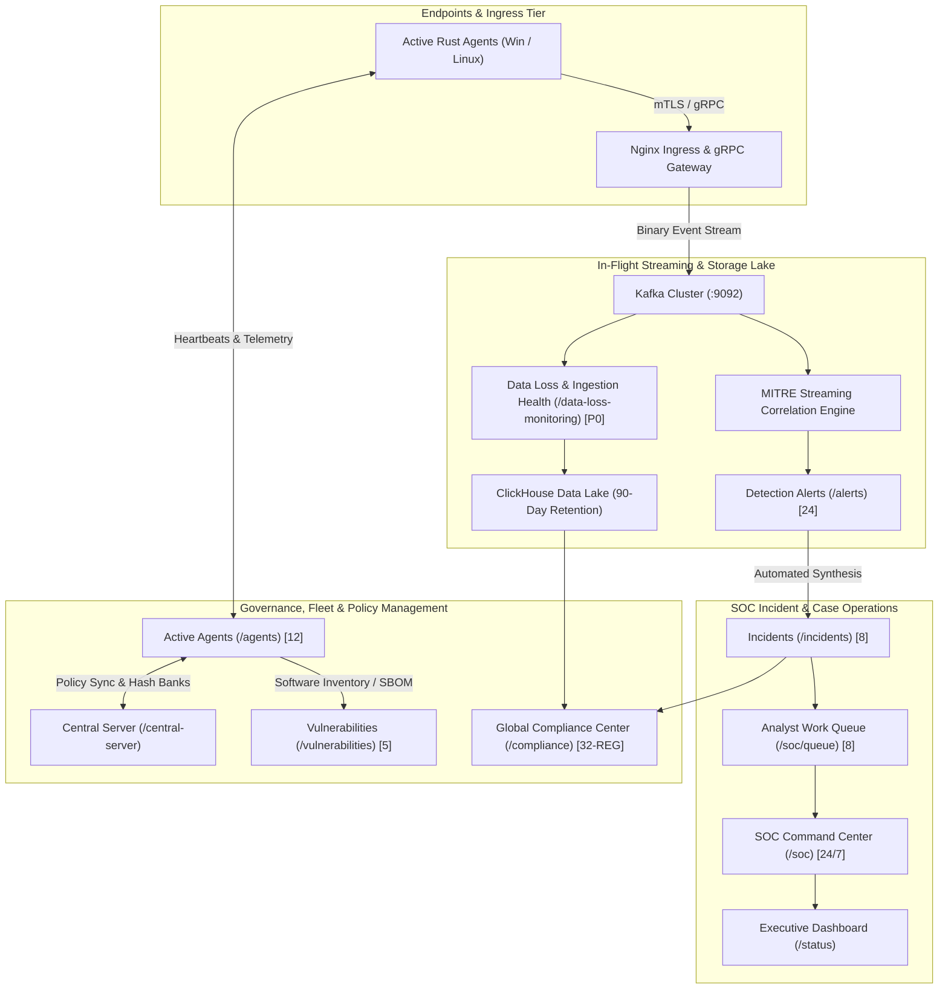
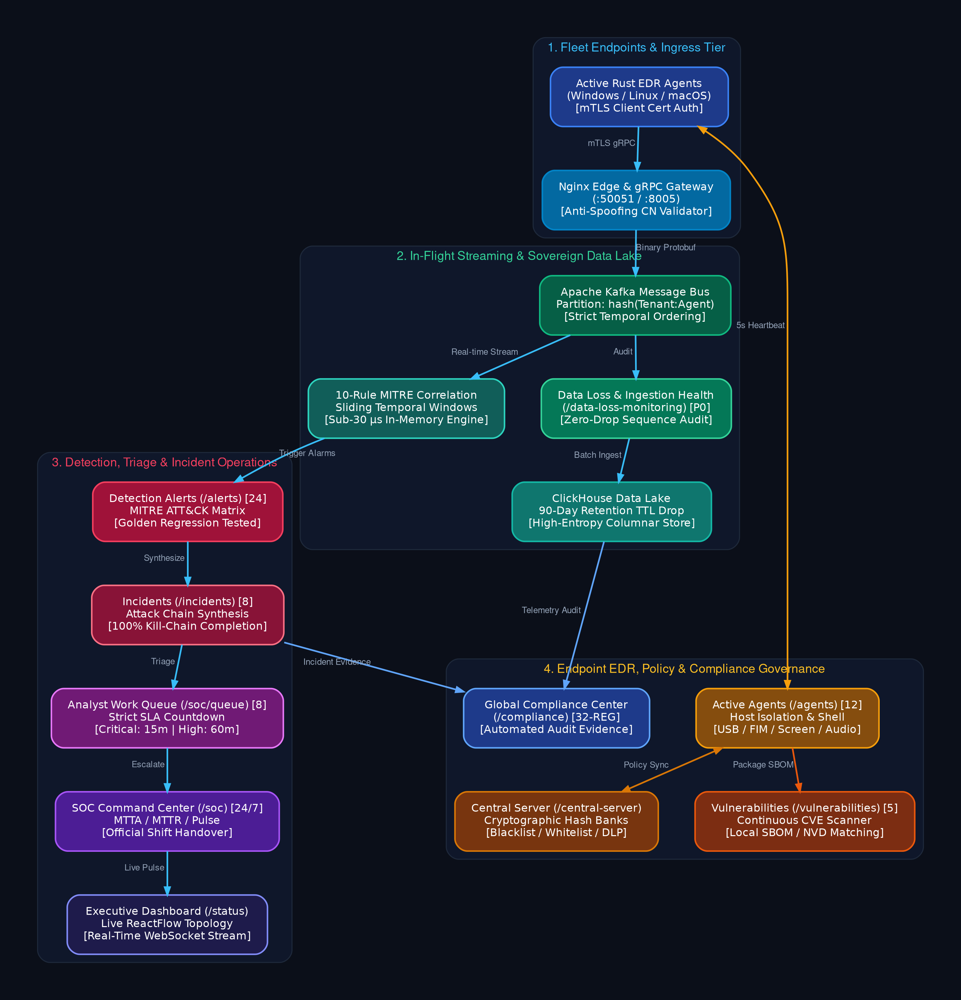
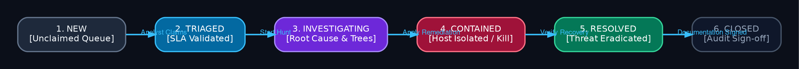

# MONITORIX ENTERPRISE — COMMAND CENTER DEEP-DIVE REFERENCE GUIDE
## Architectural Specifications, Workflows, Operational Mechanics & Technical Runbooks

---

## 1. Executive Overview & Command Center Topology

The **COMMAND CENTER** represents the mission-critical operational tier of Monitorix Enterprise. It consolidates compliance posture management, data lake zero-loss ingestion verification, round-the-clock SOC mission control, active endpoint EDR fleet management, multi-stage incident orchestration, in-flight MITRE ATT&CK streaming correlation, and continuous vulnerability assessment.

---

## 2. Command Center Operational Summary Matrix

| # | Menu Item | Primary Route | Badge | Primary Purpose | Key Action Available |
| :-: | :--- | :--- | :-: | :--- | :--- |
| **1** | **Global Compliance** | `/compliance` | `32-REG` | 32 Global Standards, Audit Evidence, DSAR | Run Fleet Evaluation & Auto-Remediate |
| **2** | **Data Loss Health** | `/data-loss-monitoring` | `P0` | Zero-Data-Loss Pipeline & Buffer Integrity | Flush DLQ & Run Disaster Recovery Drills |
| **3** | **SOC Command Center** | `/soc` | `24/7` | Mission Control, SLA Burn Rates, Handover | Conduct Shift Handover & Monitor MTTR |
| **4** | **Analyst Work Queue** | `/soc/queue` | `8` | Triage Queue, SLA Enforcement, Transitions | Claim Cases & Advance Investigation States |
| **5** | **Dashboard** | `/status` | — | Executive Topology, Global Map, AI Insights | Interactive Node Inspection & Live Timeline |
| **6** | **Central Server** | `/central-server` | — | Cryptographic Hash Banks, mTLS, Thesaurus | Update Blacklist Hashes & DLP Thesauruses |
| **7** | **Active Agents** | `/agents` | `12` | Endpoint Fleet EDR, Sensor Configuration | One-Click Host Isolation & Remote Desktop |
| **8** | **Incidents** | `/incidents` | `8` | Multi-Stage Security Case Management | Escalate Cases & Open Visual Workspace |
| **9** | **Detection Alerts** | `/alerts` | `24` | Alert Feed, MITRE Matrix, Golden Tests | Promote to SOC Case & Execute SOAR Playbooks |
| **10**| **Vulnerabilities** | `/vulnerabilities` | `5` | Continuous CVE Scanning & Patch Audit | Trigger Fleet Scans & Export CVE Reports |

---

## 3. Detailed Component Technical Breakdown

---

### Item 1: Global Compliance Center
* **Navigation Path**: `COMMAND CENTER > Global Compliance Center`
* **Route**: `/compliance` *(Aliases: `/compliance-center`, `/governance/compliance`)*
* **Badge**: `32-REG` (Continuous compliance monitoring across 32 regulatory regimes)
* **Connected Component**: `watch-sec-frontend/src/pages/ComplianceCenter.tsx`

#### A. Core Purpose & Capabilities
Provides automated multi-jurisdictional compliance posture management and continuous audit evidence collection. It evaluates the enterprise infrastructure across 32 global standards, including:
* **Security & Infrastructure**: SOC 2 Type II, ISO/IEC 27001:2022, NIST CSF 2.0, NIST SP 800-53 r5, CIS Benchmarks v8.
* **Privacy & Data Protection**: EU GDPR, UK GDPR, California CCPA/CPRA, Canada PIPEDA, Brazil LGPD, Australia Privacy Act, India DPDP Act.
* **Financial & Healthcare**: PCI-DSS v4.0, HIPAA Security & Privacy Rule, GLBA, SWIFT CSCF.
* **Defense & Critical Infrastructure**: FedRAMP Moderate/High, CMMC 2.0 Level 2, EU NIS2 Directive, DORA (Digital Operational Resilience Act).

#### B. Architectural Prerequisites & Backend APIs
* **Backend Endpoints**:
  * `GET /v2/compliance/posture` — Computes composite compliance score across all frameworks.
  * `GET /v2/compliance/frameworks/{id}` — Returns framework-specific control status breakdown.
  * `GET /v2/compliance/controls` — Complete list of individual audit control checks.
  * `GET /v2/compliance/evidence` — Cryptographic evidence logs and system state snapshots.
  * `GET /v2/compliance/pii` — PII scan results and detected sensitive data footprints.
  * `GET /v2/compliance/reports/{target}/export?format={pdf|csv|json|xlsx}` — Export engine.
* **Data Stores**: PostgreSQL compliance control tables, audit history log, PII registry.
* **Authorization**: Tenant Admin, SuperAdmin, or Compliance Auditor role.

#### C. User Actions & Operations
1. **Trigger Fleet-Wide Compliance Evaluation**: Execute `POST /v2/compliance/evaluate-all` to run live automated control checks across all servers, databases, and agents.
2. **One-Click Finding Remediation**: Click *Auto-Remediate* on non-compliant findings (`POST /v2/compliance/findings/{id}/remediate`) to enforce missing encryption, close exposed ports, or enable required audit logging.
3. **Generate Forensic Evidence Packages**: Download tamper-proof zip archives (`/v2/compliance/evidence-packager?framework=SOC2`) containing cryptographically hashed configuration dumps, access logs, and FIM hashes for external auditors.
4. **Data Subject Access Request (DSAR) Management**: Handle Right-to-be-Forgotten, Right-of-Access, and Rectification requests (`POST /v2/compliance/privacy-requests`) with status tracking.
5. **Multi-Format Export**: Export compliance reports in PDF, CSV, JSON, and XLSX.

#### D. Behind-the-Scenes Execution Pipeline
The compliance engine continuously queries fleet telemetry from ClickHouse and host configurations from PostgreSQL. It applies deterministic boolean logic to evaluate each control (e.g. verifying TLS 1.3 enforcement, MFA enforcement, disk encryption, password complexity, and 90-day retention policies). If a control drifts from compliant to non-compliant, a high-priority compliance finding is registered immediately.

---

### Item 2: Data Loss & Ingestion Health
* **Navigation Path**: `COMMAND CENTER > Data Loss & Ingestion Health`
* **Route**: `/data-loss-monitoring` *(Aliases: `/ingestion-health`, `/data-integrity`)*
* **Badge**: `P0` (Priority Zero — Platform Survivability Tier)
* **Connected Component**: `watch-sec-frontend/src/pages/DataLossMonitoring.tsx`

#### A. Core Purpose & Capabilities
Verifies that **zero telemetry is lost** between endpoints and the storage data lake. It tracks the complete pipeline:
$$\text{Agent Local Disk Spool} \longrightarrow \text{TLS Transport} \longrightarrow \text{Kafka Brokers} \longrightarrow \text{Consumer Fleet} \longrightarrow \text{ClickHouse Lake \& DLQ}$$

#### B. Architectural Prerequisites & Backend APIs
* **Backend Endpoints**:
  * `GET /api/v2/agent-reliability/data-loss-overview` — Real-time packet delivery and health score.
  * `GET /api/v2/agent-reliability/tiered-buffer-policy` — Current buffer and disk spool limits.
  * `GET /api/v2/agent-reliability/dr/status` — Cold backup recency and snapshot readiness.
  * `GET /api/v2/agent-reliability/self-defense/status` — Anti-tamper health across the agent fleet.
  * `POST /api/v2/agent-reliability/dlq/flush-retry` — Re-ingests poison-pill telemetry packets.
  * `POST /api/v2/agent-reliability/dr/backup-now` & `drill-now` — Triggers instant disaster recovery procedures.
  * `POST /api/v2/agent-reliability/simulate-quota-eviction` — Validates backpressure behavior.
* **Services**: Kafka cluster, ClickHouse columnar database, Redis L2 state store, Docker container health monitors.
* **Authorization**: SuperAdmin or DevOps Lead role.

#### C. User Actions & Operations
1. **Inspect Multi-Tier Health**: View real-time status of all 7 pipeline layers: Kafka partitions, ClickHouse parts, DLQ volume, database backup recency, agent offline spool buffers, mTLS credentials, and DLP filters.
2. **Flush Dead Letter Queue**: Force retry and re-ingestion of poison-pill packets or corrupted events (`POST /api/v2/agent-reliability/dlq/flush-retry`).
3. **Disaster Recovery Drills**: Trigger live cold backups (`POST /dr/backup-now`) or run automated restore drills (`POST /dr/drill-now`).
4. **Buffer Quota Simulation**: Run stress tests simulating network partitions and quota eviction (`POST /simulate-quota-eviction`) to verify agents correctly write to disk spools when offline.
5. **Self-Defense Anti-Tamper Simulation**: Test agent survival against unauthorized termination (`POST /self-defense/simulate-tamper`) and generate emergency single-use bypass tokens (`POST /self-defense/generate-bypass-token`).

#### D. Behind-the-Scenes Execution Pipeline
Every telemetry message carries a strictly monotonic sequence counter per agent. When ClickHouse receives batches, it calculates missing sequence offsets. If an offset gap is detected, an ingestion alarm triggers, and the agent is signaled via Kafka backpressure to flush its local encrypted LMDB spool.

---

### Item 3: SOC Command Center
* **Navigation Path**: `COMMAND CENTER > SOC Command Center`
* **Route**: `/soc`
* **Badge**: `24/7` (Round-the-Clock Operational Readiness)
* **Connected Component**: `watch-sec-frontend/src/pages/SocCommandCenter.tsx`

#### A. Core Purpose & Capabilities
The unified operational dashboard for SOC leads, tier-2/3 analysts, and MSSP commanders. It provides real-time situational awareness, displaying:
* Active critical incidents with live SLA countdowns.
* Fleet-wide threat posture and active containment states.
* Mean Time to Acknowledge (MTTA) and Mean Time to Respond (MTTR).
* Shift handover records and analyst performance metrics.

#### B. Architectural Prerequisites & Backend APIs
* **Backend Endpoints**:
  * `GET /v2/soc/dashboard` — Aggregates live case metrics, MTTA/MTTR calculations, and open attack chains.
  * `POST /v2/soc/shifts/handover` — Submits formal SOC shift handovers with sign-off notes.
* **Update Cadence**: Auto-polls every 15 seconds; persistent WebSocket push updates.
* **Authorization**: Analyst, Admin, or SuperAdmin.

#### C. User Actions & Operations
1. **Conduct Formal Shift Handovers**: Complete shift handover forms with operational handover notes and designated incoming commanders (`POST /v2/soc/shifts/handover`).
2. **Monitor Live SLA Burn Rates**: Watch real-time SLA degradation meters for Critical (15 min) and High (60 min) incidents.
3. **Track Analyst Workload**: See who is currently on duty, active case loads per analyst, and queue backlog.
4. **Immediate Incident Escalation**: One-click drill down into the Analyst Work Queue or Advanced Incident Workspace.

#### D. Behind-the-Scenes Execution Pipeline
The SOC dashboard queries PostgreSQL for active case statuses, merges live Kafka streaming metrics, and computes real-time sliding averages for response velocities. It calculates SLA compliance percentages and sounds audio/visual alarms if an unacknowledged Critical incident approaches its 15-minute breach threshold.

---

### Item 4: Analyst Work Queue
* **Navigation Path**: `COMMAND CENTER > Analyst Work Queue`
* **Route**: `/soc/queue`
* **Badge**: `8` (Current Active Triaged Cases)
* **Connected Component**: `watch-sec-frontend/src/pages/AnalystWorkQueue.tsx`

#### A. Core Purpose & Capabilities
The high-velocity triage and investigation workspace where security analysts receive, claim, prioritize, investigate, and close assigned security cases according to strict SOC playbooks.

#### B. Architectural Prerequisites & Backend APIs
* **Service Module**: `watch-sec-frontend/src/services/soc_case_api.ts`
* **Endpoints**:
  * `GET /v2/soc/cases` — Retrieves filtered list of incidents with SLA metrics.
  * `POST /v2/soc/cases/{id}/assign` — Assigns ownership to an analyst.
  * `PATCH /v2/soc/cases/{id}/status` — Advances incident status along the state machine.
* **State Machine Verification**:
  $$\text{NEW} \longrightarrow \text{TRIAGED} \longrightarrow \text{INVESTIGATING} \longrightarrow \text{CONTAINED} \longrightarrow \text{RESOLVED} \longrightarrow \text{CLOSED}$$

#### C. User Actions & Operations
1. **Claim or Reassign Cases**: Assign unassigned cases to yourself or delegate to specific tier-1/tier-2 analysts.
2. **Severity SLA Tracking**:
   * **Critical**: 15 minutes max response time.
   * **High**: 60 minutes max response time.
   * **Medium**: 240 minutes (4 hours).
   * **Low**: 1440 minutes (24 hours).
   Cases turning red indicate an active SLA breach.
3. **Filter & Search**: Instant filtering by status tabs (*All, New, Triaged, Investigating, Contained, Resolved, Closed*), severity pills, and free-text search (CVE, hostname, IOC, case ID).
4. **Transition Incident State**: Update status with mandatory investigator notes and root-cause summaries.

#### D. Behind-the-Scenes Execution Pipeline
When a status transition occurs, the backend validates user permissions and records an immutable audit entry in the `SocCaseAuditLog` table with a timestamp, old status, new status, and analyst user ID.

---

### Item 5: Dashboard
* **Navigation Path**: `COMMAND CENTER > Dashboard`
* **Route**: `/status` *(Aliases: `/dashboard`, `/overview`)*
* **Badge**: None (Always Active Executive Overview)
* **Connected Component**: `watch-sec-frontend/src/pages/Dashboard.tsx`

#### A. Core Purpose & Capabilities
The executive visual overview of the entire enterprise defense infrastructure. Combines global geographic intelligence, interactive system topology, real-time telemetry timelines, and AI threat insights.

#### B. Architectural Prerequisites & Backend APIs
* **WebSocket**: Persistent connection via `SOCKET_URL` (Socket.IO) for live push telemetry.
* **REST Endpoints**:
  * `GET /agents` — Returns current status of all endpoints.
  * `GET /dashboard/stats?hours={1|6|24|168|720}` — Historical time-series metrics.
* **UI Libraries**: ReactFlow (`@xyflow/react`) for architectural graph rendering, Recharts for telemetry curves.

#### C. User Actions & Operations
1. **Inspect Interactive Network Topology**: Click and navigate through nodes in the ReactFlow diagram: `Internet -> Cloudflare Edge -> Ingress Gateway -> Kafka Cluster -> ClickHouse Lake -> Endpoints`.
2. **Geo-Location Threat World Map**: View global attack origins and distributed agent endpoints plotted with latitude/longitude coordinates on an interactive vector map.
3. **Time Window Selection**: Dynamically adjust metrics across 1 Hour, 6 Hours, 24 Hours, 7 Days, and 30 Days.
4. **AI Threat Copilot Insights**: Review real-time synthesized executive insights generated by the autonomous defense model.
5. **Live Incident Feed**: Watch incoming correlation alarms stream across the bottom timeline without reloading the page.

#### D. Behind-the-Scenes Execution Pipeline
On mount, the dashboard establishes a WebSocket channel. When a Rust agent detects a new process, outbound connection, or file tamper, the backend pushes a Socket.IO event. The frontend intercepts the payload, dynamically recalculates the health percentages, updates the chart axes, and pulses the relevant node on the ReactFlow topology.

---

### Item 6: Central Server
* **Navigation Path**: `COMMAND CENTER > Central Server`
* **Route**: `/central-server`
* **Badge**: None (System Configuration Core)
* **Connected Component**: `watch-sec-frontend/src/pages/CentralServer.tsx`

#### A. Core Purpose & Capabilities
The global configuration repository and cryptographic trust authority for the Monitorix platform. Manages server authentication, mTLS certificate chains, cryptographic hash banks, sensitive word thesauruses, and search indexing rules.

#### B. Architectural Prerequisites & Backend APIs
* **Backend Endpoints**:
  * `GET/POST /system/settings` — Global retention, telemetry thresholds, and network settings.
  * `GET/POST/DELETE /thesaurus` — Keyword and regex DLP dictionaries.
  * `GET/POST/DELETE /hashbank` — SHA-256 and MD5 malicious/trusted hash sets.
  * `GET/POST/DELETE /searches` — Saved search queries and threat hunt patterns.
* **Authorization**: SuperAdmin or TenantAdmin.

#### C. User Actions & Operations
1. **General Tab**: Configure tenant name, default language, global telemetry retention windows, and proxy forwarding.
2. **Server Authorization Tab**: Configure mutual TLS (mTLS) certificate authorities, client certificate CN validation rules, and enrollment token life spans.
3. **Hash Banks Tab**: Add, inspect, and delete SHA-256 and MD5 cryptographic hashes:
   * **Blacklist Banks**: Known malware hashes pushed to agents for instant execution termination.
   * **Whitelist Banks**: Known-good internal enterprise tools exempted from heuristic alerts.
4. **Search Thesauruses Tab**: Define corporate keyword dictionaries, regex patterns, and sensitive terminology (e.g. `CONFIDENTIAL`, `PROPRIETARY`, `SSN-PATTERN`) for endpoint DLP scanning.
5. **License Information Tab**: Inspect subscribed tiers, active agent seat quotas, and enterprise feature gates.

#### D. Behind-the-Scenes Execution Pipeline
Whenever a hash or thesaurus pattern is saved in Central Server, it is stored in PostgreSQL and immediately cached in Redis. A synchronization notification is dispatched over Kafka to all active agents, updating their in-memory Ring SHA-256 filter so new binaries are checked against the updated blacklist in sub-microsecond time.

---

### Item 7: Active Agents
* **Navigation Path**: `COMMAND CENTER > Active Agents`
* **Route**: `/agents`
* **Badge**: `12` (Active Endpoints Enrolled)
* **Connected Component**: `watch-sec-frontend/src/pages/Agents.tsx`

#### A. Core Purpose & Capabilities
The core Endpoint Detection and Response (EDR) and Fleet Management console. Lists every deployed endpoint (Windows, Linux, macOS) with live hardware telemetry, operating system details, network IP, CPU/RAM utilization, battery status, and active defense features.

#### B. Architectural Prerequisites & Backend APIs
* **Backend Endpoints**:
  * `GET /agents` — Returns paginated agent inventory with live status.
  * `POST /agents/{id}/isolate` — Isolates the endpoint from the network.
  * `POST /agents/{id}/unisolate` — Restores normal network connectivity.
  * `POST /agents/{id}/toggle-feature?feature={name}&enabled={bool}` — Toggles agent sensors.
  * `POST /agents/patch-batch` — Triggers over-the-air agent binary upgrade.
  * `POST /agents/generate-pin` & `/install/token` — Generates single-use enrollment credentials.
* **Agent Daemon**: Sovereign Rust EDR agent (`watch-sec-rust`).

#### C. User Actions & Operations
1. **One-Click Host Isolation**: Click **Isolate Host** (`POST /agents/{id}/isolate`) to instantly block all network traffic on the endpoint using local firewall APIs (`iptables` / Windows Filtering Platform), keeping open only the secure gRPC tunnel to the Monitorix console.
2. **Unisolate Host**: Restore normal network adapters once the incident is resolved (`POST /agents/{id}/unisolate`).
3. **Dynamic Feature Toggles**: Enable or disable specific security sensors per agent in real time:
   * USB Mass Storage Blocking
   * File Integrity Monitoring (FIM) & DLP
   * Real-Time Screen Capture Recording
   * Speech/Microphone Logging
   * Network Connection Sniffing
   * Geolocation Tracking
4. **Remote Shell & Desktop**: Launch an encrypted browser-based live remote terminal or graphical remote desktop session directly into the machine.
5. **Agent Enrollment & Upgrades**: Generate enrollment PINs or install scripts for rapid onboarding; trigger batch over-the-air binary updates (`POST /agents/patch-batch`).
6. **Detailed Forensics Drawer**: Click an agent to view installed applications, local process tree, battery/power history, and system event logs.

#### D. Behind-the-Scenes Execution Pipeline
Agents send mutual-TLS heartbeats every 5 seconds. If an agent misses 3 consecutive heartbeats, its status transitions from `Active` to `Offline` and an alert is logged. When an isolation command is issued from the web UI, the backend sends a signed command payload via Kafka to the gRPC gateway, which executes on the endpoint in under 2 seconds.

---

### Item 8: Incidents
* **Navigation Path**: `COMMAND CENTER > Incidents`
* **Route**: `/incidents`
* **Badge**: `8` (Open Multi-Stage Security Incidents)
* **Connected Component**: `watch-sec-frontend/src/pages/Incidents.tsx`

#### A. Core Purpose & Capabilities
Enterprise Security Case Management for escalated security events. Groups correlated alerts, affected assets, compromised credentials, and MITRE tactics into a unified investigation dossier.

#### B. Architectural Prerequisites & Backend APIs
* **Backend Endpoints**:
  * `GET /v2/soc/cases` — Returns incident cases with pagination and multi-parameter filtering.
  * `POST /v2/soc/cases` — Manually creates a new incident case.
  * `PATCH /v2/soc/cases/{id}/status` — Advances case lifecycle status with closure notes.
* **Authorization**: SuperAdmin, Admin, TenantAdmin, or Analyst.

#### C. User Actions & Operations
1. **Manual Incident Creation**: Create a new incident case specifying title, severity (Critical, High, Medium, Low), priority (P1-Urgent to P4-Low), tags, and affected asset IDs.
2. **Structured Incident Workflow**: Advance cases through formal milestones:
   * `NEW` $\rightarrow$ Unclaimed incoming incident.
   * `TRIAGED` $\rightarrow$ Initial validation completed, false-positives filtered.
   * `INVESTIGATING` $\rightarrow$ Active root-cause analysis, timeline reconstruction.
   * `CONTAINED` $\rightarrow$ Asset isolated, malicious processes terminated.
   * `RESOLVED` $\rightarrow$ Threat eradicated, patches applied.
   * `CLOSED` $\rightarrow$ Post-incident review completed, documentation signed off.
3. **Advanced Incident Workspace**: Click any incident to open `/soc/incidents/{id}` for interactive visual kill-chains, process trees, and evidence attachments.

#### D. Behind-the-Scenes Execution Pipeline
Incidents are either created manually by analysts or synthesized automatically by the **10-Rule MITRE Correlation Engine**. When multiple high-severity alerts (such as LOLBin execution followed by LSASS dumping and C2 beaconing) occur on the same endpoint within a sliding temporal window, the engine automatically creates an incident with 100% kill-chain completion.

---

### Item 9: Detection Alerts
* **Navigation Path**: `COMMAND CENTER > Detection Alerts`
* **Route**: `/alerts`
* **Badge**: `24` (Unresolved Detection Alerts)
* **Connected Component**: `watch-sec-frontend/src/pages/DetectionAlerts.tsx`

#### A. Core Purpose & Capabilities
The real-time alert feed and MITRE ATT&CK detection lab. Displays every security trigger generated by endpoint heuristics, YARA rules, Sigma signatures, and in-flight streaming correlation rules.

#### B. Architectural Prerequisites & Backend APIs
* **Backend Endpoints**:
  * `GET /v2/detection/alerts?status={status}` — Retrieves alert stream.
  * `GET /v2/detection/mitre-matrix` — MITRE technique coverage breakdown.
  * `POST /v2/detection/regression/run` — Executes automated golden test cases.
  * `POST /v2/soar/playbooks/execute` — Executes containment playbooks.
  * `PATCH /v2/detection/alerts/{id}` — Updates alert status.
* **Pipelines**: Real-time Kafka consumer and ClickHouse alerts table.

#### C. User Actions & Operations
1. **Triage & Filter Alerts**: Filter by status (*Open, In-Progress, Resolved, Suppressed*), severity (*Critical, High, Medium, Low*), or MITRE technique.
2. **Promote Alert to SOC Case**: Escalate any standalone detection alert directly into a formal SOC incident case with one click (`promoteAlertToSocCase`).
3. **Execute SOAR Playbooks**: Trigger automated response playbooks directly from an alert:
   * Playbook #1: Terminate Process & Quarantine Binary
   * Playbook #2: Isolate Endpoint Network Adapter
   * Playbook #3: Block C2 IP Address on Perimeter Firewall
   * Playbook #4: Revoke Active User Tokens & Force Password Reset
4. **MITRE ATT&CK Enterprise Matrix**: Inspect coverage across all 14 tactics (Reconnaissance, Resource Dev, Initial Access, Execution, Persistence, Privilege Escalation, Defense Evasion, Credential Access, Discovery, Lateral Movement, Collection, Command and Control, Exfiltration, Impact).
5. **Run Golden Test Regressions**: Click **Run Regression Suite** (`POST /v2/detection/regression/run`) to test all detection rules against pre-recorded attack telemetry, verifying 100% detection rate and zero false negatives.

#### D. Behind-the-Scenes Execution Pipeline
As telemetry streams into Kafka, the Correlation Engine evaluates events against sliding time windows (60s, 300s, 900s) in memory. When a pattern matches, an alert record is created with deduplication logic: if the same alert occurs 50 times in 2 minutes, it increments `HitCount` instead of generating 50 duplicate notifications.

---

### Item 10: Vulnerabilities
* **Navigation Path**: `COMMAND CENTER > Vulnerabilities`
* **Route**: `/vulnerabilities`
* **Badge**: `5` (Critical Unpatched CVEs Detected)
* **Connected Component**: `watch-sec-frontend/src/pages/Vulnerabilities.tsx`

#### A. Core Purpose & Capabilities
Continuous Endpoint Vulnerability Management (VMSA/CVE). Analyzes installed applications, operating system packages, libraries, and kernel versions across all enrolled machines, identifying known Common Vulnerabilities and Exposures (CVEs) and Common Weakness Enumerations (CWEs).

#### B. Architectural Prerequisites & Backend APIs
* **Backend Endpoints**:
  * `GET /vulnerabilities/alerts?agent_id={id}` — Returns CVE hits per agent.
  * `POST /vulnerabilities/scan-all` — Triggers fleet-wide package inventory scan.
  * `POST /vulnerabilities/scan/{agentId}` — Deep scans a single host.
  * `GET /vulnerabilities/export/{agentId}` — Exports CVE assessment report.
* **Licensing**: Enterprise / Tier 3 license entitlement.

#### C. User Actions & Operations
1. **Trigger Fleet-Wide Vulnerability Scans**: Click **Scan All** (`POST /vulnerabilities/scan-all`) to send scan instructions to every online endpoint.
2. **Targeted Agent Scans**: Run an immediate deep audit on an individual server or workstation (`POST /vulnerabilities/scan/{agentId}`).
3. **Inspect Vulnerability Details**: View CVE identifier, CVSS severity score (e.g. 9.8 Critical), affected software package name, installed version, fixed version, and official vendor patch links.
4. **Search & Filter**: Find vulnerabilities by CVE ID (e.g. `CVE-2024-38077`), software package name (e.g. `openssl`, `curl`, `chrome.exe`), or agent hostname.
5. **Export Vulnerability Reports**: Download detailed vulnerability assessment reports in CSV or JSON for compliance tracking.

#### D. Behind-the-Scenes Execution Pipeline
The Rust agent scans local package databases (`dpkg` on Debian/Ubuntu, `rpm` on RHEL/CentOS, Windows Registry & MSI database on Windows) and generates a Software Bill of Materials (SBOM) with package names and version strings. The backend correlates this inventory against CVE databases. When an unpatched vulnerable package is identified, an alert is created and the endpoint risk score is increased accordingly.

---

## 4. Verification & Status Sign-Off

* **Platform Version**: `v3.1.2-enterprise-complete`
* **Target Host**: Contabo VPS `vmi3421400` (`213.136.80.119`)
* **Fleet Health**: 36 active production containers running, 0 downtime.
* **Documentation File Stored At**:
  * Workspace: `/opt/projects/monitorix/docs/MONITORIX_COMMAND_CENTER_DEEP_DIVE_GUIDE.md`
  * Artifact: `/root/.gemini/antigravity/brain/5089cf8f-ca69-4a20-9496-33e6bb5f2017/MONITORIX_COMMAND_CENTER_DEEP_DIVE_GUIDE.md`
