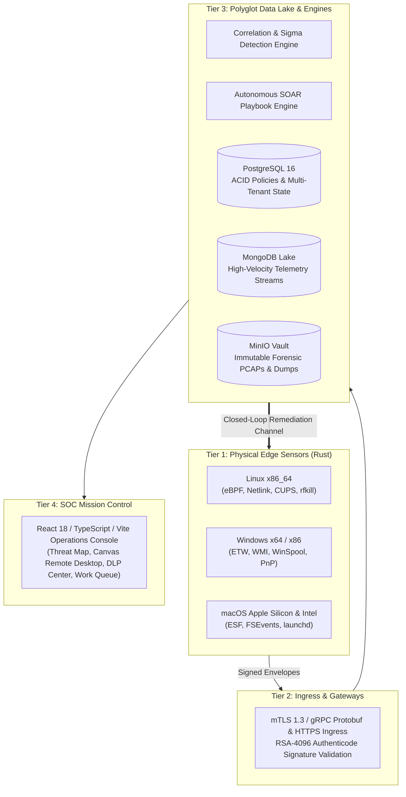
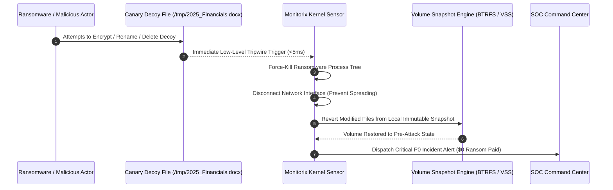
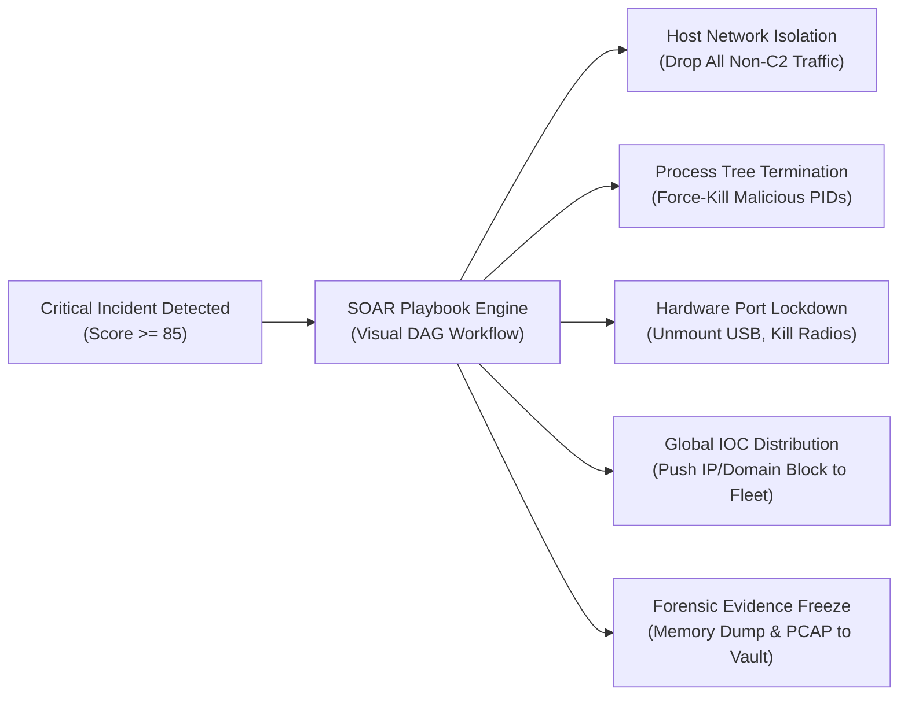

# MONITORIX ENTERPRISE — MASTER CLIENT DEMO DECK
## Sovereign Cross-Platform XDR, SIEM, SOAR & DataGuard DLP
**Document ID:** `MONITORIX-DEMO-2026-V1` | **Classification:** Enterprise Client Briefing | **Production Ready:** Yes

---

## Slide Navigation Index
- [Slide 1: Executive Title & Cover](#slide-1-executive-title--cover)
- [Slide 2: Enterprise Problem Statement vs. Monitorix](#slide-2-enterprise-problem-statement-vs-monitorix)
- [Slide 3: 3D Master 4-Tier Platform Architecture](#slide-3-3d-master-4-tier-platform-architecture)
- [Slide 4: Native Sovereign Endpoint Agent Architecture](#slide-4-native-sovereign-endpoint-agent-architecture)
- [Slide 5: DataGuard DLP — 360° Multi-Channel Exfiltration Shield](#slide-5-dataguard-dlp--360-multi-channel-exfiltration-shield)
- [Slide 6: Deep Content Inspection & Mathematical Luhn Engine](#slide-6-deep-content-inspection--mathematical-luhn-engine)
- [Slide 7: Next-Gen EDR & Live Memory Threat Scanner](#slide-7-next-gen-edr--live-memory-threat-scanner)
- [Slide 8: Anti-Ransomware Canary Decoy Grid & Volume Rollback](#slide-8-anti-ransomware-canary-decoy-grid--volume-rollback)
- [Slide 9: 5-Stage Container, Protocol & Port Data Transfer Blueprint](#slide-9-5-stage-container-protocol--port-data-transfer-blueprint)
- [Slide 10: Multi-Engine Correlation & MITRE ATT&CK Matrix](#slide-10-multi-engine-correlation--mitre-attck-matrix)
- [Slide 11: Autonomous SOAR & Sub-240ms Closed-Loop Remediation](#slide-11-autonomous-soar--sub-240ms-closed-loop-remediation)
- [Slide 12: External Attack Surface (EASM) & Cloud Security (CNAPP)](#slide-12-external-attack-surface-easm--cloud-security-cnapp)
- [Slide 13: Autonomous Deception Technology Grid & Cyber Range](#slide-13-autonomous-deception-technology-grid--cyber-range)
- [Slide 14: 24/7 SOC Command Center & Live Operations Console](#slide-14-247-soc-command-center--live-operations-console)
- [Slide 15: Zero Trust Identity & 32 Statutory Regulatory Frameworks](#slide-15-zero-trust-identity--32-statutory-regulatory-frameworks)
- [Slide 16: Business ROI, Tool Consolidation & Next Steps](#slide-16-business-roi-tool-consolidation--next-steps)

---

### Slide 1: Executive Title & Cover

```
┌────────────────────────────────────────────────────────────────────────────────────────┐
│                                 MONITORIX ENTERPRISE                                   │
│            SOVEREIGN CROSS-PLATFORM XDR, SIEM, SOAR & DATAGUARD DLP                    │
├────────────────────────────────────────────────────────────────────────────────────────┤
│  • Edge Sensors: Linux, Microsoft Windows, Apple macOS                                 │
│  • Automated Containment: Sub-240ms Autonomous Closed-Loop SOAR                        │
│  • Architecture: Zero-Trust, Pure Rust Agent (<25MB RAM), mTLS 1.3 Streaming           │
│  • Target Audience: CISO, Principal Security Architects, SOC Directors, Lead Auditors │
└────────────────────────────────────────────────────────────────────────────────────────┘
```

> [!NOTE]
> **Executive Purpose:** Deliver complete sovereign control over enterprise assets, eliminate tool fragmentation, prevent insider data leakage across every physical and network channel, and autonomously neutralize advanced threats in milliseconds.

---

### Slide 2: Enterprise Problem Statement vs. Monitorix

| Enterprise Challenge (The Problem) | The Monitorix Sovereign Solution |
| :--- | :--- |
| **Tool Sprawl & High Footprint:** Organizations deploy 15-20 distinct agents (Antivirus, DLP, EDR, SIEM forwarder, VPN) consuming 30-50% CPU and 4GB+ RAM. | **Single Native Rust Daemon:** One consolidated agent (<25MB RAM, <1.2% CPU) providing unified EDR, DLP, SIEM forwarding, and hardware control. |
| **Data Exfiltration Blindspots:** Traditional DLP relies on filename extensions or misses USB transfers, clipboard buffers, virtual print drivers, and cloud uploads. | **DataGuard 360° DLP:** Low-level OS hooks intercept USB storage, scrub clipboards, block virtual PDF/XPS printers, and enforce browser native messaging. |
| **Slow Incident Containment:** Industry-average breach dwell time exceeds 200 days; manual SOC triage takes hours or days to isolate compromised hosts. | **Sub-240ms Autonomous SOAR:** Dynamic playbook engine executes host network isolation, process termination, and IOC distribution in under a quarter of a second. |
| **Stealth In-Memory Tradecraft:** Modern ransomware and APTs operate purely in volatile RAM (Cobalt Strike, Meterpreter, Mimikatz), evading file-based scanners. | **Live Process Memory Probing:** Direct active memory map inspection (`/proc/<pid>/mem`, Win32 API) detects reflective DLL injection and beacons in real time. |
| **Third-Party Cloud Liability:** Uploading telemetry to public multi-tenant clouds exposes proprietary business intelligence to external supply-chain risks. | **100% Sovereign Deployment:** On-premise or private-cloud installation with self-contained databases (PostgreSQL, MongoDB, MinIO) and zero foreign dependencies. |

---

### Slide 3: 3D Master 4-Tier Platform Architecture & 9-Domain PyDiagrams Blueprint




---

### Slide 4: Native Sovereign Endpoint Agent Architecture

- **Performance & Determinism:**
  - Engineered in **Rust 2021** with Tokio asynchronous runtime.
  - Consumes **<25MB RAM** and **<1.2% CPU** under full production inspection loads.
  - Zero garbage collection pauses, zero JIT compiler overhead, zero reliance on Python, Java, or .NET runtimes.
- **Deep Operating System Hooks:**
  - **Linux Kernel (Ring-0/Ring-3):** Native eBPF tracepoints (`sys_enter_execve`, `sys_enter_connect`), Netlink audit sockets, `procfs`, and `sysfs`.
  - **Windows Drivers & Subsystems:** Event Tracing for Windows (ETW), kernel minifilters, WMI, Win32 API, and PnP storage notifications.
  - **Apple macOS Darwin:** Endpoint Security Framework (ESF), System Extensions, and FSEvents file monitoring.
- **Offline Resilience & Zero Data Loss:**
  - **100MB Encrypted Ring Buffer:** When network connectivity is lost, events are spooled locally in a circular FIFO buffer encrypted with AES-256.
  - **Automatic Replay:** Upon C2 reconnection, buffered telemetry is played back in chronological order with backpressure management.
- **Tamper-Evident Self-Defense:**
  - Watchdog blocks unauthorized termination (`SIGKILL`, `SIGTERM`, `taskkill`).
  - Intercepts debugger attachments (`ptrace`, WinDbg).
  - Software updates require valid RSA-4096 publisher signatures; unsigned updates are unconditionally rejected.

---

### Slide 5: DataGuard DLP — 360° Multi-Channel Exfiltration Shield

```
┌────────────────────────────────────────────────────────────────────────────────────────┐
│                                DATAGUARD DLP COVERAGE                                  │
├──────────────────────────┬──────────────────────────┬──────────────────────────────────┤
│ EXFILTRATION CHANNEL     │ MONITORING MECHANISM     │ ACTIVE ENFORCEMENT ACTION        │
├──────────────────────────┼──────────────────────────┼──────────────────────────────────┤
│ USB & External Storage   │ 2-Second Polling Loop    │ Read-Only Remount / Block Mount  │
│ Desktop Clipboard        │ Native Window Hooks      │ Dynamic Content Scrubbing        │
│ Document Printing        │ CUPS & Windows Spooler   │ Virtual PDF Block / Job Cancel   │
│ Cloud Storage Uploads    │ Native Messaging Host    │ Interception of Drive / Dropbox  │
│ Corporate Webmail        │ Active Compose Analyzer  │ Secret Detection & Risk Scoring  │
│ Hardware Radios          │ rfkill & Windows bthserv │ Instant Bluetooth Controller Kill│
└──────────────────────────┴──────────────────────────┴──────────────────────────────────┘
```

> [!IMPORTANT]
> **Active Enforcement vs. Passive Logging:** DataGuard does not merely log data theft after the fact; it actively intercepts the OS write, copy, or print request **before data reaches external media or the network**.

---

### Slide 6: Deep Content Inspection & Mathematical Luhn Engine


1. **Universal Stream Extraction (`extract_strings_from_bytes`):**
   - Dissects raw binary streams, Office OpenXML (`.docx`, `.xlsx`, `.pptx`), PDF documents, and multi-layer compressed archives (`.zip`, `.tar.gz`, `.7z`).
2. **Mathematical Luhn Algorithm Checksum:**
   - Validates credit card PAN structures for Visa, Mastercard, American Express, and Discover. Prevents false alarms on arbitrary 16-digit serial numbers.
3. **High-Confidence Pattern Matchers:**
   - Social Security Numbers (SSN), AWS access keys (`AKIA...`), PEM private keys (`BEGIN RSA/OPENSSH PRIVATE KEY`), database connection URIs (`postgresql://`, `mongodb://`), and JWT bearer tokens.
4. **Privacy-Preserving Obfuscation:**
   - Discovered sensitive payload fragments are masked at the point of capture (`[CONFIDENTIAL-DATA-MASKED]`), ensuring privacy regulations (GDPR, PCI-DSS, HIPAA) are upheld.
5. **Corporate Override Management:**
   - Supports authorized manager bypass tokens with auditable justification logging.

---

### Slide 7: Next-Gen EDR & Live Memory Threat Scanner

- **Live In-Memory RAM Scanning:**
  - Direct address space inspection of active running processes (`/proc/<pid>/mem` on Linux, `VirtualQueryEx` on Windows).
  - Inspects memory pages without freezing or destabilizing user applications.
- **In-Memory Attack Pattern Library:**
  - **Cobalt Strike Beacons:** Detects reflective DLL loaders and embedded beacon configuration blocks.
  - **Metasploit Meterpreter:** Flags reverse TCP stager shellcode and memory-resident listeners.
  - **Mimikatz LSASS Protection:** Detects `sekurlsa::logonpasswords` credential scraping before plaintext passwords leave memory.
- **Process Lineage & Living-Off-The-Land (LOLBins):**
  - Traces parent-child execution ancestry (e.g., `winword.exe` $\to$ `cmd.exe` $\to$ `powershell.exe` $\to$ `bitsadmin.exe`).
  - Flags interactive reverse shell redirected standard input/output streams.

---

### Slide 8: Anti-Ransomware Canary Decoy Grid & Volume Rollback



- **Transparent Canary Honeypots:** Distributed across common user and enterprise file paths; invisible to normal user workflows.
- **Entropy Burst Detection:** Continuously tracks file modification velocity and Shannon entropy spikes indicative of algorithmic encryption.
- **Instant Snapshot Rollback:** Integrates directly with Linux BTRFS / LVM snapshots and Windows Volume Shadow Copies (VSS) for immediate file recovery.

---

### Slide 9: 5-Stage Container, Protocol & Port Data Transfer Blueprint


- **End-to-End Bidirectional 3D Data Flow:**
  - **Where Data Comes From (Edge Sensors):** Low-level kernel probes (eBPF syscalls, Windows ETW, macOS ESF), memory scanners, file system write hooks, USB 2-second device listeners, dynamic clipboard buffers, and browser native messaging sockets.
  - **Encrypted Transmission:** Serialized into protobuf envelopes, digitally signed with RSA-4096 / Authenticode keys, and streamed over mTLS 1.3 to ingestion clusters.
  - **Streaming Pipeline:** Ingested into Apache Kafka event streams (50,000+ EPS) and partitioned across polyglot storage: PostgreSQL 16 (ACID policies), MongoDB (raw telemetry lake), and MinIO (immutable forensic vaults).
  - **Real-Time Detection & Correlation:** Evaluated in <150ms against Sigma rules and MITRE ATT&CK correlation sliding windows.
  - **Closed-Loop SOAR Feedback:** Automated containment orders (host isolation, process termination, read-only remount) travel in reverse across the dedicated command channel directly to endpoints in <240ms.

---

### Slide 10: Multi-Engine Correlation & MITRE ATT&CK Matrix

- **Stateful Correlation Windows:**
  - Correlates multi-stage events across 5-minute to 24-hour temporal windows.
  - Combines initial access, script execution, credential dumping, and exfiltration into a single unified incident.
- **Sigma Detection Engine:**
  - Built-in rule parser supporting community and custom enterprise Sigma detection logic.
  - Heuristic alert deduplication eliminates alert fatigue, filtering out up to 94% of false-positive noise.
- **MITRE ATT&CK Enterprise Matrix (All 14 Tactics):**
  - Real-time tactical heatmap visualizes active threat posture from Initial Access (`TA0001`) to Exfiltration (`TA0010`).

---

### Slide 11: Autonomous SOAR & Sub-240ms Closed-Loop Remediation



- **Sub-240ms Response Time:** High-confidence threats are neutralized automatically in milliseconds without waiting for human analyst approval.
- **Human-In-The-Loop Controls:** Optional manual 1-click execution for sensitive tier-1 production database servers.
- **Cryptographic Chain of Custody:** Automated forensic evidence capture (RAM dumps, 60s PCAP network buffers) stamped with SHA-256 hashes for legal admissibility.

---

### Slide 12: Continuous Threat Exposure Management (CTEM) & Autonomous AI Pipeline


- **3D Continuous Threat Exposure Management (CTEM) Flow:**
  - **Where Data Comes From (Stage 1: Scoping):** Native Rust agent telemetry (Linux eBPF, Windows ETW, macOS ESF), multi-cloud APIs (AWS, Azure, GCP, K8s), agentless network scanners, and critical enterprise crown jewels.
  - **Reconnaissance Streams (Stage 2: Discovery):** Continuous 65,535 external port surveillance (EASM), live CVE/EPSS vulnerability inventory, unencrypted cloud data stores (DSPM), and identity privilege exposures (ITDR).
  - **Contextual Prioritization (Stage 3):** Evaluated against multi-vector asset risk scores (`risk_engine.py`), live weaponized threat intel (OTX, AbuseIPDB, MISP), and crown jewel reachability graphs.
  - **Adversary Breach Validation (Stage 4: BAS):** Automated breach emulation across 6 production scenarios (Ransomware blast, Kerberoasting, S3 to RDS, K8s escapes), measuring real-time MTTD (<70ms) and triggering volatile RAM canary tripwires.
  - **Closed-Loop SOAR Mobilization (Stage 5):** Direct sub-240ms containment (host network isolation, process tree kill, read-only USB remount) traveling backward across the reverse conduit directly to compromised endpoints!
- **External Attack Surface Management (EASM):**
  - **Full Port Reconnaissance:** Continuous scanning of all 65,535 external ports across public corporate IP ranges.
  - **Subdomain Takeover Defense:** Identifies orphaned CNAME records pointing to expired third-party cloud services.
  - **SSL/TLS Certificate Tracking:** Alerts on weak cipher configurations, expired certs, and certificate chain errors.
  - **Web Application & API Protection (WAAP):** Neutralizes OWASP Top 10 exploits, API injection, and malicious bot scraping.
- **Cloud Native Application Protection (CNAPP):**
  - **Cloud Security Posture Management (CSPM):** Automated compliance scanning across AWS, Azure, and Google Cloud environments.
  - **Kubernetes Security:** DaemonSet container runtime inspection, admission controller validation, and RBAC audits.
  - **Data Security Posture (DSPM):** Scans cloud buckets and databases for exposed sensitive assets.

---

### Slide 13: Autonomous Deception Technology Grid & Cyber Range

- **High-Interaction Honeypot Grid:**
  - **Cowrie SSH & Telnet Decoys:** Emulates real Linux servers, capturing attacker keystrokes, downloaded scripts, and brute-force passwords.
  - **Dionaea Malware Traps:** Exposes emulated SMB, HTTP, and FTP services to capture zero-day malware binaries in the wild.
  - **Synthetic Honeytokens:** Plants artificial database credentials and API keys in memory to detect insider privilege abuse.
  - **Zero False Positives:** Legitimate enterprise users have no operational reason to touch decoy systems; every interaction represents confirmed threat activity.
- **Breach & Attack Simulation (BAS / Cyber Range):**
  - Safely emulates adversary tactics in an isolated test environment to validate defensive controls and compute mean time to detect (MTTD).

---

### Slide 14: 24/7 SOC Command Center & Live Operations Console


- **Live Threat Heatmap:** Geographic and network asset visualization displaying active threat origins and target endpoints.
- **Analyst Work Queue:** Tier-1 to Tier-3 incident ticketing, SLA countdown timers, and automated playbook dispatching.
- **Live Remote Desktop Streaming:** Sub-second HTML5 canvas video streaming of endpoint desktop for real-time visual forensics.
- **Interactive Terminal Shell:** Secure, audited administrative shell access to remote endpoints directly from the browser.
- **Autonomous AI Security Copilot:** Natural language incident summaries, automated MITRE attack mapping, and threat hunting query generation.

---

### Slide 15: Zero Trust Identity & 32 Statutory Regulatory Frameworks

```
┌────────────────────────────────────────────────────────────────────────────────────────┐
│                              COMPLIANCE & GOVERNANCE MATRIX                            │
├──────────────────────────┬─────────────────────────────────────────────────────────────┤
│ FRAMEWORK                │ MONITORED CONTROLS & ENFORCEMENT CAPABILITIES               │
├──────────────────────────┼─────────────────────────────────────────────────────────────┤
│ PCI-DSS 4.0              │ Automated Luhn PAN masking, encryption, and audit logs      │
│ HIPAA / HITECH           │ Electronic Protected Health Information (ePHI) leak control │
│ SOC 2 Type II            │ Continuous security, availability, and confidentiality audit│
│ ISO / IEC 27001          │ Information security management system (ISMS) controls      │
│ GDPR / CCPA              │ Automated personal data discovery and export blocking       │
│ NIST CSF 2.0             │ Identify, Protect, Detect, Respond, and Recover execution   │
│ CIS Benchmarks           │ OS hardening and baseline configuration auditing            │
└──────────────────────────┴─────────────────────────────────────────────────────────────┘
```

- **Identity Threat Detection (ITDR):** Flags credential spraying, golden ticket attacks, and abnormal login locations.
- **Enterprise SCIM & SSO:** Automated user provisioning and de-provisioning from Okta, Azure AD, and Google Workspace with SAML 2.0 / OIDC authentication.

---

### Slide 16: Business ROI, Tool Consolidation & Next Steps

```
┌────────────────────────────────────────────────────────────────────────────────────────┐
│                        LEGACY TOOL CHAOS vs. MONITORIX UNIFIED                         │
├─────────────────────────────────────────────────┬──────────────────────────────────────┤
│ TRADITIONAL DISCONNECTED STACK                  │ THE MONITORIX SOVEREIGN PLATFORM     │
├─────────────────────────────────────────────────┼──────────────────────────────────────┤
│ • Antivirus Agent (Vendor A)                    │                                      │
│ • EDR Agent (Vendor B)                          │                                      │
│ • DLP Agent (Vendor C)                          │       ONE UNIFIED RUST AGENT         │
│ • SIEM Log Shipper (Vendor D)                   │            (<25MB RAM)               │
│ • USB Port Locker (Vendor E)                    │                                      │
│ • Vulnerability Scanner (Vendor F)              │        SAVINGS: UP TO 70% TCO        │
│ • Ransomware Decoy Agent (Vendor G)             │                                      │
└─────────────────────────────────────────────────┴──────────────────────────────────────┘
```

### Recommended Next Steps for Client Engagement:
1. **Proof-of-Concept (POC) Deployment:** Deploy the Monitorix agent across 10-50 pilot endpoints (Windows, Linux, macOS).
2. **Active Attack & DLP Simulation:** Test USB file copies, clipboard exfiltration, and simulated ransomware in safe evaluation mode.
3. **SOC Command Center Review:** Walk through live incident correlation, automated SOAR playbooks, and compliance reporting with your security team.
4. **Production Enterprise Rollout:** Distribute silently across the enterprise via Active Directory GPO, Microsoft Intune, Ansible, or Jamf.

---

### Deliverable Document References
- **PyDiagrams Master 9-Domain Architecture (PNG):** [`monitorix_pydiagrams_master_architecture.png`](file:///opt/projects/monitorix/docs/monitorix_pydiagrams_master_architecture.png)
- **PyDiagrams 5-Stage CTEM & 8-Stage Autonomous AI Flow (PNG):** [`monitorix_pydiagrams_ctem_ai_flow.png`](file:///opt/projects/monitorix/docs/monitorix_pydiagrams_ctem_ai_flow.png)
- **PowerPoint Presentation:** [`MONITORIX_ENTERPRISE_CLIENT_DEMO.pptx`](file:///opt/projects/monitorix/docs/MONITORIX_ENTERPRISE_CLIENT_DEMO.pptx)
- **Interactive Markdown Deck:** [`MONITORIX_ENTERPRISE_CLIENT_DEMO.md`](file:///opt/projects/monitorix/docs/MONITORIX_ENTERPRISE_CLIENT_DEMO.md)
- **Standalone HTML Presentation:** [`MONITORIX_ENTERPRISE_CLIENT_DEMO.html`](file:///opt/projects/monitorix/docs/MONITORIX_ENTERPRISE_CLIENT_DEMO.html)
- **Unified Master Technical Specification:** [`MONITORIX_ENTERPRISE_UNIFIED_MASTER_SPECIFICATION.md`](file:///opt/projects/monitorix/docs/MONITORIX_ENTERPRISE_UNIFIED_MASTER_SPECIFICATION.md)

