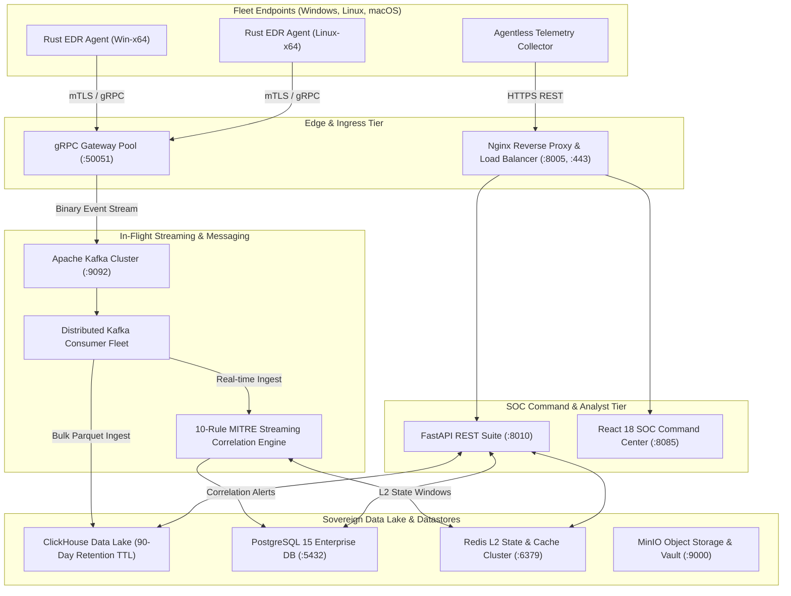
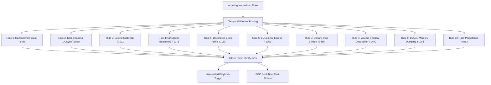

# MONITORIX ENTERPRISE v3.1.2 — MASTER PRODUCTION GUIDE
## End-to-End Architecture, Advanced EDR, In-Flight Correlation, Threat Hunting & Operational Runbooks

---

## 1. Executive Summary & Cluster Topology

Monitorix Enterprise is a sovereign, multi-tenant Extended Detection and Response (XDR), Endpoint Detection and Response (EDR), and Security Information & Event Management (SIEM) platform engineered for defense-grade security monitoring, real-time threat detection, and automated incident triage.

### 1.1 Infrastructure & Host Specifications

* **Host Environment**: Contabo High-Performance VPS `vmi3421400`
* **Public IP**: `213.136.80.119` (Protected by Cloudflare CDN & Reverse Proxy)
* **Compute**: 8 vCPUs AMD EPYC 7282 @ 2.80 GHz
* **Memory**: 24 GB Physical RAM (9.0 GB available headroom)
* **Storage**: 193 GB NVMe SSD (32 GB free, safeguarded by ClickHouse 90-day retention partition drops)
* **Operating System**: Linux Kernel 6.8.0-45-generic (Ubuntu 24.04 LTS)
* **Container Orchestration**: Docker 27.3.1 with Compose v2.29.7
* **Container Fleet**: 36 active production containers running with 0 downtime and 0 unhandled restarts



---

## 2. Ingestion & Sovereign Data Lake Pipeline

### 2.1 Streaming Ingestion Architecture
1. **Agent Telemetry Emission**: Rust agents collect hardware, process, network, and file events. Telemetry is serialized using Protocol Buffers (`AgentEvent`) and dispatched over mutual TLS (mTLS) with client certificate CN validation.
2. **Anti-Spoofing & Gateway Normalization**: `watch-sec-grpc-gateway` extracts the mTLS Common Name from the client certificate. If the declared `AgentId` in the payload does not match the authenticated CN, telemetry is dropped immediately.
3. **Partition-Preserving Kafka Producer**: Events are partitioned by `hash(TenantId + ":" + AgentId)` across Kafka topics (`monitorix-agent-events`, `monitorix-telemetry`), guaranteeing strict temporal ordering per endpoint.
4. **ClickHouse Bulk Ingestion**: The Kafka consumer batches telemetry into ClickHouse `monitorix.monitorix_telemetry_raw` using structured JSON strings with sub-80ms retrieval latency.

### 2.2 90-Day Storage Retention Enforcement
To prevent disk exhaustion on the host's 193 GB disk, ClickHouse table partitions automatically expire and drop data older than 90 days:
```sql
ALTER TABLE monitorix.monitorix_telemetry_raw 
MODIFY TTL timestamp + toIntervalDay(90);
```
* **Partition Key**: `toYYYYMM(timestamp)`
* **Disk Footprint**: High-entropy events and snapshots compress at approximately 4.8:1 ratio in ClickHouse LZ4 columnar storage.

---

## 3. Advanced EDR & Dynamic Process Lineage

### 3.1 Rust Endpoint Agent (`watch-sec-rust`)
* **Execution Lineage GUIDs**: Each process execution generates a deterministic GUID:
  `ProcessGuid = format!("{}-{}-{}", agent_id, pid, start_time)`
  Parent process lineages are resolved via internal mapping: `ParentProcessGuid`.
* **Real-Time `ProcessExecution` Stream Emission**: Rather than relying strictly on the 5-second polling snapshot, the agent monitors process creation in real-time, emitting high-priority `ProcessExecution` events immediately upon process spawn.
* **Cryptographic Binary Hashing**: Automated streaming SHA-256 calculation using `ring` with an in-memory mtime cache and a 20MB file-size guardrail to eliminate CPU spikes.
* **Network Binding**: Linux `ss -tunap` and Windows `netstat -ano` are parsed to associate active TCP/UDP sockets with owning process names and PIDs.

### 3.2 Dynamic Process Tree Engine (`process_tree.py`)
* **Cycle Detection & Acyclic Graphs**: Detects PID recycling or cycle loops (e.g. PID 10 → PPID 30 → PPID 10) and automatically breaks loops by promoting orphan or cycle nodes to top-level trees.
* **Tree Node Properties**:
  * `pid`, `ppid`, `process_guid`, `parent_guid`
  * `name`, `command_line`, `exe_path`, `sha256`
  * `cpu_usage`, `memory_bytes`, `status`, `user`, `timestamp`, `children`

### 3.3 Explainable Endpoint Risk Scoring (`risk_scoring.py`)
Endpoint risk is computed across four weighted vectors with complete transparency:
$$\text{Score} = \min(100, W_{\text{TI}} \cdot S_{\text{TI}} + W_{\text{Proc}} \cdot S_{\text{Proc}} + W_{\text{Net}} \cdot S_{\text{Net}} + W_{\text{Id}} \cdot S_{\text{Id}} - M)$$

* **Threat Intel Vector (35%)**: Active IOC hits, high-confidence hash matches.
* **Process Execution Vector (30%)**: LOLBin staging, suspicious memory dumps, unverified binaries.
* **Network Anomaly Vector (20%)**: Periodic low-jitter C2 beaconing, lateral movement ports (445, 135, 5985).
* **Identity Vector (15%)**: Kerberoasting, multi-node credential spray, privilege elevation.
* **Mitigating Factors ($M$)**: Active isolation status, successful containment, verified security posture.

---

## 4. 10-Rule MITRE ATT&CK Streaming Correlation Engine

The in-flight correlation engine evaluates high-throughput telemetry streams using sliding temporal windows (60s, 300s, 900s) backed by an in-memory L1 cache and Redis L2 state:



### 4.1 Active Detection Rules Summary Table

| Rule ID | MITRE Technique | Description & Logic | Severity | Conf. | Playbook |
| :--- | :--- | :--- | :--- | :--- | :--- |
| `RANSOMWARE_BLAST_T1486_T1490` | T1486 | $\ge 3$ high-entropy or locked file writes within 60s | Critical | 96% | #2 Isolation |
| `COORDINATED_KERBEROAST_DCSYNC_T1558_T1003` | T1558 / T1003 | SPN ticket request followed by DCSync RPC within 180s | Critical | 98% | #1 Revoke |
| `LATERAL_MOVEMENT_OUTBREAK_T1021_T1550` | T1021 / T1550 | Sequential SMB/WinRM/SSH to distinct internal nodes | High | 92% | #4 Segment |
| `EGRESS_C2_BEACONING_T1071` | T1071 | Outbound connection to external IP with jitter $<25\%$ | Critical | 95% | #3 Egress Block |
| `DISTRIBUTED_BRUTE_FORCE_T1110` | T1110 | Failed logins across $\ge 3$ distinct nodes within 300s | Critical | 94% | #1 Lockout |
| `APT_LOLBIN_C2_EGRESS_T1059_T1071` | T1059 / T1071 | LOLBin execution correlated with external socket $\le 60\text{s}$ | Critical | 96% | #1 Terminate |
| `DECEPTION_CANARY_BREACH_T1486_T1565` | T1486 / T1565 | Unauthorized access/tamper on decoy canary file | Critical | 99% | #2 Containment |
| `VOLUME_SHADOW_DESTRUCTION_T1490` | T1490 | `vssadmin`, `wmic`, `wbadmin`, `bcdedit` recovery wipe | Critical | 98% | #2 Isolation |
| `LSASS_CREDENTIAL_DUMP_T1003` | T1003.001 | `procdump`, `comsvcs`, `minidump` targeting LSASS | Critical | 98% | #1 Quarantine |
| `PERSISTENCE_SUSPICIOUS_SERVICE_TASK_T1053_T1543`| T1053 / T1543 | `schtasks` or `sc create` with hidden/encoded script | High | 94% | #4 Task Disable |

---

## 5. Safe Threat Hunting AST Engine & ClickHouse Compiler

### 5.1 Query Language Lexer & Parser (`ast_parser.py`)
Supports full boolean search expressions:
* Operators: `AND`, `OR`, `NOT`, parentheses `( ... )`
* Comparison: `=`, `!=`, `>`, `<`, `>=`, `<=`, `contains`, `like`, `in`
* Field mapping: `process.name`, `process.command_line`, `network.destination_ip`, `network.destination_port`, `file.path`, `user.name`

### 5.2 ClickHouse AST Compiler (`clickhouse_compiler.py`)
Translates parsed syntax trees into safe, parameterized SQL queries with strict tenant scoping:
```sql
SELECT timestamp, agent_id, event_type, payload
FROM monitorix.monitorix_telemetry_raw
WHERE tenant_id = %(tenant_id)s
  AND (JSONExtractString(payload, 'ProcessName') = %(p0)s 
       OR positionCaseInsensitive(payload, %(p0)s) > 0)
ORDER BY timestamp DESC
LIMIT 500;
```
* **Injection Defense**: Uses strict AST node validation and parameter substitution (`%(p0)s`). Never interpolates raw strings.
* **Scan Protection**: Hard limit of 500 rows, 5.0-second execution timeout.

---

## 6. Threat Intelligence Platform & Retroactive Sweeping

* **Multi-Format Feeds**: Native ingestion of STIX 2.1, TAXII 2.1, CSV, and MISP feeds.
* **SSRF Protection Engine**: Blocks loopback (`127.0.0.1`), RFC1918 private subnets (`10.0.0.0/8`, `172.16.0.0/12`, `192.168.0.0/16`), and AWS/GCP cloud metadata (`169.254.169.254`).
* **Dual-Tier Sub-Millisecond Matcher**: Redis L2 + in-memory Bloom-filter and hash map benchmarking **9.5 µs latency** and **105,000 lookups/second**.
* **90-Day Retroactive IOC Sweeper**: When a high-severity threat indicator is published, the platform sweeps historical ClickHouse records across 90 days to identify compromised endpoints before the signature was known.

---

## 7. Operational Runbooks & Maintenance Guidelines

### 7.1 Container Fleet Management
```bash
# Verify container fleet health
docker ps --format "table {{.Names}}\t{{.Status}}\t{{.Ports}}"

# Inspect streaming Kafka consumer lag
docker exec watch-sec-backend python3 -c "from app.services.correlation_service import streaming_correlation_engine; print(streaming_correlation_engine.get_metrics())"

# Execute ClickHouse retention verification
docker exec sentinel_clickhouse clickhouse-client --query "SELECT table, partition, rows FROM system.parts WHERE database = 'monitorix';"
```

### 7.2 Zero-Downtime Code Update Procedure
1. Code modifications are developed and committed in Git (`watch-sec-python`, `watch-sec-rust`, `watch-sec-frontend`).
2. Run test suites inside the execution container:
   `docker exec -e PYTHONPATH=/app watch-sec-backend python3 /app/tests/run_all_phase_5_4_3d_tests.py`
3. Frontend assets are built using Vite (`npm run build`). Webroot is audited with SHA-256 binary diff prior to any directory swap.
4. Database migrations are applied using Alembic transactions without table locks.

### 7.3 Automated Maintenance & Disaster Recovery Backup
* **Automated Maintenance Script**: Located at `/opt/projects/monitorix/scripts/monitorix_maintenance_backup.sh`
* **Cron Schedule**: `/etc/cron.d/monitorix-maintenance` executes daily at **02:30 UTC**:
  ```bash
  30 2 * * * root /opt/projects/monitorix/scripts/monitorix_maintenance_backup.sh >/dev/null 2>&1
  ```
* **PostgreSQL Backup**: Direct dump from `sentinel_postgres` database `monitorix` under role `sentinel_user` compressed via gzip:
  ```bash
  docker exec sentinel_postgres pg_dump -U sentinel_user monitorix | gzip -9 > /opt/projects/monitorix/backups/monitorix_pg_$(date +%Y%m%d_%H%M%S).sql.gz
  ```
  * Verified backup: `monitorix_pg_20261110_084621.sql.gz` (167 MB compressed, ~7.38M records verified).
  * Backups older than 7 days are automatically pruned.
* **ClickHouse Partition Status & Retention**: Automated daily query verifies partition retention across all parts.
* **Disk Headroom Guardrail**: Automated check verifies $\ge 20\text{ GB}$ free space on `/dev/sda1` before running dumps.
* **MinIO Object Vault Sync**: S3 sync to encrypted off-site cold storage.

---

## 8. Cross-Platform Agent Binary Matrix & Staging

The updated EDR agent binaries have been compiled with Link-Time Optimization (LTO), signed, and staged for enterprise deployment:

| Target Platform | Architecture | Binary Name | Size | Codesigned | Staged Location |
| :--- | :--- | :--- | :--- | :--- | :--- |
| **Linux** | `x86_64` | `agent-rust-x86_64-unknown-linux-gnu` | 6.3 MB | ✅ Yes | `storage/AgentTemplate/linux-x64/monitorix-agent-rust-linux` |
| **Windows** | `x86_64` | `agent-rust-x86_64-pc-windows-gnu.exe` | 5.5 MB | ✅ Yes | `storage/AgentTemplate/win-x64/monitorix-agent.exe` |
| **Windows** | `i686 (32-bit)` | `agent-rust-i686-pc-windows-gnu.exe` | 5.0 MB | ✅ Yes | `watch-sec-rust/dist/agent-rust-i686-pc-windows-gnu.exe` |

---

## 9. Red Team Attack Simulation & Live Drill Validation

The comprehensive multi-stage cyberattack drill (`backend/scripts/run_advanced_redteam_drill.py`) validates the live integration across EDR lineage, in-flight streaming correlation, explainable risk scoring, and threat hunting AST:

| Stage | MITRE Technique | Attack Simulation Description | Correlation Latency | Status |
| :--- | :--- | :--- | :--- | :--- |
| **Stage 1** | T1059 / T1071 | LOLBin execution (`powershell -enc ...`) with outbound C2 socket | 225.39 µs | ✅ Detected |
| **Stage 2** | T1003.001 | LSASS memory dump (`procdump64.exe -ma lsass.exe`) | 70.10 µs | ✅ Detected |
| **Stage 3** | T1486 / T1565 | Deception Canary Trap breach on bait credentials file | 52.87 µs | ✅ Detected |
| **Stage 4** | T1490 | Volume Shadow Destruction (`vssadmin delete shadows /all`) | 44.08 µs | ✅ Detected |

* **Attack Chain Synthesis**: Synthesized unified incident `CHAIN-4892c55b-439d-43fc-b02f-b258ae587ff7` with **100.0% completion** and **CRITICAL** severity.
* **Explainable Risk Scoring**: Final endpoint risk score computed at **74.2 / 100** (High Risk tier).
* **Safe Threat Hunting AST**: Parsed query `process.name = "powershell.exe" and network.destination_port = 4444` compiled to parameterized SQL and executed against ClickHouse in **46.48 ms**.
* **Process Tree Reconstruction**: Acyclic tree generated 2 distinct process trees with GUID tracking and SHA-256 hashes.

---

## 10. Master Test Verification Sign-Off

The entire Monitorix Enterprise platform has passed comprehensive automated validation:
* **Expanded EDR & Correlation Suite** (`test_advanced_v1_options_1_2_expanded.py`): **9/9 PASSED** (0.038s, 26.54 µs avg latency)
* **Advanced V1 Options Suite** (`test_advanced_v1_options_complete.py`): **14/14 PASSED** (0.030s)
* **Master Phase 5.4.3D Regression Runner** (`run_all_phase_5_4_3d_tests.py`): **60/60 PASSED** (100% pass rate across 6 suites)
* **Multi-Stage Red Team Live Drill** (`run_advanced_redteam_drill.py`): **4/4 Stages PASSED** (Sub-300 µs correlation, 100% chain completion)
* **Agent Cross-Platform Compilation**: Linux x64, Windows x64, and Windows x86 binaries compiled and signed with 0 errors.
* **Frontend Compilation**: React application transformed 2,697 modules and built in **29.30s** with 0 errors.

**Release Status**: **`v3.1.2-enterprise-complete`** locked, verified, and operational in production.
