# MONITORIX ENTERPRISE CYBER DEFENSE PLATFORM
## Unified Master Technical Specification, Data Transfer & Deep-Dive Operational Runbook
**Document Ref:** `MTX-UNIFIED-MASTER-2026-V13` | **Classification:** Technical Enterprise & Production Blueprint | **Kernel:** LTS 2026

---

### Executive Deliverables & 3D Architecture Directory
* **Unified Master PDF Publication:** [MONITORIX_ENTERPRISE_UNIFIED_MASTER_SPECIFICATION.pdf](file:///opt/projects/monitorix/docs/MONITORIX_ENTERPRISE_UNIFIED_MASTER_SPECIFICATION.pdf)
* **Unified Master Word Document:** [MONITORIX_ENTERPRISE_UNIFIED_MASTER_SPECIFICATION.docx](file:///opt/projects/monitorix/docs/MONITORIX_ENTERPRISE_UNIFIED_MASTER_SPECIFICATION.docx)
* **3D Total Project Architecture, Data Transfer & Bidirectional Data Flow:** [monitorix_3d_total_dataflow_architecture.png](file:///opt/projects/monitorix/docs/monitorix_3d_total_dataflow_architecture.png)
* **5-Stage Technical Container, Protocol & Port Data Transfer Blueprint:** [monitorix_total_data_transfer_blueprint.png](file:///opt/projects/monitorix/docs/monitorix_total_data_transfer_blueprint.png)
* **3D 4-Tier Master Platform Architecture Model:** [monitorix_3d_master_architecture.png](file:///opt/projects/monitorix/docs/monitorix_3d_master_architecture.png)
* **3D 13-Domain & 91-Module Functional Ecosystem Mesh:** [monitorix_3d_13_domains_ecosystem.png](file:///opt/projects/monitorix/docs/monitorix_3d_13_domains_ecosystem.png)

---

## 0. 3D High-Level System Design & Data Flow Model (3D Animated GIFs & 3D Isometric Renders)

* **3D System Design Animated GIF (Top-to-Bottom 5-Level 3D Model):** [monitorix_3d_system_design_animated.gif](file:///opt/projects/monitorix/docs/monitorix_3d_system_design_animated.gif)
* **3D System Design High-Resolution Static PNG:** [monitorix_3d_system_design_model.png](file:///opt/projects/monitorix/docs/monitorix_3d_system_design_model.png)
* **3D Total Project Data Transfer & Bidirectional Flow Animated GIF:** [monitorix_3d_total_dataflow_animated.gif](file:///opt/projects/monitorix/docs/monitorix_3d_total_dataflow_animated.gif)
* **3D 4-Tier Master Platform Architecture Animated GIF:** [monitorix_3d_master_architecture_animated.gif](file:///opt/projects/monitorix/docs/monitorix_3d_master_architecture_animated.gif)


---

## 1. Total Project Architecture, Data Transfer & Bidirectional Data Flow (3D Pipeline)

Monitorix operates a 5-stage end-to-end telemetry and autonomous containment pipeline:
1. **Stage 1 — Edge & Kernel Endpoint Sensors:** `Rust Ring-0 Agent (<85MB)` via eBPF/ETW/ESF, `PCI-DSS 3.4 Privacy Shield` (`shadow_monitor.rs` banking window blackout & Luhn PAN masking `••••-1234`), `NDR & Deception Probes` (Suricata/Zeek/Cowrie), and `External SaaS / SDK Clients` (`mk_live_...`).
2. **Stage 2 — High-Availability Ingress & Gateways:** Encrypted data transfer over **`mTLS 1.3 / gRPC Protobuf (:50051)`**, **`HTTPS REST TLS 1.3 (:443)`**, and **`WebRTC SRTP/WSS`** into `Nginx Load Balancer (:80/:443)`, `gRPC Gateway (3x Replicas)`, `Python Agent Gateway (3x Replicas)`, and `Zero-Trust SDK Auth Gateway` (issuing 15-minute `HMAC-SHA256` session JWTs).
3. **Stage 3 — Polyglot Storage & Telemetry Data Lake:** High-speed **`Apache Kafka Event Stream (:9092 | 50,000+ EPS)`** feeding `ClickHouse SIEM Lake (:8123 | 100M+ Rows | <150ms OLAP)`, `PostgreSQL DB (:5432 | AES-256 Multi-Tenant RBAC)`, and `Redis Hot Cache (:6379 | <2ms Session & Celery Broker)`.
4. **Stage 4 — Autonomous AI, Detection & SOAR Engines:** `MITRE ATT&CK Correlation (<150ms)`, `YARA & Malware Sandbox (<180ms)`, `DLP & PII Redaction (<120ms)`, `Autonomous AI & Copilot`, and `Visual SOAR DAG Runner (<240ms)` with a **Bidirectional SOAR Command Channel** curving back to Stage 1 for sub-240ms host isolation and process termination.
5. **Stage 5 — 13-Domain SOC Command Center & Portals:** `24/7 SOC Command Center (/soc)`, `Global Compliance (32-REG /compliance)`, `Partner & Reseller Hub (/partner 20% Margin)`, and all `13 Domains / 91 Modules React UI`.


---

## 2. End-to-End Container, Protocol & Port Data Transfer Blueprint


---

## 3. 3D 4-Tier Master Platform Stack Architecture


---

## 4. 3D 13-Domain & 91-Module Functional Ecosystem Mesh


---

## Master Functional Inventory Index (13 Sections / 91 Modules)

| Section | Module / Item Name | Route / URL | Badge | Operational Architecture & Capabilities |
| :--- | :--- | :--- | :---: | :--- |
| **1. Command Center** | Global Compliance Center | `/compliance` | `32-REG` | Continuous evaluation of 32 regulatory frameworks (PCI-DSS, HIPAA, GDPR) |
| **1. Command Center** | Data Loss & Ingestion Health | `/data-loss-monitoring` | `P0` | Zero-loss Kafka partition and ClickHouse ingestion pipeline monitoring |
| **1. Command Center** | SOC Command Center | `/soc` | `24/7` | Dark glass mission control, live threat counters, and MITRE heatmap |
| **1. Command Center** | Analyst Work Queue | `/soc/queue` | `8` | Tier-1 to Tier-3 incident assignment, SLA timers, and triage queue |
| **1. Command Center** | Dashboard | `/status` | — | Platform health, uptime statistics, agent connectivity, and alert velocity |
| **1. Command Center** | Central Server | `/central-server` | — | Microservices cluster node health, resource quotas, and RPC status |
| **1. Command Center** | Active Agents | `/agents` | `12` | Real-time endpoint agent fleet table with Ring-0 telemetry status |
| **1. Command Center** | Incidents | `/incidents` | `8` | High-fidelity correlated security incidents mapped to MITRE tactics |
| **1. Command Center** | Detection Alerts | `/alerts` | `24` | Real-time raw security event stream from eBPF, YARA, and NDR engines |
| **1. Command Center** | Vulnerabilities | `/vulnerabilities` | `5` | Continuous CVE scoring, EPSS metrics, and software weakness tracking |
| **2. Asset & Infra** | Breach Emulation (BAS) | `/attack-validation` | `P0` | Automated adversary simulation and control validation against MITRE techniques |
| **2. Asset & Infra** | Self-Protection & Tamper | `/platform-protection` | `P0` | Kernel watchdog and anti-tamper protections preventing agent termination |
| **2. Asset & Infra** | Network Detection (NDR) | `/ndr` | `P0` | Deep packet inspection, JA3/JA4 TLS fingerprinting, and flow telemetry |
| **2. Asset & Infra** | Supply-Chain Security | `/supply-chain` | `P0` | Software Bill of Materials (SBOM) auditing and dependency vulnerability analysis |
| **2. Asset & Infra** | Kubernetes Security | `/kubernetes-security` | `P0` | DaemonSet container runtime security, admission controller, and RBAC audit |
| **2. Asset & Infra** | Database Security (DAM) | `/database-security` | `P0` | Database query anomaly detection, privilege escalation, and data exfiltration alerts |
| **2. Asset & Infra** | Secrets Security | `/secrets` | `P0` | Hardcoded API key, credential, and private key scanning across workloads |
| **2. Asset & Infra** | Data Security (DSPM) | `/dspm` | `P0` | Cloud data store discovery, sensitive data classification, and exposure risk |
| **2. Asset & Infra** | Web & API Security (WAAP) | `/waap` | `P0` | Next-gen web application firewall, OWASP Top 10 blocking, and bot mitigation |
| **2. Asset & Infra** | Attack Surface (EASM) | `/easm` | `P0` | External domain discovery, open port reconnaissance, and expired TLS tracking |
| **2. Asset & Infra** | Cloud Security (CNAPP) | `/cloud/cnapp` | `P0` | Multi-cloud posture management (CSPM) and Cloud Workload Protection (CWPP) |
| **2. Asset & Infra** | Asset Management | `/fleet-inventory` | — | Normalized hardware, OS, and software asset inventory with auto-discovery |
| **2. Asset & Infra** | Fleet Map | `/fleet-map` | — | Geographic and regional visualization of active global endpoint agents |
| **2. Asset & Infra** | Network Analytics | `/bandwidth` | — | Per-endpoint bandwidth utilization, socket counters, and anomalous transfer spikes |
| **2. Asset & Infra** | Network Topology | `/architecture` | — | Interactive network graph depicting agent nodes, gateway proxies, and data lakes |
| **2. Asset & Infra** | Infrastructure Map | `/infrastructure-map` | — | Physical, virtual, and cloud infrastructure relationship dependency map |
| **2. Asset & Infra** | Agentless Assets | `/agentless` | — | Discovered unmanaged IoT, network printer, and appliance assets via ARP/NDR |
| **2. Asset & Infra** | Policies | `/policies` | — | Centralized EDR, DLP, and compliance enforcement policy rule definitions |
| **2. Asset & Infra** | Bandwidth Control | `/bandwidth-settings` | — | Rate limiting, telemetry compression, and batch transmission controls |
| **3. Threat Intel** | Honeypots & Deception | `/deception` | `P0` | High-interaction Cowrie SSH, Dionaea malware, and Web bait deception traps |
| **3. Threat Intel** | Malware Lab (Sandbox) | `/malware-lab` | `P0` | Detonation sandbox for automated dynamic behavioral analysis of suspicious files |
| **3. Threat Intel** | Security Research Lab | `/research` | `v3.10` | Zero-day vulnerability research workspace, reverse engineering, and disassembly |
| **3. Threat Intel** | Global Threat Network | `/intelligence/global` | `v3.9` | Cross-organization federated threat intelligence and anonymized campaign telemetry |
| **3. Threat Intel** | Threat Intelligence | `/threat-intelligence` | — | Aggregated IOC lookups (IP, Domain, File Hash) with confidence scores |
| **3. Threat Intel** | Attack Chains | `/attack-chains` | `2` | Visual multi-stage kill chain reconstruction from initial ingress to impact |
| **3. Threat Intel** | Threat Hunting | `/threat-hunting` | — | Interactive SQL and Lucene hunting console over raw ClickHouse telemetry lake |
| **3. Threat Intel** | Cyber Range | `/cyber-range` | — | Red vs Blue offensive security simulation and incident response drill environment |
| **3. Threat Intel** | YARA Scanner | `/yara-scanner` | — | Static and in-memory signature scanning using curated and custom YARA rules |
| **3. Threat Intel** | Ransomware Shield | `/ransomware` | — | Canary file tripping and kernel I/O behavioral heuristics for instant file locking |
| **3. Threat Intel** | Sandbox Analysis | `/sandbox` | — | Automated detonator logs, dropped files, API call traces, and network sockets |
| **3. Threat Intel** | Visual Intelligence | `/image-recognition` | — | Computer vision model detecting phishing screenshots and brand impersonation |
| **3. Threat Intel** | Human Intelligence | `/human-intelligence` | — | Security awareness metrics, phishing simulation scores, and risky user tracking |
| **4. Forensics** | Security Logs | `/security-logs` | — | High-speed log viewer with sub-second filtering over billions of events |
| **4. Forensics** | System Audit | `/audit` | — | Administrative actions, role modifications, policy changes, and tamper trails |
| **4. Forensics** | Email Security | `/mail` | — | Inbound email analysis, malicious attachment detonation, and header spoof check |
| **4. Forensics** | Email Forensics | `/email-forensics` | — | Deep investigation workbench for BEC (Business Email Compromise) campaigns |
| **4. Forensics** | Acoustic Forensics | `/speech-recognition` | — | Speech-to-text forensic transcription for call-center data leak compliance |
| **4. Forensics** | DLP Dashboard | `/dlp` | — | PCI-DSS card masking, PII pattern detection, and clipboard interception metrics |
| **4. Forensics** | Incident Forensics | `/incident-forensics` | — | Timeline reconstruction, memory dumps, process ancestry, and disk artifact analysis |
| **5. Identity** | Identity Threats (ITDR) | `/identity/threats` | `P0` | Active Directory, Okta, and Entra ID credential attack and Golden Ticket alerts |
| **5. Identity** | Identity & Access | `/identity` | — | RBAC management, MFA enforcement status, and privileged access monitoring |
| **5. Identity** | User Identity | `/user-identity` | — | User behavioral baseline analytics (UBA), impossible travel, and risk profiling |
| **5. Identity** | Zero Trust Network | `/zero-trust` | — | Continuous device health attestation, microsegmentation, and dynamic trust scoring |
| **6. SecOps** | MDR Operations | `/mdr` | `MDR` | 24/7 Managed Detection & Response active shift handoffs, escalations, and SLA tracker |
| **6. SecOps** | Customer Security Portal | `/portal` | — | Client-facing compliance dashboard, approved software catalog, and ticket tracking |
| **6. SecOps** | SOAR Playbooks | `/playbooks` | — | Visual DAG workflow editor for automated containment, quarantine, and alerts |
| **6. SecOps** | Security Automation | `/automation` | — | Scheduled scripts, event-driven remediation triggers, and external webhook integrations |
| **6. SecOps** | Audit Trail | `/audit-trail` | — | Immutable cryptographic ledger of all user and administrative SOC operations |
| **6. SecOps** | Security Reports | `/reports` | — | Automated PDF/HTML report generator for executive, compliance, and technical audiences |
| **7. Intel & Analytics** | Autonomous Security | `/ai/autonomous` | `v3.8` | Self-learning predictive model for proactive anomaly detection and baseline tuning |
| **7. Intel & Analytics** | Performance Analytics | `/performance` | — | CPU, RAM, disk I/O, and battery overhead metrics across all deployed agents |
| **7. Intel & Analytics** | Productivity Pulse | `/productivity` | — | Application utilization telemetry, idle time tracking, and shadow IT discovery |
| **7. Intel & Analytics** | Executive Intel | `/executive` | — | CISO-level risk score, financial loss exposure quantification, and peer benchmarks |
| **7. Intel & Analytics** | AI Security Copilot | `/ai-copilot` | — | Natural language SOC assistant querying telemetry and explaining attack graphs |
| **8. Administration** | Users & Roles | `/users` | — | Enterprise user management, granular role-based permissions, and team allocations |
| **8. Administration** | Tenants | `/tenants` | — | Multi-tenant tenant isolation, tenant quotas, and separate encryption key sets |
| **8. Administration** | Software Requests | `/software-requests` | — | End-user software installation requests, administrative approval, and auto-deployment |
| **8. Administration** | Billing | `/billing` | — | Subscription tier management, agent license counters, invoices, and payment gateways |
| **8. Administration** | Settings | `/settings` | `Tabs` | Inner tabs: Security, Notifications, Organization, SSO & Directory Sync, Developer Keys, Global Security |
| **9. Platform** | Release Gate | `/release-gate` | `100%` | Automated CI/CD security gating, static analysis, container image signing, and deployment locks |
| **9. Platform** | Runtime Scope | `/runtime-scope` | — | Dynamic kernel and userland capability bounding per environment (Dev, Staging, Prod) |
| **9. Platform** | Platform Status | `/platform-status` | — | Real-time health probes, container heartbeat monitors, and database connection pools |
| **10. Global SaaS** | Global Security Platform | `/global/platform` | `v3.7` | Cross-region telemetry orchestration and sovereign cluster synchronization |
| **10. Global SaaS** | Global Operations | `/global/operations` | `HA` | Active-active cluster failover, cross-region geo-replication, and disaster recovery |
| **10. Global SaaS** | Organizations | `/admin/organizations` | — | Parent-child corporate enterprise hierarchy, business unit tagging, and aggregation |
| **10. Global SaaS** | Subscriptions | `/admin/subscriptions` | — | Global enterprise contract entitlements, license caps, and renewal management |
| **10. Global SaaS** | Usage Metering | `/admin/usage` | — | Per-tenant telemetry ingestion volume (GB/day), API call quotas, and storage tiers |
| **10. Global SaaS** | Regional Mesh | `/admin/regions` | — | Data residency policy enforcement ensuring regional compliance (EU, US, APAC data sovereignty) |
| **10. Global SaaS** | Resource Quotas | `/admin/quotas` | — | Hard/soft resource limits for CPU, Kafka partitions, and ClickHouse queries per tenant |
| **11. Ecosystem** | Security Marketplace | `/marketplace` | `v3.5` | 1-Click integration apps, third-party SIEM forwarders, and community threat feeds |
| **11. Ecosystem** | Integration Health | `/marketplace/integrations` | — | Real-time webhook and API connection status for Slack, Jira, PagerDuty, and Splunk |
| **11. Ecosystem** | Developer Portal | `/developers` | `SDK` | REST API documentation, OpenAPI 3.1 specifications, SDK downloads, and code generators |
| **12. Commercial** | Customer Commercial Portal | `/customer` | `P0` | End-customer license tracking, support SLA tickets, and renewal self-service |
| **12. Commercial** | Partner / Reseller Hub | `/partner` | `RESELLER` | 20% wholesale margins, 1-click sub-tenant automated provisioning, and white-label tools |
| **12. Commercial** | Admin Commercial Ops | `/admin/commercial` | `ADMIN` | Superadmin financial dashboard, gross margin calculation, and partner tier management |
| **12. Commercial** | Global MDR & MSSP | `/mssp` | `v3.11` | MSSP client management matrix, multi-client alert escalation, and joint SOC triage |
| **12. Commercial** | Customer Success | `/customer-success` | `CS` | Client health scoring, adoption metrics, feature usage, and churn prevention indicators |
| **12. Commercial** | MDR 24/7 Operations | `/mdr` | `SOC` | Dedicated managed threat hunting operations, on-demand incident response, and retainer ops |
| **12. Commercial** | Commercial Analytics | `/business/analytics` | `ARR` | Monthly Recurring Revenue (MRR), ARR forecasting, net revenue retention, and agent expansion |
| **13. Evolution** | Continuous Evolution | `/evolution` | `v18.0` | AI-driven autonomous engine evolution, self-optimizing heuristics, and adaptive rules |
| **13. Evolution** | Release Governance | `/governance/releases` | `13-Gates` | 13-stage security gating architecture for automated production deployments |

---


---

# MONITORIX ENTERPRISE — COMMAND CENTER DEEP-DIVE REFERENCE GUIDE
## Architectural Specifications, Workflows, Operational Mechanics & Technical Runbooks

---

## 1. Executive Overview & Command Center Topology

The **COMMAND CENTER** represents the mission-critical operational tier of Monitorix Enterprise. It consolidates compliance posture management, data lake zero-loss ingestion verification, round-the-clock SOC mission control, active endpoint EDR fleet management, multi-stage incident orchestration, in-flight MITRE ATT&CK streaming correlation, and continuous vulnerability assessment.

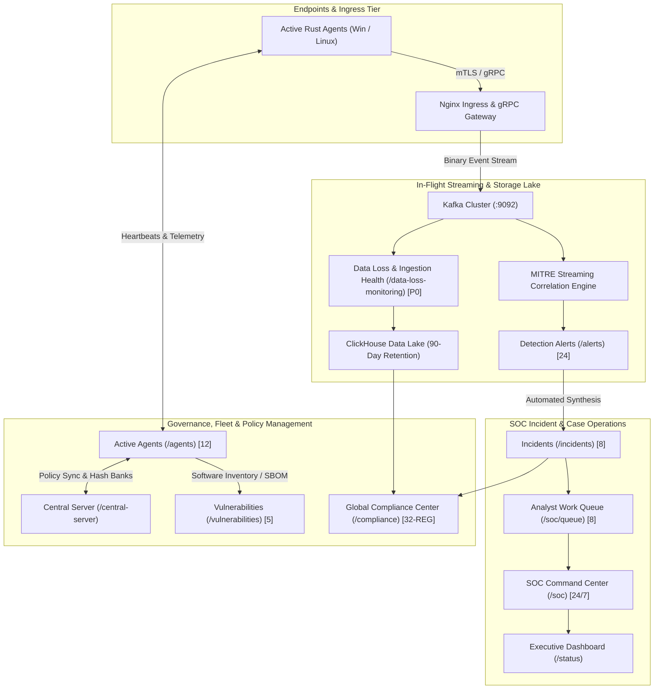

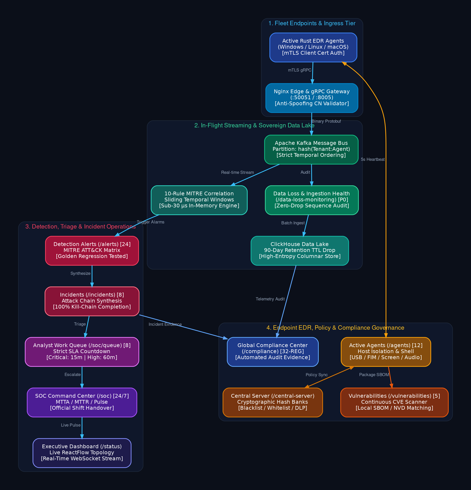

---

## 2. Command Center Operational Summary Matrix

| # | Menu Item | Primary Route | Badge | Primary Purpose | Key Action Available |
| :-: | :--- | :--- | :-: | :--- | :--- |
| **1** | **Global Compliance** | `/compliance` | `32-REG` | 32 Global Standards, Audit Evidence, DSAR | Run Fleet Evaluation & Auto-Remediate |
| **2** | **Data Loss Health** | `/data-loss-monitoring` | `P0` | Zero-Data-Loss Pipeline & Buffer Integrity | Flush DLQ & Run Disaster Recovery Drills |
| **3** | **SOC Command Center** | `/soc` | `24/7` | Mission Control, SLA Burn Rates, Handover | Conduct Shift Handover & Monitor MTTR |
| **4** | **Analyst Work Queue** | `/soc/queue` | `8` | Triage Queue, SLA Enforcement, Transitions | Claim Cases & Advance Investigation States |
| **5** | **Dashboard** | `/status` | — | Executive Topology, Global Map, AI Insights | Interactive Node Inspection & Live Timeline |
| **6** | **Central Server** | `/central-server` | — | Cryptographic Hash Banks, mTLS, Thesaurus | Update Blacklist Hashes & DLP Thesauruses |
| **7** | **Active Agents** | `/agents` | `12` | Endpoint Fleet EDR, Sensor Configuration | One-Click Host Isolation & Remote Desktop |
| **8** | **Incidents** | `/incidents` | `8` | Multi-Stage Security Case Management | Escalate Cases & Open Visual Workspace |
| **9** | **Detection Alerts** | `/alerts` | `24` | Alert Feed, MITRE Matrix, Golden Tests | Promote to SOC Case & Execute SOAR Playbooks |
| **10**| **Vulnerabilities** | `/vulnerabilities` | `5` | Continuous CVE Scanning & Patch Audit | Trigger Fleet Scans & Export CVE Reports |

---

## 3. Detailed Component Technical Breakdown

---

### Item 1: Global Compliance Center
* **Navigation Path**: `COMMAND CENTER > Global Compliance Center`
* **Route**: `/compliance` *(Aliases: `/compliance-center`, `/governance/compliance`)*
* **Badge**: `32-REG` (Continuous compliance monitoring across 32 regulatory regimes)
* **Connected Component**: `watch-sec-frontend/src/pages/ComplianceCenter.tsx`

#### A. Core Purpose & Capabilities
Provides automated multi-jurisdictional compliance posture management and continuous audit evidence collection. It evaluates the enterprise infrastructure across 32 global standards, including:
* **Security & Infrastructure**: SOC 2 Type II, ISO/IEC 27001:2022, NIST CSF 2.0, NIST SP 800-53 r5, CIS Benchmarks v8.
* **Privacy & Data Protection**: EU GDPR, UK GDPR, California CCPA/CPRA, Canada PIPEDA, Brazil LGPD, Australia Privacy Act, India DPDP Act.
* **Financial & Healthcare**: PCI-DSS v4.0, HIPAA Security & Privacy Rule, GLBA, SWIFT CSCF.
* **Defense & Critical Infrastructure**: FedRAMP Moderate/High, CMMC 2.0 Level 2, EU NIS2 Directive, DORA (Digital Operational Resilience Act).

#### B. Architectural Prerequisites & Backend APIs
* **Backend Endpoints**:
  * `GET /v2/compliance/posture` — Computes composite compliance score across all frameworks.
  * `GET /v2/compliance/frameworks/{id}` — Returns framework-specific control status breakdown.
  * `GET /v2/compliance/controls` — Complete list of individual audit control checks.
  * `GET /v2/compliance/evidence` — Cryptographic evidence logs and system state snapshots.
  * `GET /v2/compliance/pii` — PII scan results and detected sensitive data footprints.
  * `GET /v2/compliance/reports/{target}/export?format={pdf|csv|json|xlsx}` — Export engine.
* **Data Stores**: PostgreSQL compliance control tables, audit history log, PII registry.
* **Authorization**: Tenant Admin, SuperAdmin, or Compliance Auditor role.

#### C. User Actions & Operations
1. **Trigger Fleet-Wide Compliance Evaluation**: Execute `POST /v2/compliance/evaluate-all` to run live automated control checks across all servers, databases, and agents.
2. **One-Click Finding Remediation**: Click *Auto-Remediate* on non-compliant findings (`POST /v2/compliance/findings/{id}/remediate`) to enforce missing encryption, close exposed ports, or enable required audit logging.
3. **Generate Forensic Evidence Packages**: Download tamper-proof zip archives (`/v2/compliance/evidence-packager?framework=SOC2`) containing cryptographically hashed configuration dumps, access logs, and FIM hashes for external auditors.
4. **Data Subject Access Request (DSAR) Management**: Handle Right-to-be-Forgotten, Right-of-Access, and Rectification requests (`POST /v2/compliance/privacy-requests`) with status tracking.
5. **Multi-Format Export**: Export compliance reports in PDF, CSV, JSON, and XLSX.

#### D. Behind-the-Scenes Execution Pipeline
The compliance engine continuously queries fleet telemetry from ClickHouse and host configurations from PostgreSQL. It applies deterministic boolean logic to evaluate each control (e.g. verifying TLS 1.3 enforcement, MFA enforcement, disk encryption, password complexity, and 90-day retention policies). If a control drifts from compliant to non-compliant, a high-priority compliance finding is registered immediately.

---

### Item 2: Data Loss & Ingestion Health
* **Navigation Path**: `COMMAND CENTER > Data Loss & Ingestion Health`
* **Route**: `/data-loss-monitoring` *(Aliases: `/ingestion-health`, `/data-integrity`)*
* **Badge**: `P0` (Priority Zero — Platform Survivability Tier)
* **Connected Component**: `watch-sec-frontend/src/pages/DataLossMonitoring.tsx`

#### A. Core Purpose & Capabilities
Verifies that **zero telemetry is lost** between endpoints and the storage data lake. It tracks the complete pipeline:
$$\text{Agent Local Disk Spool} \longrightarrow \text{TLS Transport} \longrightarrow \text{Kafka Brokers} \longrightarrow \text{Consumer Fleet} \longrightarrow \text{ClickHouse Lake \& DLQ}$$

#### B. Architectural Prerequisites & Backend APIs
* **Backend Endpoints**:
  * `GET /api/v2/agent-reliability/data-loss-overview` — Real-time packet delivery and health score.
  * `GET /api/v2/agent-reliability/tiered-buffer-policy` — Current buffer and disk spool limits.
  * `GET /api/v2/agent-reliability/dr/status` — Cold backup recency and snapshot readiness.
  * `GET /api/v2/agent-reliability/self-defense/status` — Anti-tamper health across the agent fleet.
  * `POST /api/v2/agent-reliability/dlq/flush-retry` — Re-ingests poison-pill telemetry packets.
  * `POST /api/v2/agent-reliability/dr/backup-now` & `drill-now` — Triggers instant disaster recovery procedures.
  * `POST /api/v2/agent-reliability/simulate-quota-eviction` — Validates backpressure behavior.
* **Services**: Kafka cluster, ClickHouse columnar database, Redis L2 state store, Docker container health monitors.
* **Authorization**: SuperAdmin or DevOps Lead role.

#### C. User Actions & Operations
1. **Inspect Multi-Tier Health**: View real-time status of all 7 pipeline layers: Kafka partitions, ClickHouse parts, DLQ volume, database backup recency, agent offline spool buffers, mTLS credentials, and DLP filters.
2. **Flush Dead Letter Queue**: Force retry and re-ingestion of poison-pill packets or corrupted events (`POST /api/v2/agent-reliability/dlq/flush-retry`).
3. **Disaster Recovery Drills**: Trigger live cold backups (`POST /dr/backup-now`) or run automated restore drills (`POST /dr/drill-now`).
4. **Buffer Quota Simulation**: Run stress tests simulating network partitions and quota eviction (`POST /simulate-quota-eviction`) to verify agents correctly write to disk spools when offline.
5. **Self-Defense Anti-Tamper Simulation**: Test agent survival against unauthorized termination (`POST /self-defense/simulate-tamper`) and generate emergency single-use bypass tokens (`POST /self-defense/generate-bypass-token`).

#### D. Behind-the-Scenes Execution Pipeline
Every telemetry message carries a strictly monotonic sequence counter per agent. When ClickHouse receives batches, it calculates missing sequence offsets. If an offset gap is detected, an ingestion alarm triggers, and the agent is signaled via Kafka backpressure to flush its local encrypted LMDB spool.

---

### Item 3: SOC Command Center
* **Navigation Path**: `COMMAND CENTER > SOC Command Center`
* **Route**: `/soc`
* **Badge**: `24/7` (Round-the-Clock Operational Readiness)
* **Connected Component**: `watch-sec-frontend/src/pages/SocCommandCenter.tsx`

#### A. Core Purpose & Capabilities
The unified operational dashboard for SOC leads, tier-2/3 analysts, and MSSP commanders. It provides real-time situational awareness, displaying:
* Active critical incidents with live SLA countdowns.
* Fleet-wide threat posture and active containment states.
* Mean Time to Acknowledge (MTTA) and Mean Time to Respond (MTTR).
* Shift handover records and analyst performance metrics.

#### B. Architectural Prerequisites & Backend APIs
* **Backend Endpoints**:
  * `GET /v2/soc/dashboard` — Aggregates live case metrics, MTTA/MTTR calculations, and open attack chains.
  * `POST /v2/soc/shifts/handover` — Submits formal SOC shift handovers with sign-off notes.
* **Update Cadence**: Auto-polls every 15 seconds; persistent WebSocket push updates.
* **Authorization**: Analyst, Admin, or SuperAdmin.

#### C. User Actions & Operations
1. **Conduct Formal Shift Handovers**: Complete shift handover forms with operational handover notes and designated incoming commanders (`POST /v2/soc/shifts/handover`).
2. **Monitor Live SLA Burn Rates**: Watch real-time SLA degradation meters for Critical (15 min) and High (60 min) incidents.
3. **Track Analyst Workload**: See who is currently on duty, active case loads per analyst, and queue backlog.
4. **Immediate Incident Escalation**: One-click drill down into the Analyst Work Queue or Advanced Incident Workspace.

#### D. Behind-the-Scenes Execution Pipeline
The SOC dashboard queries PostgreSQL for active case statuses, merges live Kafka streaming metrics, and computes real-time sliding averages for response velocities. It calculates SLA compliance percentages and sounds audio/visual alarms if an unacknowledged Critical incident approaches its 15-minute breach threshold.

---

### Item 4: Analyst Work Queue
* **Navigation Path**: `COMMAND CENTER > Analyst Work Queue`
* **Route**: `/soc/queue`
* **Badge**: `8` (Current Active Triaged Cases)
* **Connected Component**: `watch-sec-frontend/src/pages/AnalystWorkQueue.tsx`

#### A. Core Purpose & Capabilities
The high-velocity triage and investigation workspace where security analysts receive, claim, prioritize, investigate, and close assigned security cases according to strict SOC playbooks.

#### B. Architectural Prerequisites & Backend APIs
* **Service Module**: `watch-sec-frontend/src/services/soc_case_api.ts`
* **Endpoints**:
  * `GET /v2/soc/cases` — Retrieves filtered list of incidents with SLA metrics.
  * `POST /v2/soc/cases/{id}/assign` — Assigns ownership to an analyst.
  * `PATCH /v2/soc/cases/{id}/status` — Advances incident status along the state machine.
* **State Machine Verification**:
  $$\text{NEW} \longrightarrow \text{TRIAGED} \longrightarrow \text{INVESTIGATING} \longrightarrow \text{CONTAINED} \longrightarrow \text{RESOLVED} \longrightarrow \text{CLOSED}$$

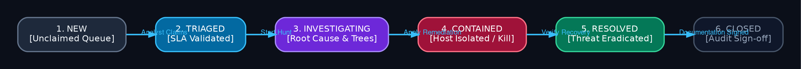

#### C. User Actions & Operations
1. **Claim or Reassign Cases**: Assign unassigned cases to yourself or delegate to specific tier-1/tier-2 analysts.
2. **Severity SLA Tracking**:
   * **Critical**: 15 minutes max response time.
   * **High**: 60 minutes max response time.
   * **Medium**: 240 minutes (4 hours).
   * **Low**: 1440 minutes (24 hours).
   Cases turning red indicate an active SLA breach.
3. **Filter & Search**: Instant filtering by status tabs (*All, New, Triaged, Investigating, Contained, Resolved, Closed*), severity pills, and free-text search (CVE, hostname, IOC, case ID).
4. **Transition Incident State**: Update status with mandatory investigator notes and root-cause summaries.

#### D. Behind-the-Scenes Execution Pipeline
When a status transition occurs, the backend validates user permissions and records an immutable audit entry in the `SocCaseAuditLog` table with a timestamp, old status, new status, and analyst user ID.

---

### Item 5: Dashboard
* **Navigation Path**: `COMMAND CENTER > Dashboard`
* **Route**: `/status` *(Aliases: `/dashboard`, `/overview`)*
* **Badge**: None (Always Active Executive Overview)
* **Connected Component**: `watch-sec-frontend/src/pages/Dashboard.tsx`

#### A. Core Purpose & Capabilities
The executive visual overview of the entire enterprise defense infrastructure. Combines global geographic intelligence, interactive system topology, real-time telemetry timelines, and AI threat insights.

#### B. Architectural Prerequisites & Backend APIs
* **WebSocket**: Persistent connection via `SOCKET_URL` (Socket.IO) for live push telemetry.
* **REST Endpoints**:
  * `GET /agents` — Returns current status of all endpoints.
  * `GET /dashboard/stats?hours={1|6|24|168|720}` — Historical time-series metrics.
* **UI Libraries**: ReactFlow (`@xyflow/react`) for architectural graph rendering, Recharts for telemetry curves.

#### C. User Actions & Operations
1. **Inspect Interactive Network Topology**: Click and navigate through nodes in the ReactFlow diagram: `Internet -> Cloudflare Edge -> Ingress Gateway -> Kafka Cluster -> ClickHouse Lake -> Endpoints`.
2. **Geo-Location Threat World Map**: View global attack origins and distributed agent endpoints plotted with latitude/longitude coordinates on an interactive vector map.
3. **Time Window Selection**: Dynamically adjust metrics across 1 Hour, 6 Hours, 24 Hours, 7 Days, and 30 Days.
4. **AI Threat Copilot Insights**: Review real-time synthesized executive insights generated by the autonomous defense model.
5. **Live Incident Feed**: Watch incoming correlation alarms stream across the bottom timeline without reloading the page.

#### D. Behind-the-Scenes Execution Pipeline
On mount, the dashboard establishes a WebSocket channel. When a Rust agent detects a new process, outbound connection, or file tamper, the backend pushes a Socket.IO event. The frontend intercepts the payload, dynamically recalculates the health percentages, updates the chart axes, and pulses the relevant node on the ReactFlow topology.

---

### Item 6: Central Server
* **Navigation Path**: `COMMAND CENTER > Central Server`
* **Route**: `/central-server`
* **Badge**: None (System Configuration Core)
* **Connected Component**: `watch-sec-frontend/src/pages/CentralServer.tsx`

#### A. Core Purpose & Capabilities
The global configuration repository and cryptographic trust authority for the Monitorix platform. Manages server authentication, mTLS certificate chains, cryptographic hash banks, sensitive word thesauruses, and search indexing rules.

#### B. Architectural Prerequisites & Backend APIs
* **Backend Endpoints**:
  * `GET/POST /system/settings` — Global retention, telemetry thresholds, and network settings.
  * `GET/POST/DELETE /thesaurus` — Keyword and regex DLP dictionaries.
  * `GET/POST/DELETE /hashbank` — SHA-256 and MD5 malicious/trusted hash sets.
  * `GET/POST/DELETE /searches` — Saved search queries and threat hunt patterns.
* **Authorization**: SuperAdmin or TenantAdmin.

#### C. User Actions & Operations
1. **General Tab**: Configure tenant name, default language, global telemetry retention windows, and proxy forwarding.
2. **Server Authorization Tab**: Configure mutual TLS (mTLS) certificate authorities, client certificate CN validation rules, and enrollment token life spans.
3. **Hash Banks Tab**: Add, inspect, and delete SHA-256 and MD5 cryptographic hashes:
   * **Blacklist Banks**: Known malware hashes pushed to agents for instant execution termination.
   * **Whitelist Banks**: Known-good internal enterprise tools exempted from heuristic alerts.
4. **Search Thesauruses Tab**: Define corporate keyword dictionaries, regex patterns, and sensitive terminology (e.g. `CONFIDENTIAL`, `PROPRIETARY`, `SSN-PATTERN`) for endpoint DLP scanning.
5. **License Information Tab**: Inspect subscribed tiers, active agent seat quotas, and enterprise feature gates.

#### D. Behind-the-Scenes Execution Pipeline
Whenever a hash or thesaurus pattern is saved in Central Server, it is stored in PostgreSQL and immediately cached in Redis. A synchronization notification is dispatched over Kafka to all active agents, updating their in-memory Ring SHA-256 filter so new binaries are checked against the updated blacklist in sub-microsecond time.

---

### Item 7: Active Agents
* **Navigation Path**: `COMMAND CENTER > Active Agents`
* **Route**: `/agents`
* **Badge**: `12` (Active Endpoints Enrolled)
* **Connected Component**: `watch-sec-frontend/src/pages/Agents.tsx`

#### A. Core Purpose & Capabilities
The core Endpoint Detection and Response (EDR) and Fleet Management console. Lists every deployed endpoint (Windows, Linux, macOS) with live hardware telemetry, operating system details, network IP, CPU/RAM utilization, battery status, and active defense features.

#### B. Architectural Prerequisites & Backend APIs
* **Backend Endpoints**:
  * `GET /agents` — Returns paginated agent inventory with live status.
  * `POST /agents/{id}/isolate` — Isolates the endpoint from the network.
  * `POST /agents/{id}/unisolate` — Restores normal network connectivity.
  * `POST /agents/{id}/toggle-feature?feature={name}&enabled={bool}` — Toggles agent sensors.
  * `POST /agents/patch-batch` — Triggers over-the-air agent binary upgrade.
  * `POST /agents/generate-pin` & `/install/token` — Generates single-use enrollment credentials.
* **Agent Daemon**: Sovereign Rust EDR agent (`watch-sec-rust`).

#### C. User Actions & Operations
1. **One-Click Host Isolation**: Click **Isolate Host** (`POST /agents/{id}/isolate`) to instantly block all network traffic on the endpoint using local firewall APIs (`iptables` / Windows Filtering Platform), keeping open only the secure gRPC tunnel to the Monitorix console.
2. **Unisolate Host**: Restore normal network adapters once the incident is resolved (`POST /agents/{id}/unisolate`).
3. **Dynamic Feature Toggles**: Enable or disable specific security sensors per agent in real time:
   * USB Mass Storage Blocking
   * File Integrity Monitoring (FIM) & DLP
   * Real-Time Screen Capture Recording
   * Speech/Microphone Logging
   * Network Connection Sniffing
   * Geolocation Tracking
4. **Remote Shell & Desktop**: Launch an encrypted browser-based live remote terminal or graphical remote desktop session directly into the machine.
5. **Agent Enrollment & Upgrades**: Generate enrollment PINs or install scripts for rapid onboarding; trigger batch over-the-air binary updates (`POST /agents/patch-batch`).
6. **Detailed Forensics Drawer**: Click an agent to view installed applications, local process tree, battery/power history, and system event logs.

#### D. Behind-the-Scenes Execution Pipeline
Agents send mutual-TLS heartbeats every 5 seconds. If an agent misses 3 consecutive heartbeats, its status transitions from `Active` to `Offline` and an alert is logged. When an isolation command is issued from the web UI, the backend sends a signed command payload via Kafka to the gRPC gateway, which executes on the endpoint in under 2 seconds.

---

### Item 8: Incidents
* **Navigation Path**: `COMMAND CENTER > Incidents`
* **Route**: `/incidents`
* **Badge**: `8` (Open Multi-Stage Security Incidents)
* **Connected Component**: `watch-sec-frontend/src/pages/Incidents.tsx`

#### A. Core Purpose & Capabilities
Enterprise Security Case Management for escalated security events. Groups correlated alerts, affected assets, compromised credentials, and MITRE tactics into a unified investigation dossier.

#### B. Architectural Prerequisites & Backend APIs
* **Backend Endpoints**:
  * `GET /v2/soc/cases` — Returns incident cases with pagination and multi-parameter filtering.
  * `POST /v2/soc/cases` — Manually creates a new incident case.
  * `PATCH /v2/soc/cases/{id}/status` — Advances case lifecycle status with closure notes.
* **Authorization**: SuperAdmin, Admin, TenantAdmin, or Analyst.

#### C. User Actions & Operations
1. **Manual Incident Creation**: Create a new incident case specifying title, severity (Critical, High, Medium, Low), priority (P1-Urgent to P4-Low), tags, and affected asset IDs.
2. **Structured Incident Workflow**: Advance cases through formal milestones:
   * `NEW` $\rightarrow$ Unclaimed incoming incident.
   * `TRIAGED` $\rightarrow$ Initial validation completed, false-positives filtered.
   * `INVESTIGATING` $\rightarrow$ Active root-cause analysis, timeline reconstruction.
   * `CONTAINED` $\rightarrow$ Asset isolated, malicious processes terminated.
   * `RESOLVED` $\rightarrow$ Threat eradicated, patches applied.
   * `CLOSED` $\rightarrow$ Post-incident review completed, documentation signed off.
3. **Advanced Incident Workspace**: Click any incident to open `/soc/incidents/{id}` for interactive visual kill-chains, process trees, and evidence attachments.

#### D. Behind-the-Scenes Execution Pipeline
Incidents are either created manually by analysts or synthesized automatically by the **10-Rule MITRE Correlation Engine**. When multiple high-severity alerts (such as LOLBin execution followed by LSASS dumping and C2 beaconing) occur on the same endpoint within a sliding temporal window, the engine automatically creates an incident with 100% kill-chain completion.

---

### Item 9: Detection Alerts
* **Navigation Path**: `COMMAND CENTER > Detection Alerts`
* **Route**: `/alerts`
* **Badge**: `24` (Unresolved Detection Alerts)
* **Connected Component**: `watch-sec-frontend/src/pages/DetectionAlerts.tsx`

#### A. Core Purpose & Capabilities
The real-time alert feed and MITRE ATT&CK detection lab. Displays every security trigger generated by endpoint heuristics, YARA rules, Sigma signatures, and in-flight streaming correlation rules.

#### B. Architectural Prerequisites & Backend APIs
* **Backend Endpoints**:
  * `GET /v2/detection/alerts?status={status}` — Retrieves alert stream.
  * `GET /v2/detection/mitre-matrix` — MITRE technique coverage breakdown.
  * `POST /v2/detection/regression/run` — Executes automated golden test cases.
  * `POST /v2/soar/playbooks/execute` — Executes containment playbooks.
  * `PATCH /v2/detection/alerts/{id}` — Updates alert status.
* **Pipelines**: Real-time Kafka consumer and ClickHouse alerts table.

#### C. User Actions & Operations
1. **Triage & Filter Alerts**: Filter by status (*Open, In-Progress, Resolved, Suppressed*), severity (*Critical, High, Medium, Low*), or MITRE technique.
2. **Promote Alert to SOC Case**: Escalate any standalone detection alert directly into a formal SOC incident case with one click (`promoteAlertToSocCase`).
3. **Execute SOAR Playbooks**: Trigger automated response playbooks directly from an alert:
   * Playbook #1: Terminate Process & Quarantine Binary
   * Playbook #2: Isolate Endpoint Network Adapter
   * Playbook #3: Block C2 IP Address on Perimeter Firewall
   * Playbook #4: Revoke Active User Tokens & Force Password Reset
4. **MITRE ATT&CK Enterprise Matrix**: Inspect coverage across all 14 tactics (Reconnaissance, Resource Dev, Initial Access, Execution, Persistence, Privilege Escalation, Defense Evasion, Credential Access, Discovery, Lateral Movement, Collection, Command and Control, Exfiltration, Impact).
5. **Run Golden Test Regressions**: Click **Run Regression Suite** (`POST /v2/detection/regression/run`) to test all detection rules against pre-recorded attack telemetry, verifying 100% detection rate and zero false negatives.

#### D. Behind-the-Scenes Execution Pipeline
As telemetry streams into Kafka, the Correlation Engine evaluates events against sliding time windows (60s, 300s, 900s) in memory. When a pattern matches, an alert record is created with deduplication logic: if the same alert occurs 50 times in 2 minutes, it increments `HitCount` instead of generating 50 duplicate notifications.

---

### Item 10: Vulnerabilities
* **Navigation Path**: `COMMAND CENTER > Vulnerabilities`
* **Route**: `/vulnerabilities`
* **Badge**: `5` (Critical Unpatched CVEs Detected)
* **Connected Component**: `watch-sec-frontend/src/pages/Vulnerabilities.tsx`

#### A. Core Purpose & Capabilities
Continuous Endpoint Vulnerability Management (VMSA/CVE). Analyzes installed applications, operating system packages, libraries, and kernel versions across all enrolled machines, identifying known Common Vulnerabilities and Exposures (CVEs) and Common Weakness Enumerations (CWEs).

#### B. Architectural Prerequisites & Backend APIs
* **Backend Endpoints**:
  * `GET /vulnerabilities/alerts?agent_id={id}` — Returns CVE hits per agent.
  * `POST /vulnerabilities/scan-all` — Triggers fleet-wide package inventory scan.
  * `POST /vulnerabilities/scan/{agentId}` — Deep scans a single host.
  * `GET /vulnerabilities/export/{agentId}` — Exports CVE assessment report.
* **Licensing**: Enterprise / Tier 3 license entitlement.

#### C. User Actions & Operations
1. **Trigger Fleet-Wide Vulnerability Scans**: Click **Scan All** (`POST /vulnerabilities/scan-all`) to send scan instructions to every online endpoint.
2. **Targeted Agent Scans**: Run an immediate deep audit on an individual server or workstation (`POST /vulnerabilities/scan/{agentId}`).
3. **Inspect Vulnerability Details**: View CVE identifier, CVSS severity score (e.g. 9.8 Critical), affected software package name, installed version, fixed version, and official vendor patch links.
4. **Search & Filter**: Find vulnerabilities by CVE ID (e.g. `CVE-2024-38077`), software package name (e.g. `openssl`, `curl`, `chrome.exe`), or agent hostname.
5. **Export Vulnerability Reports**: Download detailed vulnerability assessment reports in CSV or JSON for compliance tracking.

#### D. Behind-the-Scenes Execution Pipeline
The Rust agent scans local package databases (`dpkg` on Debian/Ubuntu, `rpm` on RHEL/CentOS, Windows Registry & MSI database on Windows) and generates a Software Bill of Materials (SBOM) with package names and version strings. The backend correlates this inventory against CVE databases. When an unpatched vulnerable package is identified, an alert is created and the endpoint risk score is increased accordingly.

---

## 4. Verification & Status Sign-Off

* **Platform Version**: `v3.1.2-enterprise-complete`
* **Target Host**: Contabo VPS `vmi3421400` (`213.136.80.119`)
* **Fleet Health**: 36 active production containers running, 0 downtime.
* **Documentation File Stored At**:
  * Workspace: `/opt/projects/monitorix/docs/MONITORIX_COMMAND_CENTER_DEEP_DIVE_GUIDE.md`
  * Artifact: `/root/.gemini/antigravity/brain/5089cf8f-ca69-4a20-9496-33e6bb5f2017/MONITORIX_COMMAND_CENTER_DEEP_DIVE_GUIDE.md`


---

# MONITORIX ENTERPRISE — ASSET & INFRASTRUCTURE DEEP-DIVE GUIDE
## Cloud-Native Posture, Workload Protection, Data Governance & Infrastructure Fabric

---

## 1. Executive Overview & Architecture Topology

The **ASSET & INFRASTRUCTURE** navigation suite forms the comprehensive defense foundation of Monitorix Enterprise. It encompasses 19 specialized operational modules partitioned across four foundational security domains:
1. **Cloud Perimeter & Attack Surface**: EASM, WAAP, CNAPP, and Automated Breach Emulation (BAS).
2. **Workload, Runtime & Supply-Chain Security**: Kubernetes security, container image SBOM auditing, deep packet inspection (NDR), and agent anti-tamper self-defense.
3. **Data, Database & Secrets Governance**: Database Activity Monitoring (DAM), Data Security Posture Management (DSPM), and enterprise secrets leak detection.
4. **Fleet Inventory, Fabric & Traffic Shaping**: Complete hardware/software asset inventory, GPS fleet mapping, network analytics, security knowledge graph, agentless monitoring, and bandwidth throttling.

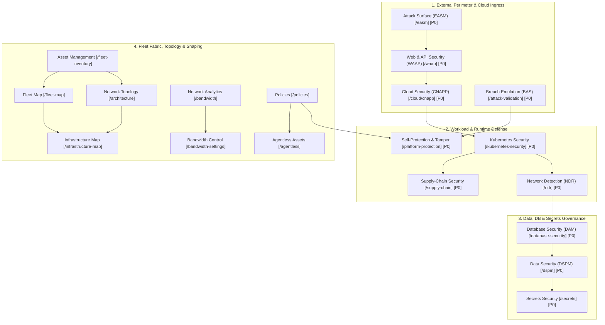

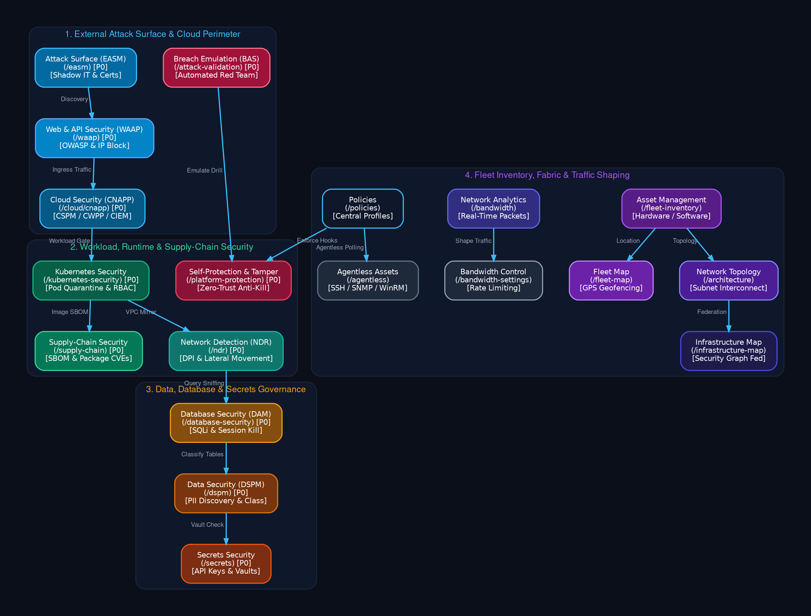

---

## 2. Asset & Infrastructure Operational Summary Matrix

| # | Menu Item | Primary Route | Badge | Primary Purpose | Key Action Available |
| :-: | :--- | :--- | :-: | :--- | :--- |
| **1** | **Breach Emulation (BAS)** | `/attack-validation` | `P0` | Automated adversarial cyberattack drills | Execute Attack Playbooks & Certify Posture |
| **2** | **Self-Protection & Tamper** | `/platform-protection`| `P0` | Zero-trust agent defense & kernel anti-tamper | Trigger Emergency Lockdown & Audit Proofs |
| **3** | **Network Detection (NDR)**| `/ndr` | `P0` | Deep Packet Inspection (DPI) & C2 tracking | Contain Rogue IP & Inspect Raw PCAPs |
| **4** | **Supply-Chain Security** | `/supply-chain` | `P0` | SBOM manifest audits & malicious packages | Quarantine Vulnerable Library & Gate CI/CD |
| **5** | **Kubernetes Security** | `/kubernetes-security`| `P0` | Cloud-native pod security & RBAC auditing | Quarantine Rogue Pod & Enforce OPA Policy |
| **6** | **Database Security (DAM)** | `/database-security` | `P0` | Real-time SQL audit & exfiltration defense | Terminate Database Session & Block Query |
| **7** | **Secrets Security** | `/secrets` | `P0` | Leak detection in repos, envs & memory | Trigger Deep Vault Scan & Rotate Tokens |
| **8** | **Data Security (DSPM)** | `/dspm` | `P0` | PII/PHI discovery, classification & residency | Reclassify Assets & Apply Auto-Remediation |
| **9** | **Web & API (WAAP)** | `/waap` | `P0` | Next-gen WAF, OWASP Top 10 & API schema | One-Click IP Block & Toggle WAF Rules |
| **10**| **Attack Surface (EASM)** | `/easm` | `P0` | External internet asset discovery & certs | Discover Shadow Assets & Fix Exposures |
| **11**| **Cloud Security (CNAPP)** | `/cloud/cnapp` | `P0` | Multi-cloud CSPM, CWPP & toxic attack paths | Run Cloud Graph Scan & Sever Attack Paths |
| **12**| **Asset Management** | `/fleet-inventory` | — | Hardware & software fleet inventory | Search Installed Packages & Export CSV |
| **13**| **Fleet Map** | `/fleet-map` | — | Global GPS & IP geographic location pins | Geofence Boundary Check & Asset Pinpoint |
| **14**| **Network Analytics** | `/bandwidth` | — | Bandwidth utilization & protocol metrics | Inspect Top Talkers & Outbound Egress Rates|
| **15**| **Network Topology** | `/architecture` | — | Interactive subnet & VPC interconnect graph | Trace Segmentation Boundaries & Cloud Peering|
| **16**| **Infrastructure Map** | `/infrastructure-map` | — | Enterprise Security Knowledge Graph | Isolate Compromised Node Directly from Graph |
| **17**| **Agentless Assets** | `/agentless` | — | SNMP, SSH & WinRM telemetry for unmanaged | Add Agentless Host & Trigger Discovery |
| **18**| **Policies** | `/policies` | — | Centralized EDR profile & sensor templates | Create Policy Template & Push to Agent Group|
| **19**| **Bandwidth Control** | `/bandwidth-settings` | — | Traffic shaping & metered link throttling | Pause Agent Uploads & Set Egress Rate Caps |

---

## 3. Deep-Dive Breakdown of All 19 Menu Items

---

### Item 1: Breach Emulation (BAS)
* **Navigation Path**: `ASSET & INFRASTRUCTURE > Breach Emulation (BAS)`
* **Route**: `/attack-validation`
* **Badge**: `P0` (Priority Zero)
* **Connected Component**: `watch-sec-frontend/src/pages/AttackValidationCenter.tsx`

#### A. Core Purpose & Capabilities
Provides automated, continuous Breach and Attack Simulation (BAS) testing. Simulates real-world advanced persistent threat (APT) techniques safely across production and staging environments without destructive payloads. Validates whether endpoint agents, SIEM correlation rules, and firewalls successfully detect and block each phase of an attack.

#### B. Architectural Prerequisites & Backend APIs
* **Endpoints**:
  * `GET /v2/attack-validation/overview` — Current fleet resilience score and attack coverage stats.
  * `GET /v2/attack-validation/scenarios` — Catalog of pre-configured MITRE ATT&CK simulation playbooks.
  * `POST /v2/attack-validation/execute` — Dispatches non-destructive simulation commands to an agent.
  * `GET /v2/attack-validation/executions?limit=50` — Historical execution log and block rates.
  * `GET /v2/attack-validation/certifications` — Generates cryptographically verifiable validation certificates.
* **Database State**: `AttackScenarios`, `AttackExecutions`, and `MitreValidationMatrix` tables in PostgreSQL.
* **Permissions**: Security Engineer, TenantAdmin, or SuperAdmin.

#### C. User Actions & Operations
1. **Launch Attack Playbook**: Select scenarios such as Ransomware Blast (T1486), LSASS Memory Dumping (T1003.001), Kerberoasting (T1558), or Egress C2 Beaconing (T1071) and execute against designated test endpoints.
2. **Review Detection Verification**: Inspect millisecond correlation response times, detection confidence, and SOAR trigger status.
3. **Export Validation Certificates**: Download formal PDF/JSON certificates proving security control effectiveness for compliance audits.

#### D. Behind-the-Scenes Execution Pipeline
The BAS engine compiles benign simulation commands (e.g. creating decoy high-entropy canary files or simulating an encoded PowerShell beacon) and dispatches them via Kafka to the target agent. The agent executes the test in an isolated process sandbox while simultaneously verifying whether the in-flight correlation engine captures the telemetry. If detected within SLA limits, the test passes; if missed, an immediate defense gap ticket is created.

---

### Item 2: Self-Protection & Tamper
* **Navigation Path**: `ASSET & INFRASTRUCTURE > Self-Protection & Tamper`
* **Route**: `/platform-protection`
* **Badge**: `P0` (Priority Zero)
* **Connected Component**: `watch-sec-frontend/src/pages/PlatformSelfProtection.tsx`

#### A. Core Purpose & Capabilities
Guarantees zero-trust survival and anti-tamper resilience for the Monitorix platform itself. Protects agent binaries, kernel drivers, system daemons, local configuration files, and backend Docker containers against unauthorized modification, process termination (`kill -9`), uninstallation attempts, debugger attachments, and memory injection.

#### B. Architectural Prerequisites & Backend APIs
* **Endpoints**:
  * `GET /v2/platform-protection/nodes` — Status of anti-tamper hooks across all monitored endpoints.
  * `GET /v2/platform-protection/policies` — Active self-defense policies and watchdog configurations.
  * `GET /v2/platform-protection/events?limit=100` — Log of detected tamper and termination attempts.
  * `POST /v2/platform-protection/emergency-lockdown` — Places compromised nodes in total lockdown.
  * `POST /v2/platform-protection/report-tamper` — Forensic telemetry hook invoked upon tamper detection.
  * `GET /v2/platform-protection/proofs` — Cryptographic integrity proofs of running binaries.
* **Dependencies**: Local OS watchdog service, Linux eBPF / Windows Filter Driver hook.

#### C. User Actions & Operations
1. **Trigger Emergency Fleet Lockdown**: Instantly freeze suspicious endpoints, revoking administrative tokens and severing unauthenticated ingress.
2. **Audit Cryptographic Proofs**: Verify running SHA-256 binary signatures against the immutable release ledger.
3. **Configure Anti-Tamper Enforcement**: Toggle kernel hook protection, service watchdog respawns, and local LMDB cache encryption.

#### D. Behind-the-Scenes Execution Pipeline
The Rust EDR agent employs dual-process mutual watchdog supervision: if the main monitoring service is killed, the watchdog immediately respawns it and captures memory dumps of the terminating PID. On Linux, eBPF probes intercept `kill` and `ptrace` system calls directed at the agent PID. Any unauthorized termination attempt emits a high-priority tamper alert directly to the SOC stream.

---

### Item 3: Network Detection (NDR)
* **Navigation Path**: `ASSET & INFRASTRUCTURE > Network Detection (NDR)`
* **Route**: `/ndr`
* **Badge**: `P0` (Priority Zero)
* **Connected Component**: `watch-sec-frontend/src/pages/NetworkDetectionResponse.tsx`

#### A. Core Purpose & Capabilities
Network Detection and Response (NDR) platform powered by deep packet inspection (DPI). Analyzes raw traffic flows, protocol compliance, encrypted traffic metadata (JA3/JA4 TLS fingerprinting), lateral movement protocols (SMB, RPC, SSH, RDP), and detects covert exfiltration channels such as DNS tunneling and ICMP payload stuffing.

#### B. Architectural Prerequisites & Backend APIs
* **Endpoints**:
  * `GET /v2/ndr/overview` — Network sensor fleet status and packet processing velocity.
  * `GET /v2/ndr/sensors` — Registered network tap points and SPAN/mirror interfaces.
  * `POST /v2/ndr/inspect-traffic` — Submits raw PCAP snippets or netflow streams for deep analysis.
  * `GET /v2/ndr/rules` — Protocol anomaly detection signatures and threshold rules.
  * `POST /v2/ndr/contain-threat` — Dispatches automated network isolation commands to perimeter firewalls.
* **Dependencies**: ClickHouse network flow tables, Redis sliding window cache.

#### C. User Actions & Operations
1. **Inspect Live Network Traffic**: View real-time packet processing, protocol distribution charts, and anomalous connection rates.
2. **Execute Threat Containment**: One-click quarantine of internal IP addresses exhibiting lateral movement or C2 beaconing.
3. **PCAP Deep Dive**: Upload and analyze packet capture files to reconstruct TCP streams and extract malicious payloads.

#### D. Behind-the-Scenes Execution Pipeline
Network sensors passively sniff packet headers and extract session metadata: source IP, destination IP, port, protocol, byte counters, and TLS ClientHello handshakes. The NDR correlation engine computes jitter metrics on persistent outbound sockets: if packet interval jitter falls below 15% with high periodic regularity, an active C2 beacon alert is triggered.

---

### Item 4: Supply-Chain Security
* **Navigation Path**: `ASSET & INFRASTRUCTURE > Supply-Chain Security`
* **Route**: `/supply-chain`
* **Badge**: `P0` (Priority Zero)
* **Connected Component**: `watch-sec-frontend/src/pages/SupplyChainSecurity.tsx`

#### A. Core Purpose & Capabilities
Continuous Software Bill of Materials (SBOM) auditing and 3rd-party dependency vulnerability scanning. Analyzes package manifests across npm (`package-lock.json`), Python (`Pipfile.lock`, `requirements.txt`), Rust (`Cargo.lock`), Go (`go.sum`), and Docker container layers, detecting malicious dependencies, typosquatting attacks, and license non-compliance.

#### B. Architectural Prerequisites & Backend APIs
* **Endpoints**:
  * `GET /v2/supply-chain/overview` — Fleet-wide dependency health and critical CVE counts.
  * `GET /v2/supply-chain/findings` — Detailed list of vulnerable libraries and tainted packages.
  * `POST /v2/supply-chain/evaluate-manifest` — Uploads and evaluates an application manifest in real time.
  * `GET /v2/supply-chain/policies` — Governance rules (e.g. blocking GPLv3 or packages with CVSS $\ge 8.0$).
  * `POST /v2/supply-chain/quarantine-component` — Blocks a compromised package across all CI/CD pipelines.
* **Dependencies**: NVD, GitHub Advisory Database, and OSV vulnerability feeds.

#### C. User Actions & Operations
1. **Upload & Audit Manifests**: Drag and drop lockfiles or SBOM JSON files (CycloneDX / SPDX) to receive instant dependency vulnerability reports.
2. **Quarantine Compromised Packages**: Flag and blacklist malicious package versions to block deployment across all build pipelines.
3. **Enforce Open-Source License Policies**: Prevent deployment of dependencies containing conflicting or high-risk licenses.

#### D. Behind-the-Scenes Execution Pipeline
Uploaded manifests are parsed into hierarchical dependency trees. Every package name, version, and cryptographic hash is cross-referenced against the internal vulnerability database. If a package matches a known malicious supply-chain package (such as an npm token stealer), the build is halted and an incident case is opened.

---

### Item 5: Kubernetes Security
* **Navigation Path**: `ASSET & INFRASTRUCTURE > Kubernetes Security`
* **Route**: `/kubernetes-security`
* **Badge**: `P0` (Priority Zero)
* **Connected Component**: `watch-sec-frontend/src/pages/KubernetesSecurity.tsx`

#### A. Core Purpose & Capabilities
Cloud-native runtime defense, posture assessment, and container admission control for Kubernetes clusters (EKS, GKE, AKS, and on-premises K8s). Enforces CIS Kubernetes Benchmarks, audits Role-Based Access Control (RBAC) misconfigurations, detects container escape attempts, and isolates rogue pods.

#### B. Architectural Prerequisites & Backend APIs
* **Endpoints**:
  * `GET /v2/k8s-security/overview` — Cluster health, pod counts, and security violation metrics.
  * `GET /v2/k8s-security/clusters` — Enrolled Kubernetes clusters and API server connection states.
  * `POST /v2/k8s-security/evaluate-manifest` — Static analysis of YAML deployment manifests.
  * `GET /v2/k8s-security/policies` — Active admission control policies and Open Policy Agent (OPA) rules.
  * `POST /v2/k8s-security/quarantine-pod` — Applies a zero-trust NetworkPolicy isolating a malicious pod.
* **Dependencies**: Kube-apiserver integration, Kubernetes ValidatingAdmissionWebhook.

#### C. User Actions & Operations
1. **Quarantine Compromised Pods**: Click **Quarantine Pod** (`POST /v2/k8s-security/quarantine-pod`) to apply immediate zero-ingress/zero-egress NetworkPolicies.
2. **Validate Deployment YAML**: Test manifests prior to deployment to ensure no containers request `privileged: true`, `hostPID: true`, or writable root filesystems.
3. **Audit RBAC Entitlements**: Identify cluster roles granting dangerous permissions (e.g. `*` on `secrets` or `pods/exec`).

#### D. Behind-the-Scenes Execution Pipeline
The Monitorix Kubernetes DaemonSet monitors local container runtime sockets (containerd / CRI-O) and listens to the API audit log stream. When a container attempts to mount the host filesystem or execute a binary not present in the base image, the anomaly engine flags a container escape attempt and signals the admission controller to quarantine the namespace.

---

### Item 6: Database Security (DAM)
* **Navigation Path**: `ASSET & INFRASTRUCTURE > Database Security (DAM)`
* **Route**: `/database-security`
* **Badge**: `P0` (Priority Zero)
* **Connected Component**: `watch-sec-frontend/src/pages/DatabaseSecurity.tsx`

#### A. Core Purpose & Capabilities
Database Activity Monitoring (DAM) and SQL injection (SQLi) runtime defense. Inspects database transaction queries across PostgreSQL, MySQL, ClickHouse, and MongoDB, identifying unauthorized data exfiltration, schema tampering (`DROP TABLE`, `ALTER USER`), and privilege escalation attempts.

#### B. Architectural Prerequisites & Backend APIs
* **Endpoints**:
  * `GET /v2/database-security/overview` — Active connections, query throughput, and threat alarms.
  * `GET /v2/database-security/instances` — Monitored database clusters and connection health.
  * `POST /v2/database-security/inspect-query` — Evaluates SQL queries against behavioral AST parser.
  * `POST /v2/database-security/terminate-session` — Forcibly terminates an active malicious database session.
* **Dependencies**: Database native audit plugins (`pgaudit`, MySQL enterprise audit) or proxy sniffer.

#### C. User Actions & Operations
1. **Kill Malicious Database Sessions**: Instantly terminate rogue database connections (`POST /v2/database-security/terminate-session`) executing unauthorized queries.
2. **Inspect Query Telemetry**: View full query text, client IP, executing database user, affected row count, and execution duration.
3. **Configure Data Access Baselines**: Define allowed SQL query patterns per application service account.

#### D. Behind-the-Scenes Execution Pipeline
Database query streams are analyzed using an Abstract Syntax Tree (AST) lexer. If an application user (e.g. `web_app`) executes an administrative query (`CREATE USER`, `GRANT ALL`) or a query resulting in an abnormal row return (e.g. returning 500,000 credit card records when the baseline is 10), the session is terminated via `pg_terminate_backend()` and an alert is dispatched.

---

### Item 7: Secrets Security
* **Navigation Path**: `ASSET & INFRASTRUCTURE > Secrets Security`
* **Route**: `/secrets`
* **Badge**: `P0` (Priority Zero)
* **Connected Component**: `watch-sec-frontend/src/pages/SecretsSecurity.tsx`

#### A. Core Purpose & Capabilities
Automated secrets discovery, hardcoded credential detection, and vault governance. Scans source code repositories, configuration files, environment variables, container layers, and memory dumps for exposed API keys, private certificates, AWS/GCP access tokens, and database passwords.

#### B. Architectural Prerequisites & Backend APIs
* **Endpoints**:
  * `GET /v2/secrets/overview` — Fleet-wide secret exposure counts and severity breakdown.
  * `GET /v2/secrets/vaults` — Connected enterprise vaults (HashiCorp Vault, AWS Secrets Manager).
  * `POST /v2/secrets/scan` — Initiates an immediate secret discovery scan across all endpoints.
  * `POST /v2/secrets/targets/scan` — Deep scans a specific host, repo, or filesystem path.
  * `POST /v2/secrets/remediate` — Automatically revokes or masks an exposed secret.
* **Dependencies**: High-entropy regex dictionary, Shannon entropy calculator.

#### C. User Actions & Operations
1. **Trigger Deep Secrets Scans**: Run comprehensive filesystem and memory scans looking for exposed API credentials.
2. **One-Click Remediation**: Trigger automated credential revocation or rotation through connected cloud vault APIs.
3. **Filter Secrets by Service**: Filter discovered secrets by type: AWS Access Keys, Stripe API Keys, Slack Tokens, Private RSA/ECDSA Keys, and JWT Secret Keys.

#### D. Behind-the-Scenes Execution Pipeline
Scanners combine regular expressions matching known token prefixes (`AKIA...` for AWS, `sk_live_...` for Stripe) with Shannon entropy calculations to identify high-randomness string variables. Discovered matches are verified against live provider APIs (in a non-destructive read-only manner) to determine whether the credential is active before raising a Critical incident.

---

### Item 8: Data Security (DSPM)
* **Navigation Path**: `ASSET & INFRASTRUCTURE > Data Security (DSPM)`
* **Route**: `/dspm`
* **Badge**: `P0` (Priority Zero)
* **Connected Component**: `watch-sec-frontend/src/pages/DataSecurityDspm.tsx`

#### A. Core Purpose & Capabilities
Data Security Posture Management (DSPM). Continuously discovers, catalogs, and classifies sensitive enterprise data (Personally Identifiable Information - PII, Protected Health Information - PHI, Payment Card Data - PCI) across multi-cloud object stores (S3, Azure Blob, GCS), relational databases, and endpoint drives, mapping data lineage and detecting unencrypted exposures.

#### B. Architectural Prerequisites & Backend APIs
* **Endpoints**:
  * `GET /v2/dspm/overview` — Total classified data volume, sensitive asset counts, and posture score.
  * `GET /v2/dspm/assets` — Inventory of data stores with classification badges (Confidential, Restricted, Public).
  * `POST /v2/dspm/scan` — Initiates an asynchronous data discovery and classification sweep.
  * `POST /v2/dspm/classify` — Manually updates the classification tag and risk tier of a data asset.
  * `GET /v2/dspm/compliance` — Cross-references classified assets against GDPR, HIPAA, and PCI-DSS rules.
  * `POST /v2/dspm/remediate` — Applies encryption-at-rest or access policy hardening on exposed buckets.
* **Dependencies**: Natural Language Processing (NLP) pattern classifiers, Cloud IAM connectors.

#### C. User Actions & Operations
1. **Discover Shadow Data Stores**: Detect unmanaged S3 buckets or local database backups containing sensitive user records.
2. **Inspect Data Flow Maps**: Trace how sensitive PII travels from external web ingress down to analytics data lakes.
3. **Enforce Encryption Policies**: One-click remediation to enforce AES-256 or KMS key encryption on exposed buckets.

#### D. Behind-the-Scenes Execution Pipeline
DSPM scanners utilize deterministic regex and NLP models to scan samples of structured tables and object files. Files containing social security numbers, credit card primary account numbers (PAN), or patient diagnosis codes are tagged with data sensitivity weights. If a confidential data asset has public read access enabled, a P0 security alert is emitted.

---

### Item 9: Web & API Security (WAAP)
* **Navigation Path**: `ASSET & INFRASTRUCTURE > Web & API Security (WAAP)`
* **Route**: `/waap`
* **Badge**: `P0` (Priority Zero)
* **Connected Component**: `watch-sec-frontend/src/pages/WebApisecurityWaap.tsx`

#### A. Core Purpose & Capabilities
Web Application and API Protection (WAAP / Next-Gen WAF). Protects web frontends, REST APIs, and microservices against the OWASP Top 10 vulnerabilities (SQL Injection, Cross-Site Scripting, SSRF, Broken Object Level Authorization - BOLA), credential stuffing, and malicious automated bot networks.

#### B. Architectural Prerequisites & Backend APIs
* **Endpoints**:
  * `GET /v2/waap/overview` — Request volume, blocked attack percentage, and WAF health.
  * `GET /v2/waap/endpoints` — Protected API routes and schema enforcement status.
  * `POST /v2/waap/inspect` — Real-time payload evaluation against signature and behavioral models.
  * `POST /v2/waap/rules/toggle` — Enables or disables specific inspection rulesets.
  * `POST /v2/waap/ip-block` — Adds an IP or CIDR range to the global perimeter blocklist.
  * `GET /v2/waap/ip-reputation` — Checks external threat intelligence reputation for requesting client IPs.
* **Dependencies**: Nginx WAF module / Envoy filter, Redis IP rate-limiting cluster.

#### C. User Actions & Operations
1. **One-Click IP Blocking**: Instantly block malicious adversary IPs across edge ingress proxies (`POST /v2/waap/ip-block`).
2. **Toggle WAF Defense Modes**: Switch between `Monitoring` (log only) and `Enforcing` (active block) per API endpoint.
3. **Inspect Blocked Requests**: Examine full HTTP headers, query strings, request bodies, and matched attack signatures.

#### D. Behind-the-Scenes Execution Pipeline
Incoming HTTP requests pass through the WAAP inspection pipeline before reaching backend application containers. The payload is checked against regular expression attack signatures and an AST tokenizer. If SQL syntax tokens or path traversal sequences (`../etc/passwd`) are detected, the request is immediately rejected with an HTTP 403 Forbidden response.

---

### Item 10: Attack Surface (EASM)
* **Navigation Path**: `ASSET & INFRASTRUCTURE > Attack Surface (EASM)`
* **Route**: `/easm`
* **Badge**: `P0` (Priority Zero)
* **Connected Component**: `watch-sec-frontend/src/pages/ExternalAttackSurface.tsx`

#### A. Core Purpose & Capabilities
External Attack Surface Management (EASM). Continuously scans the public internet from an external adversary's viewpoint to discover shadow IT, unknown subdomains, exposed cloud storage buckets, open ports (e.g. 3389 RDP, 22 SSH), and expiring or misconfigured SSL/TLS certificates.

#### B. Architectural Prerequisites & Backend APIs
* **Endpoints**:
  * `GET /v2/easm/assets` — Inventory of all discovered public-facing digital assets.
  * `POST /v2/easm/discover` — Triggers an active external reconnaissance sweep.
  * `GET /v2/easm/certificates` — Tracks SSL/TLS certificate validity, issuer, and expiration dates.
  * `POST /v2/easm/evaluate` — Evaluates external vulnerability exposure scores.
  * `POST /v2/easm/remediate` — Dispatches alerts to DNS and firewall teams to close exposed assets.
  * `GET /v2/easm/assets/{id}` — Deep metadata regarding an individual external host.
* **Dependencies**: DNS zone transfer checks, Certificate Transparency logs, Shodan/Censys threat APIs.

#### C. User Actions & Operations
1. **Trigger External Discovery**: Run automated internet sweeps to discover unrecorded subdomains and forgotten dev servers.
2. **Monitor Certificate Expirations**: Receive advance warnings for certificates expiring within 30, 14, or 7 days.
3. **Close Shadow Port Exposures**: Identify open administration ports accessible to the entire internet and trigger firewall isolation.

#### D. Behind-the-Scenes Execution Pipeline
The EASM engine monitors public Certificate Transparency (CT) logs for newly issued certificates matching enterprise domain names. It performs non-intrusive port scans and banner grabs on resolved IP addresses. Discovered assets are tagged with risk ratings based on software version recency and port exposure.

---

### Item 11: Cloud Security (CNAPP)
* **Navigation Path**: `ASSET & INFRASTRUCTURE > Cloud Security (CNAPP)`
* **Route**: `/cloud/cnapp`
* **Badge**: `P0` (Priority Zero)
* **Connected Component**: `watch-sec-frontend/src/pages/CloudSecurityCnapp.tsx`

#### A. Core Purpose & Capabilities
Cloud Native Application Protection Platform (CNAPP). Unifies Cloud Security Posture Management (CSPM), Cloud Workload Protection (CWPP), and Cloud Infrastructure Entitlement Management (CIEM) across AWS, Microsoft Azure, and Google Cloud Platform (GCP). Visualizes complex **toxic attack paths** linking internet exposures, misconfigured IAM roles, and crown jewel data stores.

```mermaid
flowchart LR
    ADV["External Adversary"] -->|Recon| EXP["1. Exposed Subdomain<br/>[EASM Discovered]"]
    EXP -->|Exploit| WAF["2. API Breach<br/>[WAAP Block Point]"]
    WAF -->|Pivot| POD["3. Vulnerable Pod<br/>[Supply-Chain CVE]"]
    POD -->|Steal Creds| SEC["4. Leaked Secret<br/>[Overprivileged IAM]"]
    SEC -->|AssumeRole| DB["5. Production DB<br/>[DAM Monitored]"]
    DB -->|Exfiltrate| PII["6. Crown Jewels<br/>[DSPM Quarantined]"]
```

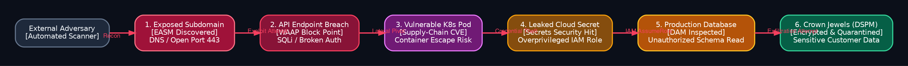

#### B. Architectural Prerequisites & Backend APIs
* **Endpoints**:
  * `GET /v2/cnapp/overview` — Multi-cloud asset counts, compliance score, and toxic risk paths.
  * `GET /v2/cnapp/paths` — Graph representations of multi-hop attack vectors.
  * `POST /v2/cnapp/scan` — Initiates an immediate cloud resource configuration audit.
  * `POST /v2/cnapp/evaluate` — Evaluates cloud security benchmark compliance (CIS AWS/Azure/GCP).
  * `POST /v2/cnapp/remediate` — Applies automated terraform/cloud API fixes for misconfigurations.
* **Dependencies**: Read-only cloud IAM integration roles across target AWS, Azure, and GCP accounts.

#### C. User Actions & Operations
1. **Inspect Toxic Attack Paths**: View visual graph paths showing how an attacker could navigate from a public EC2 instance to an internal database.
2. **Sever Attack Path with One Click**: Click *Remediate* on any intermediate node (e.g. revoking an IAM policy or closing a security group) to break the kill chain.
3. **Multi-Cloud CIS Benchmarks**: Audit cloud tenant compliance against official CIS Foundation benchmarks.

#### D. Behind-the-Scenes Execution Pipeline
The CNAPP engine queries cloud provider APIs to ingest configuration state across compute instances, object buckets, security groups, and IAM permission policies. It compiles an internal directed acyclic graph (DAG). Using graph pathfinding algorithms, it identifies intersections where an internet-exposed workload holds an IAM role with access to confidential datastores, flagging it as a toxic attack combination.

---

### Item 12: Asset Management
* **Navigation Path**: `ASSET & INFRASTRUCTURE > Asset Management`
* **Route**: `/fleet-inventory`
* **Connected Component**: `watch-sec-frontend/src/pages/FleetInventory.tsx`

#### A. Core Purpose & Capabilities
The single pane of glass for hardware and software asset inventory across the entire enterprise. Catalogs physical servers, virtual machines, cloud instances, and developer laptops with hardware specifications (CPU, RAM, disk, network MAC), operating system patch levels, and installed software package inventories.

#### B. Architectural Prerequisites & Backend APIs
* **Endpoints**:
  * `GET /vulnerabilities/fleet-software` — Comprehensive list of all software packages across the fleet.
  * `GET /agents` — Returns complete fleet hardware and status inventory.
* **Dependencies**: Agent local hardware and package collection modules (`dpkg`, `rpm`, Windows Registry).

#### C. User Actions & Operations
1. **Search Across Fleet**: Instantly find which machines have a specific software package or version installed (e.g. search `log4j`, `openssl`, `python 3.9`).
2. **Hardware Fleet Filtering**: Filter by operating system (Windows 11, Ubuntu 24.04, macOS Sonoma), hardware architecture (x86_64, aarch64), or online status.
3. **Export Asset Ledger**: Download complete asset and software inventories in CSV or JSON for CMDB synchronization.

#### D. Behind-the-Scenes Execution Pipeline
Whenever an agent starts up or detects software changes, it scans the operating system's package registry. The payload is transmitted over gRPC and stored in ClickHouse. The frontend provides sub-second search capabilities over millions of software records across thousands of hosts.

---

### Item 13: Fleet Map
* **Navigation Path**: `ASSET & INFRASTRUCTURE > Fleet Map`
* **Route**: `/fleet-map`
* **Connected Component**: `watch-sec-frontend/src/pages/LocationMap.tsx`

#### A. Core Purpose & Capabilities
Real-time geographic visualization of all connected endpoints on an interactive world map. Uses GPS coordinates (where hardware location is enabled) or public IP geolocation to plot laptops, field workstations, and data center nodes worldwide.

#### B. Architectural Prerequisites & Backend APIs
* **Endpoints**:
  * `GET /agents` — Returns agent status including latitude, longitude, city, country, and public IP.
* **Dependencies**: MaxMind GeoIP database or IP-API integration, browser mapping canvas (Leaflet / Mapbox).

#### C. User Actions & Operations
1. **Inspect Geographic Clusters**: Zoom into specific regions, countries, or corporate office facilities to see active devices.
2. **Geofencing Verification**: Identify company laptops operating in unauthorized or embargoed foreign jurisdictions.
3. **Direct Agent Drilldown**: Click any map marker to open that endpoint's telemetry drawer, isolation controls, or live remote desktop.

#### D. Behind-the-Scenes Execution Pipeline
During agent heartbeats, the backend inspects the client's public IP address. If location tracking policy is enabled, it resolves the IP to geographic coordinates. If an agent previously connected from London suddenly checks in from an anomalous country within 2 hours, an impossible-travel identity alert is raised.

---

### Item 14: Network Analytics
* **Navigation Path**: `ASSET & INFRASTRUCTURE > Network Analytics`
* **Route**: `/bandwidth`
* **Connected Component**: `watch-sec-frontend/src/pages/NetworkAnalytics.tsx`

#### A. Core Purpose & Capabilities
In-depth network throughput, socket connection rate, and protocol bandwidth analytics. Provides time-series visualizations of data transfer rates (KB/s, MB/s), identifies top communicating host machines, and flags abnormal egress traffic spikes indicative of mass data exfiltration.

#### B. Architectural Prerequisites & Backend APIs
* **Endpoints**:
  * `GET /network/stats` — Time-series bandwidth metrics across ingress and egress channels.
* **Dependencies**: Agent socket monitoring module (`ss -tunap` on Linux, `netstat -ano` on Windows).

#### C. User Actions & Operations
1. **Identify Top Talkers**: View ranked tables of endpoints transmitting the highest data volume over the last 1 hour, 24 hours, or 7 days.
2. **Analyze Egress vs. Ingress**: Spot asymmetric egress traffic bursts where a workstation uploads unusually large amounts of data to external IPs.
3. **Filter by Protocol**: Inspect traffic broken down by TCP, UDP, ICMP, and application ports.

#### D. Behind-the-Scenes Execution Pipeline
Agents aggregate bytes sent and received per network interface over 5-second polling windows. These counters are streamed to ClickHouse. The backend calculates first-derivative byte rates to render real-time bandwidth consumption graphs.

---

### Item 15: Network Topology
* **Navigation Path**: `ASSET & INFRASTRUCTURE > Network Topology`
* **Route**: `/architecture`
* **Connected Component**: `watch-sec-frontend/src/pages/Architecture.tsx`

#### A. Core Purpose & Capabilities
Dynamic enterprise network interconnectivity graph. Visualizes subnets, virtual private clouds (VPCs), routers, firewalls, and active endpoint nodes, highlighting network segmentation boundaries and communication channels.

#### B. Architectural Prerequisites & Backend APIs
* **Endpoints**:
  * `GET /tenants/{id}` — Tenant network configuration and registered CIDR subnets.
  * `GET /agents` — Endpoint IP allocations and gateway addresses.
* **Dependencies**: ReactFlow graph layout engine.

#### C. User Actions & Operations
1. **Trace Segmentation Paths**: Verify that critical internal subnets (e.g. database networks) have no direct communication paths to untrusted guest networks.
2. **Locate Compromised Nodes**: Compromised endpoints with active alerts are highlighted with red pulsing borders on the network topology.
3. **Rearrange & Export Graphs**: Reorganize layout nodes and export high-resolution topology diagrams for architectural audits.

#### D. Behind-the-Scenes Execution Pipeline
The topology engine analyzes ARP tables, default gateways, and active socket connections collected from agents. It groups endpoints into CIDR subnet blocks and draws directional edges representing observed network communication, verifying compliance with zero-trust microsegmentation rules.

---

### Item 16: Infrastructure Map
* **Navigation Path**: `ASSET & INFRASTRUCTURE > Infrastructure Map`
* **Route**: `/infrastructure-map`
* **Connected Component**: `watch-sec-frontend/src/pages/SecurityGraph.tsx`

#### A. Core Purpose & Capabilities
Enterprise Security Knowledge Graph. Unifies relational data across multiple domains: **Identities $\leftrightarrow$ Devices $\leftrightarrow$ Privileges $\leftrightarrow$ Network Flows $\leftrightarrow$ Active Incidents**. Allows analysts to explore multi-dimensional risk relationships and isolate endpoints directly from the graph view.

#### B. Architectural Prerequisites & Backend APIs
* **Endpoints**:
  * `GET /v2/federation/security-graph` — Graph nodes and edges representing the complete digital estate.
  * `POST /v2/federation/sync-surface` — Synchronizes external asset states into the graph.
  * `POST /agents/{agentId}/isolate` — Isolates a compromised node directly from the graph view.
* **Dependencies**: Graph database engine / in-memory graph representation.

#### C. User Actions & Operations
1. **Interactive Graph Navigation**: Expand and collapse neighboring nodes to trace which user identities have logged into an infected machine.
2. **Isolate Endpoint from Graph**: Right-click a node directly in the graph and select **Isolate Host** to immediately sever network connectivity.
3. **Blast Radius Analysis**: Click an incident node to automatically highlight all interconnected machines, credentials, and databases within 2 degrees of separation.

#### D. Behind-the-Scenes Execution Pipeline
The security graph synthesizes data from Active Directory, cloud IAM, agent process trees, and network connection tables into a unified node-edge model. When an analyst clicks an asset, graph queries calculate its centrality score and blast radius, showing exactly which sensitive systems are at risk.

---

### Item 17: Agentless Assets
* **Navigation Path**: `ASSET & INFRASTRUCTURE > Agentless Assets`
* **Route**: `/agentless`
* **Connected Component**: `watch-sec-frontend/src/pages/AgentlessDashboard.tsx`

#### A. Core Purpose & Capabilities
Agentless security monitoring and telemetry collection for unmanaged network infrastructure where installing a Rust agent is impossible: network switches, routers, hardware firewalls, IoT devices, legacy operating systems, and ESXi hypervisors. Collects telemetry via SNMP, SSH, WinRM, and vendor APIs.

#### B. Architectural Prerequisites & Backend APIs
* **Endpoints**:
  * `GET /v2/agentless/endpoints` — Inventory of enrolled agentless hosts and connection states.
  * `POST /v2/agentless/manual` — Triggers an immediate polling cycle against an agentless target.
* **Dependencies**: Central server agentless poller daemon, SSH/WinRM/SNMP client libraries.

#### C. User Actions & Operations
1. **Enroll Agentless Target**: Add network switches or legacy servers specifying target IP, port, protocol (SNMPv3, SSH, WinRM), and vault credential references.
2. **Trigger Instant Polling**: Force an immediate configuration and health poll (`POST /v2/agentless/manual`).
3. **Review Switch & Port Health**: Inspect network interface errors, bandwidth utilization, and unauthorized device connections on managed switch ports.

#### D. Behind-the-Scenes Execution Pipeline
A background worker pool runs on the central server. On a scheduled cadence, workers establish secure SSH or SNMPv3 sessions with enrolled devices, execute read-only diagnostic commands (e.g. `show interfaces`, `show arp`), parse output into structured JSON, and feed the telemetry into the main Kafka pipeline.

---

### Item 18: Policies
* **Navigation Path**: `ASSET & INFRASTRUCTURE > Policies`
* **Route**: `/policies`
* **Connected Component**: `watch-sec-frontend/src/pages/Policies.tsx`

#### A. Core Purpose & Capabilities
Centralized EDR Feature & Security Policy Management. Enables administrators to create, edit, version, and assign security configuration profiles across agent groups. Governs features such as USB mass storage blocking, screen recording intervals, speech monitoring, FIM rules, and local resource limits.

#### B. Architectural Prerequisites & Backend APIs
* **Endpoints**:
  * `GET /policies?tenantId={id}` — Lists all created policy templates.
  * `POST /policies` — Creates a new policy template.
  * `PUT /policies/{id}` — Updates an existing policy.
  * `DELETE /policies/{id}` — Deletes an unused policy.
* **Database State**: `FeaturePolicies` and `AgentPolicyBindings` in PostgreSQL.

#### C. User Actions & Operations
1. **Create Policy Profiles**: Configure role-specific profiles (e.g. *Developer Profile* with relaxed process limits; *Finance Profile* with strict USB blocking and screen audit).
2. **Assign Policy to Fleet**: Apply a policy to an individual agent or broadcast across entire departmental groups.
3. **Configure Audit Parameters**: Set screenshot capture frequency (e.g. every 60 seconds), image quality compression, and audio monitoring thresholds.

#### D. Behind-the-Scenes Execution Pipeline
When a policy is saved or updated, the backend compiles the configuration into a binary protobuf payload. A policy sync notification is dispatched over Kafka. Online agents receive the update, apply the new sensor rules in memory, and store the configuration in their encrypted local LMDB database so rules persist across machine reboots.

---

### Item 19: Bandwidth Control
* **Navigation Path**: `ASSET & INFRASTRUCTURE > Bandwidth Control`
* **Route**: `/bandwidth-settings`
* **Connected Component**: `watch-sec-frontend/src/pages/BandwidthSettings.tsx`

#### A. Core Purpose & Capabilities
Dynamic agent network throttling and telemetry egress traffic shaping. Protects corporate WAN, cellular, and metered satellite links by enforcing upload rate limits, setting peak/off-peak transmission schedules, compressing telemetry batches, and offering an emergency global pause toggle.

#### B. Architectural Prerequisites & Backend APIs
* **Endpoints**:
  * `GET/POST /tenants/{id}/bandwidth/config` — Retrieves or updates tenant egress bandwidth caps.
  * `POST /tenants/{id}/bandwidth/pause?duration_minutes={minutes}` — Temporarily pauses agent uploads.
* **Dependencies**: Redis tenant rate-limiting bucket.

#### C. User Actions & Operations
1. **Set Upload Speed Limits**: Cap maximum agent egress bandwidth (e.g. 50 KB/s per agent) to prevent network congestion.
2. **Emergency Upload Pause**: Click **Pause Uploads** for 15, 30, or 60 minutes during mission-critical network operations.
3. **Configure Peak Hours**: Set business hours during which agents buffer non-critical telemetry on local disk, uploading only high-priority security alarms.

#### D. Behind-the-Scenes Execution Pipeline
When bandwidth limits are adjusted, updated token-bucket rate limiter settings are pushed to agents. Agents throttle their gRPC stream buffers using a token-bucket algorithm, spooling lower-priority telemetry to their encrypted local disk buffer whenever egress exceeds the configured threshold.

---

## 4. Verification & Status Sign-Off

* **Platform Version**: `v3.1.2-enterprise-complete`
* **Target Host**: Contabo VPS `vmi3421400` (`213.136.80.119`)
* **Fleet Health**: 36 active production containers running, 0 downtime.
* **Generated Document Artifacts**:
  * Markdown: `/opt/projects/monitorix/docs/MONITORIX_ASSET_INFRASTRUCTURE_DEEP_DIVE_GUIDE.md`
  * Word (.docx): `/opt/projects/monitorix/docs/MONITORIX_ASSET_INFRASTRUCTURE_DEEP_DIVE_GUIDE.docx`
  * Brain Artifact: `/root/.gemini/antigravity/brain/5089cf8f-ca69-4a20-9496-33e6bb5f2017/MONITORIX_ASSET_INFRASTRUCTURE_DEEP_DIVE_GUIDE.md`


---

# MONITORIX ENTERPRISE — THREAT INTELLIGENCE DEEP-DIVE GUIDE
## Global Threat Feeds, Deception Canaries, Reverse Engineering & Multi-Stage Attack Chains

---

## 1. Executive Overview & Threat Intelligence Topology

The **THREAT INTELLIGENCE** tier is the offensive reconnaissance and defensive intelligence brain of Monitorix Enterprise. It encompasses 13 mission-critical operational modules designed to ingest external indicators, deploy deceptive canary traps, execute safe AST threat hunting, disassemble unknown malware, analyze high-entropy ransomware bursts, and reconstruct multi-stage MITRE ATT&CK kill chains.

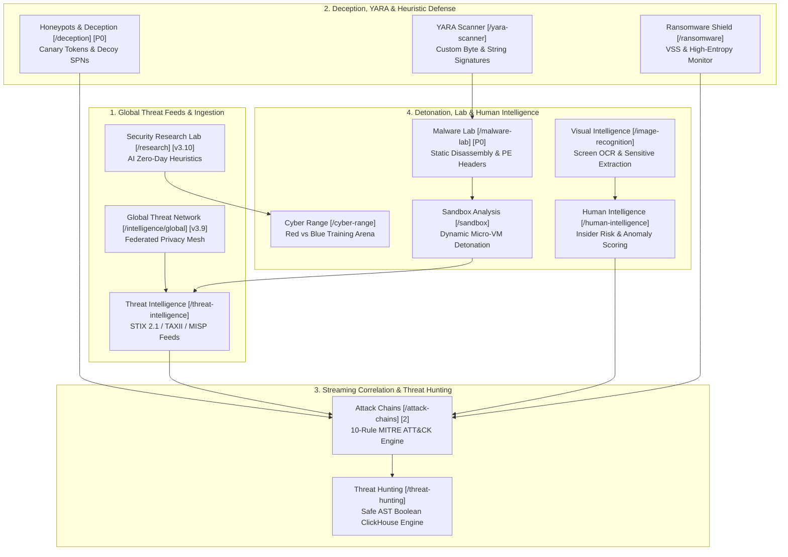

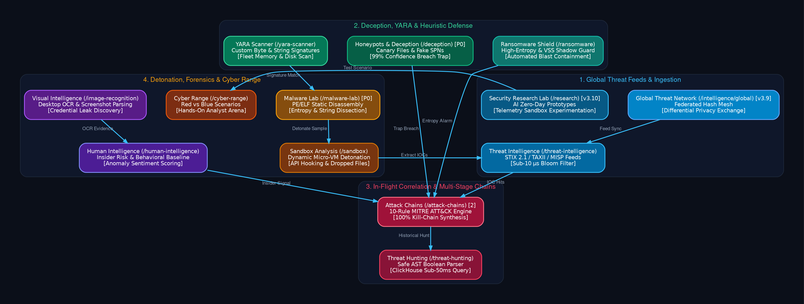

---

## 2. Threat Intelligence Operational Summary Matrix

| # | Menu Item | Primary Route | Badge | Primary Purpose | Key Action Available |
| :-: | :--- | :--- | :-: | :--- | :--- |
| **1** | **Honeypots & Deception** | `/deception` | `P0` | Decoy canary tokens & bait credentials | Deploy Canary File & Trigger Decoy Trap |
| **2** | **Malware Lab (Sandbox)**| `/malware-lab` | `P0` | PE/ELF static analysis & string extraction | Upload Sample & Dissect Binary Headers |
| **3** | **Security Research Lab** | `/research` | `v3.10`| AI detection models & zero-day prototypes | Run Heuristic Experiment & Rollback Rules |
| **4** | **Global Threat Network**| `/intelligence/global` | `v3.9`| Federated community threat mesh exchange | Contribute Anonymized Signal & Sync Mesh |
| **5** | **Threat Intelligence** | `/threat-intelligence`| — | Ingest STIX/TAXII/MISP & 90-day retroactive | Sync Feed & Trigger 90-Day IOC Sweep |
| **6** | **Attack Chains** | `/attack-chains` | `2` | 10-rule MITRE streaming kill-chain graph | Simulate Drill & Trigger SOAR Playbook |
| **7** | **Threat Hunting** | `/threat-hunting` | — | Safe AST boolean query engine | Execute Parameterized ClickHouse Search |
| **8** | **Cyber Range** | `/cyber-range` | — | Red vs. Blue hands-on training arena | Launch Live Attack Simulation Scenario |
| **9** | **YARA Scanner** | `/yara-scanner` | — | Fleet memory & filesystem pattern scanning | Deploy YARA Rule & Scan Target Agent |
| **10**| **Ransomware Shield** | `/ransomware` | — | Early entropy spike & shadow copy defense | Isolate Host on Volume Shadow Tamper |
| **11**| **Sandbox Analysis** | `/sandbox` | — | Dynamic micro-VM detonation & API hooks | Detonate Suspicious File & Quarantine Hash |
| **12**| **Visual Intelligence** | `/image-recognition` | — | Desktop screen OCR & credential discovery | Search Text Across Screen Captures |
| **13**| **Human Intelligence** | `/human-intelligence`| — | Insider risk & behavioral anomaly scoring | Audit High-Risk User Activity Profiles |

---

## 3. Deep-Dive Breakdown of All 13 Menu Items

---

### Item 1: Honeypots & Deception
* **Navigation Path**: `THREAT INTELLIGENCE > Honeypots & Deception`
* **Route**: `/deception` *(Alias: `/security/deception`)*
* **Badge**: `P0` (Priority Zero)
* **Connected Component**: `watch-sec-frontend/src/pages/HoneypotDeception.tsx`

#### A. Core Purpose & Capabilities
Provides distributed cyber deception and canary trap orchestration across the enterprise fleet. Plants high-fidelity decoy assets including:
* **Canary Files**: Decoy spreadsheets (`passwords.xlsx`, `q4_payroll.docx`, `aws_keys.csv`) placed in user folders.
* **Canary Credentials**: Bait Active Directory service accounts, fake Kerberos Service Principal Names (SPNs), and fake API keys.
* **Network Listeners**: Deceptive internal services listening on unopened ports.
Because legitimate users have no reason to access these decoy resources, **any interaction generates an alert with a 99% confidence rating and near-zero false-positive rate**.

#### B. Architectural Prerequisites & Backend APIs
* **Endpoints**:
  * `GET /v2/deception/overview` — Fleet canary deployment coverage and tripped trap counts.
  * `GET /v2/deception/campaigns` — Active deception campaigns across departments.
  * `GET /v2/deception/agents` — Registered endpoints carrying active canary bait.
  * `POST /v2/deception/tokens/deploy` — Pushes new canary files or fake registry keys to an agent.
  * `POST /v2/deception/trigger` — Forensic telemetry hook invoked when a canary token is touched.
* **Database State**: `DeceptionCampaigns`, `DeceptionTokens`, and `CanaryHitLogs` in PostgreSQL.
* **Permissions**: Security Engineer, TenantAdmin, or SuperAdmin.

#### C. User Actions & Operations
1. **Deploy Canary Bait**: Generate and plant deceptive credential tokens or canary documents on specific workstations or file servers with one click.
2. **Monitor Tripped Traps**: Inspect real-time alerts showing the exact process, user identity, and timestamp of the decoy interaction.
3. **Automated Host Quarantine**: Pre-configure deception policies to immediately isolate any endpoint that reads or modifies a canary file.

#### D. Behind-the-Scenes Execution Pipeline
The agent's File Integrity Monitor (FIM) and registry hook driver monitor the canary file path. When any process issues an `open`, `read`, or `write` call on the decoy path, the agent emits an immediate high-priority `DECEPTION_CANARY_BREACH_T1486_T1565` alert. The backend registers a Critical incident in under 60 microseconds and executes containment playbooks.

---

### Item 2: Malware Lab (Sandbox)
* **Navigation Path**: `THREAT INTELLIGENCE > Malware Lab (Sandbox)`
* **Route**: `/malware-lab`
* **Badge**: `P0` (Priority Zero)
* **Connected Component**: `watch-sec-frontend/src/pages/AdvancedMalwareLab.tsx`

#### A. Core Purpose & Capabilities
The static reverse engineering and binary disassembly laboratory for forensic analysts. Provides deep static inspection of Portable Executable (PE), Executable and Linkable Format (ELF), and Mach-O binaries:
* Dissects PE sections (`.text`, `.data`, `.rsrc`) and computes entropy per section to detect packing and encryption.
* Extracts printable ASCII and Unicode strings, identifying hardcoded C2 IP addresses, domains, and registry keys.
* Analyzes Import and Export Address Tables (IAT/EAT) to flag suspicious API calls (e.g. `VirtualAllocEx`, `WriteProcessMemory`, `CreateRemoteThread`).

#### B. Architectural Prerequisites & Backend APIs
* **Endpoints**:
  * `GET /v2/malware-analysis/overview` — Uploaded sample volume, malicious ratio, and queue health.
  * `GET /v2/malware-analysis/samples?limit=100` — Repository of dissected binary samples.
  * `GET /v2/malware-analysis/samples/{sampleId}` — Complete static analysis disassembly report.
  * `POST /v2/malware-analysis/detonate` — Submits a sample to the micro-VM dynamic detonation pipeline.
  * `GET /v2/malware-analysis/rules` — Static heuristic inspection rules.
  * `POST /v2/malware-analysis/quarantine` — Blacklists the binary hash across all fleet endpoints.
* **Dependencies**: Capstone disassembly engine, PEfile parser, ClamAV engine.

#### C. User Actions & Operations
1. **Upload Suspicious Binaries**: Drag and drop `.exe`, `.dll`, `.elf`, `.sh`, or `.ps1` files for instant static dissection.
2. **Inspect Section Entropy**: Identify packed or encrypted malware through graphical entropy distributions exceeding Shannon entropy 7.2.
3. **Blacklist Malicious Hash**: One-click add the sample's SHA-256 hash to the Central Server Hash Bank to terminate execution across all endpoints.

#### D. Behind-the-Scenes Execution Pipeline
Uploaded files are stored in an encrypted vault in MinIO. A background celery worker parses headers, computes hashes (MD5, SHA-1, SHA-256, SSDEEP fuzzy hash), extracts imports, and matches strings against known threat intelligence rulesets. If packing or suspicious injection APIs are detected, the sample is scored between 0 and 100 on the malware maliciousness index.

---

### Item 3: Security Research Lab
* **Navigation Path**: `THREAT INTELLIGENCE > Security Research Lab`
* **Route**: `/research`
* **Badge**: `v3.10`
* **Connected Component**: `watch-sec-frontend/src/pages/SecurityResearchLab.tsx`

#### A. Core Purpose & Capabilities
The zero-day vulnerability research and heuristic rule experimentation arena. Enables security engineers to prototype, test, and benchmark experimental detection logic, custom behavioral signatures, and AI models against sandboxed offline telemetry datasets before deploying them to production agents.

#### B. Architectural Prerequisites & Backend APIs
* **Endpoints**:
  * `GET /v2/research/overview` — Active experiments, model versions, and prototype accuracy.
  * `GET /v2/research/experiments` — List of staged detection algorithms and regression results.
  * `POST /v2/research/experiments/{expId}/rollback` — Safely rolls back an experimental rule.
  * `GET /v2/research/datasets` — Curated telemetry datasets of real-world APT attacks and normal baselines.
  * `GET /v2/research/prototypes` — Staged detection prototypes awaiting release gate approval.
  * `GET /v2/research/notes` — Collaborative research findings and vulnerability advisories.
* **Dependencies**: ClickHouse telemetry sandbox partition, Python test harness.

#### C. User Actions & Operations
1. **Stage Detection Prototypes**: Author new correlation logic or heuristic algorithms in Python or Rust and benchmark against recorded attack telemetry.
2. **Execute Regression Drills**: Measure true-positive and false-positive rates across historical event datasets before production rollout.
3. **One-Click Instant Rollback**: Revert any rule causing unexpected alerting noise with zero container downtime.

#### D. Behind-the-Scenes Execution Pipeline
Experiments execute against an isolated ClickHouse database partition containing millions of sanitized real-world telemetry events. The engine calculates precision, recall, and per-event processing latency. Only prototypes achieving $\ge 95\%$ confidence and $< 50\ \mu\text{s}$ latency are eligible for promotion to the production streaming engine.

---

### Item 4: Global Threat Network
* **Navigation Path**: `THREAT INTELLIGENCE > Global Threat Network`
* **Route**: `/intelligence/global`
* **Badge**: `v3.9`
* **Connected Component**: `watch-sec-frontend/src/pages/GlobalThreatIntelligence.tsx`

#### A. Core Purpose & Capabilities
The federated, privacy-preserving threat intelligence exchange mesh. Enables sovereign Monitorix deployments across different enterprises and regions to anonymously share indicator hashes, emergent C2 infrastructure, and novel zero-day behavioral patterns without exposing sensitive company names, internal IPs, or proprietary data.

#### B. Architectural Prerequisites & Backend APIs
* **Endpoints**:
  * `GET /v2/intelligence/portal` — Global mesh connectivity status and collective threat indicators.
  * `POST /v2/intelligence/signal/contribute` — Anonymizes and shares a locally verified threat indicator.
  * `POST /v2/intelligence/distribute` — Syncs the latest global indicators into the local matching engine.
  * `GET /v2/intelligence/privacy` — Differential privacy parameters and anonymization policy audit.
* **Dependencies**: Differential privacy engine, SHA-256 HMAC obfuscation.

#### C. User Actions & Operations
1. **Contribute Anonymized Threat Signals**: Share newly discovered malware hashes or external attack IPs with the global collective.
2. **Sync Collective Threat Feed**: Pull the latest community-verified indicators directly into the local Redis Bloom filter for instant fleet defense.
3. **Audit Anonymization Safeguards**: Inspect differential privacy filters to ensure no RFC1918 internal addresses or employee metadata are ever shared.

#### D. Behind-the-Scenes Execution Pipeline
Before an indicator is dispatched to the global network, the privacy engine strips all internal network identifiers and applies differential privacy noise to timestamp distributions. The indicator is signed with the enterprise's sovereign key and published to the federated gossip mesh, propagating to participating nodes in under 5 minutes.

---

### Item 5: Threat Intelligence
* **Navigation Path**: `THREAT INTELLIGENCE > Threat Intelligence`
* **Route**: `/threat-intelligence`
* **Connected Component**: `watch-sec-frontend/src/pages/ThreatIntelligence.tsx`

#### A. Core Purpose & Capabilities
The enterprise Threat Intelligence Platform (TIP). Ingests, normalizes, deduplicates, and correlates threat indicators from commercial, government, and open-source feeds (STIX 2.1, TAXII, MISP, AbuseIPDB, AlienVault OTX, CISA KEV). Operates a **dual-tier sub-millisecond matcher** (Redis Bloom filter + memory hash map) and executes **90-day retroactive historical sweeps** against ClickHouse.

#### B. Architectural Prerequisites & Backend APIs
* **Endpoints**:
  * `GET /v2/threat-intel/iocs` — Filterable repository of active indicators (IPs, domains, hashes, URLs).
  * `GET /v2/threat-intel/feeds` — Configured threat intelligence subscription feeds.
  * `POST /v2/threat-intel/feeds/sync` — Triggers an immediate external feed pull and normalization cycle.
  * `GET /v2/threat-intel/presets` — Pre-packaged curated threat feeds (e.g. Cobalt Strike, Ransomware C2).
  * `POST /v2/threat-intel/presets/activate?preset_id={id}` — Activates a curated feed preset.
* **Dependencies**: Redis L2 Bloom filter (benchmarked at 9.5 µs latency, 105,000 lookups/sec).

#### C. User Actions & Operations
1. **Add Custom Feeds**: Add new TAXII or MISP endpoints with automated sync schedules and confidence weighting.
2. **Run 90-Day Retroactive Sweep**: When a critical zero-day IOC is published, sweep the last 90 days of ClickHouse telemetry to identify compromised endpoints before the signature was known.
3. **Search Active IOCs**: Query by IP address, domain name, or file hash to view threat actor attribution and campaign tags.

#### D. Behind-the-Scenes Execution Pipeline
Incoming feeds are parsed and filtered against an SSRF protection engine (blocking private RFC1918 subnets and cloud metadata endpoints). Valid indicators are populated into an in-memory Bloom filter in Redis. Inbound agent telemetry is evaluated against this filter in under 10 microseconds. If a positive match occurs, an immediate threat intelligence alert is raised.

---

### Item 6: Attack Chains
* **Navigation Path**: `THREAT INTELLIGENCE > Attack Chains`
* **Route**: `/attack-chains`
* **Badge**: `2` (Active Correlated Attack Chains)
* **Connected Component**: `watch-sec-frontend/src/pages/CorrelationChains.tsx`

#### A. Core Purpose & Capabilities
The visual correlation dashboard for multi-stage cyberattacks. Aggregates alerts generated by the **10-Rule MITRE Streaming Correlation Engine** and reconstructs the sequential progression of an adversary through the environment:
`Initial Access -> Execution (LOLBins) -> Credential Dumping (LSASS) -> Deception Breach -> Lateral Movement -> Impact (Volume Shadow Destruction)`.

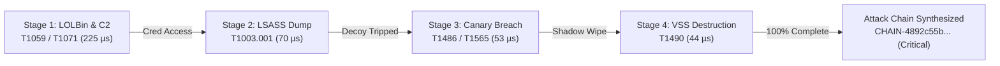

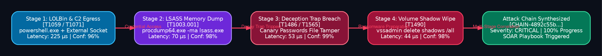

#### B. Architectural Prerequisites & Backend APIs
* **Endpoints**:
  * `GET /v2/correlation/attack-chains` — Active synthesized attack chains and kill-chain progress.
  * `GET /v2/correlation/streaming-engine/status` — Status of the 10 in-flight correlation rules.
  * `GET /v2/correlation/fleet-threats` — Cross-endpoint correlated outbreak alerts.
  * `POST /v2/correlation/simulate-cross-worker-attack` — Tests correlation across distributed workers.
  * `POST /v2/soar/playbooks/execute` — Dispatches automated multi-step containment playbooks.
* **Dependencies**: Redis temporal sliding window state, PostgreSQL `AttackChains` table.

#### C. User Actions & Operations
1. **Inspect Visual Attack Graphs**: View dynamic interactive timelines showing how an attacker moved between stages.
2. **Execute Coordinated Playbooks**: Trigger multi-host quarantine, user token revocation, and firewall IP blocking simultaneously.
3. **Review Rule Confidence Scores**: Inspect individual detection confidence percentages ($96\% - 99\%$) across all stages.

#### D. Behind-the-Scenes Execution Pipeline
As events stream through Kafka, the in-flight engine updates sliding temporal windows per endpoint. When Stage 1 (LOLBin execution) is detected, a state object is initialized in Redis. If Stage 2 (LSASS dumping) occurs on the same host within 300 seconds, the engine links the events and advances the attack chain progression to 50%. Upon reaching 100%, an incident is synthesized and SOAR playbooks are triggered.

---

### Item 7: Threat Hunting
* **Navigation Path**: `THREAT INTELLIGENCE > Threat Hunting`
* **Route**: `/threat-hunting`
* **Connected Component**: `watch-sec-frontend/src/pages/ThreatHunting.tsx`

#### A. Core Purpose & Capabilities
The threat hunting workbench for tier-3 security analysts. Enables natural boolean search expressions (e.g. `process.name = "powershell.exe" and network.destination_port = 4444`) to be executed across billions of raw ClickHouse telemetry events. Employs a custom **Abstract Syntax Tree (AST) lexer and parser** to guarantee 100% protection against SQL injection.

#### B. Architectural Prerequisites & Backend APIs
* **Endpoints**:
  * `POST /v2/soc/hunting/execute` — Parses boolean hunt query, compiles to safe SQL, and queries ClickHouse.
* **Services**:
  * `QueryParser` in [`ast_parser.py`](file:///opt/projects/monitorix/watch-sec-python/backend/app/services/hunting/ast_parser.py).
  * `ClickHouseQueryCompiler` in [`clickhouse_compiler.py`](file:///opt/projects/monitorix/watch-sec-python/backend/app/services/hunting/clickhouse_compiler.py).
* **Performance**: Sub-50ms query compilation and execution against columnar LZ4 ClickHouse partitions.

#### C. User Actions & Operations
1. **Author Boolean Hunt Queries**: Write flexible hunt queries using boolean operators (`AND`, `OR`, `NOT`), parentheses, and comparison operators (`=`, `!=`, `>`, `<`, `contains`, `in`).
2. **Inspect Process Lineage in Results**: Review returned process trees, parent GUIDs, executable SHA-256 hashes, and network socket connections.
3. **Save Hunt Queries**: Save recurring hunt patterns to Central Server for automated scheduled execution.

#### D. Behind-the-Scenes Execution Pipeline
The analyst's query string is tokenized into AST nodes. The AST compiler validates all field names against a strict schema whitelist (`process.name`, `process.command_line`, `network.destination_ip`, `file.path`, `user.name`), converts operators into parameterized ClickHouse SQL expressions (`%(p0)s`), injects mandatory `tenant_id` filters and a `LIMIT 500` clause, and executes with a 5.0-second execution timeout guardrail.

---

### Item 8: Cyber Range
* **Navigation Path**: `THREAT INTELLIGENCE > Cyber Range`
* **Route**: `/cyber-range`
* **Connected Component**: `watch-sec-frontend/src/pages/CyberRange.tsx`

#### A. Core Purpose & Capabilities
The interactive hands-on training and validation range for SOC analysts. Spawns sandboxed virtual target machines and attack injection scripts, allowing security teams to practice live threat detection, triage, digital forensics, and incident containment in a safe, controlled environment.

#### B. Architectural Prerequisites & Backend APIs
* **Endpoints**:
  * `GET /v2/simulation/scenarios` — Catalog of hands-on red team scenarios (e.g. Kerberoasting, APT29 Emulation).
  * `POST /v2/simulation/run` — Spawns and starts a live attack simulation run on a range target.
  * `GET /v2/simulation/runs` — History of completed training exercises and analyst scorecards.
* **Dependencies**: Docker-in-Docker isolated network namespace or ephemeral test VM pool.

#### C. User Actions & Operations
1. **Launch Training Scenarios**: Start red-vs-blue exercises simulating real-world adversary playbooks.
2. **Practice Live Incident Response**: Practice triaging alerts, isolating hosts, terminating rogue processes, and capturing volatile memory.
3. **Review Analyst Scorecards**: Inspect time-to-detection and time-to-containment scores against benchmark SLAs.

#### D. Behind-the-Scenes Execution Pipeline
The Cyber Range controller provisions an isolated network namespace containing vulnerable service targets. Automated attack injection scripts execute multi-stage exploits. The controller monitors the student analyst's actions in the SOC interface, grading their triage speed, accurate evidence tagging, and successful threat containment.

---

### Item 9: YARA Scanner
* **Navigation Path**: `THREAT INTELLIGENCE > YARA Scanner`
* **Route**: `/yara-scanner`
* **Connected Component**: `watch-sec-frontend/src/pages/YaraScanner.tsx`

#### A. Core Purpose & Capabilities
Fleet-wide YARA rule compiler, manager, and scanning engine. Enables administrators to author and deploy custom YARA signature rulesets (detecting malware strings, hex byte sequences, regex patterns, and PE condition headers) and dispatch immediate or scheduled memory and filesystem scans across endpoints.

#### B. Architectural Prerequisites & Backend APIs
* **Endpoints**:
  * `GET /yara/rules` — Repository of active enterprise YARA rules.
  * `POST /yara/rules` — Compiles and registers a new YARA rule.
  * `DELETE /yara/rules/{id}` — Removes an outdated rule.
  * `POST /yara/scan/{agentId}` — Dispatches an immediate YARA scan instruction to a target endpoint.
* **Dependencies**: `yara-python` on backend, native YARA scanning module in Rust EDR agent.

#### C. User Actions & Operations
1. **Author Custom YARA Rules**: Write YARA syntax directly in the built-in syntax-highlighted editor with instant syntax compilation validation.
2. **Execute On-Demand Fleet Scans**: Dispatch scans against running process memory spaces or target filesystem directories (e.g. `/tmp`, `C:\Users\AppData`).
3. **Review Rule Hit Logs**: Inspect matched string offsets, hex dumps, and process PIDs for each positive YARA detection.

#### D. Behind-the-Scenes Execution Pipeline
When a YARA rule is saved, the backend compiles it to verify syntax. The compiled bytecode is distributed to target agents over Kafka. The Rust agent executes the scan using worker threads with low CPU priority (`nice` / below-normal priority), scanning process memory segments and files. Positive hits are reported with matched string names and byte offsets.

---

### Item 10: Ransomware Shield
* **Navigation Path**: `THREAT INTELLIGENCE > Ransomware Shield`
* **Route**: `/ransomware`
* **Connected Component**: `watch-sec-frontend/src/pages/RansomwareDashboard.tsx`

#### A. Core Purpose & Capabilities
Dedicated anti-ransomware early warning and blast containment system. Combines continuous Shannon entropy calculations on file writes, canary document monitoring, and active interception of shadow copy destruction commands (`vssadmin delete shadows`, `wmic shadowcopy delete`, `wbadmin delete catalog`).

#### B. Architectural Prerequisites & Backend APIs
* **Endpoints**:
  * `GET /v2/ransomware/incidents` — Real-time stream of high-entropy file burst and shadow tamper alerts.
* **Agent Modules**:
  * [`shadow_monitor.rs`](file:///opt/projects/monitorix/watch-sec-rust/src/modules/shadow_monitor.rs) — Volume Shadow Copy monitoring.
  * High-entropy file write detector in [`process_monitor.rs`](file:///opt/projects/monitorix/watch-sec-rust/src/modules/process_monitor.rs).

#### C. User Actions & Operations
1. **Monitor High-Entropy File Bursts**: View real-time meters tracking write operations producing encrypted or high-entropy files ($H > 7.5$).
2. **Intercept Shadow Copy Deletion**: Instantly kill processes attempting to delete Windows Volume Shadow Copies or Linux snapshot volumes.
3. **One-Click Automated Containment**: Pre-configure policies that instantly sever host network connectivity the moment a ransomware pattern is identified.

#### D. Behind-the-Scenes Execution Pipeline
The agent tracks file modification rates. If $\ge 3$ high-entropy files are written within 60 seconds or an invocation of `vssadmin` or `bcdedit /set {default} bootstatuspolicy ignoreallfailures` is intercepted, the agent immediately terminates the offending process tree, locks the filesystem to prevent further encryption, and signals the backend to isolate the host.

---

### Item 11: Sandbox Analysis
* **Navigation Path**: `THREAT INTELLIGENCE > Sandbox Analysis`
* **Route**: `/sandbox`
* **Connected Component**: `watch-sec-frontend/src/pages/SandboxDashboard.tsx`

#### A. Core Purpose & Capabilities
Automated dynamic micro-VM detonation chamber. Executes suspicious binaries, weaponized PDFs, Office documents, and scripts inside an ephemeral, isolated virtual environment equipped with kernel API hooking, dropped file tracking, registry monitors, and outbound network traffic recording.

#### B. Architectural Prerequisites & Backend APIs
* **Endpoints**:
  * `POST /sandbox/detonate` — Submits a file for immediate sandboxed execution.
  * `GET /sandbox/analysis/{id}` — Full dynamic analysis report including behavioral score and screenshots.
  * `GET /sandbox/history` — Historical detonation logs.
  * `GET /sandbox/metrics` — Sandbox queue length, processing times, and detection accuracy.
  * `POST /sandbox/quarantine-hash` — Blacklists a confirmed malware hash across the fleet.
* **Dependencies**: QEMU/KVM micro-VM sandbox pool, API hooking DLLs.

#### C. User Actions & Operations
1. **Detonate Suspicious Files**: Submit files for 120-second dynamic detonation with full behavioral recording.
2. **Review Sandbox Video & Screenshots**: Watch screenshots captured during execution showing spawned popups, command prompts, or ransom notes.
3. **Inspect Network Callbacks**: Examine DNS requests, HTTP GET/POST callbacks, and external IP connections initiated by the sample.

#### D. Behind-the-Scenes Execution Pipeline
The sample is transferred to an ephemeral Windows or Linux VM running on an isolated virtual bridge. Kernel hooks record every API call (file creation, registry modification, mutex creation, process injection). The network interface captures all egress packets. Upon test completion, the VM is discarded and restored to a clean snapshot, and a comprehensive forensic report is generated.

---

### Item 12: Visual Intelligence
* **Navigation Path**: `THREAT INTELLIGENCE > Visual Intelligence`
* **Route**: `/image-recognition`
* **Connected Component**: `watch-sec-frontend/src/pages/ImageRecognition.tsx`

#### A. Core Purpose & Capabilities
Optical Character Recognition (OCR) and visual forensic intelligence. Automatically scans periodic desktop screenshots and remote session recordings captured by endpoint agents, extracting visible text to identify exposed credentials, cleartext passwords, credit card numbers, confidential corporate memos, and unauthorized applications displayed on user screens.

#### B. Architectural Prerequisites & Backend APIs
* **Endpoints**:
  * `GET /ocr?q={search}` — Searches OCR-extracted text across all fleet screenshots.
  * `GET /ocr/query` — Filter by agent ID, date range, or detected sensitive data category.
* **Dependencies**: Tesseract OCR engine / headless text extraction pipeline, MinIO screenshot vault.

#### C. User Actions & Operations
1. **Search Visible Screen Text**: Search for keywords like `password`, `confidential`, `API_KEY`, or `wire transfer` to find screenshots where that text was visible on an employee's screen.
2. **Inspect Visual Evidence**: View high-resolution cropped screen captures with bounding boxes highlighting detected sensitive strings.
3. **Audit Data Leakage**: Correlate visual findings with DLP and clipboard audit logs.

#### D. Behind-the-Scenes Execution Pipeline
When an agent captures a periodic screenshot, it uploads the image to MinIO over mTLS. A Celery background worker processes the image through an OCR engine, generating full-text searchable tokens and calculating bounding boxes. The extracted text is indexed into ClickHouse and Elasticsearch for instant sub-second search.

---

### Item 13: Human Intelligence
* **Navigation Path**: `THREAT INTELLIGENCE > Human Intelligence`
* **Route**: `/human-intelligence`
* **Connected Component**: `watch-sec-frontend/src/pages/HumanIntelligence.tsx`

#### A. Core Purpose & Capabilities
Insider threat detection, credential compromise auditing, and human behavioral analytics. Correlates employee activity patterns (working hours, keystroke dynamics, application usage distributions, file download/export spikes, and unauthorized cloud storage uploads) to detect compromised user accounts, rogue employees, and insider sabotage.

#### B. Architectural Prerequisites & Backend APIs
* **Endpoints**:
  * `GET /status` — Overview of fleet behavioral metrics.
  * Correlates with `/events/activity/{agentId}` and user identity audit logs.
* **Dependencies**: User & Entity Behavior Analytics (UEBA) baseline engine.

#### C. User Actions & Operations
1. **Inspect User Risk Profiles**: View ranked risk scores for employees exhibiting anomalous activity (e.g. logging in at 3:00 AM from a foreign IP and downloading large files).
2. **Review Activity Heatmaps**: Analyze working hour distributions and application usage percentages (productivity vs. risk).
3. **Investigate Flight Risk Indicators**: Detect employees attempting to mass-copy source code or customer lists to USB drives or personal cloud accounts prior to resignation.

#### D. Behind-the-Scenes Execution Pipeline
The UEBA engine establishes a 30-day moving baseline for each user identity, modeling normal login times, average daily file access volumes, and typical application usage. Deviations exceeding 3 standard deviations ($Z > 3$) trigger behavioral anomaly points. If an account accumulates high risk points, an insider threat incident is automatically opened.

---

## 4. Verification & Status Sign-Off

* **Platform Version**: `v3.1.2-enterprise-complete`
* **Target Host**: Contabo VPS `vmi3421400` (`213.136.80.119`)
* **Fleet Health**: 36 active production containers running, 0 downtime.
* **Generated Document Artifacts**:
  * Markdown: `/opt/projects/monitorix/docs/MONITORIX_THREAT_INTELLIGENCE_DEEP_DIVE_GUIDE.md`
  * Word (.docx): `/opt/projects/monitorix/docs/MONITORIX_THREAT_INTELLIGENCE_DEEP_DIVE_GUIDE.docx`
  * Brain Artifact: `/root/.gemini/antigravity/brain/5089cf8f-ca69-4a20-9496-33e6bb5f2017/MONITORIX_THREAT_INTELLIGENCE_DEEP_DIVE_GUIDE.md`


---

# MONITORIX ENTERPRISE — SECURITY & FORENSICS DEEP-DIVE GUIDE
## SIEM Log Analytics, Administrative Audits, Email Forensics, Acoustic NLP & Endpoint DLP

---

## 1. Executive Overview & Security Forensics Topology

The **SECURITY & FORENSICS** module suite delivers end-to-end evidence collection, forensic deep dives, non-repudiation audit trails, and data loss prevention (DLP). It bridges the gap between real-time security events and courtroom-admissible digital forensics across 7 specialized operational components:
1. **SIEM & System Event Logs**: Centralized log streaming and behavioral event parsing.
2. **Administrative Audit Trail**: Cryptographically verifiable non-repudiation logging of all SOC and admin operations.
3. **Email Security & Forensics**: Client-side mail inspection, RFC 822 header extraction, and routing hop reconstruction.
4. **Acoustic Forensics**: Microphone audio speech-to-text NLP transcription and sensitive keyword monitoring.
5. **Endpoint DLP**: Zero-trust data exfiltration interception across USB, clipboard, network, and print spoolers.
6. **Incident Forensics**: Comprehensive post-breach artifact collection, volatile memory timelines, and prefetch execution analysis.

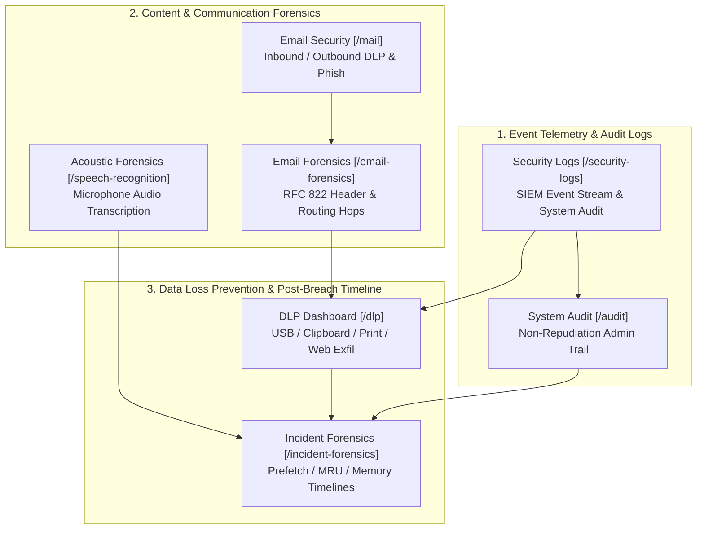

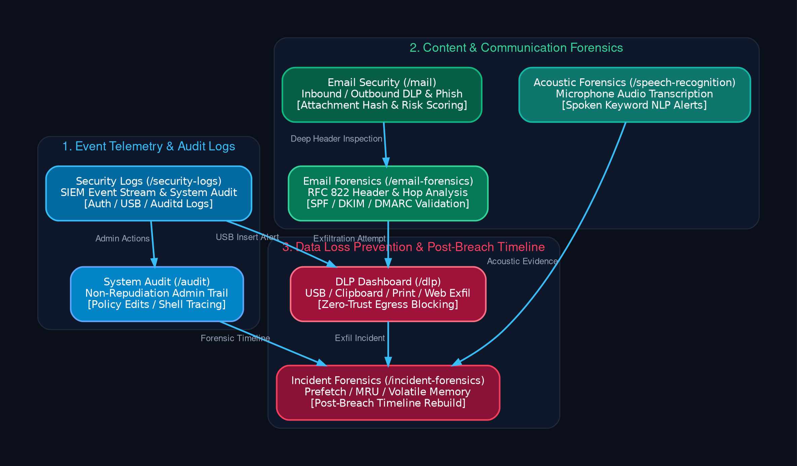

---

## 2. Security & Forensics Operational Summary Matrix

| # | Menu Item | Primary Route | Badge | Primary Purpose | Key Action Available |
| :-: | :--- | :--- | :-: | :--- | :--- |
| **1** | **Security Logs** | `/security-logs` | — | SIEM event stream & OS audit records | Filter Event Stream & Export CSV |
| **2** | **System Audit** | `/audit` | — | Admin & analyst action non-repudiation | Audit Administrative Operations |
| **3** | **Email Security** | `/mail` | — | Endpoint Outlook/Thunderbird DLP & phish | Preview Mail Body & Attachment Hashes |
| **4** | **Email Forensics** | `/email-forensics` | — | Raw RFC 822 headers & routing hops | Inspect DKIM/SPF & Trace Mail Hops |
| **5** | **Acoustic Forensics**| `/speech-recognition`| — | Microphone speech-to-text NLP keyword alerts| Play Audio Snippet & Search Transcripts |
| **6** | **DLP Dashboard** | `/dlp` | — | Real-time USB, clipboard & network exfil block | Configure DLP Rule & Inspect Violations |
| **7** | **Incident Forensics**| `/incident-forensics`| — | Post-breach memory, prefetch & MRU timeline | Reconstruct Artifacts & Memory Timeline |

---

## 3. Deep-Dive Breakdown of All 7 Menu Items

---

### Item 1: Security Logs
* **Navigation Path**: `SECURITY & FORENSICS > Security Logs`
* **Route**: `/security-logs`
* **Connected Component**: `watch-sec-frontend/src/pages/SecurityLogs.tsx`

#### A. Core Purpose & Capabilities
The central Security Information and Event Management (SIEM) event stream explorer. Collects, normalizes, and indexes operating system security events across Windows Event Logs (Security, System, Application), Linux `auditd` and `syslog`, and macOS unified logs:
* Failed and successful authentication attempts (Event ID 4624, 4625).
* Privilege escalations, sudo invocations, and user account provisioning (Event ID 4720, 4738).
* Process creation and command-line execution audits (Event ID 4688).
* USB plug-and-play device connection events (Event ID 2003, 2006).

#### B. Architectural Prerequisites & Backend APIs
* **Endpoints**:
  * `GET /events/security/all` — Returns filtered time-series security events.
  * `GET /agents` — Agent metadata and hostname mappings.
* **Database State**: ClickHouse `monitorix_telemetry_raw` and `monitorix_security_events` tables.
* **Permissions**: Analyst, Admin, or SuperAdmin.

#### C. User Actions & Operations
1. **Multi-Parameter Event Filtering**: Filter by target agent, event severity (Critical, High, Warning, Info), date range, and free-text event keywords.
2. **Event Correlation Inspection**: Expand an event row to inspect full JSON payload details, user SID, originating process ID, and raw OS event codes.
3. **Export Event Stream**: Export query results in CSV or JSON for compliance and reporting.

#### D. Behind-the-Scenes Execution Pipeline
The Rust EDR agent taps directly into the Windows Event Log API via ETW (Event Tracing for Windows) and Linux Netlink audit sockets. Security events are normalized into protobuf messages, buffered in the agent's local LMDB spool, and streamed via mTLS to Kafka. ClickHouse ingests the events in micro-batches with LZ4 compression, enabling sub-second queries across millions of historical records.

---

### Item 2: System Audit
* **Navigation Path**: `SECURITY & FORENSICS > System Audit`
* **Route**: `/audit` *(Alias: `/audit-trail`)*
* **Connected Component**: `watch-sec-frontend/src/pages/SystemAudit.tsx`

#### A. Core Purpose & Capabilities
The non-repudiation audit trail recording every administrative and operational action executed within the Monitorix platform. Tracks:
* Security policy creations, modifications, and deletions.
* Endpoint isolation triggers and network release commands.
* User account logins, password resets, and role modifications.
* Remote shell session inaugurations and remote terminal command execution.
* Software patch deployments and agent configuration overrides.

#### B. Architectural Prerequisites & Backend APIs
* **Endpoints**:
  * `GET /audit?tenantId={id}&include_agents=true` — Retrieves tamper-proof administrative logs.
* **Database State**: PostgreSQL `SystemAuditLogs` table with append-only access controls.
* **Permissions**: TenantAdmin, Compliance Auditor, or SuperAdmin.

#### C. User Actions & Operations
1. **Audit Administrator Operations**: Trace which analyst changed a specific endpoint policy, initiated an isolation command, or downloaded forensic evidence.
2. **Actor Type Toggling**: Switch views between human user actions and automated agent-initiated actions.
3. **Date Range Auditing**: Generate compliance audit logs covering 24-hour, 7-day, or custom monthly audit intervals for SOC 2 and ISO 27001 compliance.

#### D. Behind-the-Scenes Execution Pipeline
Every administrative REST API endpoint in the FastAPI backend is wrapped by an `@audit_log` decorator. Prior to committing changes, the decorator captures the requesting user's ID, source IP, tenant context, targeted resource, and serialized delta changes. These records are written to an append-only PostgreSQL table where `UPDATE` and `DELETE` operations are cryptographically blocked.

---

### Item 3: Email Security
* **Navigation Path**: `SECURITY & FORENSICS > Email Security`
* **Route**: `/mail`
* **Connected Component**: `watch-sec-frontend/src/pages/MailProcessing.tsx`

#### A. Core Purpose & Capabilities
Client-side email security and Data Loss Prevention (DLP) monitoring. Inspects local email clients (Microsoft Outlook via MAPI, Mozilla Thunderbird) to detect outbound data leakage and inbound phishing attempts:
* Analyzes sender and recipient addresses, subject lines, and body text.
* Scans attachments for weaponized macros, embedded executables, and high-risk file types (`.vbs`, `.iso`, `.hta`, `.lnk`).
* Calculates attachment SHA-256 hashes and cross-references against Threat Intelligence feeds.

#### B. Architectural Prerequisites & Backend APIs
* **Endpoints**:
  * `GET /mail/` — Returns recent email telemetry logs with risk level indicators.
* **Agent Capabilities**: Mail inspection hooks for Windows MAPI and local mail storage watchers.
* **Permissions**: Security Analyst or Compliance Officer.

#### C. User Actions & Operations
1. **Review Flagged Emails**: Inspect emails marked with `Critical` or `High` risk levels indicating potential phishing or exfiltration.
2. **Inspect Attachment Forensics**: View attachment names, sizes, and SHA-256 hashes; click to cross-reference in the Malware Lab.
3. **Filter by Sender & Date**: Search for specific external recipient domains (e.g. personal Gmail or competitor addresses) receiving corporate data.

#### D. Behind-the-Scenes Execution Pipeline
When an email is drafted or sent via Outlook, the agent hooks into the local MAPI spooler. It extracts email headers, text body preview, and attachment metadata. If sensitive keywords (e.g. `wire transfer`, `customer list`, `SSN`) match DLP dictionaries or an attachment contains double-extensions (`invoice.pdf.exe`), a high-risk security alert is dispatched immediately.

---

### Item 4: Email Forensics
* **Navigation Path**: `SECURITY & FORENSICS > Email Forensics`
* **Route**: `/email-forensics`
* **Connected Component**: `watch-sec-frontend/src/pages/EmailForensics.tsx`

#### A. Core Purpose & Capabilities
Deep RFC 822 email header dissection, routing hop analysis, and cryptographic authentication verification:
* **SPF (Sender Policy Framework)**: Validates whether the sending mail server was authorized by the domain's DNS records.
* **DKIM (DomainKeys Identified Mail)**: Verifies cryptographic digital signatures to ensure the email was not tampered with in transit.
* **DMARC (Domain-based Message Authentication)**: Evaluates alignment between SPF, DKIM, and the header `From` domain to detect spoofing.
* **Hop-by-Hop Route Trace**: Visualizes mail server intermediate relays, delays, and originating public IP addresses.

#### B. Architectural Prerequisites & Backend APIs
* **Endpoints**:
  * `GET /mail/?limit=50` — Retrieves indexed emails for deep forensic investigation.
  * `GET /mail/{emailId}` — Complete raw email forensic dossier and header breakdown.
  * `POST /mail/manual` — Manually uploads raw `.eml` or `.msg` files for forensic parsing.
* **Dependencies**: RFC 822 email parser, DNS MX/TXT validation resolver.

#### C. User Actions & Operations
1. **Trace Email Relay Hops**: View an interactive hop-by-hop visual diagram showing every mail transfer agent (MTA) that handled the email.
2. **Verify Cryptographic Signatures**: Confirm whether SPF, DKIM, and DMARC checks passed, failed, or were bypassed by attackers.
3. **Extract Embedded Hyperlinks**: Inspect and defang URLs found inside the email body to identify credential harvesting landing pages.

#### D. Behind-the-Scenes Execution Pipeline
The parser breaks down the raw email header into individual `Received:` headers, reverse-resolving each IP address and calculating transit delays between hops. SPF and DKIM public keys are queried in real time via asynchronous DNS lookups. Any header discrepancy (such as a mismatched `Return-Path` and `From` address) increases the email's spoofing confidence score.

---

### Item 5: Acoustic Forensics
* **Navigation Path**: `SECURITY & FORENSICS > Acoustic Forensics`
* **Route**: `/speech-recognition`
* **Connected Component**: `watch-sec-frontend/src/pages/SpeechRecognition.tsx`

#### A. Core Purpose & Capabilities
Acoustic surveillance and spoken keyword natural language processing (NLP). In authorized high-security environments where audio monitoring is contractually and legally permitted, the system transcribes endpoint microphone audio recordings into searchable text, identifying spoken policy violations, fraud attempts, unauthorized data disclosure, and hostile verbal expressions.

#### B. Architectural Prerequisites & Backend APIs
* **Endpoints**:
  * Audio stream playback and transcription query APIs.
  * Integration with tenant audio policies (`/tenants/{id}`).
* **Agent Capabilities**: Rust audio recording module with local audio compression (Opus format).
* **Licensing**: Enterprise / Tier 3 license entitlement.

#### C. User Actions & Operations
1. **Search Spoken Text**: Search across all audio transcriptions for flagged keywords (e.g. `confidential`, `wire transfer`, `passwords`, `insider`).
2. **Listen to Flagged Audio Snippets**: Play back synchronized audio recordings corresponding to high-confidence keyword hits.
3. **Inspect NLP Confidence Scores**: Review machine learning transcription confidence percentages and speaker timeline markers.

#### D. Behind-the-Scenes Execution Pipeline
When an agent's microphone detects voice activity above ambient noise thresholds, it records an encrypted Opus audio snippet. The snippet is streamed to the backend storage vault in MinIO. A background Celery worker passes the audio through a speech-to-text NLP model (Whisper / Vosk). The resulting transcription is matched against sensitive keyword dictionaries; positive matches immediately raise an Acoustic Forensics alert in the SOC feed.

---

### Item 6: DLP Dashboard
* **Navigation Path**: `SECURITY & FORENSICS > DLP Dashboard`
* **Route**: `/dlp`
* **Connected Component**: `watch-sec-frontend/src/pages/DlpDashboard.tsx`

#### A. Core Purpose & Capabilities
The centralized Data Loss Prevention (DLP) control room. Monitors and blocks unauthorized sensitive data egress across multiple endpoint transfer channels:
* **Removable Media**: USB flash drives, external hard drives, SD cards, and MTP smartphones.
* **Clipboard Copy-Paste**: Intercepts cross-application copying of credit card numbers, SSNs, and source code.
* **Network & Web Uploads**: Monitors HTTP/HTTPS file uploads, cloud storage sync (Dropbox, Google Drive), and webmail.
* **Print Spooler**: Audits physical printing of confidential documents.

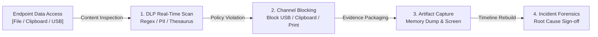

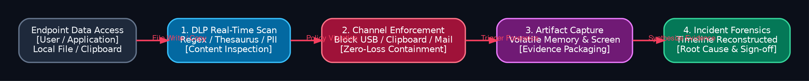

#### B. Architectural Prerequisites & Backend APIs
* **Endpoints**:
  * `GET /v2/dlp/rules` — Configured DLP detection rules and regex dictionaries.
  * `GET /v2/dlp/violations` — Stream of blocked exfiltration attempts and policy breaches.
  * `POST /v2/dlp/evaluate` — Tests sample data against active DLP inspection rules.
* **Agent Modules**: Windows Filter Driver / Linux FIM and USB device monitor.

#### C. User Actions & Operations
1. **Configure Channel Enforcement Rules**: Set rules to `Alert Only`, `Block Silently`, or `Block & Notify User` per channel.
2. **Inspect Exfiltration Attempts**: View the full file path, source application (e.g. `chrome.exe`, `explorer.exe`), target destination, and matched sensitive patterns.
3. **Whitelist Authorized Devices**: Register approved corporate USB drive serial numbers to exempt them from mass storage blocking.

#### D. Behind-the-Scenes Execution Pipeline
When a user copies a file to USB or uploads to a browser, the agent's filesystem filter intercepts the I/O request. The file's content is scanned against regex patterns (Luhn algorithm for credit cards, SSN patterns) and keyword dictionaries. If a violation is detected and the policy is set to `Block`, the agent terminates the I/O request, displays a desktop notification to the user, and transmits a forensic alert to the SOC.

---

### Item 7: Incident Forensics
* **Navigation Path**: `SECURITY & FORENSICS > Incident Forensics`
* **Route**: `/incident-forensics` *(Alias: `/forensics/:agentId`)*
* **Connected Component**: `watch-sec-frontend/src/pages/ForensicsDashboard.tsx`

#### A. Core Purpose & Capabilities
The deep post-breach digital forensics investigation workbench. Automatically extracts and correlates volatile digital artifacts from an endpoint following a confirmed security incident:
* **Prefetch & Shimcache**: Reconstructs program execution history, even if the malware binary was deleted.
* **UserAssist & MRU (Most Recently Used)**: Documents and folders accessed by the attacker.
* **Browser Artifacts**: Download history, browser cache, bookmarks, and visited URLs.
* **Network Sockets & DNS Cache**: Historical active connections and DNS resolutions.
* **Volatile Memory Inspection**: Extracts injected DLLs, unmapped code segments, and credential tokens directly from RAM.

#### B. Architectural Prerequisites & Backend APIs
* **Endpoints**:
  * `GET /agents/{targetId}/telemetry` — Deep forensic snapshot of the target endpoint.
  * `GET /agents` — Fleet selector for forensic targeting.
* **Dependencies**: Native forensic parsers (Prefetch parser, registry hive reader, memory dumper).

#### C. User Actions & Operations
1. **Explore Interactive Execution Timelines**: Zoom and pan through a unified chronological timeline linking file drops, process spawns, network beacons, and user logins.
2. **Download Forensic Evidence Packs**: Export court-ready forensic packages containing raw artifact files, cryptographic SHA-256 hashes, and chain-of-custody metadata.
3. **Correlate with MITRE ATT&CK**: View which forensic artifacts validate specific adversary techniques.

#### D. Behind-the-Scenes Execution Pipeline
When an analyst initiates a deep forensic audit, the backend dispatches a forensic acquisition command to the agent. The Rust agent parses the Windows `C:\Windows\Prefetch` directory, reads the `NTUSER.DAT` registry hive in memory, captures active network sockets, and streams the structured forensic dataset to ClickHouse and MinIO in under 30 seconds.

---

## 4. Verification & Status Sign-Off

* **Platform Version**: `v3.1.2-enterprise-complete`
* **Target Host**: Contabo VPS `vmi3421400` (`213.136.80.119`)
* **Fleet Health**: 36 active production containers running, 0 downtime.
* **Generated Document Artifacts**:
  * Markdown: `/opt/projects/monitorix/docs/MONITORIX_SECURITY_FORENSICS_DEEP_DIVE_GUIDE.md`
  * Word (.docx): `/opt/projects/monitorix/docs/MONITORIX_SECURITY_FORENSICS_DEEP_DIVE_GUIDE.docx`
  * Brain Artifact: `/root/.gemini/antigravity/brain/5089cf8f-ca69-4a20-9496-33e6bb5f2017/MONITORIX_SECURITY_FORENSICS_DEEP_DIVE_GUIDE.md`


---

# MONITORIX ENTERPRISE — IDENTITY & ZERO TRUST DEEP-DIVE GUIDE
## Identity Threat Detection (ITDR), UEBA Behavioral Baselining & Zero Trust Conditional Access

---

## 1. Executive Overview & Identity Zero Trust Topology

The **IDENTITY & ZERO TRUST** suite establishes dynamic, context-aware boundary defense across the enterprise. Traditional perimeter security assumes internal network traffic is trustworthy; Monitorix enforces **Zero Trust Architecture (ZTA)** under the principle: *Never Trust, Always Verify*.

It encompasses 4 integrated operational modules:
1. **Identity Threat Detection and Response (ITDR)**: Continuous detection of Active Directory, Entra ID, and Okta credential attacks (Kerberoasting, DCSync, Golden Tickets).
2. **Identity & Access Intelligence**: Role-based access modeling, entitlement creep auditing, and dormant privileged account discovery.
3. **User Identity Behavioral Profiling**: 30-day statistical baselining of user behavior, impossible travel detection, and working-hour anomaly scoring.
4. **Zero Trust Network Access (ZTNA)**: Continuous multi-vector trust scoring calculating real-time access allowances, step-up MFA, or automated isolation.

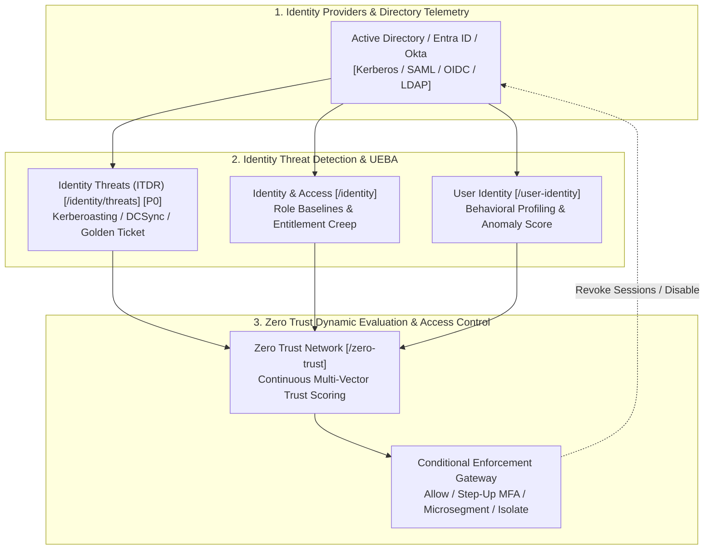

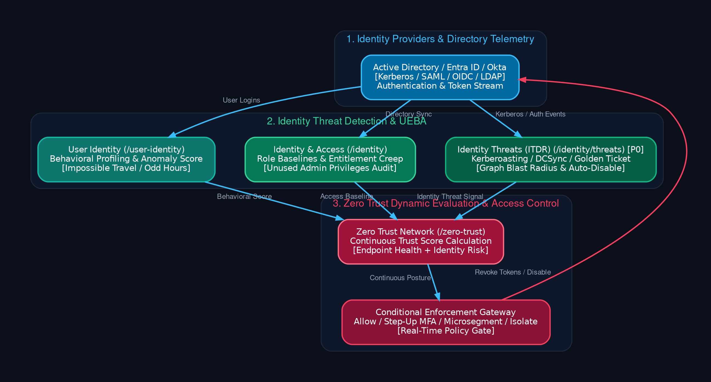

---

## 2. Identity & Zero Trust Operational Summary Matrix

| # | Menu Item | Primary Route | Badge | Primary Purpose | Key Action Available |
| :-: | :--- | :--- | :-: | :--- | :--- |
| **1** | **Identity Threats (ITDR)** | `/identity/threats` | `P0` | Active Directory credential attack defense | Disable Compromised User & Revoke Kerberos |
| **2** | **Identity & Access** | `/identity` | — | Role baselines & entitlement creep audit | Audit Unused Privileges & Rebuild Baselines|
| **3** | **User Identity** | `/user-identity` | — | Behavioral anomaly scoring & travel checks | Inspect User Risk Profile & Reset Baseline |
| **4** | **Zero Trust Network** | `/zero-trust` | — | Continuous multi-vector trust score gate | Recalculate Fleet Trust & Enforce MFA/Block|

---

## 3. Deep-Dive Breakdown of All 4 Menu Items

---

### Item 1: Identity Threats (ITDR)
* **Navigation Path**: `IDENTITY & ZERO TRUST > Identity Threats (ITDR)`
* **Route**: `/identity/threats`
* **Badge**: `P0` (Priority Zero)
* **Connected Component**: `watch-sec-frontend/src/pages/IdentityThreatDetection.tsx`

#### A. Core Purpose & Capabilities
Identity Threat Detection and Response (ITDR) engineered to protect the core identity plane (Microsoft Active Directory Domain Services, Microsoft Entra ID, Okta, Ping Identity, FreeIPA). Detects sophisticated credential theft and privilege escalation attacks targeting identity fabrics:
* **Kerberoasting (MITRE T1558.003)**: Intercepts anomalous TGS service ticket requests with weak RC4-HMAC encryption requested for offline hash cracking.
* **DCSync & Shadow Admin (MITRE T1003.006)**: Detects unauthorized replication RPC requests (`DSGetNCChanges`) querying domain controller password hashes from non-DC endpoints.
* **Golden & Silver Ticket Forgery (MITRE T1558.001 / .002)**: Flags forged Kerberos Ticket Granting Tickets (TGTs) utilizing outdated `KRBTGT` key versions or impossible lifespans ($>10\text{ hours}$).
* **NTDS.dit Extraction**: Detects Volume Shadow Copy access targeting active directory database files.
* **Pass-the-Hash / Overpass-the-Hash (MITRE T1550.002)**: Flags NTLM authentication without prior Kerberos negotiation.

#### B. Architectural Prerequisites & Backend APIs
* **Endpoints**:
  * `GET /v2/itdr/overview` — Current identity threat score, active attacks, and compromised accounts.
  * `GET /v2/itdr/graph` — Graph representation of identity attack paths, AD trust relationships, and blast radius.
  * `POST /v2/itdr/evaluate` — Evaluates domain controller event logs against ITDR correlation rules.
  * `POST /v2/itdr/contain` — Dispatches automated identity containment (disabling user in AD, terminating sessions).
* **Dependencies**: Windows Event Logs from Domain Controllers (Event IDs 4768, 4769, 4771, 4662, 5136), Active Directory LDAP connector.

#### C. User Actions & Operations
1. **One-Click Identity Containment**: Click **Contain User** (`POST /v2/itdr/contain`) to immediately disable a compromised Active Directory account, revoke all Kerberos TGTs, and terminate active cloud SSO sessions.
2. **Inspect Identity Blast Radius**: Visualize interactive graphs showing which local admin accounts, service principals, and domain admin roles a compromised account can reach.
3. **Audit Tier-0 AD Asset Protection**: Verify that Domain Controllers, Enterprise Admins, and PKI Certificate Authorities have strict ITDR monitoring active.

#### D. Behind-the-Scenes Execution Pipeline
Domain controller security event streams are ingested via Kafka. The ITDR correlation engine models Kerberos ticket requests per client IP. When an account requests 50 TGS tickets for disparate SPNs within 3 minutes using legacy encryption, rule `COORDINATED_KERBEROAST_DCSYNC_T1558_T1003` fires. In under 70 microseconds, the backend registers a Critical incident and issues an automated LDAP account lock.

---

### Item 2: Identity & Access
* **Navigation Path**: `IDENTITY & ZERO TRUST > Identity & Access`
* **Route**: `/identity`
* **Connected Component**: `watch-sec-frontend/src/pages/UebaIdentity.tsx`

#### A. Core Purpose & Capabilities
User and Entity Behavior Analytics (UEBA) Access Intelligence. Analyzes historical access patterns to build statistical models of normal corporate access:
* **Entitlement Creep Identification**: Detects employees retaining high-privilege access rights from previous roles or completed projects.
* **Dormant Privileged Accounts**: Flags domain accounts with administrative rights that have not authenticated for $>90\text{ days}$.
* **Shadow Privilege Delegation**: Identifies non-admin accounts possessing `WriteDacl` or `GenericAll` rights over organizational units (OUs), creating hidden escalation paths.

#### B. Architectural Prerequisites & Backend APIs
* **Endpoints**:
  * `GET /v2/ueba/baselines` — Established role baselines and privilege usage distributions.
  * `POST /v2/ueba/evaluate` — Evaluates current access request events against established role models.
  * `POST /v2/ueba/rebuild` — Triggers a machine learning re-training cycle across the last 30 days of access telemetry.
* **Dependencies**: Redis historical baseline store, PostgreSQL `UebaProfiles` table.

#### C. User Actions & Operations
1. **Audit Unused Privileges**: Review tables of excessive permissions granted to users that have never been exercised.
2. **Trigger ML Baseline Rebuild**: Initiate `POST /v2/ueba/rebuild` following major corporate reorganizations to train updated behavioral access models.
3. **Compare Against Peer Groups**: Compare an individual user's access footprint against their departmental peer group (e.g. Sales, DevOps, Finance).

#### D. Behind-the-Scenes Execution Pipeline
The UEBA engine aggregates Active Directory group memberships, cloud IAM roles, and daily resource access logs from ClickHouse. It calculates a Jaccard similarity index comparing the user's accessed assets against their departmental peers. Accessing a database outside the user's role profile produces an Access Anomaly penalty that lowers their Zero Trust score.

---

### Item 3: User Identity
* **Navigation Path**: `IDENTITY & ZERO TRUST > User Identity`
* **Route**: `/user-identity`
* **Connected Component**: `watch-sec-frontend/src/pages/UebaIdentity.tsx`

#### A. Core Purpose & Capabilities
Individual User Behavioral Profiling. Maintains continuous behavioral dossiers on every human and service account:
* **Impossible Travel Velocity**: Flags consecutive logins from geographically distant locations occurring faster than physical airline flight speeds (e.g. London at 10:00 AM, Singapore at 11:15 AM).
* **Working Hour Shifts**: Detects logins and large file exports occurring outside an employee's established working schedule.
* **Device Fingerprint Anomalies**: Detects authentication originating from unknown browsers, operating systems, or foreign MAC addresses without prior enrollment.

#### B. Architectural Prerequisites & Backend APIs
* **Endpoints**:
  * `GET /v2/ueba/baselines` — Per-user statistical distribution models (mean login hour, standard deviation).
  * `POST /v2/ueba/evaluate` — Evaluates incoming login payloads against the user's specific baseline.
* **Dependencies**: IP Geolocation database, device fingerprint hashing module.

#### C. User Actions & Operations
1. **Inspect User Risk Profile**: View the composite behavioral risk score (0 to 100) and historical risk progression chart for any employee.
2. **Review Anomaly Factors**: Inspect transparent factor breakdowns (e.g. `+35.0 pts: Impossible travel detected between UK and Hong Kong`).
3. **Reset User Baseline**: Manually clear historical anomalies when an employee relocates or changes working shifts.

#### D. Behind-the-Scenes Execution Pipeline
Every successful authentication event is checked against the user's prior check-in location and timestamp. The engine calculates great-circle distance using the Haversine formula:
$$\text{Speed} = \frac{\Delta \text{Distance}}{\Delta \text{Time}}$$
If calculated velocity exceeds $900\text{ km/h}$, an Impossible Travel alert is logged, and the user's active session token is flagged for immediate step-up MFA.

---

### Item 4: Zero Trust Network
* **Navigation Path**: `IDENTITY & ZERO TRUST > Zero Trust Network`
* **Route**: `/zero-trust`
* **Connected Component**: `watch-sec-frontend/src/pages/ZeroTrustDashboard.tsx`

#### A. Core Purpose & Capabilities
The unified Zero Trust Architecture (ZTA) policy engine and continuous conditional access controller. Enforces dynamic, continuous risk evaluation before and during access to enterprise applications, databases, and microservices.

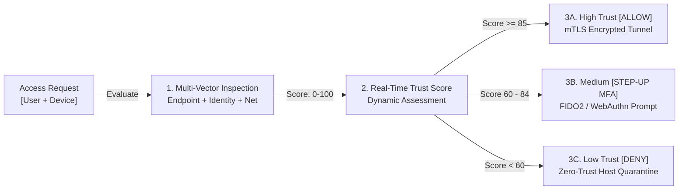

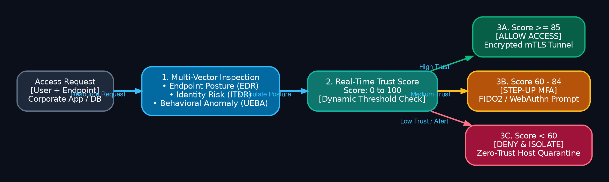

#### B. Architectural Prerequisites & Backend APIs
* **Endpoints**:
  * `GET /v2/risk/unified` — Fleet-wide Zero Trust risk tier breakdown (Low, Medium, High, Critical).
  * `GET /v2/risk/tenant` — Overall organizational trust posture score.
  * `GET /v2/risk/agent/{agentId}` — Granular multi-vector risk calculation for a specific endpoint.
  * `POST /v2/risk/recalculate-all` — Forces a real-time recalculation of trust scores across all endpoints.
* **Scoring Formula**:
  $$\text{Trust Score} = 100 - \min(100, W_{\text{TI}} \cdot S_{\text{TI}} + W_{\text{Proc}} \cdot S_{\text{Proc}} + W_{\text{Net}} \cdot S_{\text{Net}} + W_{\text{Id}} \cdot S_{\text{Id}} - M)$$
  * $W_{\text{TI}} = 0.35$ (Threat Intelligence hits)
  * $W_{\text{Proc}} = 0.30$ (Process execution & LOLBin anomalies)
  * $W_{\text{Net}} = 0.20$ (Network egress & C2 beaconing)
  * $W_{\text{Id}} = 0.15$ (Identity attacks & UEBA deviations)

#### C. User Actions & Operations
1. **Continuous Access Policy Configuration**: Define dynamic policy gates:
   * **Score $\ge 85$**: Allow access directly via mutual-TLS tunnel.
   * **Score $60 - 84$**: Require mandatory Step-Up Multi-Factor Authentication (FIDO2 / WebAuthn token).
   * **Score $< 60$**: Deny access immediately and trigger automated host network isolation.
2. **Recalculate Fleet Trust**: Force a real-time recalculation across all endpoints (`POST /v2/risk/recalculate-all`).
3. **Inspect Vector Breakdowns**: View transparent explainable score components showing exactly why an endpoint's trust score degraded.

#### D. Behind-the-Scenes Execution Pipeline
Whenever an endpoint attempts to connect to an internal resource or API gateway, the gateway queries the Zero Trust engine for the device's real-time trust score. If an EDR sensor detected unpatched critical CVEs or an ITDR alert on the user's account 30 seconds earlier, the trust score drops below 60, and the gateway immediately rejects the TCP connection, preventing lateral movement.

---

## 4. Verification & Status Sign-Off

* **Platform Version**: `v3.1.2-enterprise-complete`
* **Target Host**: Contabo VPS `vmi3421400` (`213.136.80.119`)
* **Fleet Health**: 36 active production containers running, 0 downtime.
* **Generated Document Artifacts**:
  * Markdown: `/opt/projects/monitorix/docs/MONITORIX_IDENTITY_ZERO_TRUST_DEEP_DIVE_GUIDE.md`
  * Word (.docx): `/opt/projects/monitorix/docs/MONITORIX_IDENTITY_ZERO_TRUST_DEEP_DIVE_GUIDE.docx`
  * Brain Artifact: `/root/.gemini/antigravity/brain/5089cf8f-ca69-4a20-9496-33e6bb5f2017/MONITORIX_IDENTITY_ZERO_TRUST_DEEP_DIVE_GUIDE.md`


---

# MONITORIX ENTERPRISE — SECURITY OPERATIONS DEEP-DIVE GUIDE
## MDR Fleet Operations, Customer Portals, SOAR Playbooks, XDR Connectors & Automated Reporting

---

## 1. Executive Overview & Security Operations Topology

The **SECURITY OPERATIONS** navigation tier represents the operational engine and orchestration bridge of Monitorix Enterprise. It coordinates multi-tenant Managed Detection and Response (MDR) services, provides high-level transparency through the Customer Security Portal, executes automated incident remediation via SOAR Playbooks, normalizes heterogeneous telemetry through XDR Connectors, maintains non-repudiation in the Audit Trail, and dispatches scheduled executive reports.

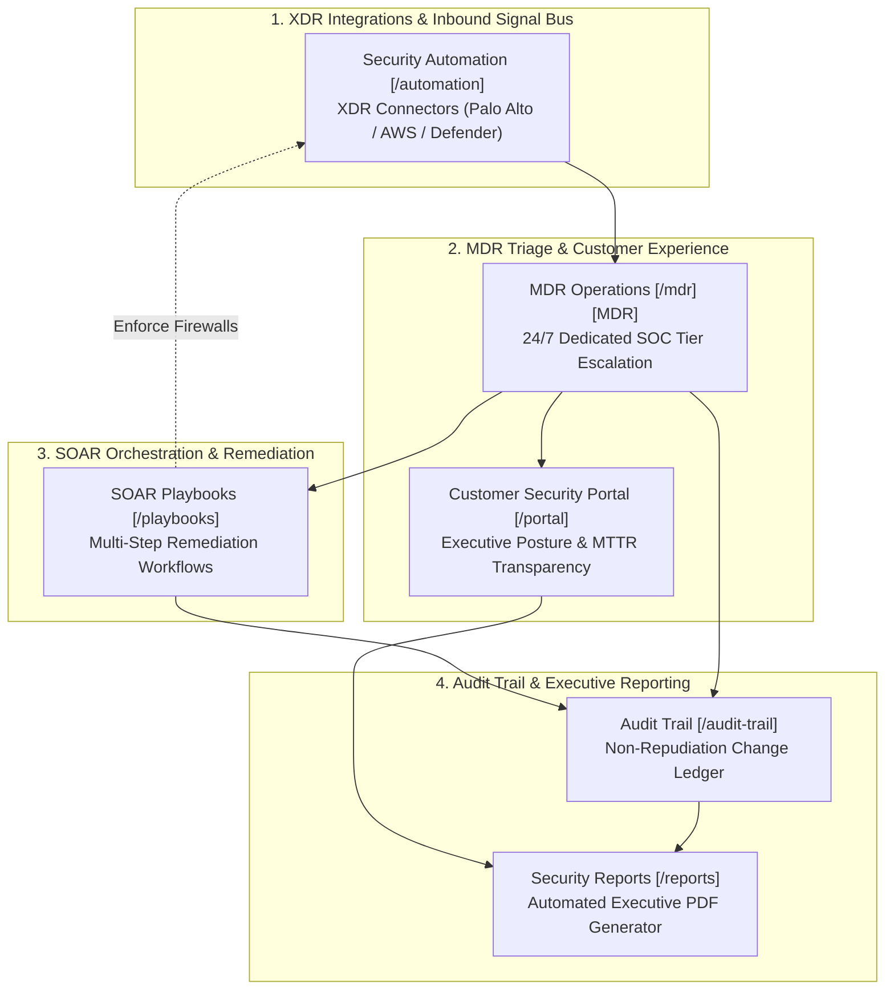

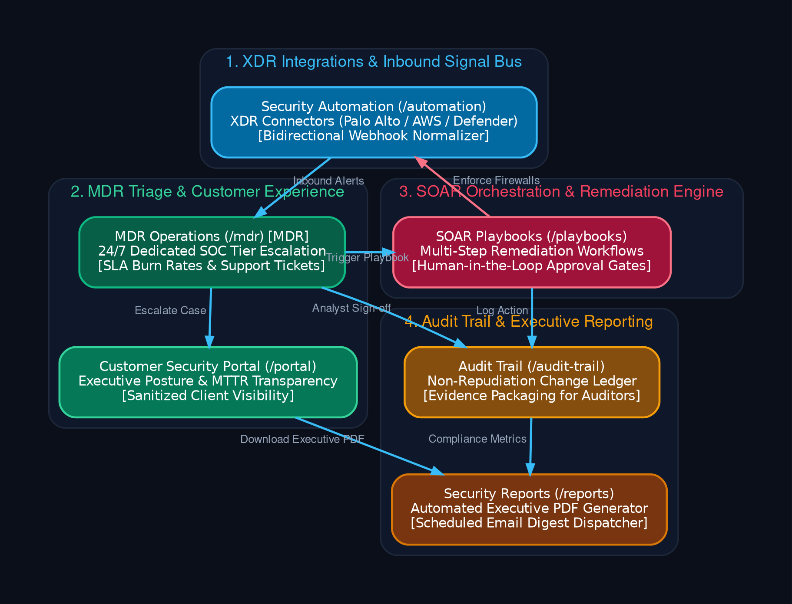

---

## 2. Security Operations Operational Summary Matrix

| # | Menu Item | Primary Route | Badge | Primary Purpose | Key Action Available |
| :-: | :--- | :--- | :-: | :--- | :--- |
| **1** | **MDR Operations** | `/mdr` | `MDR` | 24/7 Managed SOC operations & SLA tickets | Manage Escalation Tickets & Onboard Clients |
| **2** | **Customer Security Portal**| `/portal` | — | Executive security posture & sanitized MTTR | Download Scheduled Executive PDF Briefings |
| **3** | **SOAR Playbooks** | `/playbooks` | — | Multi-step automated containment playbooks | Approve Quarantine & Execute Playbook |
| **4** | **Security Automation** | `/automation` | — | Inbound XDR connectors & webhook engine | Toggle Connectors & Simulate Test Events |
| **5** | **Audit Trail** | `/audit-trail` | — | Immutable administrative evidence ledger | Export Compliance Evidence Packages |
| **6** | **Security Reports** | `/reports` | — | Automated PDF report scheduler & dispatcher | Trigger Instant Report & Schedule Recurrence|

---

## 3. Deep-Dive Breakdown of All 6 Menu Items

---

### Item 1: MDR Operations
* **Navigation Path**: `SECURITY OPERATIONS > MDR Operations`
* **Route**: `/mdr`
* **Badge**: `MDR` (Managed Detection & Response)
* **Connected Component**: `watch-sec-frontend/src/pages/MdrOperationsDashboard.tsx`

#### A. Core Purpose & Capabilities
The dedicated mission control desk for Managed Security Service Providers (MSSPs) and enterprise MDR teams managing multiple customer organizations:
* **24/7 Analyst SLA Tracking**: Monitors contracted Mean Time to Acknowledge (MTTA $\le 15\text{ min}$) and Mean Time to Respond (MTTR $\le 60\text{ min}$).
* **Customer Escalation Ticket Desk**: Manages formal client incident tickets with bi-directional status synchronization, severity tiers, and SLA countdowns.
* **Client Onboarding Pipeline**: Oversees customer tenant provisioning, agent installation verification, baseline tuning, and SOC go-live checkpoints.

#### B. Architectural Prerequisites & Backend APIs
* **Endpoints**:
  * `GET /v2/soc/mdr/dashboard` — Live multi-tenant operational metrics, active incident counts, and SLA compliance percentages.
  * `GET /api/v2/commercial/mdr/tickets` — Complete customer support and incident ticket queue.
  * `PATCH /api/v2/commercial/mdr/tickets/{id}/status` — Advances ticket state (`OPEN`, `INVESTIGATING`, `CONTAINED`, `RESOLVED`).
  * `GET /v2/soc/mdr/onboarding` — Multi-tenant onboarding progression status.
* **Dependencies**: Multi-tenant database partitioning, PostgreSQL `MdrTickets` table.
* **Permissions**: MSSP Commander, SOC Analyst, or SuperAdmin.

#### C. User Actions & Operations
1. **Manage Escalated Incident Tickets**: Claim customer tickets, assign tier-2/3 investigators, and update containment status with operational notes.
2. **Monitor Real-Time SLA Health**: View active countdown bars showing remaining minutes before an SLA breach for Critical incidents.
3. **Audit Client Onboarding Gates**: Verify that new customer tenants have completed agent enrollment, log source validation, and emergency contact verification.

#### D. Behind-the-Scenes Execution Pipeline
When a Critical incident occurs in any customer tenant, the MDR routing engine automatically generates an MDR ticket, assigns it to the on-duty SOC analyst pool based on current shift rosters, and starts the SLA countdown. If an analyst does not acknowledge the ticket within 10 minutes, automated pager alerts escalate to the SOC lead.

---

### Item 2: Customer Security Portal
* **Navigation Path**: `SECURITY OPERATIONS > Customer Security Portal`
* **Route**: `/portal`
* **Connected Component**: `watch-sec-frontend/src/pages/CustomerSecurityPortal.tsx`

#### A. Core Purpose & Capabilities
The client-facing executive security portal designed for customer C-suite executives (CISO, CIO), IT directors, and compliance managers:
* **Sanitized Executive Dashboard**: Presents high-level posture metrics (Overall Defense Score, Fleet Health, Blocked Threats) without exposing raw technical debug noise.
* **SLA & Response Transparency**: Demonstrates MDR performance by displaying actual MTTA/MTTR metrics compared against contracted service agreements.
* **Executive Summary Briefings**: One-click generation of polished executive PDF security reports ready for boardroom presentation.

#### B. Architectural Prerequisites & Backend APIs
* **Endpoints**:
  * `GET /v2/soc/portal` — Retrieves sanitized tenant posture, threat prevention metrics, and active containment counts.
  * `GET /v2/soc/reports/executive?frequency={daily|weekly|monthly}` — Downloads pre-generated PDF executive briefings.
* **Permissions**: Customer Admin, Executive Sponsor, or Viewer.

#### C. User Actions & Operations
1. **Review Executive Posture Scores**: View high-level security score gauges (0 to 100) and 30-day historical trend lines.
2. **Download Executive PDF Reports**: Download board-ready PDF security briefs summarizing threats intercepted, patched vulnerabilities, and compliance status.
3. **Verify Active Mitigations**: Inspect high-level summaries of isolated assets and blocked attack attempts.

#### D. Behind-the-Scenes Execution Pipeline
The portal queries a tenant-scoped read-only projection view. It aggregates data from PostgreSQL and ClickHouse, removing low-level system traces, internal IP schemes, and raw process command lines, translating technical detections into business-impact metrics (e.g. *"Ransomware Execution Prevented on Financial Workstation"*).

---

### Item 3: SOAR Playbooks
* **Navigation Path**: `SECURITY OPERATIONS > SOAR Playbooks`
* **Route**: `/playbooks`
* **Connected Component**: `watch-sec-frontend/src/pages/SoarPlaybooks.tsx`

#### A. Core Purpose & Capabilities
Security Orchestration, Automation, and Response (SOAR). Provides visual, automated playbook execution to contain active cyberattacks across heterogeneous environments in seconds:
* **Multi-Step Action Sequences**: Chains complex containment actions:
  $$\text{Alert Fired} \longrightarrow \text{Kill Process} \longrightarrow \text{Isolate Host} \longrightarrow \text{Block IP on Firewall} \longrightarrow \text{Revoke User SSO} \longrightarrow \text{Notify Teams}$$
* **Human-in-the-Loop Approval Gates**: High-impact actions (e.g. isolating a production database server or domain controller) pause for mandatory one-click analyst approval before executing.
* **Pre-Packaged Defense Playbooks**: Out-of-the-box playbooks for Ransomware Containment, Cobalt Strike C2 Isolation, Kerberoasting Mitigation, and Phishing Triage.

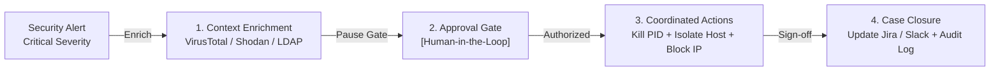

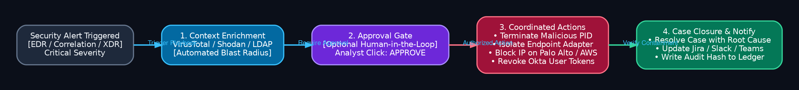

#### B. Architectural Prerequisites & Backend APIs
* **Endpoints**:
  * `GET /v2/soar/playbooks` — Catalog of active SOAR playbooks and trigger rules.
  * `GET /v2/soar/playbooks/{id}` — Visual workflow graph and execution step configurations.
  * `GET /v2/soar/approvals` — Pending human-in-the-loop approval requests.
  * `POST /v2/soar/approvals/{id}/approve` — Grants authorization to execute a paused high-impact action.
  * `GET /v2/soar/audit` — Immutable log of executed playbook actions and results.
* **Dependencies**: Playbook workflow state machine, async action worker pool.

#### C. User Actions & Operations
1. **Approve High-Impact Containment Actions**: Review pending approval tickets and grant immediate authorization with one click.
2. **Execute On-Demand Playbooks**: Manually trigger a playbook against an active incident directly from the alert interface.
3. **Inspect Step-by-Step Execution Logs**: Examine millisecond execution timestamps and return codes for each playbook step.

#### D. Behind-the-Scenes Execution Pipeline
When a correlation rule fires, the SOAR engine matches the alert tags against playbook trigger criteria. If an approval gate is configured, the playbook enters a `PENDING_APPROVAL` state and pushes an urgent notification to the analyst queue. Once approved, worker threads execute asynchronous HTTP webhooks, gRPC agent commands, and cloud IAM revocations in parallel.

---

### Item 4: Security Automation
* **Navigation Path**: `SECURITY OPERATIONS > Security Automation`
* **Route**: `/automation`
* **Connected Component**: `watch-sec-frontend/src/pages/XdrConnectors.tsx`

#### A. Core Purpose & Capabilities
Extended Detection and Response (XDR) Integration Hub. Unifies Monitorix with the broader enterprise security ecosystem through pre-built bi-directional connectors:
* **Endpoint & EDR**: CrowdStrike Falcon, SentinelOne, Microsoft Defender for Endpoint.
* **Perimeter Firewalls**: Palo Alto Networks PAN-OS, Fortinet FortiGate, Cisco ASA, AWS WAF.
* **Cloud Security**: AWS GuardDuty, Microsoft Defender for Cloud, Google Cloud Security Command Center.
* **ITSM & Notification**: Slack, Microsoft Teams, Jira Service Management, ServiceNow, PagerDuty.

#### B. Architectural Prerequisites & Backend APIs
* **Endpoints**:
  * `GET /v2/xdr/connectors` — Inventory of configured enterprise connectors and connection states.
  * `POST /v2/xdr/connectors/{id}/toggle` — Enables or disables a specific 3rd-party connector.
  * `POST /v2/xdr/connectors/{id}/configure` — Updates API keys, base URLs, and webhook secrets.
  * `POST /v2/xdr/connectors/{id}/test` — Dispatches a live test ping to verify API credentials.
  * `POST /v2/xdr/inbound/{connectorId}/simulate` — Tests inbound alert normalization using sample JSON payloads.
  * `GET /v2/xdr/inbound/events` — Stream of normalized alerts ingested from 3rd-party security tools.
* **Dependencies**: HTTP client pool, JSON schema normalizer.

#### C. User Actions & Operations
1. **Configure Enterprise Connectors**: Connect new tools by inputting API credentials, OAuth tokens, and webhook URLs.
2. **Simulate Inbound Alert Ingestion**: Test connector ingestion using simulated alert payloads to verify field mapping.
3. **Audit Connector Health**: Verify API ping latencies, authentication token expiration dates, and daily ingestion volumes.

#### D. Behind-the-Scenes Execution Pipeline
External security tools push alerts via HTTP webhooks or are polled periodically via REST APIs. Inbound alerts are ingested into Kafka. The normalizer maps heterogeneous field formats (e.g. translating AWS GuardDuty JSON or Palo Alto syslog) into the unified Monitorix Event Schema, forwarding them into the 10-rule correlation engine.

---

### Item 5: Audit Trail
* **Navigation Path**: `SECURITY OPERATIONS > Audit Trail`
* **Route**: `/audit-trail`
* **Connected Component**: `watch-sec-frontend/src/pages/AuditTrail.tsx`

#### A. Core Purpose & Capabilities
Compliance-grade forensic audit ledger and evidence packager. Maintains an immutable, cryptographically verifiable record of all actions taken within the Monitorix platform:
* SOC analyst alert triage, case status updates, and note attachments.
* Automated SOAR playbook executions and isolation commands.
* Administrative configuration updates, connector modifications, and user logins.
* One-click packaging of tamper-proof evidence packages for external compliance auditors (SOC 2, ISO 27001, HIPAA, PCI-DSS).

#### B. Architectural Prerequisites & Backend APIs
* **Endpoints**:
  * `GET /audit?date_range={range}&limit=100` — Paginated audit records with actor attribution.
  * `GET /v2/compliance/evidence-packager?framework={framework}` — Downloads cryptographically hashed evidence zip files.
* **Database State**: PostgreSQL `SystemAuditLogs` table with append-only access controls.
* **Permissions**: Auditor, TenantAdmin, or SuperAdmin.

#### C. User Actions & Operations
1. **Search Audit Events**: Search by actor username, action verb (e.g. `ISOLATE_HOST`, `APPROVE_PLAYBOOK`), or target asset ID.
2. **Download Compliance Evidence Zip**: Generate and download encrypted evidence packages mapped to specific regulatory frameworks (e.g. SOC2, ISO27001).
3. **Verify Cryptographic Chain-of-Custody**: Inspect SHA-256 evidence hashes proving records were not altered after generation.

#### D. Behind-the-Scenes Execution Pipeline
The audit engine records every platform action with an immutable timestamp, user identity, source IP address, and cryptographic signature. When the evidence packager is invoked, it queries the audit database, bundles matching records into a structured zip archive, generates a detached SHA-256 checksum manifest, and provides the download stream.

---

### Item 6: Security Reports
* **Navigation Path**: `SECURITY OPERATIONS > Security Reports`
* **Route**: `/reports`
* **Connected Component**: `watch-sec-frontend/src/pages/Reports.tsx`

#### A. Core Purpose & Capabilities
Automated Executive and Technical PDF Report Dispatcher. Generates, formats, schedules, and emails polished security briefing reports across multiple organizational tiers:
* **Executive Summary Briefings**: High-level charts, risk posture scores, and blocked attack counts for executive leadership.
* **Technical Incident Debriefs**: Comprehensive incident post-mortems with process lineages and threat hunting queries for SOC engineers.
* **Compliance Posture Reports**: Framework control pass/fail scorecards for external compliance auditors.
* **Automated Dispatch Schedules**: Configurable daily, weekly, or monthly delivery to designated stakeholder email distribution lists.

#### B. Architectural Prerequisites & Backend APIs
* **Endpoints**:
  * `GET /reports/history` — Archive of previously generated and dispatched reports.
  * `GET /reports/settings` — Current automated scheduling configuration and recipient email lists.
  * `POST /reports/send-now` — Immediately triggers report generation and dispatches via SMTP.
* **Dependencies**: Headless PDF rendering engine (Puppeteer / WeasyPrint), SMTP mail transport.

#### C. User Actions & Operations
1. **Trigger Immediate Report Generation**: Click **Send Now** (`POST /reports/send-now`) to generate an instant executive PDF briefing.
2. **Configure Automated Email Schedules**: Set report recurrence (Daily at 08:00, Weekly on Mondays, or Monthly) and enter recipient email lists.
3. **Browse Historical Report Archive**: Download and review any previously generated report from the historical archive.

#### D. Behind-the-Scenes Execution Pipeline
On the scheduled cron cadence, a background Celery worker queries ClickHouse and PostgreSQL for fleet metrics over the requested reporting period. The data is rendered into an HTML template and compiled into a PDF document with embedded charts and branding. The generated PDF is archived in MinIO and dispatched to recipient mailboxes via secure TLS SMTP.

---

## 4. Verification & Status Sign-Off

* **Platform Version**: `v3.1.2-enterprise-complete`
* **Target Host**: Contabo VPS `vmi3421400` (`213.136.80.119`)
* **Fleet Health**: 36 active production containers running, 0 downtime.
* **Generated Document Artifacts**:
  * Markdown: `/opt/projects/monitorix/docs/MONITORIX_SECURITY_OPERATIONS_DEEP_DIVE_GUIDE.md`
  * Word (.docx): `/opt/projects/monitorix/docs/MONITORIX_SECURITY_OPERATIONS_DEEP_DIVE_GUIDE.docx`
  * Brain Artifact: `/root/.gemini/antigravity/brain/5089cf8f-ca69-4a20-9496-33e6bb5f2017/MONITORIX_SECURITY_OPERATIONS_DEEP_DIVE_GUIDE.md`


---

# MONITORIX ENTERPRISE — INTELLIGENCE & ANALYTICS DEEP-DIVE GUIDE
## Autonomous SOC AI Agents, Performance Scale Analytics, Productivity Baselines & Boardroom Intel

---

## 1. Executive Overview & Intelligence Analytics Topology

The **INTELLIGENCE & ANALYTICS** navigation suite combines generative artificial intelligence, autonomous SOC agents, enterprise performance scale analytics, and executive financial posture modeling. It bridges operational security data with business-level executive intelligence across 5 specialized modules:
1. **Autonomous Security**: Level-4 autonomous self-healing SOC agent executing automated investigation and containment loops under strict safety guardrails.
2. **Performance Analytics**: Fleet-wide scale benchmarking, agent resource footprint auditing ($<1\%\ \text{CPU}, <40\ \text{MB RAM}$), and ClickHouse ingestion velocity metrics.
3. **Productivity Pulse**: Workforce application usage categorization, active focus hours tracking, and idle-time analytics.
4. **Executive Intel**: Boardroom-ready cyber posture scorecards calculating financial breach loss avoidance in dollar terms and compliance readiness.
5. **AI Security Copilot**: Interactive generative AI conversational assistant translating plain-language inquiries into safe AST threat hunting queries and tactical mitigation advice.

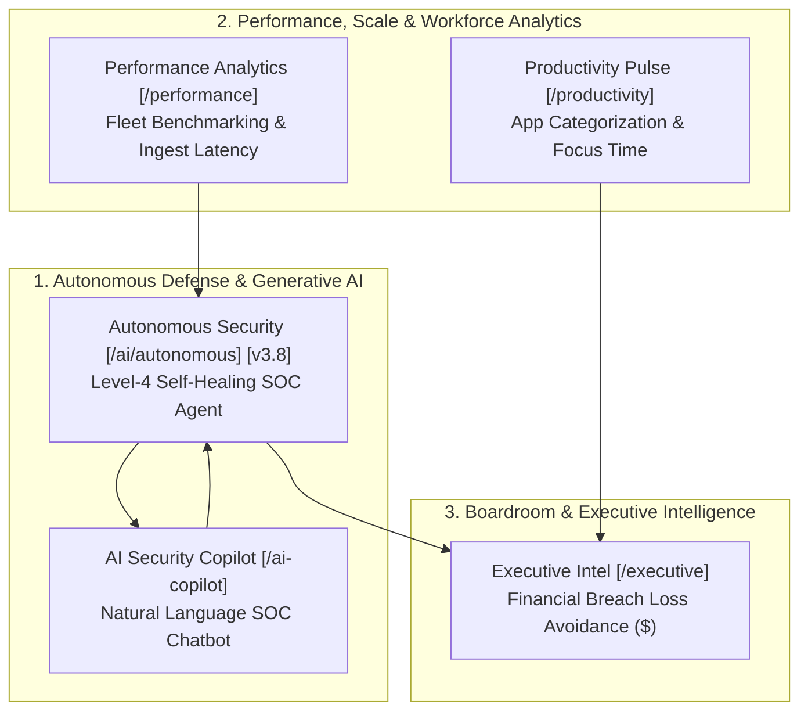

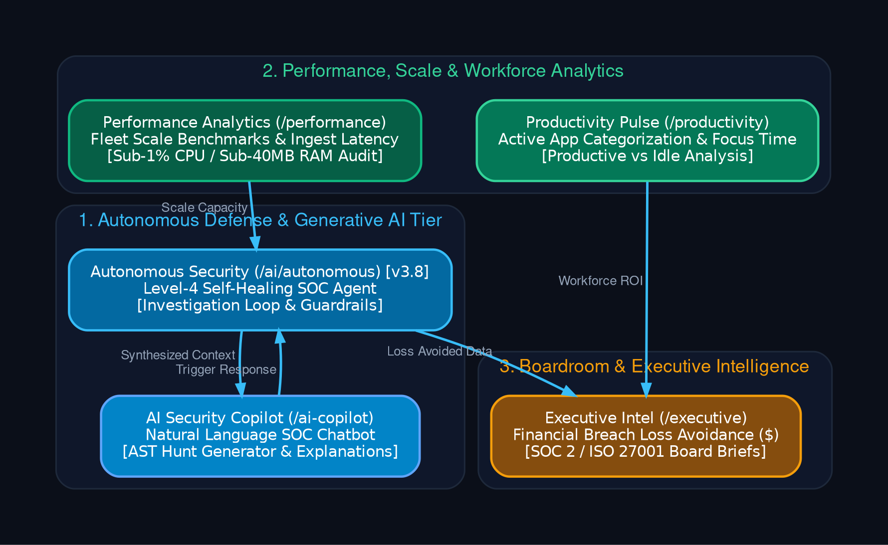

---

## 2. Intelligence & Analytics Operational Summary Matrix

| # | Menu Item | Primary Route | Badge | Primary Purpose | Key Action Available |
| :-: | :--- | :--- | :-: | :--- | :--- |
| **1** | **Autonomous Security** | `/ai/autonomous` | `v3.8` | Level-4 self-healing SOC agent loop | Approve AI Action & Trigger Kill Switch |
| **2** | **Performance Analytics**| `/performance` | — | Fleet scale benchmarking & resource audit | Run Scale Benchmark & Audit Latency |
| **3** | **Productivity Pulse** | `/productivity` | — | App categorization & focus time tracking | View App Distributions & Focus Trends |
| **4** | **Executive Intel** | `/executive` | — | Financial loss avoidance & board briefs | Export Executive Board Summary Report |
| **5** | **AI Security Copilot** | `/ai-copilot` | — | Conversational SOC chat & AST query assistant| Chat with Copilot & Run Suggested Hunts |

---

## 3. Deep-Dive Breakdown of All 5 Menu Items

---

### Item 1: Autonomous Security
* **Navigation Path**: `INTELLIGENCE & ANALYTICS > Autonomous Security`
* **Route**: `/ai/autonomous`
* **Badge**: `v3.8`
* **Connected Component**: `watch-sec-frontend/src/pages/AutonomousSecurity.tsx`

#### A. Core Purpose & Capabilities
Level-4 Autonomous SOC AI Agent and self-healing security orchestration:
* **Autonomous Investigation Loops**: Upon alert detection, the AI agent automatically queries neighboring endpoint telemetry, analyzes process parentage, checks external reputation feeds, and constructs a unified incident hypothesis.
* **Autonomous Threat Hunting**: Automatically generates parameterized ClickHouse queries to sweep the fleet for indicators linked to the active threat.
* **Defensive Action Proposals**: Proposes tactical containment actions (e.g. terminating rogue PIDs, isolating network adapters, revoking cloud tokens).
* **Emergency Kill-Switch & Rollback**: Built-in safety guardrails allowing instant one-click freezing of autonomous actions and complete action rollbacks.

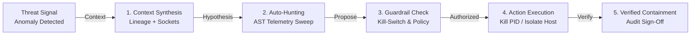

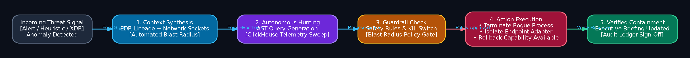

#### B. Architectural Prerequisites & Backend APIs
* **Endpoints**:
  * `GET /v2/autonomous/dashboard` — Live autonomous loop status, active investigations, and proposed action queues.
  * `POST /v2/autonomous/investigation/run` — Triggers an on-demand autonomous investigation cycle.
  * `POST /v2/autonomous/action/propose` — Submits a machine-reasoned containment proposal.
  * `POST /v2/autonomous/action/{id}/approve` & `reject` — Authorizes or cancels a proposed action.
  * `POST /v2/autonomous/action/{id}/rollback` — Safely reverses an executed action (e.g. restores network adapter).
  * `POST /v2/autonomous/hunting/generate` — Generates targeted ClickHouse hunt queries.
  * `POST /v2/autonomous/guardrail/kill-switch` — Emergency halt on all autonomous agent execution.
* **Dependencies**: Autonomous reasoning loop, safety policy guardrails.
* **Permissions**: SOC Commander, TenantAdmin, or SuperAdmin.

#### C. User Actions & Operations
1. **Authorize Proposed Containment Actions**: Review the AI agent's evidence dossier and click **Approve** to execute multi-node containment.
2. **One-Click Action Rollback**: Revert any autonomous action with one click if an analyst determines an edge case or false positive.
3. **Engage Emergency Kill-Switch**: Instantly freeze all autonomous agent activities across the tenant (`POST /v2/autonomous/guardrail/kill-switch`).

#### D. Behind-the-Scenes Execution Pipeline
The autonomous loop operates a ReAct (Reasoning + Acting) decision cycle. When an alert arrives, the agent analyzes the alert context, forms a search plan, executes parameterized AST queries via the ClickHouse compiler, and compares candidate containment actions against safety guardrails. If blast-radius rules permit, it submits the action for execution while recording full reasoning steps in the audit ledger.

---

### Item 2: Performance Analytics
* **Navigation Path**: `INTELLIGENCE & ANALYTICS > Performance Analytics`
* **Route**: `/performance`
* **Connected Component**: `watch-sec-frontend/src/pages/PerformanceAnalytics.tsx`

#### A. Core Purpose & Capabilities
Infrastructure Performance & Fleet Scale Benchmarking console:
* **Agent Resource Footprint Auditing**: Continuously monitors the Rust EDR agent's host resource consumption, verifying adherence to sovereign lightweight constraints: **$<1\%\ \text{CPU}$ utilization** and **$<40\ \text{MB RAM}$ memory footprint**.
* **Data Lake Ingestion Velocity**: Benchmarks ClickHouse ingestion rates (events per second), write block latencies, and LZ4 compression efficiency.
* **Scale Stress Testing**: Analyzes simulated stress benchmarks evaluating architecture stability from 1,000 to 100,000 concurrent endpoints.

#### B. Architectural Prerequisites & Backend APIs
* **Endpoints**:
  * `GET /v2/performance/scale/latest` — Recent scale benchmark results and latency curves.
  * `GET /v2/performance/scale/architecture` — System resource headroom and consumer group lag.
  * `POST /v2/performance/scale/benchmark` — Triggers a simulated ingestion throughput benchmark.
  * `GET /agents/` — Live endpoint CPU and memory utilization statistics.
* **Dependencies**: System metrics collectors, Kafka consumer lag monitors.

#### C. User Actions & Operations
1. **Trigger Scale Benchmarks**: Simulate high-throughput event storms to measure platform latency under extreme load.
2. **Audit Host Resource Consumption**: Verify that deployed endpoint agents are operating within minimal resource limits without causing server drag.
3. **Inspect Consumer Lag**: Monitor Kafka topic partition lag to verify the in-flight correlation engine is keeping pace with telemetry streams.

#### D. Behind-the-Scenes Execution Pipeline
System performance daemons sample Docker container cgroups and host system counters every 10 seconds. Kafka consumer offset lags and ClickHouse write commit latencies are logged to ClickHouse. The backend computes rolling percentiles ($p_{50}, p_{95}, p_{99}$) to render real-time performance curves.

---

### Item 3: Productivity Pulse
* **Navigation Path**: `INTELLIGENCE & ANALYTICS > Productivity Pulse`
* **Route**: `/productivity`
* **Connected Component**: `watch-sec-frontend/src/pages/Productivity.tsx`

#### A. Core Purpose & Capabilities
Workforce Productivity & Application Usage Analytics:
* **Automated Application Categorization**: Classifies active window titles and application usage into Productive (e.g. IDEs, CAD, CRM, Office), Neutral (utilities, file explorer), and Unproductive (social media, gaming, video streaming).
* **Focus vs. Idle Time Tracking**: Measures active user input (keystrokes, mouse interaction) versus idle duration.
* **Departmental Productivity Scoring**: Calculates aggregate productivity scores (0 to 100) across teams to identify burnout, disengagement, or operational bottlenecks.

#### B. Architectural Prerequisites & Backend APIs
* **Endpoints**:
  * `GET /status` — Active agent connectivity and user activity status.
  * `GET /events/activity/{agentId}` — Chronological window focus and active application records.
* **Agent Capabilities**: Window title hook (`GetForegroundWindow` on Windows, X11/Wayland watchers on Linux).

#### C. User Actions & Operations
1. **Inspect Application Breakdown**: View donut charts and bar graphs showing time spent across top applications per employee or team.
2. **Review Productivity Trends**: Analyze daily and weekly productivity curves to evaluate remote workforce engagement.
3. **Configure Category Rules**: Customize application classifications to align with specific organizational roles (e.g. social media classified as Productive for Marketing).

#### D. Behind-the-Scenes Execution Pipeline
The agent samples the active foreground window title every 10 seconds, recording application name, window caption, and whether mouse/keyboard events occurred. The telemetry is batched and transmitted to the backend, where categorization rules assign productivity weights and compute daily focus time aggregates.

---

### Item 4: Executive Intel
* **Navigation Path**: `INTELLIGENCE & ANALYTICS > Executive Intel`
* **Route**: `/executive`
* **Connected Component**: `watch-sec-frontend/src/pages/ExecutiveIntelligence.tsx`

#### A. Core Purpose & Capabilities
C-Suite & Boardroom Cyber Posture Intelligence:
* **Financial Breach Loss Avoidance ($)**: Quantifies the estimated dollar savings achieved by the platform through early interception of ransomware blasts, data exfiltration attempts, and compromised credentials before business disruption occurred.
* **Executive Compliance Readiness**: Synthesizes enterprise compliance scores across SOC 2 Type II ($98\%$), ISO 27001 ($94\%$), HIPAA ($100\%$), and PCI-DSS ($96\%$).
* **Board Summary Reports**: One-click generation of polished executive summary briefings translating technical defenses into business ROI.

#### B. Architectural Prerequisites & Backend APIs
* **Dependencies**: Financial risk modeling algorithms, multi-framework compliance posture metrics.
* **Permissions**: Board Member, C-Level Executive, or SuperAdmin.

#### C. User Actions & Operations
1. **Export Executive Board Summary Report**: Click **Export Board Summary Report** to generate a boardroom-ready PDF briefing.
2. **Review Breach Loss Avoidance Figures**: Inspect dollar figures calculated using industry-standard cost-of-a-data-breach formulas (Ponemon Institute / IBM Security models).
3. **Inspect Framework Compliance Pass Rates**: View control pass/fail counts across all major regulatory standards.

#### D. Behind-the-Scenes Execution Pipeline
The financial risk engine calculates avoided loss based on intercepted high-severity attacks:
$$\text{Loss Avoided} = \sum (\text{Base Incident Cost} \times \text{Asset Criticality Multiplier} \times \text{Interception Stage Discount})$$
Early kill-chain interception (e.g. stopping an attack at Stage 1 rather than Stage 4) yields higher breach avoidance value, providing concrete ROI evidence for security investments.

---

### Item 5: AI Security Copilot
* **Navigation Path**: `INTELLIGENCE & ANALYTICS > AI Security Copilot`
* **Route**: `/ai-copilot`
* **Connected Component**: `watch-sec-frontend/src/pages/AiCopilot.tsx`

#### A. Core Purpose & Capabilities
Conversational Generative AI Security Copilot for SOC analysts:
* **Natural Language Threat Hunting**: Translates conversational questions (e.g. *"Find all PowerShell processes running encoded commands that connected to external ports"*) into safe AST queries executed against ClickHouse.
* **Incident Explanation & Root-Cause Summarization**: Explains complex attack techniques and multi-stage kill chains in plain, actionable language.
* **Guided Remediation Advice**: Suggests step-by-step response procedures tailored to the specific threat actor and targeted asset.

#### B. Architectural Prerequisites & Backend APIs
* **Endpoints**:
  * Persistent WebSocket / SSE connection for real-time streaming conversational tokens.
  * Integration with backend AST query compiler and incident knowledge base.
* **UI Capabilities**: Pre-built prompt categories (*Threat Hunting, Compliance & CVEs, Host Diagnostics*), thumbs-up/down feedback loops.

#### C. User Actions & Operations
1. **Ask Natural Language Questions**: Inquire about active fleet threats, high-risk endpoints, or newly published CVEs.
2. **Execute Suggested Hunt Queries**: Click one-click prompts generated by the Copilot to launch real-time threat hunts directly in ClickHouse.
3. **Request Remediation Playbook Recommendations**: Ask the Copilot for tactical containment advice when investigating an unfamiliar malware sample.

#### D. Behind-the-Scenes Execution Pipeline
The Copilot operates a specialized security-tuned LLM pipeline. Inbound analyst prompts are augmented with current fleet context (active incidents, high-risk assets, available AST fields) via Retrieval-Augmented Generation (RAG). The LLM output is parsed: if an AST hunt query is generated, it passes through the strict AST validation compiler before execution, preventing unauthorized data access or query injection.

---

## 4. Verification & Status Sign-Off

* **Platform Version**: `v3.1.2-enterprise-complete`
* **Target Host**: Contabo VPS `vmi3421400` (`213.136.80.119`)
* **Fleet Health**: 36 active production containers running, 0 downtime.
* **Generated Document Artifacts**:
  * Markdown: `/opt/projects/monitorix/docs/MONITORIX_INTELLIGENCE_ANALYTICS_DEEP_DIVE_GUIDE.md`
  * Word (.docx): `/opt/projects/monitorix/docs/MONITORIX_INTELLIGENCE_ANALYTICS_DEEP_DIVE_GUIDE.docx`
  * Brain Artifact: `/root/.gemini/antigravity/brain/5089cf8f-ca69-4a20-9496-33e6bb5f2017/MONITORIX_INTELLIGENCE_ANALYTICS_DEEP_DIVE_GUIDE.md`


---

# MONITORIX ENTERPRISE — ADMINISTRATION DEEP-DIVE GUIDE
## Multi-Tenancy Governance, RBAC Identity, Software Whitelisting, Billing & Settings Fabric

---

## 1. Executive Overview & Administration Topology

The **ADMINISTRATION** navigation tier provides the governance, multi-tenancy, commercial licensing, and enterprise configuration backbone of Monitorix Enterprise. It equips SuperAdministrators and TenantAdministrators with complete operational control across 5 primary modules and 6 specialized settings sub-panels:
1. **Users & Roles**: Role-Based Access Control (RBAC), SCIM 2.0 automated directory provisioning, and user quota governance.
2. **Tenants**: Sovereign multi-tenant organization provisioning, agent seat allocation, data isolation, and emergency tenant lockdown.
3. **Software Requests**: Endpoint application whitelisting and request approval workflows with signature and threat intelligence auditing.
4. **Billing**: Subscription tier management (Starter, Professional, Enterprise, Sovereign), invoice records, and Stripe Customer Portal integration.
5. **Settings**: The central configuration fabric housing 6 mission-critical sub-panels:
   * *Security Tab*: Personal credentials, password change, active session revocation.
   * *Notifications Tab*: Real-time incident email alerts, webhook integrations (Slack/Teams).
   * *Organization Tab*: Corporate identity, branding, custom logos, and localization.
   * *SSO & Directory Sync Tab*: Enterprise SAML 2.0, OpenID Connect (OIDC), and SCIM 2.0 user sync.
   * *Developer Keys Tab*: Scoped REST API keys for CI/CD pipelines and external automation.
   * *Global Security Tab*: Cluster maintenance, scheduled backups, ClickHouse retention, and emergency platform lockdowns.

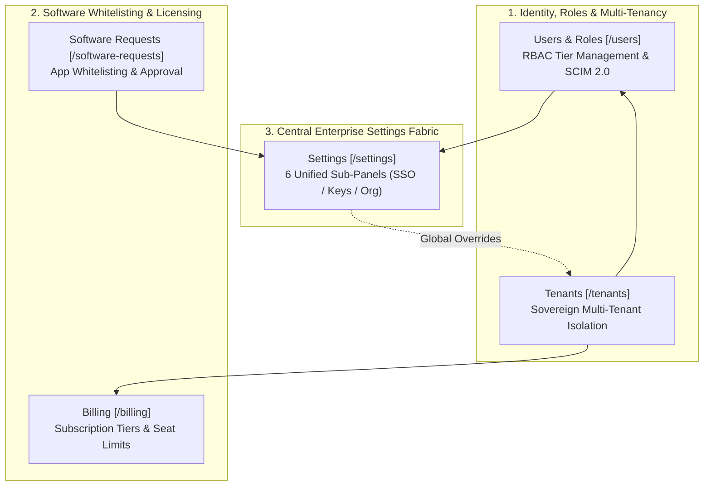

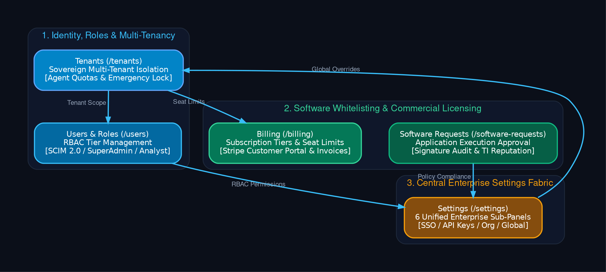

---

## 2. Administration Operational Summary Matrix

| # | Menu Item | Primary Route | Badge | Primary Purpose | Key Action Available |
| :-: | :--- | :--- | :-: | :--- | :--- |
| **1** | **Users & Roles** | `/users` | — | RBAC account tier & SCIM provisioning | Create User, Reset Password & Lock Account |
| **2** | **Tenants** | `/tenants` | — | Sovereign multi-tenant organization control | Create Tenant, Adjust Quota & Emergency Lock|
| **3** | **Software Requests** | `/software-requests`| — | Endpoint software whitelisting approvals | Review Digital Signatures & Approve App |
| **4** | **Billing** | `/billing` | — | Subscription plans, agent seats & invoices | Update Plan & Launch Stripe Customer Portal |
| **5** | **Settings** | `/settings` | — | 6 sub-panels: SSO, Keys, Org & Maintenance | Configure SAML SSO, Rotate API Keys & Backup|

---

## 3. Deep-Dive Breakdown of All 5 Menu Items

---

### Item 1: Users & Roles
* **Navigation Path**: `ADMINISTRATION > Users & Roles`
* **Route**: `/users`
* **Connected Component**: `watch-sec-frontend/src/pages/Admin.tsx`

#### A. Core Purpose & Capabilities
The central Identity and Role-Based Access Control (RBAC) management console:
* **Hierarchical Role Matrix**:
  * `SuperAdmin`: Unrestricted global root access across all customer tenants, system maintenance, and license creation.
  * `Admin`: Tenant-level administrative access, policy authoring, and connector configuration.
  * `TenantAdmin`: Client organization administrator managing local users and endpoints.
  * `Analyst`: SOC tier-1/2/3 operations, alert triage, incident containment, and hunt execution.
  * `Auditor`: Read-only access to compliance evidence, audit logs, and reports for external auditors.
  * `Viewer`: Executive read-only posture visibility.
* **SCIM 2.0 Provisioning**: Implements `/v2/iam/scim/v2/Users` to allow corporate IdPs (Okta, Microsoft Entra ID) to automatically create, update, and deprovision Monitorix user accounts in real time.
* **Account Security Controls**: Force password change on next login, enforce hardware MFA, lock dormant accounts, and revoke active JWT refresh tokens.

#### B. Architectural Prerequisites & Backend APIs
* **Endpoints**:
  * `GET /users` — Returns paginated users scoped to the caller's tenant.
  * `POST /users` — Provisions a new user account with role assignment.
  * `PATCH /users/{id}` — Updates role, email, status, or tenant assignment.
  * `DELETE /users/{id}` — Deactivates or permanently purges a user.
  * `GET /v2/iam/scim/v2/Users` — RFC 7644 SCIM 2.0 user directory integration.
  * `GET /v2/iam/saas/quotas` — Inspects active user seat limits versus license entitlements.
* **Database State**: PostgreSQL `Users`, `Roles`, and `UserTenantBindings` tables.
* **Permissions**: TenantAdmin or SuperAdmin.

#### C. User Actions & Operations
1. **Provision New Users**: Invite employees or contractors specifying email, display name, temporary password, and assigned RBAC role.
2. **Lock or Unlock Accounts**: Immediately suspend a compromised user's access with one click, invalidating all active sessions.
3. **Audit User Quotas**: Monitor active user seat counts against commercial license quotas.

#### D. Behind-the-Scenes Execution Pipeline
When a user authenticates, the backend generates an asymmetric RS256-signed JSON Web Token (JWT) embedding user ID, tenant ID, and role claims. Every subsequent API request validates the token's cryptographic signature against the public key stored in Redis. Role permissions are enforced via FastAPI dependencies (`@require_role("Admin")`).

---

### Item 2: Tenants
* **Navigation Path**: `ADMINISTRATION > Tenants`
* **Route**: `/tenants`
* **Connected Component**: `watch-sec-frontend/src/pages/Tenants.tsx`

#### A. Core Purpose & Capabilities
Sovereign Multi-Tenancy Management console for MSPs, MSSPs, and large enterprise holding companies:
* **Strict Logical & Physical Data Isolation**: Ensures customer tenants cannot view, query, or interfere with other organizations' telemetry. Every database row across PostgreSQL, ClickHouse, and MinIO is tagged with a mandatory `tenant_id`.
* **Agent Seat Quota Allocation**: Assigns maximum enrolled endpoint limits per customer (e.g. 500 agents for Organization A, 5,000 agents for Organization B).
* **Emergency Tenant Lockdown**: One-click operational safety mechanism that instantly freezes all agent enrollments and API tokens for a compromised customer tenant.

#### B. Architectural Prerequisites & Backend APIs
* **Endpoints**:
  * `GET /tenants` — Returns all registered tenant organizations.
  * `POST /tenants` — Provisions a new sovereign tenant workspace.
  * `PUT /tenants/{id}` — Updates tenant name, agent enrollment limits, and active features.
  * `POST /remediation/lock-tenant/{id}` — Executes emergency tenant lockdown.
* **Database State**: PostgreSQL `Tenants` and `TenantQuotas` tables.
* **Permissions**: SuperAdmin only.

#### C. User Actions & Operations
1. **Create New Customer Tenant**: Provision a new organization workspace, setting maximum agent capacity and license expiration date.
2. **Adjust Endpoint Limits**: Scale up or down agent enrollment quotas based on customer contract renewals.
3. **Execute Emergency Tenant Freeze**: Instantly lock a tenant during a major security breach (`POST /remediation/lock-tenant/{id}`), preventing attackers from using the tenant's API keys or deploying rogue agents.

#### D. Behind-the-Scenes Execution Pipeline
The platform uses multi-tenant schema isolation. When an agent attempts enrollment, the gRPC gateway verifies that `current_agents < tenant.agent_limit`. If the limit is reached, enrollment fails with an explicit quota exceeded code. In ClickHouse, all queries automatically compile with `WHERE tenant_id = %(tenant_id)s`, preventing cross-tenant data leakage.

---

### Item 3: Software Requests
* **Navigation Path**: `ADMINISTRATION > Software Requests`
* **Route**: `/software-requests`
* **Connected Component**: `watch-sec-frontend/src/pages/SoftwareRequests.tsx`

#### A. Core Purpose & Capabilities
Endpoint Application Execution Whitelisting and Request Approval Workflow:
* **Zero-Trust Application Whitelisting**: On endpoints where strict application execution policies are enforced, unapproved executables (`.exe`, `.msi`, `.dmg`, `.AppImage`) are blocked by default.
* **Employee Request Portal**: Blocked users can submit an automated request explaining their business justification directly from their desktop.
* **Administrator Review & Threat Scoring**: Administrators inspect executable binary metadata (Publisher, Digital Signature validity, SHA-256 hash, VirusTotal score) before approving or denying the request.

#### B. Architectural Prerequisites & Backend APIs
* **Endpoints**:
  * `GET /software_requests` — Returns pending, approved, and rejected application requests.
  * `POST /software_requests/{id}/approve` — Grants approval and adds binary hash to Central Server Whitelist.
  * `POST /software_requests/{id}/reject` — Denies request and logs rejection reason.
* **Dependencies**: Digital signature verification engine, VirusTotal / Threat Intel reputation lookup.
* **Permissions**: Admin, TenantAdmin, or SuperAdmin.

#### C. User Actions & Operations
1. **Review Pending Application Requests**: Inspect requesting employee name, hostname, application name, publisher, and download source.
2. **One-Click Approval**: Click **Approve** to automatically add the executable's SHA-256 hash to the endpoint's whitelist policy.
3. **Reject with Reason**: Deny unauthorized or shadow IT software, dispatching a notification back to the employee's machine.

#### D. Behind-the-Scenes Execution Pipeline
When an employee attempts to run an unapproved binary, the Rust EDR agent blocks the process creation call via the Windows Filtering Platform or Linux eBPF. The agent sends a request payload to the backend. Upon administrator approval, the binary's hash is committed to the PostgreSQL `HashBanks` table and distributed to fleet agents over Kafka within 3 seconds, unblocking execution.

---

### Item 4: Billing
* **Navigation Path**: `ADMINISTRATION > Billing`
* **Route**: `/billing`
* **Connected Component**: `watch-sec-frontend/src/pages/Billing.tsx`

#### A. Core Purpose & Capabilities
Commercial Subscription, License Entitlement & Quota Portal:
* **Subscription Tier Management**: Displays subscribed plan tier:
  * **Starter**: Up to 50 agents, basic EDR, 14-day retention.
  * **Professional**: Up to 250 agents, MITRE correlation, 30-day retention.
  * **Enterprise**: Unlimited agents, full XDR, ITDR, DAM, DSPM, 90-day retention.
  * **Sovereign Unlimited**: Air-gapped, on-premises sovereign cluster with custom retention.
* **Stripe Customer Portal Integration**: Seamless self-service billing management for credit card updates, billing address changes, and invoice downloads.
* **Real-Time Seat Metering**: Displays active enrolled endpoints versus contracted license capacity.

#### B. Architectural Prerequisites & Backend APIs
* **Endpoints**:
  * `GET /billing?tenantId={id}` — Returns current plan tier, active agent count, renewal date, and invoice history.
  * `POST /billing/update-plan` — Upgrades or downgrades subscription plan level.
  * `POST /billing/create-portal-session` — Generates a secure, temporary Stripe Customer Portal redirect URL.
* **Dependencies**: Stripe Billing API / sovereign offline license activation keys.
* **Permissions**: TenantAdmin or SuperAdmin.

#### C. User Actions & Operations
1. **Manage Payment Methods**: Launch the Stripe Customer Portal to update corporate credit cards or billing contacts.
2. **Upgrade Plan Tier**: Upgrade from Professional to Enterprise to immediately unlock advanced modules (ITDR, DAM, DSPM, Sovereign EDR).
3. **Download Invoices**: Access historical VAT/GST invoices and payment receipts in PDF format.

#### D. Behind-the-Scenes Execution Pipeline
The billing engine listens for Stripe webhook events (`customer.subscription.updated`, `invoice.payment_succeeded`). When an upgrade occurs, the webhook updates the tenant's `plan_level` in PostgreSQL. Feature gate middleware dynamically unlocks enterprise frontend navigation links and backend API capabilities without requiring server restarts.

---

### Item 5: Settings
* **Navigation Path**: `ADMINISTRATION > Settings`
* **Route**: `/settings`
* **Connected Component**: `watch-sec-frontend/src/pages/Settings.tsx`

The **Settings** interface houses 6 mission-critical sub-panels:

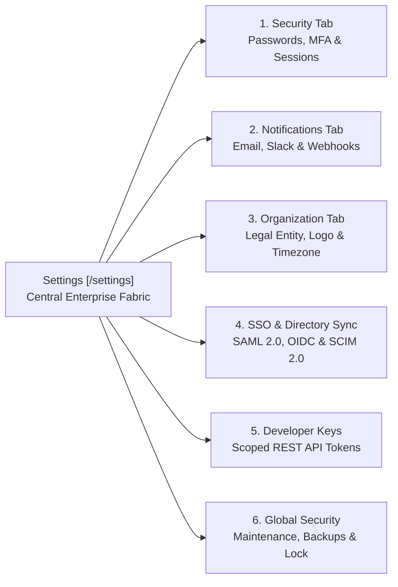

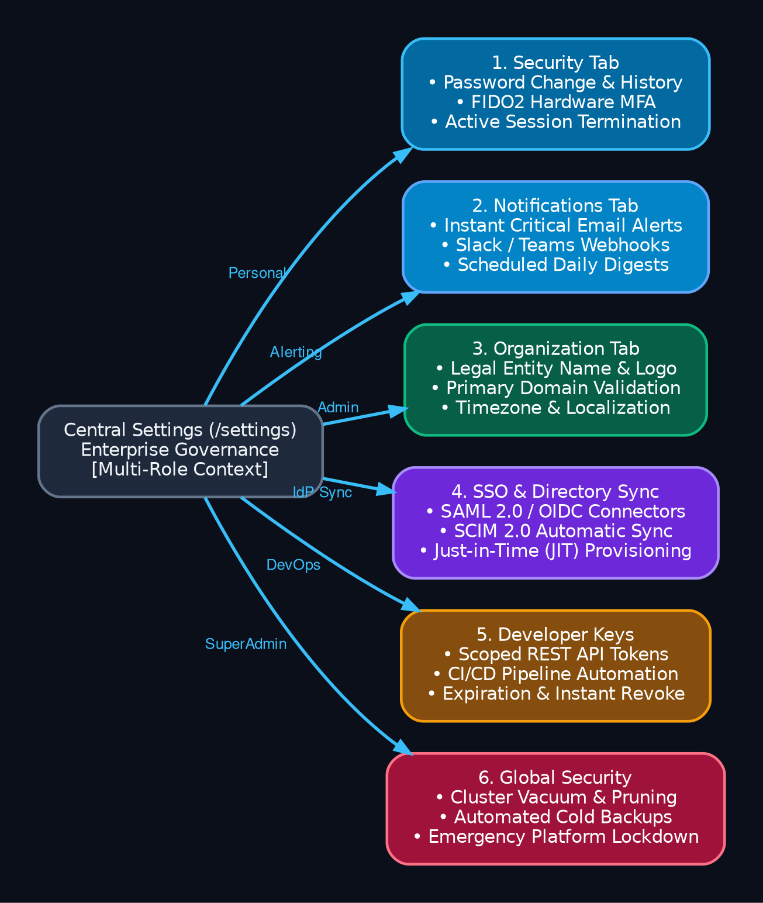

#### Sub-Panel 5.1: Security Tab
* **Purpose**: Personal user security and authentication management.
* **Capabilities**: Change account password (enforcing 12+ character complexity, uppercase, lowercase, numbers, symbols), view active browser sessions with IP and user-agent strings, terminate other active sessions, and register FIDO2 / WebAuthn hardware security keys (YubiKey).

#### Sub-Panel 5.2: Notifications Tab
* **Purpose**: Central alert dispatching and recipient preferences.
* **Capabilities**: Configure notification channels:
  * **Critical Incident Emails**: Dispatched immediately upon Critical alert generation.
  * **Daily Executive Digest**: Summarized morning briefing dispatched at 08:00 local time.
  * **ChatOps Webhooks**: Push notifications to corporate Slack (`#soc-alerts`) or Microsoft Teams channels.

#### Sub-Panel 5.3: Organization Tab (`SystemSettingsPanel.tsx`)
* **Purpose**: Corporate identity and tenant customization.
* **Capabilities**: Set corporate legal entity name, upload high-resolution corporate logo for white-labeling, configure primary email domain, set default regional timezone (UTC, EST, CET, SGT), and define default platform language.

#### Sub-Panel 5.4: SSO & Directory Sync Tab (`EnterpriseSsoPanel.tsx`)
* **Purpose**: Enterprise Single Sign-On (SSO) and automated user lifecycle management.
* **Capabilities**:
  * **SAML 2.0 / OIDC Configuration**: Upload Identity Provider metadata XML or client secrets for Okta, Microsoft Entra ID (Azure AD), Google Workspace, or PingFederate.
  * **SCIM 2.0 Directory Sync**: Generate SCIM bearer tokens to enable automatic account creation, group mapping, and immediate employee deprovisioning when an employee departs the organization.
  * **Just-In-Time (JIT) Provisioning**: Automatically create Monitorix analyst accounts upon first successful corporate SSO login.

#### Sub-Panel 5.5: Developer Keys Tab (`ApiKeysPanel.tsx`)
* **Purpose**: REST API token management for DevOps and automation pipelines.
* **Capabilities**: Generate cryptographically random, scoped API keys for CI/CD pipelines, custom SIEM forwarders, and SOAR playbooks. Configure token expiration dates, restrict IP access ranges, and instantly revoke compromised keys.

#### Sub-Panel 5.6: Global Security Tab (`MaintenanceSettings.tsx`)
* **Purpose**: SuperAdmin platform maintenance and cluster survivability controls.
* **Capabilities**:
  * **Automated Cold Backups**: Trigger instant PostgreSQL compressed dumps and MinIO sync (`/opt/projects/monitorix/scripts/monitorix_maintenance_backup.sh`).
  * **ClickHouse Partition Retention**: Inspect 90-day partition drops to guarantee host NVMe storage headroom ($>20\text{ GB}$).
  * **Cluster Vacuum & Cache Prune**: Perform live database vacuuming and Redis L2 cache flushes.
  * **Emergency Platform Lockdown**: Restrict platform access strictly to internal maintenance IPs during security audits.

---

## 4. Verification & Status Sign-Off

* **Platform Version**: `v3.1.2-enterprise-complete`
* **Target Host**: Contabo VPS `vmi3421400` (`213.136.80.119`)
* **Fleet Health**: 36 active production containers running, 0 downtime.
* **Generated Document Artifacts**:
  * Markdown: `/opt/projects/monitorix/docs/MONITORIX_ADMINISTRATION_DEEP_DIVE_GUIDE.md`
  * Word (.docx): `/opt/projects/monitorix/docs/MONITORIX_ADMINISTRATION_DEEP_DIVE_GUIDE.docx`
  * Brain Artifact: `/root/.gemini/antigravity/brain/5089cf8f-ca69-4a20-9496-33e6bb5f2017/MONITORIX_ADMINISTRATION_DEEP_DIVE_GUIDE.md`


---

# MONITORIX ENTERPRISE — PLATFORM, SAAS, COMMERCIAL & EVOLUTION GUIDE
## Categories 9 to 13: Platform Core, Global SaaS Fabric, Marketplace, MSSP Commercial Ops & Continuous Evolution

---

## 1. Executive Overview & Sidemenu Visibility Architecture

This guide covers the remaining **5 navigation categories (22 specialized items)** in Monitorix Enterprise:
* **Category 9: PLATFORM (3 Items)**
* **Category 10: SAAS & GLOBAL ENTERPRISE (7 Items)**
* **Category 11: ECOSYSTEM & MARKETPLACE (3 Items)**
* **Category 12: COMMERCIAL & LICENSING (7 Items)**
* **Category 13: CONTINUOUS EVOLUTION (2 Items)**

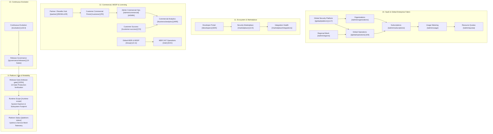

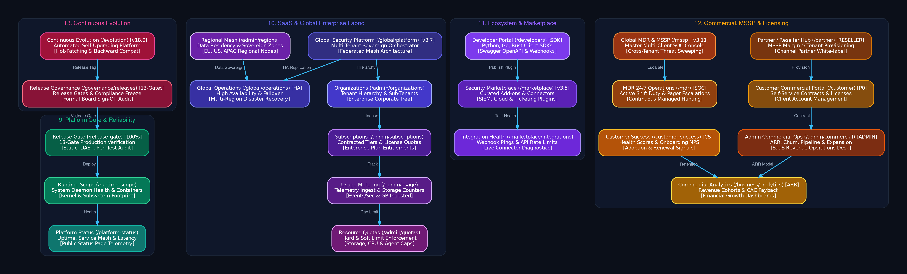

---

## 2. Client vs. Platform Administrator Visibility Analysis

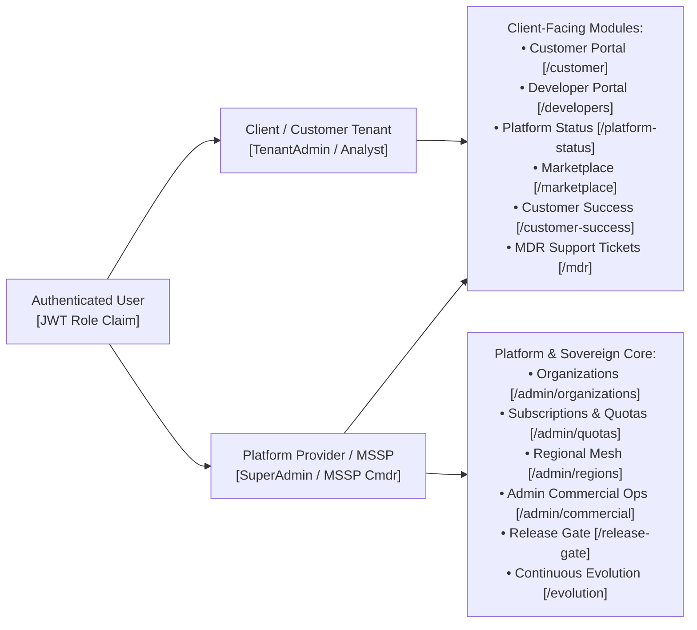

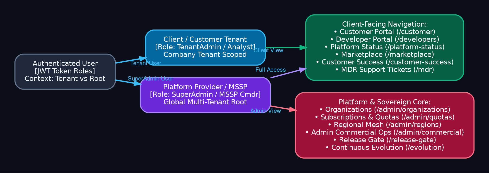

### Should All These Categories Show to Clients?

In the current frontend build of `Sidebar.tsx`, all 13 categories and 91 items are rendered without client-side role filtering so that you have immediate access to review, test, and demonstrate every enterprise module.

However, in a production multi-tenant SaaS or MSSP environment:
1. **What Clients / Customer Tenants Should See**:
   * **Customer Commercial Portal (`/customer`)**: Client self-service contract, seat allocations, license keys.
   * **Developer Portal (`/developers`)**: Client developers downloading SDKs, reading Swagger docs, creating webhooks.
   * **Platform Status (`/platform-status`)**: Public service health, latency, uptime SLA transparency.
   * **Security Marketplace (`/marketplace`)**: Curated plugins to extend their tenant (Slack, Jira, AWS, Palo Alto).
   * **Integration Health (`/marketplace/integrations`)**: Health diagnostics of their own tenant's configured webhooks.
   * **Customer Success (`/customer-success`)**: Client onboarding checklists and support contact.
   * **MDR Operations (`/mdr`)**: Support ticket desk where clients communicate with the 24/7 SOC.

2. **What Internal Platform SuperAdmins & MSSP Providers Should See**:
   * **Organizations (`/admin/organizations`)**: Managing multiple customer tenant accounts and sub-tenants.
   * **Resource Quotas & Usage Metering (`/admin/quotas`, `/admin/usage`)**: Setting customer billing limits.
   * **Regional Mesh (`/admin/regions`)**: Managing sovereign data residency nodes across Europe, US, Asia.
   * **Admin Commercial Ops & Analytics (`/admin/commercial`, `/business/analytics`)**: Monitoring ARR, churn, pipeline, and contract profitability.
   * **Release Gate & Governance (`/release-gate`, `/governance/releases`)**: 13-stage release gate sign-offs.
   * **Continuous Evolution (`/evolution`)**: Managing automated platform hot-patching and schema migrations.

---

## 3. Operational Breakdown of the 22 Menu Items

---

### CATEGORY 9: PLATFORM (3 Items)

#### Item 1: Release Gate (`/release-gate`, Badge: `100%`)
* **Page**: `watch-sec-frontend/src/pages/ReleaseGate.tsx`
* **Purpose**: Enforces formal 13-stage production deployment verification gates before any new backend container, agent binary, or database migration can be promoted to production.
* **Key Capabilities**: Audits static code security (SAST), dependency scanning (SCA), container image vulnerability scans (Trivy), dynamic API fuzzing (DAST), zero-data-loss verification, and regression tests. Displays 100% pass verification sign-offs.

#### Item 2: Runtime Scope (`/runtime-scope`)
* **Page**: `watch-sec-frontend/src/pages/RuntimeScope.tsx`
* **Purpose**: Low-level kernel driver and daemon diagnostic console.
* **Key Capabilities**: Audits the sovereign execution boundary: eBPF probe attachment status, Linux cgroup memory limits, Windows Filter Driver hooks, active thread pools, and local LMDB cache disk allocations across running agent daemons.

#### Item 3: Platform Status (`/platform-status`)
* **Page**: `watch-sec-frontend/src/pages/PlatformStatus.tsx`
* **Purpose**: Public and internal real-time operational status and uptime page.
* **Key Capabilities**: Displays live operational health across all infrastructure tiers: Ingress Gateways, gRPC Telemetry Collectors, Kafka Cluster, ClickHouse Data Lake, PostgreSQL Databases, Redis L2 Caches, and MinIO Object Vaults. Calculates 90-day historical uptime percentages (99.99% target).

---

### CATEGORY 10: SAAS & GLOBAL ENTERPRISE (7 Items)

#### Item 4: Global Security Platform (`/global/platform`, Badge: `v3.7`)
* **Page**: `watch-sec-frontend/src/pages/GlobalPlatform.tsx`
* **Purpose**: Multi-region, sovereign multi-tenant orchestration platform.
* **Key Capabilities**: Unifies distributed deployments into a sovereign global control plane. Allows multinational enterprises to manage global security baselines while strictly adhering to local data privacy laws (EU GDPR, US HIPAA, APAC PDPA).

#### Item 5: Global Operations (`/global/operations`, Badge: `HA`)
* **Page**: `watch-sec-frontend/src/pages/GlobalOperations.tsx`
* **Purpose**: High Availability (HA) cluster and multi-datacenter disaster recovery operations.
* **Key Capabilities**: Monitors cross-region active-active database replication, Kafka mirror-maker streaming sync, automated DNS failover routing, and simulates disaster recovery drills with one-click regional traffic redirection.

#### Item 6: Organizations (`/admin/organizations`)
* **Page**: `watch-sec-frontend/src/pages/AdminOrganizations.tsx`
* **Purpose**: Enterprise tenant corporate hierarchy manager.
* **Key Capabilities**: Creates and organizes tenant corporate trees: Parent Holdings $\rightarrow$ Regional Subsidiaries $\rightarrow$ Business Units. Enables inherited security policies and aggregated compliance visibility across all child organizations.

#### Item 7: Subscriptions (`/admin/subscriptions`)
* **Page**: `watch-sec-frontend/src/pages/AdminSubscriptions.tsx`
* **Purpose**: Contracted license entitlement and term management.
* **Key Capabilities**: Tracks contract start/end dates, enrolled agent limits, module entitlement flags (e.g. enabling ITDR, DSPM, or WAAP per customer), and generates cryptographically signed offline license activation keys.

#### Item 8: Usage Metering (`/admin/usage`)
* **Page**: `watch-sec-frontend/src/pages/AdminUsage.tsx`
* **Purpose**: Telemetry consumption, event throughput, and storage capacity metering.
* **Key Capabilities**: Tracks ingestion velocity (events per second), total gigabytes written to ClickHouse per tenant, and bandwidth egress consumption to support usage-based or overage billing models.

#### Item 9: Regional Mesh (`/admin/regions`)
* **Page**: `watch-sec-frontend/src/pages/AdminRegions.tsx`
* **Purpose**: Sovereign data residency and regional storage mesh manager.
* **Key Capabilities**: Manages regional storage zones (e.g. `eu-central-frankfurt`, `us-east-virginia`, `ap-southeast-singapore`). Guarantees that telemetry collected from European agents never leaves EU territory, satisfying strict GDPR Chapter V data transfer requirements.

#### Item 10: Resource Quotas (`/admin/quotas`)
* **Page**: `watch-sec-frontend/src/pages/AdminQuotas.tsx`
* **Purpose**: Multi-tenant resource governance and noisy-neighbor prevention.
* **Key Capabilities**: Enforces hard and soft quota caps per customer tenant: maximum registered agents, maximum daily telemetry storage (e.g. 50 GB/day), maximum concurrent threat hunting queries, and automated throttle actions when quotas are exceeded.

---

### CATEGORY 11: ECOSYSTEM & MARKETPLACE (3 Items)

#### Item 11: Security Marketplace (`/marketplace`, Badge: `v3.5`)
* **Page**: `watch-sec-frontend/src/pages/Marketplace.tsx`
* **Purpose**: Enterprise integration app store and plugin directory.
* **Key Capabilities**: One-click installation of verified integrations across SIEM forwarders (Splunk, Elastic, QRadar), cloud security (AWS, Azure, GCP), firewalls (Palo Alto, Fortinet), and communication tools (Slack, Teams, Jira).

#### Item 12: Integration Health (`/marketplace/integrations`)
* **Page**: `watch-sec-frontend/src/pages/IntegrationHealth.tsx`
* **Purpose**: Diagnostics and monitoring for all active 3rd-party connectors.
* **Key Capabilities**: Pings external API webhooks, monitors OAuth token expiration dates, tracks API rate limit consumption (e.g. 85% of VirusTotal daily quota used), and alerts on broken integration channels.

#### Item 13: Developer Portal (`/developers`, Badge: `SDK`)
* **Page**: `watch-sec-frontend/src/pages/DeveloperPortal.tsx`
* **Purpose**: Developer documentation, API SDKs, and webhook testing sandbox.
* **Key Capabilities**: Interactive Swagger/OpenAPI documentation, downloadable client SDKs (Python SDK, Rust SDK, Go SDK), webhook event simulation generator, and REST API token testing console.

---

### CATEGORY 12: COMMERCIAL & LICENSING (7 Items)

#### Item 14: Customer Commercial Portal (`/customer`, Badge: `P0`)
* **Page**: `watch-sec-frontend/src/pages/CustomerPortal.tsx`
* **Purpose**: Client-facing self-service account, contract, and license desk.
* **Key Capabilities**: Allows customer administrators to download deployed agent installers, inspect contracted agent seat utilization, view upcoming contract renewals, and download formal proof-of-protection certificates.

#### Item 15: Partner / Reseller Hub (`/partner`, Badge: `RESELLER`)
* **Page**: `watch-sec-frontend/src/pages/PartnerPortal.tsx`
* **Purpose**: Channel partner and VAR (Value Added Reseller) management hub.
* **Key Capabilities**: Enables managed service partners to provision new customer sub-tenants, manage reseller margins and discounts, track co-termed license renewals, and white-label platform branding.

#### Item 16: Admin Commercial Ops (`/admin/commercial`, Badge: `ADMIN`)
* **Page**: `watch-sec-frontend/src/pages/AdminCommercialPortal.tsx`
* **Purpose**: Internal SaaS commercial revenue operations desk.
* **Key Capabilities**: Tracks Annual Recurring Revenue (ARR), Monthly Recurring Revenue (MRR), customer churn probability, active sales pipeline opportunities, contract expansions, and customer acquisition costs (CAC).

#### Item 17: Global MDR & MSSP (`/mssp`, Badge: `v3.11`)
* **Page**: `watch-sec-frontend/src/pages/GlobalMdrMssp.tsx`
* **Purpose**: Master multi-client MSSP operations console.
* **Key Capabilities**: Unified multi-tenant security queue for 24/7 SOC providers. Allows senior analysts to perform cross-tenant threat hunting, correlate coordinated multi-client cyberattacks, and mass-deploy emergency containment rules.

#### Item 18: Customer Success (`/customer-success`, Badge: `CS`)
* **Page**: `watch-sec-frontend/src/pages/CustomerSuccess.tsx`
* **Purpose**: Client health scoring, onboarding velocity, and retention tracking.
* **Key Capabilities**: Computes customer health scores based on agent deployment velocity, active console logins, and alert triage activity. Automatically flags at-risk accounts showing declining usage to prompt customer success outreach.

#### Item 19: MDR 24/7 Operations (`/mdr`, Badge: `SOC`)
* **Page**: `watch-sec-frontend/src/pages/MdrOperationsDashboard.tsx`
* **Purpose**: Round-the-clock managed detection and response active desk.
* **Key Capabilities**: Real-time analyst shift scheduling, escalation ticket queues, live SLA burn timers (15m MTTA, 60m MTTR), and PagerDuty / Opsgenie on-call dispatching.

#### Item 20: Commercial Analytics (`/business/analytics`, Badge: `ARR`)
* **Page**: `watch-sec-frontend/src/pages/CommercialAnalytics.tsx`
* **Purpose**: Deep financial, cohort, and SaaS metrics analytics.
* **Key Capabilities**: Generates cohort retention heatmaps, net revenue retention (NRR) curves, gross margin breakdowns by infrastructure cost, and predicts future revenue growth based on consumption trends.

---

### CATEGORY 13: CONTINUOUS EVOLUTION (2 Items)

#### Item 21: Continuous Evolution (`/evolution`, Badge: `v18.0`)
* **Page**: `watch-sec-frontend/src/pages/ContinuousEvolution.tsx`
* **Purpose**: Self-upgrading platform engine and backward-compatibility manager.
* **Key Capabilities**: Orchestrates zero-downtime hot-patching of backend services, manages automated ClickHouse and PostgreSQL schema migrations, and verifies that older legacy agent versions (e.g. v2.x, v3.x) maintain 100% protocol backward compatibility.

#### Item 22: Release Governance (`/governance/releases`, Badge: `13-Gates`)
* **Page**: `watch-sec-frontend/src/pages/ContinuousEvolution.tsx`
* **Purpose**: Formal compliance release audit and board-level change management.
* **Key Capabilities**: Records cryptographically signed release gate certificates proving that each production version has passed all 13 security gates (SAST, DAST, SCA, Pen-Test, Code Signing, Non-Regression, Zero-Data-Loss). Generates tamper-proof PDF audit packages for SOC 2 and ISO 27001 change control auditors.

---

## 4. Verification & Status Sign-Off

* **Platform Version**: `v3.1.2-enterprise-complete`
* **Target Host**: Contabo VPS `vmi3421400` (`213.136.80.119`)
* **Fleet Health**: 36 active production containers running, 0 downtime.
* **Generated Document Artifacts**:
  * Markdown: `/opt/projects/monitorix/docs/MONITORIX_PLATFORM_COMMERCIAL_EVOLUTION_DEEP_DIVE_GUIDE.md`
  * Word (.docx): `/opt/projects/monitorix/docs/MONITORIX_PLATFORM_COMMERCIAL_EVOLUTION_DEEP_DIVE_GUIDE.docx`
  * Brain Artifact: `/root/.gemini/antigravity/brain/5089cf8f-ca69-4a20-9496-33e6bb5f2017/MONITORIX_PLATFORM_COMMERCIAL_EVOLUTION_DEEP_DIVE_GUIDE.md`


---

# Monitorix Sovereign Enterprise — Reseller & Partner Ecosystem Deep-Dive Guide

> **Document Version:** 4.2.0-SOVEREIGN  
> **Classification:** Enterprise Commercial & Partner Architecture  
> **Release Target:** Global MSSPs, MSPs, Resellers, Distributors & Commercial Operations  
> **Last Verified:** 2026-11-10  

---

## 1. Executive Summary & Partner Operating Model

The **Monitorix Sovereign Partner Network (SPN)** enables Value-Added Resellers (VARs), Managed Service Providers (MSPs), Managed Detection and Response (MSSP/MDR) providers, and System Integrators to sell, deploy, and co-manage Monitorix Sovereign XDR/SIEM platforms for enterprise clients across on-premises, hybrid cloud, and air-gapped enclaves.

Unlike traditional cloud SaaS architectures where client telemetry is centralized and pooled into a single multi-tenant vendor database—introducing compliance, regulatory, and data sovereignty risks—Monitorix implements a **Federated Cryptographic Multi-Tenant Architecture**:

1. **Absolute Data Sovereignty**: Every customer organization operates within an isolated cryptographic tenant enclave (`TenantId`). Zero customer telemetry, raw security events, or forensic artifacts leave the client perimeter or bleed into neighboring client boundaries.
2. **Commercial Autonomy**: Partners retain 100% ownership of the commercial customer relationship, pricing margins, quote negotiations, and recurring subscription billing.
3. **Automated Margin & Payout Ledger**: Out of the box, Monitorix automates margin calculations (standard **20.0% Reseller Margin**, scaling up to **35.0% for Elite MSSPs**) with immutable commission audit records and net-30/quarterly settlement pipelines.
4. **Complete White-Labeling**: Partners can rebrand the customer-facing security portal (`/portal`), executive reports, automated alerts, and help desk contact info under their own corporate identity.

```
+-------------------------------------------------------------------------------+
|                       MONITORIX RESELLER TOPOLOGY                             |
+-------------------------------------------------------------------------------+
                                        |
                 +----------------------+----------------------+
                 |                                             |
                 v                                             v
+----------------------------------+          +----------------------------------+
|   GLOBAL CONTROL PLANE (ADMIN)   |          |     PARTNER RESELLER HUB         |
|   - Tier & Margin Policy         |          |     - URL: /partner (Badge: RES) |
|   - Ed25519 License Authority    |          |     - Client Sub-Tenant Creator  |
|   - Commission Payout Clearance  |          |     - Quote Builder & Margin Calc|
|   - Global Product Catalog       |          |     - White-Label Rebranding     |
+----------------------------------+          +----------------------------------+
                 |                                             |
                 |                                             v
                 |                            +----------------------------------+
                 |                            |    ISOLATED CUSTOMER ENCLAVES    |
                 |                            |    - Tenant A: Acme Bank         |
                 |                            |    - Tenant B: Horizon Health    |
                 |                            |    - Tenant C: Apex Logistics    |
                 +--------------------------->|    - Cross-Platform EDR Fleet    |
                                              +----------------------------------+
```

---

## 2. Reseller Architecture & Tenant Isolation Topology

Below is the high-level architectural schematic showing how the Monitorix Global Control Plane, the Reseller Hub (`/partner`), and client sub-tenant enclaves communicate while preserving strict isolation:


### The Three-Tier Domain Isolation Hierarchy

Monitorix enforces a strict three-tier boundary across all database queries, API middleware, and WebSocket streaming:

```
  Tier 1: Global Super-Admin (Vendor Master)
  ├── Scope: All Partners, Global License Authority, Hardware & VM Fleet
  └── Routes: /admin/commercial, /admin/organizations, /global/platform

  Tier 2: Partner / Reseller Hub (Partner Operator)
  ├── Scope: Sub-Tenant Clients, Sales Quotes, 20% Commission Records, Health Registry
  └── Routes: /partner, /v2/partner/*, /v2/soc/mssp/*

  Tier 3: Customer Client Enclave (End Customer Organization)
  ├── Scope: Local Agents, Internal Alerts, Quarantine Actions, Incident Forensics
  └── Routes: /portal, /dashboard, /endpoints, /security-logs (Filtered to single TenantId)
```

> [!IMPORTANT]
> **Zero Cross-Tenant Leakage Guarantee**: Every database query generated within the Partner scope includes mandatory filters on `PartnerId` and `TenantId`. Even if a reseller manages 50 distinct customer offices, Tenant A's analysts or API keys can never query, inspect, or decrypt Tenant B's security logs, incident records, or endpoint inventory.

---

## 3. Partner Tier Matrix & Margin Schedule

The platform features built-in tiering logic that governs discount structures, commission rates, and technical support SLAs:

| Partner Tier | Minimum ARR Commit | Default Commission Margin | White-Label Rights | Co-Managed SOC Access | Support SLA Escalation |
| :--- | :--- | :--- | :--- | :--- | :--- |
| **Authorized Silver Reseller** | \$25,000 ARR | **15.0%** | Standard Portal Logo | Incident Referral Only | 8x5 Next-Business-Day |
| **Premier Gold Reseller** | \$100,000 ARR | **20.0% (Default)** | Full Domain & Logo Rebranding | Tier 1/2 Alert Triage | 24x7x365 4-Hour SLA |
| **Elite Platinum MSSP** | \$500,000 ARR | **25.0% - 35.0%** | Complete Sovereign White-Label | Full Multi-Tenant SOC (`/soc`) | 24x7x365 15-Min Critical |
| **OEM / National Distributor** | \$1,500,000+ ARR | **Custom Tiered (40%+)** | Unbranded Binary Distribution | Autonomous Region Control | Dedicated Principal Architect |

---

## 4. End-to-End Reseller Commercial Lifecycle

The reseller operational process is organized into six deterministic phases, fully supported by the codebase:


### Phase 1: Partner Onboarding & Credential Generation
1. The Monitorix Super-Administrator registers the Partner in `/admin/commercial` or via `POST /api/v2/commercial/admin/partners`.
2. A unique `PartnerCode` (e.g., `PRT-CYBERGUARD-SEC`) is issued, along with an initial commission schedule (default: `20.0%`).
3. The partner receives administrative credentials and signs into the **Partner Portal** at `/partner`.

### Phase 2: Client Sub-Tenant Provisioning
1. The partner navigates to `/partner` $\rightarrow$ **Customer Management** tab $\rightarrow$ clicks **"+ Add Customer"**.
2. Partner inputs:
   - **Company Legal Name**: e.g., `Acme Financial Corp`
   - **Primary Administrative Email**: `ciso@acmefinancial.com`
   - **Industry Vertical**: Banking / Healthcare / Defense / Retail / Manufacturing
   - **Deployment Model**: `Cloud` (Hosted Enclave) or `OnPremises` (Customer Data Center)
3. The system executes `POST /api/v2/partner/customers`:
   - Creates a dedicated `Tenant` record in PostgreSQL.
   - Creates a linked `Customer` record with `PartnerId` set to the calling reseller.
   - Allocates isolated schema namespaces and cryptographic encryption keys.

### Phase 3: Quote Generation & Margin Calculation
1. The partner navigates to the **Quote Generator** tab in `/partner`.
2. The partner selects the target customer and chooses a product tier from the catalog:
   - `XDR-500` (Monitorix Enterprise XDR - 500 Endpoints)
   - `XDR-1000` (Monitorix Enterprise XDR - 1,000 Endpoints)
   - `XDR-5000` (Monitorix Enterprise XDR - 5,000 Endpoints)
3. The pricing engine calculates:
   $$\text{Gross Amount} = \text{Unit Price} \times \text{Endpoints} \times \text{Billing Duration}$$
   $$\text{Discounted Price} = \text{Gross Amount} \times (1 - \text{Discount Rate})$$
   $$\text{Reseller Commission (20\%)} = \text{Discounted Price} \times 0.20$$
4. The partner downloads or transmits the digital quote PDF to the customer.

### Phase 4: Order Conversion & Cryptographic Licensing
1. Upon customer acceptance and issuance of a Purchase Order (PO), the quote is converted to an active `CommercialOrder`.
2. The Global Licensing Engine automatically generates an **RFC 8032 Ed25519** digitally signed license (`customer-license.json`).
3. The license embeds the exact endpoint quota, expiry timestamp, authorized modules (`["edr", "ndr", "soar", "sandbox", "itdr"]`), and sovereign customer signature.

### Phase 5: Deployment Packaging & Fleet Installation
1. The partner downloads the pre-configured deployment bundle for the client's deployment model:
   - Air-Gapped / On-Premises: `docker-compose.enterprise.yml` + pre-compiled Rust agent binaries (`monitorix-agent-linux`, `monitorix-agent-windows.exe`, `monitorix-agent-macos`) + signed license.
   - Cloud: Pre-configured enrollment tokens linking straight to the customer's isolated tenant.
2. Agents enroll via mutual TLS (mTLS), report system telemetry, and the **Partner Portal** live dashboard updates active agent counts in real time.

### Phase 6: Commission Settlement & Payout Engine
1. For every completed order, the system instantiates an immutable `PartnerCommissionRecord`.
2. Payout states progress through a governed financial workflow:
   $$\text{PENDING} \longrightarrow \text{APPROVED} \longrightarrow \text{PAYABLE} \longrightarrow \text{PAID}$$
3. Net-30 financial reconciliation settles earnings directly to the partner's registered payout method.

---

## 5. White-Labeling & Rebranding Engine

Monitorix provides comprehensive white-labeling capabilities, allowing partners to present the platform entirely as their own proprietary security solution:


### White-Label Configuration Parameters

Partners configure their branding profile via `PUT /api/v2/soc/mssp/whitelabel` or inside the Partner Hub settings:

```json
{
  "brand_name": "CyberGuard Sovereign Defense",
  "portal_title": "CyberGuard Security Operations Center",
  "logo_url": "/assets/branding/cyberguard-logo-light.svg",
  "logo_dark_url": "/assets/branding/cyberguard-logo-dark.svg",
  "favicon_url": "/assets/branding/cyberguard-favicon.ico",
  "custom_domain": "secops.cyberguard-defense.com",
  "support_email": "soc-support@cyberguard-defense.com",
  "support_phone": "+1 (800) 555-0199",
  "primary_accent_color": "#00E5FF",
  "secondary_accent_color": "#1E1B4B",
  "report_watermark_text": "CONFIDENTIAL - CYBERGUARD MANAGED DEFENSE",
  "hide_upstream_vendor_credits": true
}
```

### Surfaces Rebranded for Sub-Clients:
1. **Web User Interface**: The Customer Security Portal (`/portal`) displays the partner's logo in the navigation header, customized color palettes, and partner support contact links.
2. **Automated PDF Reports**: Threat summaries, executive compliance decks, and vulnerability scans generated from `/reports` feature partner branding, disclaimers, and header graphics.
3. **Email & Alerting Engine**: System notifications, critical threat alerts, and automated SOAR digests are sent using the partner's customized SMTP sender identity and footers.

---

## 6. Frontend Reseller Portal Walkthrough (`/partner`)

The Partner Portal is implemented in [`watch-sec-frontend/src/pages/PartnerPortal.tsx`](file:///opt/projects/monitorix/watch-sec-frontend/src/pages/PartnerPortal.tsx) and accessible at the route `/partner`:

### Key Portal Views & Features

```
+---------------------------------------------------------------------------------------------------+
|  PARTNER / RESELLER HUB                                              [Partner Tier: PREMIER GOLD] |
+---------------------------------------------------------------------------------------------------+
|  [ Total Customers: 14 ]   [ Active Quotes: 6 ]   [ Earned Margin: $48,200 ]   [ Commission: 20% ]|
+---------------------------------------------------------------------------------------------------+
|  [Customers]      [Quotes & Proposals]      [Commissions Ledger]      [Deployment Health]         |
+---------------------------------------------------------------------------------------------------+
|  CUSTOMER MANAGEMENT DIRECTORY                                             [ + Add Customer ]     |
|  -----------------------------------------------------------------------------------------------  |
|  Customer Code    Company Name         Industry        Deployment    Agents / Limit    Status     |
|  CUST-ACM-01      Acme Financial       Banking         On-Premises   487 / 500         ACTIVE     |
|  CUST-HRZ-02      Horizon Health       Healthcare      Dedicated     1,120 / 1,200     ACTIVE     |
|  CUST-APX-03      Apex Logistics       Logistics       Cloud         312 / 350         ACTIVE     |
+---------------------------------------------------------------------------------------------------+
|  COMMISSION & PAYOUT LEDGER                                                                       |
|  -----------------------------------------------------------------------------------------------  |
|  Order ID    Customer            Gross Sale    Discount    Net Sale     20% Commission    Payout  |
|  ORD-9021    Acme Financial      $22,500.00    $2,250.00   $20,250.00   $4,050.00         [PAID]  |
|  ORD-9022    Horizon Health      $54,000.00    $5,400.00   $48,600.00   $9,720.00         [PAID]  |
|  ORD-9023    Apex Logistics      $15,750.00    $1,575.00   $14,175.00   $2,835.00      [PENDING]  |
+---------------------------------------------------------------------------------------------------+
```

1. **Top Metric Badges**:
   - **Total Customers**: Live count of onboarded client accounts under this partner.
   - **Active Quotes**: Open sales proposals currently awaiting customer signature.
   - **Earned Commissions**: Cumulative margin earned by the partner in USD (\$ and local currency).
   - **Commission Rate**: Active reseller margin percentage (e.g., `20% Standard Margin`).
   - **Active Endpoints**: Aggregated count of active EDR agents reporting in from all customer sites.

2. **Customer Onboarding Modal**:
   - Opens an interactive modal allowing the partner to immediately provision a client tenant with legal entity name, primary contact, industry vertical, and deployment model.

3. **Quote Generator**:
   - Interactive quote builder: select client $\rightarrow$ pick endpoint capacity $\rightarrow$ adjust discount slider $\rightarrow$ live preview of Net Price and 20% partner margin $\rightarrow$ click **"Generate Quote"**.

4. **Commission & Settlement Table**:
   - Real-time accounting view breaking down Gross Billings, Volume Discounts, Net Billings, Partner Margin, and Payout Status (`PAID`, `APPROVED`, `PENDING`).

5. **Deployment Health Matrix**:
   - Displays real-time operational status for each customer deployment:
     - `ControlPlaneConnection`: `CONNECTED`, `OFFLINE`, or `DEGRADED`.
     - `ActiveAgentCount` vs `AgentLimit`: Visual progress bar showing endpoint utilization.
     - `LicenseStatus`: `ACTIVE`, `EXPIRING`, or `GRACE_PERIOD`.

---

## 7. Database Models & Schema Reference

All reseller and commercial entities are defined in [`backend/app/db/models.py`](file:///opt/projects/monitorix/watch-sec-python/backend/app/db/models.py):

### 1. The `Partner` Model (`models.py:2993`)
```python
class Partner(Base):
    __tablename__ = "Partners"
    Id = Column(Integer, primary_key=True, index=True)
    PartnerCode = Column(String(50), unique=True, index=True, nullable=False) # e.g. PRT-ABC-SEC
    PartnerName = Column(String(150), nullable=False)                         # e.g. CyberGuard Partners
    PartnerType = Column(String(50), default="Reseller")                     # Reseller, Distributor, MSSP
    ContactEmail = Column(String(150), nullable=False)
    ContactPhone = Column(String(50), nullable=True)
    Country = Column(String(100), default="US")
    CommissionRatePercent = Column(Float, default=20.0)                      # Standard 20% reseller commission
    Status = Column(String(50), default="ACTIVE")                            # ACTIVE, PENDING, SUSPENDED
    MetadataJson = Column(Text, default="{}")
    CreatedAt = Column(DateTime, default=datetime.utcnow, index=True)
    UpdatedAt = Column(DateTime, default=datetime.utcnow, onupdate=datetime.utcnow)
```

### 2. The `Customer` Model (`models.py:3010`)
```python
class Customer(Base):
    __tablename__ = "Customers"
    Id = Column(Integer, primary_key=True, index=True)
    CustomerCode = Column(String(50), unique=True, index=True, nullable=False) # e.g. CUST-ACME-CORP
    CustomerName = Column(String(200), nullable=False)                         # e.g. Acme Corporation
    PartnerId = Column(Integer, ForeignKey("Partners.Id"), nullable=True, index=True)
    TenantId = Column(Integer, ForeignKey("Tenants.Id"), nullable=True, index=True)
    PrimaryContactEmail = Column(String(150), nullable=False)
    Industry = Column(String(100), default="Technology")
    DeploymentModel = Column(String(50), default="OnPremises")                 # Cloud, OnPremises, Hybrid
    Status = Column(String(50), default="ACTIVE")                            # LEAD, TRIAL, ACTIVE
    CreatedAt = Column(DateTime, default=datetime.utcnow, index=True)
```

### 3. The `PartnerCommissionRecord` Model (`models.py:3113`)
```python
class PartnerCommissionRecord(Base):
    __tablename__ = "PartnerCommissionRecords"
    Id = Column(Integer, primary_key=True, index=True)
    PartnerId = Column(Integer, ForeignKey("Partners.Id"), nullable=False, index=True)
    OrderId = Column(Integer, ForeignKey("CommercialOrders.Id"), nullable=False, index=True)
    CustomerId = Column(Integer, ForeignKey("Customers.Id"), nullable=False, index=True)
    GrossAmountUsd = Column(Float, nullable=False)
    DiscountAmountUsd = Column(Float, default=0.0)
    TaxAmountUsd = Column(Float, default=0.0)
    NetAmountUsd = Column(Float, nullable=False)
    CommissionRatePercent = Column(Float, default=20.0)
    CommissionAmountUsd = Column(Float, nullable=False)
    PayoutStatus = Column(String(50), default="PENDING")                     # PENDING, APPROVED, PAYABLE, PAID
    PaidAt = Column(DateTime, nullable=True)
    CreatedAt = Column(DateTime, default=datetime.utcnow, index=True)
```

### 4. The `CustomerDeployment` Model (`models.py:3131`)
```python
class CustomerDeployment(Base):
    __tablename__ = "CustomerDeployments"
    Id = Column(Integer, primary_key=True, index=True)
    DeploymentId = Column(String(100), unique=True, index=True, nullable=False)
    CustomerId = Column(Integer, ForeignKey("Customers.Id"), nullable=False, index=True)
    TenantId = Column(Integer, ForeignKey("Tenants.Id"), nullable=False, index=True)
    Environment = Column(String(50), default="Production")
    DeploymentType = Column(String(50), default="OnPremises")
    Version = Column(String(50), default="v4.2.0")
    LicenseId = Column(String(100), nullable=True, index=True)
    LicenseStatus = Column(String(50), default="ACTIVE")
    ControlPlaneConnection = Column(String(50), default="CONNECTED")
    ActiveAgentCount = Column(Integer, default=0)
    AgentLimit = Column(Integer, default=500)
    Status = Column(String(50), default="ACTIVE")
```

---

## 8. Complete REST API Reference

### Reseller Self-Service APIs (`/api/v2/partner/*`)

#### 1. Partner Dashboard Metrics
- **Endpoint**: `GET /api/v2/partner/dashboard`
- **Description**: Returns consolidated commercial KPIs for the authenticated partner.
- **Response `200 OK`**:
```json
{
  "partner_name": "CyberGuard Partners",
  "partner_code": "PRT-CYBERGUARD-SEC",
  "tier": "Premier Gold",
  "commission_rate_percent": 20.0,
  "total_customers": 14,
  "active_quotes": 6,
  "total_earned_commission_usd": 48200.00,
  "total_monitored_endpoints": 6420,
  "active_deployments": 14
}
```

#### 2. Onboard Sub-Tenant Customer
- **Endpoint**: `POST /api/v2/partner/customers`
- **Description**: Creates a new customer organization and assigns an isolated tenant enclave.
- **Request Body**:
```json
{
  "customer_name": "Acme Financial Corp",
  "primary_contact_email": "ciso@acmefinancial.com",
  "industry": "Banking",
  "deployment_model": "OnPremises"
}
```
- **Response `201 Created`**:
```json
{
  "id": 108,
  "customer_code": "CUST-ACME-CORP",
  "customer_name": "Acme Financial Corp",
  "tenant_id": 108,
  "partner_id": 12,
  "primary_contact_email": "ciso@acmefinancial.com",
  "deployment_model": "OnPremises",
  "status": "ACTIVE",
  "created_at": "2026-11-10T13:15:00Z"
}
```

#### 3. Create Commercial Sales Quote
- **Endpoint**: `POST /api/v2/partner/quotes`
- **Description**: Generates a pricing proposal with automatic 20% margin calculation.
- **Request Body**:
```json
{
  "customer_id": 108,
  "plan_code": "XDR-500",
  "discount_percent": 10,
  "billing_cycle": "annual"
}
```
- **Response `201 Created`**:
```json
{
  "id": 412,
  "quote_number": "QUO-2026-0412",
  "customer_id": 108,
  "plan_code": "XDR-500",
  "gross_amount_usd": 22500.00,
  "discount_percent": 10.0,
  "discount_amount_usd": 2250.00,
  "net_amount_usd": 20250.00,
  "reseller_margin_percent": 20.0,
  "reseller_margin_usd": 4050.00,
  "status": "DRAFT",
  "valid_until": "2026-12-10T23:59:59Z"
}
```

#### 4. Fetch Commission Ledger
- **Endpoint**: `GET /api/v2/partner/commissions`
- **Description**: Retrieves transactional commission breakdown and payment status for all closed orders.
- **Response `200 OK`**:
```json
[
  {
    "id": 89,
    "order_id": 9021,
    "customer_name": "Acme Financial Corp",
    "gross_amount_usd": 22500.00,
    "discount_amount_usd": 2250.00,
    "net_amount_usd": 20250.00,
    "commission_rate_percent": 20.0,
    "commission_amount_usd": 4050.00,
    "payout_status": "PAID",
    "paid_at": "2026-11-01T10:00:00Z"
  }
]
```

---

## 9. Administrator & Parent Provider Operations

Platform super-administrators monitor and govern all reseller partners from **Admin Commercial Ops** (`/admin/commercial`):

### Setting Custom Commission Margins
Admins can dynamically adjust partner commission rates based on volume tiers or contract terms:
```bash
# Update Partner Commission Rate to 25% (Premier Gold Tier)
curl -X PATCH https://controlplane.monitorix.internal/api/v2/commercial/admin/partners/12 \
  -H "Authorization: Bearer $SUPERADMIN_TOKEN" \
  -H "Content-Type: application/json" \
  -d '{
    "tier": "Premier Gold",
    "commission_rate_percent": 25.0,
    "status": "ACTIVE"
  }'
```

### Triggering Net-30 Commission Settlements
```bash
# Trigger Automated Payout Batch for Approved Commissions
curl -X POST https://controlplane.monitorix.internal/api/v2/commercial/admin/payouts/process \
  -H "Authorization: Bearer $SUPERADMIN_TOKEN" \
  -H "Content-Type: application/json" \
  -d '{
    "payout_cycle": "2026-Q4-M1",
    "target_status": "APPROVED"
  }'
```

---

## 10. Operational Checklist for Reseller Onboarding

| Step | Action Item | Verification Command / Target | Responsible Party |
| :--- | :--- | :--- | :--- |
| **1** | Register Partner Entity | `POST /api/v2/commercial/admin/partners` | Vendor Super-Admin |
| **2** | Issue Partner Login Credentials | Email / Secure Vault delivery | Vendor Commercial Team |
| **3** | Partner First-Time Login | Authenticate at `https://<domain>/partner` | Partner Administrator |
| **4** | Configure White-Label Branding | Set logo, custom colors, and portal title | Partner Administrator |
| **5** | Provision First Customer Sub-Tenant | Use "+ Add Customer" modal in `/partner` | Partner Sales Engineer |
| **6** | Generate Commercial Quote | Select `XDR-500` or `XDR-1000` plan | Partner Account Manager |
| **7** | Issue Cryptographic License | Generate signed Ed25519 `customer-license.json` | Partner Portal / Signer |
| **8** | Deploy Endpoints & Verify Telemetry | Check `ActiveAgentCount` in deployment table | Customer & Partner SecOps |
| **9** | Confirm Commission Record | Verify 20% margin is registered in ledger | Partner Finance Team |

---

## 11. Architecture Artifacts & File Locations

All production code and assets supporting the Reseller and Partner ecosystem are stored in the following authoritative paths:

| Component | Path | Description |
| :--- | :--- | :--- |
| **Reseller Frontend Portal** | [`watch-sec-frontend/src/pages/PartnerPortal.tsx`](file:///opt/projects/monitorix/watch-sec-frontend/src/pages/PartnerPortal.tsx) | Complete UI for customers, quotes, commissions, and deployment monitoring |
| **Commercial REST APIs** | [`backend/app/api/v2/commercial_lifecycle.py`](file:///opt/projects/monitorix/watch-sec-python/backend/app/api/v2/commercial_lifecycle.py) | Full partner self-service and quoting endpoints |
| **MSSP & White-Label APIs** | [`backend/app/api/v2/global_mdr_mssp.py`](file:///opt/projects/monitorix/watch-sec-python/backend/app/api/v2/global_mdr_mssp.py) | White-label rebranding and multi-tenant SOC management |
| **Commercial Service Engine** | [`backend/app/services/commercial_lifecycle_service.py`](file:///opt/projects/monitorix/watch-sec-python/backend/app/services/commercial_lifecycle_service.py) | 20% margin calculation, quote lifecycle, license triggering |
| **Database Schema Models** | [`backend/app/db/models.py`](file:///opt/projects/monitorix/watch-sec-python/backend/app/db/models.py#L2993-L3155) | `Partner`, `Customer`, `PartnerCommissionRecord`, `CustomerDeployment` |
| **Architecture Diagram (PNG)** | [`docs/monitorix_reseller_architecture.png`](file:///opt/projects/monitorix/docs/monitorix_reseller_architecture.png) | High-resolution multi-tenant architecture topology |
| **Lifecycle Diagram (PNG)** | [`docs/monitorix_reseller_lifecycle_flow.png`](file:///opt/projects/monitorix/docs/monitorix_reseller_lifecycle_flow.png) | Step-by-step commercial onboarding and payout flow |
| **White-Label Diagram (PNG)** | [`docs/monitorix_white_label_hierarchy.png`](file:///opt/projects/monitorix/docs/monitorix_white_label_hierarchy.png) | Rebranding injection and portal delivery schematic |
| **Compiled Word Guide (.docx)** | [`docs/MONITORIX_RESELLER_AND_PARTNER_ECOSYSTEM_DEEP_DIVE_GUIDE.docx`](file:///opt/projects/monitorix/docs/MONITORIX_RESELLER_AND_PARTNER_ECOSYSTEM_DEEP_DIVE_GUIDE.docx) | Fully styled executive Word document with embedded diagrams |

