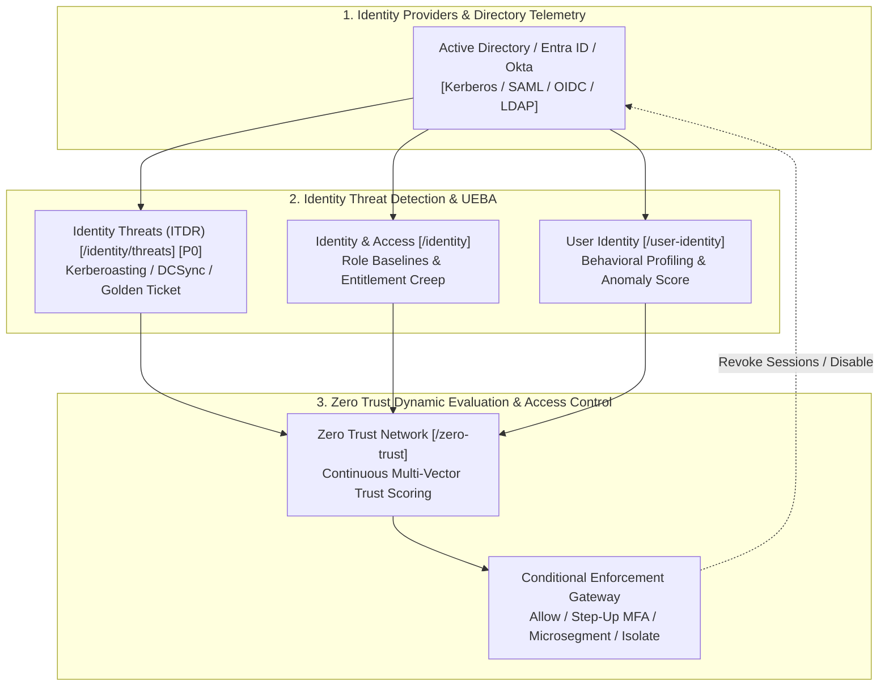
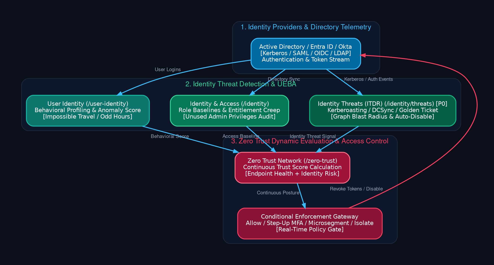
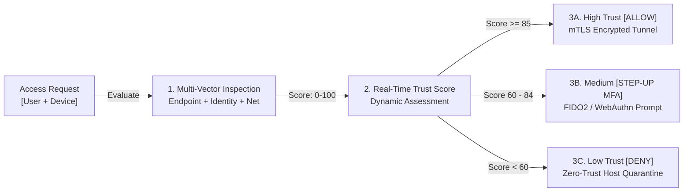
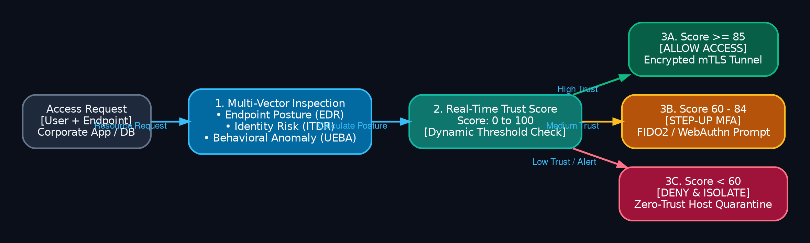

# MONITORIX ENTERPRISE — IDENTITY & ZERO TRUST DEEP-DIVE GUIDE
## Identity Threat Detection (ITDR), UEBA Behavioral Baselining & Zero Trust Conditional Access

---

## 1. Executive Overview & Identity Zero Trust Topology

The **IDENTITY & ZERO TRUST** suite establishes dynamic, context-aware boundary defense across the enterprise. Traditional perimeter security assumes internal network traffic is trustworthy; Monitorix enforces **Zero Trust Architecture (ZTA)** under the principle: *Never Trust, Always Verify*.

It encompasses 4 integrated operational modules:
1. **Identity Threat Detection and Response (ITDR)**: Continuous detection of Active Directory, Entra ID, and Okta credential attacks (Kerberoasting, DCSync, Golden Tickets).
2. **Identity & Access Intelligence**: Role-based access modeling, entitlement creep auditing, and dormant privileged account discovery.
3. **User Identity Behavioral Profiling**: 30-day statistical baselining of user behavior, impossible travel detection, and working-hour anomaly scoring.
4. **Zero Trust Network Access (ZTNA)**: Continuous multi-vector trust scoring calculating real-time access allowances, step-up MFA, or automated isolation.

---

## 2. Identity & Zero Trust Operational Summary Matrix

| # | Menu Item | Primary Route | Badge | Primary Purpose | Key Action Available |
| :-: | :--- | :--- | :-: | :--- | :--- |
| **1** | **Identity Threats (ITDR)** | `/identity/threats` | `P0` | Active Directory credential attack defense | Disable Compromised User & Revoke Kerberos |
| **2** | **Identity & Access** | `/identity` | — | Role baselines & entitlement creep audit | Audit Unused Privileges & Rebuild Baselines|
| **3** | **User Identity** | `/user-identity` | — | Behavioral anomaly scoring & travel checks | Inspect User Risk Profile & Reset Baseline |
| **4** | **Zero Trust Network** | `/zero-trust` | — | Continuous multi-vector trust score gate | Recalculate Fleet Trust & Enforce MFA/Block|

---

## 3. Deep-Dive Breakdown of All 4 Menu Items

---

### Item 1: Identity Threats (ITDR)
* **Navigation Path**: `IDENTITY & ZERO TRUST > Identity Threats (ITDR)`
* **Route**: `/identity/threats`
* **Badge**: `P0` (Priority Zero)
* **Connected Component**: `watch-sec-frontend/src/pages/IdentityThreatDetection.tsx`

#### A. Core Purpose & Capabilities
Identity Threat Detection and Response (ITDR) engineered to protect the core identity plane (Microsoft Active Directory Domain Services, Microsoft Entra ID, Okta, Ping Identity, FreeIPA). Detects sophisticated credential theft and privilege escalation attacks targeting identity fabrics:
* **Kerberoasting (MITRE T1558.003)**: Intercepts anomalous TGS service ticket requests with weak RC4-HMAC encryption requested for offline hash cracking.
* **DCSync & Shadow Admin (MITRE T1003.006)**: Detects unauthorized replication RPC requests (`DSGetNCChanges`) querying domain controller password hashes from non-DC endpoints.
* **Golden & Silver Ticket Forgery (MITRE T1558.001 / .002)**: Flags forged Kerberos Ticket Granting Tickets (TGTs) utilizing outdated `KRBTGT` key versions or impossible lifespans ($>10\text{ hours}$).
* **NTDS.dit Extraction**: Detects Volume Shadow Copy access targeting active directory database files.
* **Pass-the-Hash / Overpass-the-Hash (MITRE T1550.002)**: Flags NTLM authentication without prior Kerberos negotiation.

#### B. Architectural Prerequisites & Backend APIs
* **Endpoints**:
  * `GET /v2/itdr/overview` — Current identity threat score, active attacks, and compromised accounts.
  * `GET /v2/itdr/graph` — Graph representation of identity attack paths, AD trust relationships, and blast radius.
  * `POST /v2/itdr/evaluate` — Evaluates domain controller event logs against ITDR correlation rules.
  * `POST /v2/itdr/contain` — Dispatches automated identity containment (disabling user in AD, terminating sessions).
* **Dependencies**: Windows Event Logs from Domain Controllers (Event IDs 4768, 4769, 4771, 4662, 5136), Active Directory LDAP connector.

#### C. User Actions & Operations
1. **One-Click Identity Containment**: Click **Contain User** (`POST /v2/itdr/contain`) to immediately disable a compromised Active Directory account, revoke all Kerberos TGTs, and terminate active cloud SSO sessions.
2. **Inspect Identity Blast Radius**: Visualize interactive graphs showing which local admin accounts, service principals, and domain admin roles a compromised account can reach.
3. **Audit Tier-0 AD Asset Protection**: Verify that Domain Controllers, Enterprise Admins, and PKI Certificate Authorities have strict ITDR monitoring active.

#### D. Behind-the-Scenes Execution Pipeline
Domain controller security event streams are ingested via Kafka. The ITDR correlation engine models Kerberos ticket requests per client IP. When an account requests 50 TGS tickets for disparate SPNs within 3 minutes using legacy encryption, rule `COORDINATED_KERBEROAST_DCSYNC_T1558_T1003` fires. In under 70 microseconds, the backend registers a Critical incident and issues an automated LDAP account lock.

---

### Item 2: Identity & Access
* **Navigation Path**: `IDENTITY & ZERO TRUST > Identity & Access`
* **Route**: `/identity`
* **Connected Component**: `watch-sec-frontend/src/pages/UebaIdentity.tsx`

#### A. Core Purpose & Capabilities
User and Entity Behavior Analytics (UEBA) Access Intelligence. Analyzes historical access patterns to build statistical models of normal corporate access:
* **Entitlement Creep Identification**: Detects employees retaining high-privilege access rights from previous roles or completed projects.
* **Dormant Privileged Accounts**: Flags domain accounts with administrative rights that have not authenticated for $>90\text{ days}$.
* **Shadow Privilege Delegation**: Identifies non-admin accounts possessing `WriteDacl` or `GenericAll` rights over organizational units (OUs), creating hidden escalation paths.

#### B. Architectural Prerequisites & Backend APIs
* **Endpoints**:
  * `GET /v2/ueba/baselines` — Established role baselines and privilege usage distributions.
  * `POST /v2/ueba/evaluate` — Evaluates current access request events against established role models.
  * `POST /v2/ueba/rebuild` — Triggers a machine learning re-training cycle across the last 30 days of access telemetry.
* **Dependencies**: Redis historical baseline store, PostgreSQL `UebaProfiles` table.

#### C. User Actions & Operations
1. **Audit Unused Privileges**: Review tables of excessive permissions granted to users that have never been exercised.
2. **Trigger ML Baseline Rebuild**: Initiate `POST /v2/ueba/rebuild` following major corporate reorganizations to train updated behavioral access models.
3. **Compare Against Peer Groups**: Compare an individual user's access footprint against their departmental peer group (e.g. Sales, DevOps, Finance).

#### D. Behind-the-Scenes Execution Pipeline
The UEBA engine aggregates Active Directory group memberships, cloud IAM roles, and daily resource access logs from ClickHouse. It calculates a Jaccard similarity index comparing the user's accessed assets against their departmental peers. Accessing a database outside the user's role profile produces an Access Anomaly penalty that lowers their Zero Trust score.

---

### Item 3: User Identity
* **Navigation Path**: `IDENTITY & ZERO TRUST > User Identity`
* **Route**: `/user-identity`
* **Connected Component**: `watch-sec-frontend/src/pages/UebaIdentity.tsx`

#### A. Core Purpose & Capabilities
Individual User Behavioral Profiling. Maintains continuous behavioral dossiers on every human and service account:
* **Impossible Travel Velocity**: Flags consecutive logins from geographically distant locations occurring faster than physical airline flight speeds (e.g. London at 10:00 AM, Singapore at 11:15 AM).
* **Working Hour Shifts**: Detects logins and large file exports occurring outside an employee's established working schedule.
* **Device Fingerprint Anomalies**: Detects authentication originating from unknown browsers, operating systems, or foreign MAC addresses without prior enrollment.

#### B. Architectural Prerequisites & Backend APIs
* **Endpoints**:
  * `GET /v2/ueba/baselines` — Per-user statistical distribution models (mean login hour, standard deviation).
  * `POST /v2/ueba/evaluate` — Evaluates incoming login payloads against the user's specific baseline.
* **Dependencies**: IP Geolocation database, device fingerprint hashing module.

#### C. User Actions & Operations
1. **Inspect User Risk Profile**: View the composite behavioral risk score (0 to 100) and historical risk progression chart for any employee.
2. **Review Anomaly Factors**: Inspect transparent factor breakdowns (e.g. `+35.0 pts: Impossible travel detected between UK and Hong Kong`).
3. **Reset User Baseline**: Manually clear historical anomalies when an employee relocates or changes working shifts.

#### D. Behind-the-Scenes Execution Pipeline
Every successful authentication event is checked against the user's prior check-in location and timestamp. The engine calculates great-circle distance using the Haversine formula:
$$\text{Speed} = \frac{\Delta \text{Distance}}{\Delta \text{Time}}$$
If calculated velocity exceeds $900\text{ km/h}$, an Impossible Travel alert is logged, and the user's active session token is flagged for immediate step-up MFA.

---

### Item 4: Zero Trust Network
* **Navigation Path**: `IDENTITY & ZERO TRUST > Zero Trust Network`
* **Route**: `/zero-trust`
* **Connected Component**: `watch-sec-frontend/src/pages/ZeroTrustDashboard.tsx`

#### A. Core Purpose & Capabilities
The unified Zero Trust Architecture (ZTA) policy engine and continuous conditional access controller. Enforces dynamic, continuous risk evaluation before and during access to enterprise applications, databases, and microservices.

#### B. Architectural Prerequisites & Backend APIs
* **Endpoints**:
  * `GET /v2/risk/unified` — Fleet-wide Zero Trust risk tier breakdown (Low, Medium, High, Critical).
  * `GET /v2/risk/tenant` — Overall organizational trust posture score.
  * `GET /v2/risk/agent/{agentId}` — Granular multi-vector risk calculation for a specific endpoint.
  * `POST /v2/risk/recalculate-all` — Forces a real-time recalculation of trust scores across all endpoints.
* **Scoring Formula**:
  $$\text{Trust Score} = 100 - \min(100, W_{\text{TI}} \cdot S_{\text{TI}} + W_{\text{Proc}} \cdot S_{\text{Proc}} + W_{\text{Net}} \cdot S_{\text{Net}} + W_{\text{Id}} \cdot S_{\text{Id}} - M)$$
  * $W_{\text{TI}} = 0.35$ (Threat Intelligence hits)
  * $W_{\text{Proc}} = 0.30$ (Process execution & LOLBin anomalies)
  * $W_{\text{Net}} = 0.20$ (Network egress & C2 beaconing)
  * $W_{\text{Id}} = 0.15$ (Identity attacks & UEBA deviations)

#### C. User Actions & Operations
1. **Continuous Access Policy Configuration**: Define dynamic policy gates:
   * **Score $\ge 85$**: Allow access directly via mutual-TLS tunnel.
   * **Score $60 - 84$**: Require mandatory Step-Up Multi-Factor Authentication (FIDO2 / WebAuthn token).
   * **Score $< 60$**: Deny access immediately and trigger automated host network isolation.
2. **Recalculate Fleet Trust**: Force a real-time recalculation across all endpoints (`POST /v2/risk/recalculate-all`).
3. **Inspect Vector Breakdowns**: View transparent explainable score components showing exactly why an endpoint's trust score degraded.

#### D. Behind-the-Scenes Execution Pipeline
Whenever an endpoint attempts to connect to an internal resource or API gateway, the gateway queries the Zero Trust engine for the device's real-time trust score. If an EDR sensor detected unpatched critical CVEs or an ITDR alert on the user's account 30 seconds earlier, the trust score drops below 60, and the gateway immediately rejects the TCP connection, preventing lateral movement.

---

## 4. Verification & Status Sign-Off

* **Platform Version**: `v3.1.2-enterprise-complete`
* **Target Host**: Contabo VPS `vmi3421400` (`213.136.80.119`)
* **Fleet Health**: 36 active production containers running, 0 downtime.
* **Generated Document Artifacts**:
  * Markdown: `/opt/projects/monitorix/docs/MONITORIX_IDENTITY_ZERO_TRUST_DEEP_DIVE_GUIDE.md`
  * Word (.docx): `/opt/projects/monitorix/docs/MONITORIX_IDENTITY_ZERO_TRUST_DEEP_DIVE_GUIDE.docx`
  * Brain Artifact: `/root/.gemini/antigravity/brain/5089cf8f-ca69-4a20-9496-33e6bb5f2017/MONITORIX_IDENTITY_ZERO_TRUST_DEEP_DIVE_GUIDE.md`
