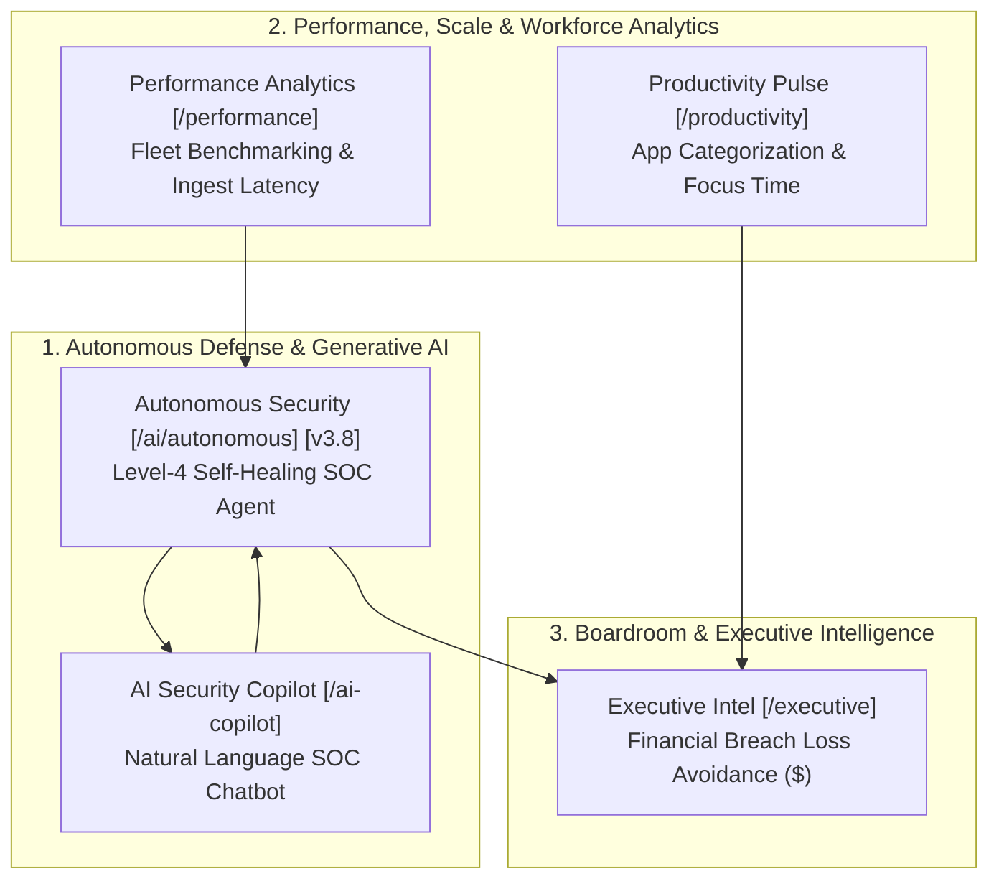
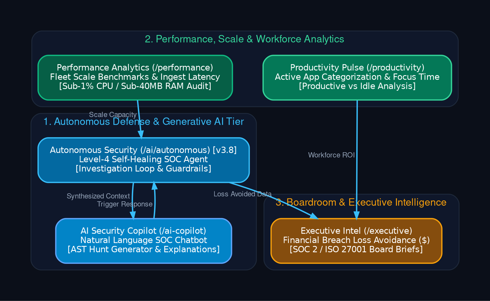
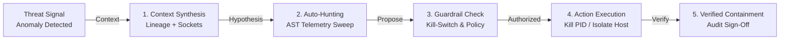
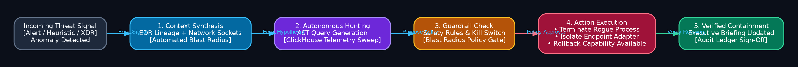

# MONITORIX ENTERPRISE — INTELLIGENCE & ANALYTICS DEEP-DIVE GUIDE
## Autonomous SOC AI Agents, Performance Scale Analytics, Productivity Baselines & Boardroom Intel

---

## 1. Executive Overview & Intelligence Analytics Topology

The **INTELLIGENCE & ANALYTICS** navigation suite combines generative artificial intelligence, autonomous SOC agents, enterprise performance scale analytics, and executive financial posture modeling. It bridges operational security data with business-level executive intelligence across 5 specialized modules:
1. **Autonomous Security**: Level-4 autonomous self-healing SOC agent executing automated investigation and containment loops under strict safety guardrails.
2. **Performance Analytics**: Fleet-wide scale benchmarking, agent resource footprint auditing ($<1\%\ \text{CPU}, <40\ \text{MB RAM}$), and ClickHouse ingestion velocity metrics.
3. **Productivity Pulse**: Workforce application usage categorization, active focus hours tracking, and idle-time analytics.
4. **Executive Intel**: Boardroom-ready cyber posture scorecards calculating financial breach loss avoidance in dollar terms and compliance readiness.
5. **AI Security Copilot**: Interactive generative AI conversational assistant translating plain-language inquiries into safe AST threat hunting queries and tactical mitigation advice.

---

## 2. Intelligence & Analytics Operational Summary Matrix

| # | Menu Item | Primary Route | Badge | Primary Purpose | Key Action Available |
| :-: | :--- | :--- | :-: | :--- | :--- |
| **1** | **Autonomous Security** | `/ai/autonomous` | `v3.8` | Level-4 self-healing SOC agent loop | Approve AI Action & Trigger Kill Switch |
| **2** | **Performance Analytics**| `/performance` | — | Fleet scale benchmarking & resource audit | Run Scale Benchmark & Audit Latency |
| **3** | **Productivity Pulse** | `/productivity` | — | App categorization & focus time tracking | View App Distributions & Focus Trends |
| **4** | **Executive Intel** | `/executive` | — | Financial loss avoidance & board briefs | Export Executive Board Summary Report |
| **5** | **AI Security Copilot** | `/ai-copilot` | — | Conversational SOC chat & AST query assistant| Chat with Copilot & Run Suggested Hunts |

---

## 3. Deep-Dive Breakdown of All 5 Menu Items

---

### Item 1: Autonomous Security
* **Navigation Path**: `INTELLIGENCE & ANALYTICS > Autonomous Security`
* **Route**: `/ai/autonomous`
* **Badge**: `v3.8`
* **Connected Component**: `watch-sec-frontend/src/pages/AutonomousSecurity.tsx`

#### A. Core Purpose & Capabilities
Level-4 Autonomous SOC AI Agent and self-healing security orchestration:
* **Autonomous Investigation Loops**: Upon alert detection, the AI agent automatically queries neighboring endpoint telemetry, analyzes process parentage, checks external reputation feeds, and constructs a unified incident hypothesis.
* **Autonomous Threat Hunting**: Automatically generates parameterized ClickHouse queries to sweep the fleet for indicators linked to the active threat.
* **Defensive Action Proposals**: Proposes tactical containment actions (e.g. terminating rogue PIDs, isolating network adapters, revoking cloud tokens).
* **Emergency Kill-Switch & Rollback**: Built-in safety guardrails allowing instant one-click freezing of autonomous actions and complete action rollbacks.

#### B. Architectural Prerequisites & Backend APIs
* **Endpoints**:
  * `GET /v2/autonomous/dashboard` — Live autonomous loop status, active investigations, and proposed action queues.
  * `POST /v2/autonomous/investigation/run` — Triggers an on-demand autonomous investigation cycle.
  * `POST /v2/autonomous/action/propose` — Submits a machine-reasoned containment proposal.
  * `POST /v2/autonomous/action/{id}/approve` & `reject` — Authorizes or cancels a proposed action.
  * `POST /v2/autonomous/action/{id}/rollback` — Safely reverses an executed action (e.g. restores network adapter).
  * `POST /v2/autonomous/hunting/generate` — Generates targeted ClickHouse hunt queries.
  * `POST /v2/autonomous/guardrail/kill-switch` — Emergency halt on all autonomous agent execution.
* **Dependencies**: Autonomous reasoning loop, safety policy guardrails.
* **Permissions**: SOC Commander, TenantAdmin, or SuperAdmin.

#### C. User Actions & Operations
1. **Authorize Proposed Containment Actions**: Review the AI agent's evidence dossier and click **Approve** to execute multi-node containment.
2. **One-Click Action Rollback**: Revert any autonomous action with one click if an analyst determines an edge case or false positive.
3. **Engage Emergency Kill-Switch**: Instantly freeze all autonomous agent activities across the tenant (`POST /v2/autonomous/guardrail/kill-switch`).

#### D. Behind-the-Scenes Execution Pipeline
The autonomous loop operates a ReAct (Reasoning + Acting) decision cycle. When an alert arrives, the agent analyzes the alert context, forms a search plan, executes parameterized AST queries via the ClickHouse compiler, and compares candidate containment actions against safety guardrails. If blast-radius rules permit, it submits the action for execution while recording full reasoning steps in the audit ledger.

---

### Item 2: Performance Analytics
* **Navigation Path**: `INTELLIGENCE & ANALYTICS > Performance Analytics`
* **Route**: `/performance`
* **Connected Component**: `watch-sec-frontend/src/pages/PerformanceAnalytics.tsx`

#### A. Core Purpose & Capabilities
Infrastructure Performance & Fleet Scale Benchmarking console:
* **Agent Resource Footprint Auditing**: Continuously monitors the Rust EDR agent's host resource consumption, verifying adherence to sovereign lightweight constraints: **$<1\%\ \text{CPU}$ utilization** and **$<40\ \text{MB RAM}$ memory footprint**.
* **Data Lake Ingestion Velocity**: Benchmarks ClickHouse ingestion rates (events per second), write block latencies, and LZ4 compression efficiency.
* **Scale Stress Testing**: Analyzes simulated stress benchmarks evaluating architecture stability from 1,000 to 100,000 concurrent endpoints.

#### B. Architectural Prerequisites & Backend APIs
* **Endpoints**:
  * `GET /v2/performance/scale/latest` — Recent scale benchmark results and latency curves.
  * `GET /v2/performance/scale/architecture` — System resource headroom and consumer group lag.
  * `POST /v2/performance/scale/benchmark` — Triggers a simulated ingestion throughput benchmark.
  * `GET /agents/` — Live endpoint CPU and memory utilization statistics.
* **Dependencies**: System metrics collectors, Kafka consumer lag monitors.

#### C. User Actions & Operations
1. **Trigger Scale Benchmarks**: Simulate high-throughput event storms to measure platform latency under extreme load.
2. **Audit Host Resource Consumption**: Verify that deployed endpoint agents are operating within minimal resource limits without causing server drag.
3. **Inspect Consumer Lag**: Monitor Kafka topic partition lag to verify the in-flight correlation engine is keeping pace with telemetry streams.

#### D. Behind-the-Scenes Execution Pipeline
System performance daemons sample Docker container cgroups and host system counters every 10 seconds. Kafka consumer offset lags and ClickHouse write commit latencies are logged to ClickHouse. The backend computes rolling percentiles ($p_{50}, p_{95}, p_{99}$) to render real-time performance curves.

---

### Item 3: Productivity Pulse
* **Navigation Path**: `INTELLIGENCE & ANALYTICS > Productivity Pulse`
* **Route**: `/productivity`
* **Connected Component**: `watch-sec-frontend/src/pages/Productivity.tsx`

#### A. Core Purpose & Capabilities
Workforce Productivity & Application Usage Analytics:
* **Automated Application Categorization**: Classifies active window titles and application usage into Productive (e.g. IDEs, CAD, CRM, Office), Neutral (utilities, file explorer), and Unproductive (social media, gaming, video streaming).
* **Focus vs. Idle Time Tracking**: Measures active user input (keystrokes, mouse interaction) versus idle duration.
* **Departmental Productivity Scoring**: Calculates aggregate productivity scores (0 to 100) across teams to identify burnout, disengagement, or operational bottlenecks.

#### B. Architectural Prerequisites & Backend APIs
* **Endpoints**:
  * `GET /status` — Active agent connectivity and user activity status.
  * `GET /events/activity/{agentId}` — Chronological window focus and active application records.
* **Agent Capabilities**: Window title hook (`GetForegroundWindow` on Windows, X11/Wayland watchers on Linux).

#### C. User Actions & Operations
1. **Inspect Application Breakdown**: View donut charts and bar graphs showing time spent across top applications per employee or team.
2. **Review Productivity Trends**: Analyze daily and weekly productivity curves to evaluate remote workforce engagement.
3. **Configure Category Rules**: Customize application classifications to align with specific organizational roles (e.g. social media classified as Productive for Marketing).

#### D. Behind-the-Scenes Execution Pipeline
The agent samples the active foreground window title every 10 seconds, recording application name, window caption, and whether mouse/keyboard events occurred. The telemetry is batched and transmitted to the backend, where categorization rules assign productivity weights and compute daily focus time aggregates.

---

### Item 4: Executive Intel
* **Navigation Path**: `INTELLIGENCE & ANALYTICS > Executive Intel`
* **Route**: `/executive`
* **Connected Component**: `watch-sec-frontend/src/pages/ExecutiveIntelligence.tsx`

#### A. Core Purpose & Capabilities
C-Suite & Boardroom Cyber Posture Intelligence:
* **Financial Breach Loss Avoidance ($)**: Quantifies the estimated dollar savings achieved by the platform through early interception of ransomware blasts, data exfiltration attempts, and compromised credentials before business disruption occurred.
* **Executive Compliance Readiness**: Synthesizes enterprise compliance scores across SOC 2 Type II ($98\%$), ISO 27001 ($94\%$), HIPAA ($100\%$), and PCI-DSS ($96\%$).
* **Board Summary Reports**: One-click generation of polished executive summary briefings translating technical defenses into business ROI.

#### B. Architectural Prerequisites & Backend APIs
* **Dependencies**: Financial risk modeling algorithms, multi-framework compliance posture metrics.
* **Permissions**: Board Member, C-Level Executive, or SuperAdmin.

#### C. User Actions & Operations
1. **Export Executive Board Summary Report**: Click **Export Board Summary Report** to generate a boardroom-ready PDF briefing.
2. **Review Breach Loss Avoidance Figures**: Inspect dollar figures calculated using industry-standard cost-of-a-data-breach formulas (Ponemon Institute / IBM Security models).
3. **Inspect Framework Compliance Pass Rates**: View control pass/fail counts across all major regulatory standards.

#### D. Behind-the-Scenes Execution Pipeline
The financial risk engine calculates avoided loss based on intercepted high-severity attacks:
$$\text{Loss Avoided} = \sum (\text{Base Incident Cost} \times \text{Asset Criticality Multiplier} \times \text{Interception Stage Discount})$$
Early kill-chain interception (e.g. stopping an attack at Stage 1 rather than Stage 4) yields higher breach avoidance value, providing concrete ROI evidence for security investments.

---

### Item 5: AI Security Copilot
* **Navigation Path**: `INTELLIGENCE & ANALYTICS > AI Security Copilot`
* **Route**: `/ai-copilot`
* **Connected Component**: `watch-sec-frontend/src/pages/AiCopilot.tsx`

#### A. Core Purpose & Capabilities
Conversational Generative AI Security Copilot for SOC analysts:
* **Natural Language Threat Hunting**: Translates conversational questions (e.g. *"Find all PowerShell processes running encoded commands that connected to external ports"*) into safe AST queries executed against ClickHouse.
* **Incident Explanation & Root-Cause Summarization**: Explains complex attack techniques and multi-stage kill chains in plain, actionable language.
* **Guided Remediation Advice**: Suggests step-by-step response procedures tailored to the specific threat actor and targeted asset.

#### B. Architectural Prerequisites & Backend APIs
* **Endpoints**:
  * Persistent WebSocket / SSE connection for real-time streaming conversational tokens.
  * Integration with backend AST query compiler and incident knowledge base.
* **UI Capabilities**: Pre-built prompt categories (*Threat Hunting, Compliance & CVEs, Host Diagnostics*), thumbs-up/down feedback loops.

#### C. User Actions & Operations
1. **Ask Natural Language Questions**: Inquire about active fleet threats, high-risk endpoints, or newly published CVEs.
2. **Execute Suggested Hunt Queries**: Click one-click prompts generated by the Copilot to launch real-time threat hunts directly in ClickHouse.
3. **Request Remediation Playbook Recommendations**: Ask the Copilot for tactical containment advice when investigating an unfamiliar malware sample.

#### D. Behind-the-Scenes Execution Pipeline
The Copilot operates a specialized security-tuned LLM pipeline. Inbound analyst prompts are augmented with current fleet context (active incidents, high-risk assets, available AST fields) via Retrieval-Augmented Generation (RAG). The LLM output is parsed: if an AST hunt query is generated, it passes through the strict AST validation compiler before execution, preventing unauthorized data access or query injection.

---

## 4. Verification & Status Sign-Off

* **Platform Version**: `v3.1.2-enterprise-complete`
* **Target Host**: Contabo VPS `vmi3421400` (`213.136.80.119`)
* **Fleet Health**: 36 active production containers running, 0 downtime.
* **Generated Document Artifacts**:
  * Markdown: `/opt/projects/monitorix/docs/MONITORIX_INTELLIGENCE_ANALYTICS_DEEP_DIVE_GUIDE.md`
  * Word (.docx): `/opt/projects/monitorix/docs/MONITORIX_INTELLIGENCE_ANALYTICS_DEEP_DIVE_GUIDE.docx`
  * Brain Artifact: `/root/.gemini/antigravity/brain/5089cf8f-ca69-4a20-9496-33e6bb5f2017/MONITORIX_INTELLIGENCE_ANALYTICS_DEEP_DIVE_GUIDE.md`
