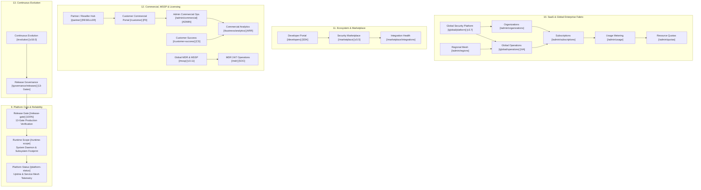
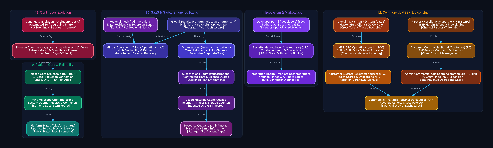
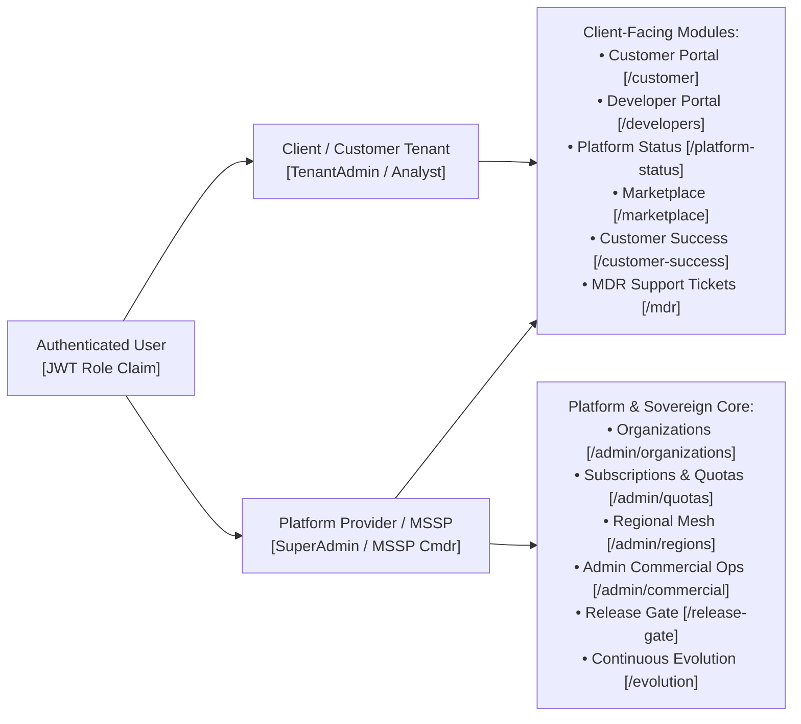
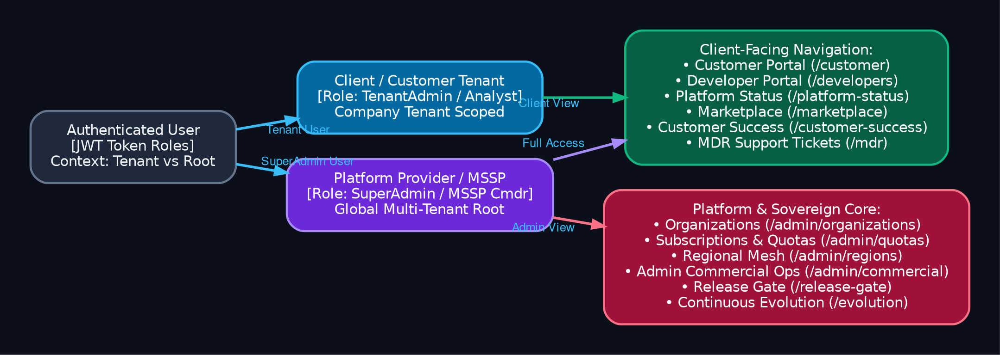

# MONITORIX ENTERPRISE — PLATFORM, SAAS, COMMERCIAL & EVOLUTION GUIDE
## Categories 9 to 13: Platform Core, Global SaaS Fabric, Marketplace, MSSP Commercial Ops & Continuous Evolution

---

## 1. Executive Overview & Sidemenu Visibility Architecture

This guide covers the remaining **5 navigation categories (22 specialized items)** in Monitorix Enterprise:
* **Category 9: PLATFORM (3 Items)**
* **Category 10: SAAS & GLOBAL ENTERPRISE (7 Items)**
* **Category 11: ECOSYSTEM & MARKETPLACE (3 Items)**
* **Category 12: COMMERCIAL & LICENSING (7 Items)**
* **Category 13: CONTINUOUS EVOLUTION (2 Items)**

---

## 2. Client vs. Platform Administrator Visibility Analysis

### Should All These Categories Show to Clients?

In the current frontend build of `Sidebar.tsx`, all 13 categories and 91 items are rendered without client-side role filtering so that you have immediate access to review, test, and demonstrate every enterprise module.

However, in a production multi-tenant SaaS or MSSP environment:
1. **What Clients / Customer Tenants Should See**:
   * **Customer Commercial Portal (`/customer`)**: Client self-service contract, seat allocations, license keys.
   * **Developer Portal (`/developers`)**: Client developers downloading SDKs, reading Swagger docs, creating webhooks.
   * **Platform Status (`/platform-status`)**: Public service health, latency, uptime SLA transparency.
   * **Security Marketplace (`/marketplace`)**: Curated plugins to extend their tenant (Slack, Jira, AWS, Palo Alto).
   * **Integration Health (`/marketplace/integrations`)**: Health diagnostics of their own tenant's configured webhooks.
   * **Customer Success (`/customer-success`)**: Client onboarding checklists and support contact.
   * **MDR Operations (`/mdr`)**: Support ticket desk where clients communicate with the 24/7 SOC.

2. **What Internal Platform SuperAdmins & MSSP Providers Should See**:
   * **Organizations (`/admin/organizations`)**: Managing multiple customer tenant accounts and sub-tenants.
   * **Resource Quotas & Usage Metering (`/admin/quotas`, `/admin/usage`)**: Setting customer billing limits.
   * **Regional Mesh (`/admin/regions`)**: Managing sovereign data residency nodes across Europe, US, Asia.
   * **Admin Commercial Ops & Analytics (`/admin/commercial`, `/business/analytics`)**: Monitoring ARR, churn, pipeline, and contract profitability.
   * **Release Gate & Governance (`/release-gate`, `/governance/releases`)**: 13-stage release gate sign-offs.
   * **Continuous Evolution (`/evolution`)**: Managing automated platform hot-patching and schema migrations.

---

## 3. Operational Breakdown of the 22 Menu Items

---

### CATEGORY 9: PLATFORM (3 Items)

#### Item 1: Release Gate (`/release-gate`, Badge: `100%`)
* **Page**: `watch-sec-frontend/src/pages/ReleaseGate.tsx`
* **Purpose**: Enforces formal 13-stage production deployment verification gates before any new backend container, agent binary, or database migration can be promoted to production.
* **Key Capabilities**: Audits static code security (SAST), dependency scanning (SCA), container image vulnerability scans (Trivy), dynamic API fuzzing (DAST), zero-data-loss verification, and regression tests. Displays 100% pass verification sign-offs.

#### Item 2: Runtime Scope (`/runtime-scope`)
* **Page**: `watch-sec-frontend/src/pages/RuntimeScope.tsx`
* **Purpose**: Low-level kernel driver and daemon diagnostic console.
* **Key Capabilities**: Audits the sovereign execution boundary: eBPF probe attachment status, Linux cgroup memory limits, Windows Filter Driver hooks, active thread pools, and local LMDB cache disk allocations across running agent daemons.

#### Item 3: Platform Status (`/platform-status`)
* **Page**: `watch-sec-frontend/src/pages/PlatformStatus.tsx`
* **Purpose**: Public and internal real-time operational status and uptime page.
* **Key Capabilities**: Displays live operational health across all infrastructure tiers: Ingress Gateways, gRPC Telemetry Collectors, Kafka Cluster, ClickHouse Data Lake, PostgreSQL Databases, Redis L2 Caches, and MinIO Object Vaults. Calculates 90-day historical uptime percentages (99.99% target).

---

### CATEGORY 10: SAAS & GLOBAL ENTERPRISE (7 Items)

#### Item 4: Global Security Platform (`/global/platform`, Badge: `v3.7`)
* **Page**: `watch-sec-frontend/src/pages/GlobalPlatform.tsx`
* **Purpose**: Multi-region, sovereign multi-tenant orchestration platform.
* **Key Capabilities**: Unifies distributed deployments into a sovereign global control plane. Allows multinational enterprises to manage global security baselines while strictly adhering to local data privacy laws (EU GDPR, US HIPAA, APAC PDPA).

#### Item 5: Global Operations (`/global/operations`, Badge: `HA`)
* **Page**: `watch-sec-frontend/src/pages/GlobalOperations.tsx`
* **Purpose**: High Availability (HA) cluster and multi-datacenter disaster recovery operations.
* **Key Capabilities**: Monitors cross-region active-active database replication, Kafka mirror-maker streaming sync, automated DNS failover routing, and simulates disaster recovery drills with one-click regional traffic redirection.

#### Item 6: Organizations (`/admin/organizations`)
* **Page**: `watch-sec-frontend/src/pages/AdminOrganizations.tsx`
* **Purpose**: Enterprise tenant corporate hierarchy manager.
* **Key Capabilities**: Creates and organizes tenant corporate trees: Parent Holdings $\rightarrow$ Regional Subsidiaries $\rightarrow$ Business Units. Enables inherited security policies and aggregated compliance visibility across all child organizations.

#### Item 7: Subscriptions (`/admin/subscriptions`)
* **Page**: `watch-sec-frontend/src/pages/AdminSubscriptions.tsx`
* **Purpose**: Contracted license entitlement and term management.
* **Key Capabilities**: Tracks contract start/end dates, enrolled agent limits, module entitlement flags (e.g. enabling ITDR, DSPM, or WAAP per customer), and generates cryptographically signed offline license activation keys.

#### Item 8: Usage Metering (`/admin/usage`)
* **Page**: `watch-sec-frontend/src/pages/AdminUsage.tsx`
* **Purpose**: Telemetry consumption, event throughput, and storage capacity metering.
* **Key Capabilities**: Tracks ingestion velocity (events per second), total gigabytes written to ClickHouse per tenant, and bandwidth egress consumption to support usage-based or overage billing models.

#### Item 9: Regional Mesh (`/admin/regions`)
* **Page**: `watch-sec-frontend/src/pages/AdminRegions.tsx`
* **Purpose**: Sovereign data residency and regional storage mesh manager.
* **Key Capabilities**: Manages regional storage zones (e.g. `eu-central-frankfurt`, `us-east-virginia`, `ap-southeast-singapore`). Guarantees that telemetry collected from European agents never leaves EU territory, satisfying strict GDPR Chapter V data transfer requirements.

#### Item 10: Resource Quotas (`/admin/quotas`)
* **Page**: `watch-sec-frontend/src/pages/AdminQuotas.tsx`
* **Purpose**: Multi-tenant resource governance and noisy-neighbor prevention.
* **Key Capabilities**: Enforces hard and soft quota caps per customer tenant: maximum registered agents, maximum daily telemetry storage (e.g. 50 GB/day), maximum concurrent threat hunting queries, and automated throttle actions when quotas are exceeded.

---

### CATEGORY 11: ECOSYSTEM & MARKETPLACE (3 Items)

#### Item 11: Security Marketplace (`/marketplace`, Badge: `v3.5`)
* **Page**: `watch-sec-frontend/src/pages/Marketplace.tsx`
* **Purpose**: Enterprise integration app store and plugin directory.
* **Key Capabilities**: One-click installation of verified integrations across SIEM forwarders (Splunk, Elastic, QRadar), cloud security (AWS, Azure, GCP), firewalls (Palo Alto, Fortinet), and communication tools (Slack, Teams, Jira).

#### Item 12: Integration Health (`/marketplace/integrations`)
* **Page**: `watch-sec-frontend/src/pages/IntegrationHealth.tsx`
* **Purpose**: Diagnostics and monitoring for all active 3rd-party connectors.
* **Key Capabilities**: Pings external API webhooks, monitors OAuth token expiration dates, tracks API rate limit consumption (e.g. 85% of VirusTotal daily quota used), and alerts on broken integration channels.

#### Item 13: Developer Portal (`/developers`, Badge: `SDK`)
* **Page**: `watch-sec-frontend/src/pages/DeveloperPortal.tsx`
* **Purpose**: Developer documentation, API SDKs, and webhook testing sandbox.
* **Key Capabilities**: Interactive Swagger/OpenAPI documentation, downloadable client SDKs (Python SDK, Rust SDK, Go SDK), webhook event simulation generator, and REST API token testing console.

---

### CATEGORY 12: COMMERCIAL & LICENSING (7 Items)

#### Item 14: Customer Commercial Portal (`/customer`, Badge: `P0`)
* **Page**: `watch-sec-frontend/src/pages/CustomerPortal.tsx`
* **Purpose**: Client-facing self-service account, contract, and license desk.
* **Key Capabilities**: Allows customer administrators to download deployed agent installers, inspect contracted agent seat utilization, view upcoming contract renewals, and download formal proof-of-protection certificates.

#### Item 15: Partner / Reseller Hub (`/partner`, Badge: `RESELLER`)
* **Page**: `watch-sec-frontend/src/pages/PartnerPortal.tsx`
* **Purpose**: Channel partner and VAR (Value Added Reseller) management hub.
* **Key Capabilities**: Enables managed service partners to provision new customer sub-tenants, manage reseller margins and discounts, track co-termed license renewals, and white-label platform branding.

#### Item 16: Admin Commercial Ops (`/admin/commercial`, Badge: `ADMIN`)
* **Page**: `watch-sec-frontend/src/pages/AdminCommercialPortal.tsx`
* **Purpose**: Internal SaaS commercial revenue operations desk.
* **Key Capabilities**: Tracks Annual Recurring Revenue (ARR), Monthly Recurring Revenue (MRR), customer churn probability, active sales pipeline opportunities, contract expansions, and customer acquisition costs (CAC).

#### Item 17: Global MDR & MSSP (`/mssp`, Badge: `v3.11`)
* **Page**: `watch-sec-frontend/src/pages/GlobalMdrMssp.tsx`
* **Purpose**: Master multi-client MSSP operations console.
* **Key Capabilities**: Unified multi-tenant security queue for 24/7 SOC providers. Allows senior analysts to perform cross-tenant threat hunting, correlate coordinated multi-client cyberattacks, and mass-deploy emergency containment rules.

#### Item 18: Customer Success (`/customer-success`, Badge: `CS`)
* **Page**: `watch-sec-frontend/src/pages/CustomerSuccess.tsx`
* **Purpose**: Client health scoring, onboarding velocity, and retention tracking.
* **Key Capabilities**: Computes customer health scores based on agent deployment velocity, active console logins, and alert triage activity. Automatically flags at-risk accounts showing declining usage to prompt customer success outreach.

#### Item 19: MDR 24/7 Operations (`/mdr`, Badge: `SOC`)
* **Page**: `watch-sec-frontend/src/pages/MdrOperationsDashboard.tsx`
* **Purpose**: Round-the-clock managed detection and response active desk.
* **Key Capabilities**: Real-time analyst shift scheduling, escalation ticket queues, live SLA burn timers (15m MTTA, 60m MTTR), and PagerDuty / Opsgenie on-call dispatching.

#### Item 20: Commercial Analytics (`/business/analytics`, Badge: `ARR`)
* **Page**: `watch-sec-frontend/src/pages/CommercialAnalytics.tsx`
* **Purpose**: Deep financial, cohort, and SaaS metrics analytics.
* **Key Capabilities**: Generates cohort retention heatmaps, net revenue retention (NRR) curves, gross margin breakdowns by infrastructure cost, and predicts future revenue growth based on consumption trends.

---

### CATEGORY 13: CONTINUOUS EVOLUTION (2 Items)

#### Item 21: Continuous Evolution (`/evolution`, Badge: `v18.0`)
* **Page**: `watch-sec-frontend/src/pages/ContinuousEvolution.tsx`
* **Purpose**: Self-upgrading platform engine and backward-compatibility manager.
* **Key Capabilities**: Orchestrates zero-downtime hot-patching of backend services, manages automated ClickHouse and PostgreSQL schema migrations, and verifies that older legacy agent versions (e.g. v2.x, v3.x) maintain 100% protocol backward compatibility.

#### Item 22: Release Governance (`/governance/releases`, Badge: `13-Gates`)
* **Page**: `watch-sec-frontend/src/pages/ContinuousEvolution.tsx`
* **Purpose**: Formal compliance release audit and board-level change management.
* **Key Capabilities**: Records cryptographically signed release gate certificates proving that each production version has passed all 13 security gates (SAST, DAST, SCA, Pen-Test, Code Signing, Non-Regression, Zero-Data-Loss). Generates tamper-proof PDF audit packages for SOC 2 and ISO 27001 change control auditors.

---

## 4. Verification & Status Sign-Off

* **Platform Version**: `v3.1.2-enterprise-complete`
* **Target Host**: Contabo VPS `vmi3421400` (`213.136.80.119`)
* **Fleet Health**: 36 active production containers running, 0 downtime.
* **Generated Document Artifacts**:
  * Markdown: `/opt/projects/monitorix/docs/MONITORIX_PLATFORM_COMMERCIAL_EVOLUTION_DEEP_DIVE_GUIDE.md`
  * Word (.docx): `/opt/projects/monitorix/docs/MONITORIX_PLATFORM_COMMERCIAL_EVOLUTION_DEEP_DIVE_GUIDE.docx`
  * Brain Artifact: `/root/.gemini/antigravity/brain/5089cf8f-ca69-4a20-9496-33e6bb5f2017/MONITORIX_PLATFORM_COMMERCIAL_EVOLUTION_DEEP_DIVE_GUIDE.md`
