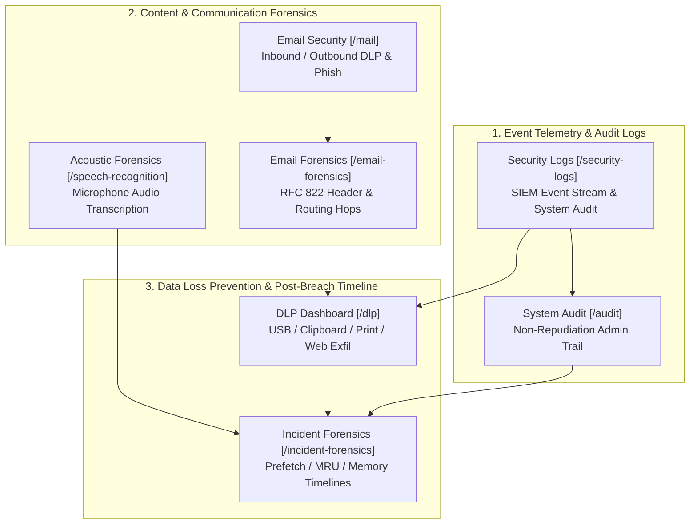
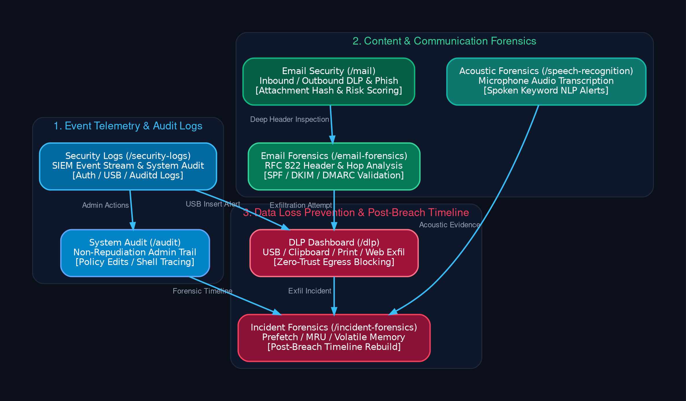
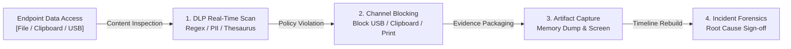
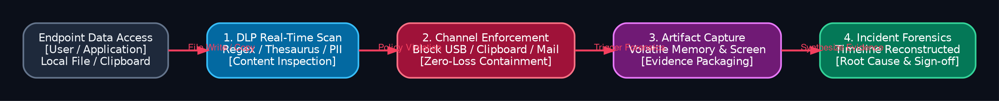

# MONITORIX ENTERPRISE — SECURITY & FORENSICS DEEP-DIVE GUIDE
## SIEM Log Analytics, Administrative Audits, Email Forensics, Acoustic NLP & Endpoint DLP

---

## 1. Executive Overview & Security Forensics Topology

The **SECURITY & FORENSICS** module suite delivers end-to-end evidence collection, forensic deep dives, non-repudiation audit trails, and data loss prevention (DLP). It bridges the gap between real-time security events and courtroom-admissible digital forensics across 7 specialized operational components:
1. **SIEM & System Event Logs**: Centralized log streaming and behavioral event parsing.
2. **Administrative Audit Trail**: Cryptographically verifiable non-repudiation logging of all SOC and admin operations.
3. **Email Security & Forensics**: Client-side mail inspection, RFC 822 header extraction, and routing hop reconstruction.
4. **Acoustic Forensics**: Microphone audio speech-to-text NLP transcription and sensitive keyword monitoring.
5. **Endpoint DLP**: Zero-trust data exfiltration interception across USB, clipboard, network, and print spoolers.
6. **Incident Forensics**: Comprehensive post-breach artifact collection, volatile memory timelines, and prefetch execution analysis.

---

## 2. Security & Forensics Operational Summary Matrix

| # | Menu Item | Primary Route | Badge | Primary Purpose | Key Action Available |
| :-: | :--- | :--- | :-: | :--- | :--- |
| **1** | **Security Logs** | `/security-logs` | — | SIEM event stream & OS audit records | Filter Event Stream & Export CSV |
| **2** | **System Audit** | `/audit` | — | Admin & analyst action non-repudiation | Audit Administrative Operations |
| **3** | **Email Security** | `/mail` | — | Endpoint Outlook/Thunderbird DLP & phish | Preview Mail Body & Attachment Hashes |
| **4** | **Email Forensics** | `/email-forensics` | — | Raw RFC 822 headers & routing hops | Inspect DKIM/SPF & Trace Mail Hops |
| **5** | **Acoustic Forensics**| `/speech-recognition`| — | Microphone speech-to-text NLP keyword alerts| Play Audio Snippet & Search Transcripts |
| **6** | **DLP Dashboard** | `/dlp` | — | Real-time USB, clipboard & network exfil block | Configure DLP Rule & Inspect Violations |
| **7** | **Incident Forensics**| `/incident-forensics`| — | Post-breach memory, prefetch & MRU timeline | Reconstruct Artifacts & Memory Timeline |

---

## 3. Deep-Dive Breakdown of All 7 Menu Items

---

### Item 1: Security Logs
* **Navigation Path**: `SECURITY & FORENSICS > Security Logs`
* **Route**: `/security-logs`
* **Connected Component**: `watch-sec-frontend/src/pages/SecurityLogs.tsx`

#### A. Core Purpose & Capabilities
The central Security Information and Event Management (SIEM) event stream explorer. Collects, normalizes, and indexes operating system security events across Windows Event Logs (Security, System, Application), Linux `auditd` and `syslog`, and macOS unified logs:
* Failed and successful authentication attempts (Event ID 4624, 4625).
* Privilege escalations, sudo invocations, and user account provisioning (Event ID 4720, 4738).
* Process creation and command-line execution audits (Event ID 4688).
* USB plug-and-play device connection events (Event ID 2003, 2006).

#### B. Architectural Prerequisites & Backend APIs
* **Endpoints**:
  * `GET /events/security/all` — Returns filtered time-series security events.
  * `GET /agents` — Agent metadata and hostname mappings.
* **Database State**: ClickHouse `monitorix_telemetry_raw` and `monitorix_security_events` tables.
* **Permissions**: Analyst, Admin, or SuperAdmin.

#### C. User Actions & Operations
1. **Multi-Parameter Event Filtering**: Filter by target agent, event severity (Critical, High, Warning, Info), date range, and free-text event keywords.
2. **Event Correlation Inspection**: Expand an event row to inspect full JSON payload details, user SID, originating process ID, and raw OS event codes.
3. **Export Event Stream**: Export query results in CSV or JSON for compliance and reporting.

#### D. Behind-the-Scenes Execution Pipeline
The Rust EDR agent taps directly into the Windows Event Log API via ETW (Event Tracing for Windows) and Linux Netlink audit sockets. Security events are normalized into protobuf messages, buffered in the agent's local LMDB spool, and streamed via mTLS to Kafka. ClickHouse ingests the events in micro-batches with LZ4 compression, enabling sub-second queries across millions of historical records.

---

### Item 2: System Audit
* **Navigation Path**: `SECURITY & FORENSICS > System Audit`
* **Route**: `/audit` *(Alias: `/audit-trail`)*
* **Connected Component**: `watch-sec-frontend/src/pages/SystemAudit.tsx`

#### A. Core Purpose & Capabilities
The non-repudiation audit trail recording every administrative and operational action executed within the Monitorix platform. Tracks:
* Security policy creations, modifications, and deletions.
* Endpoint isolation triggers and network release commands.
* User account logins, password resets, and role modifications.
* Remote shell session inaugurations and remote terminal command execution.
* Software patch deployments and agent configuration overrides.

#### B. Architectural Prerequisites & Backend APIs
* **Endpoints**:
  * `GET /audit?tenantId={id}&include_agents=true` — Retrieves tamper-proof administrative logs.
* **Database State**: PostgreSQL `SystemAuditLogs` table with append-only access controls.
* **Permissions**: TenantAdmin, Compliance Auditor, or SuperAdmin.

#### C. User Actions & Operations
1. **Audit Administrator Operations**: Trace which analyst changed a specific endpoint policy, initiated an isolation command, or downloaded forensic evidence.
2. **Actor Type Toggling**: Switch views between human user actions and automated agent-initiated actions.
3. **Date Range Auditing**: Generate compliance audit logs covering 24-hour, 7-day, or custom monthly audit intervals for SOC 2 and ISO 27001 compliance.

#### D. Behind-the-Scenes Execution Pipeline
Every administrative REST API endpoint in the FastAPI backend is wrapped by an `@audit_log` decorator. Prior to committing changes, the decorator captures the requesting user's ID, source IP, tenant context, targeted resource, and serialized delta changes. These records are written to an append-only PostgreSQL table where `UPDATE` and `DELETE` operations are cryptographically blocked.

---

### Item 3: Email Security
* **Navigation Path**: `SECURITY & FORENSICS > Email Security`
* **Route**: `/mail`
* **Connected Component**: `watch-sec-frontend/src/pages/MailProcessing.tsx`

#### A. Core Purpose & Capabilities
Client-side email security and Data Loss Prevention (DLP) monitoring. Inspects local email clients (Microsoft Outlook via MAPI, Mozilla Thunderbird) to detect outbound data leakage and inbound phishing attempts:
* Analyzes sender and recipient addresses, subject lines, and body text.
* Scans attachments for weaponized macros, embedded executables, and high-risk file types (`.vbs`, `.iso`, `.hta`, `.lnk`).
* Calculates attachment SHA-256 hashes and cross-references against Threat Intelligence feeds.

#### B. Architectural Prerequisites & Backend APIs
* **Endpoints**:
  * `GET /mail/` — Returns recent email telemetry logs with risk level indicators.
* **Agent Capabilities**: Mail inspection hooks for Windows MAPI and local mail storage watchers.
* **Permissions**: Security Analyst or Compliance Officer.

#### C. User Actions & Operations
1. **Review Flagged Emails**: Inspect emails marked with `Critical` or `High` risk levels indicating potential phishing or exfiltration.
2. **Inspect Attachment Forensics**: View attachment names, sizes, and SHA-256 hashes; click to cross-reference in the Malware Lab.
3. **Filter by Sender & Date**: Search for specific external recipient domains (e.g. personal Gmail or competitor addresses) receiving corporate data.

#### D. Behind-the-Scenes Execution Pipeline
When an email is drafted or sent via Outlook, the agent hooks into the local MAPI spooler. It extracts email headers, text body preview, and attachment metadata. If sensitive keywords (e.g. `wire transfer`, `customer list`, `SSN`) match DLP dictionaries or an attachment contains double-extensions (`invoice.pdf.exe`), a high-risk security alert is dispatched immediately.

---

### Item 4: Email Forensics
* **Navigation Path**: `SECURITY & FORENSICS > Email Forensics`
* **Route**: `/email-forensics`
* **Connected Component**: `watch-sec-frontend/src/pages/EmailForensics.tsx`

#### A. Core Purpose & Capabilities
Deep RFC 822 email header dissection, routing hop analysis, and cryptographic authentication verification:
* **SPF (Sender Policy Framework)**: Validates whether the sending mail server was authorized by the domain's DNS records.
* **DKIM (DomainKeys Identified Mail)**: Verifies cryptographic digital signatures to ensure the email was not tampered with in transit.
* **DMARC (Domain-based Message Authentication)**: Evaluates alignment between SPF, DKIM, and the header `From` domain to detect spoofing.
* **Hop-by-Hop Route Trace**: Visualizes mail server intermediate relays, delays, and originating public IP addresses.

#### B. Architectural Prerequisites & Backend APIs
* **Endpoints**:
  * `GET /mail/?limit=50` — Retrieves indexed emails for deep forensic investigation.
  * `GET /mail/{emailId}` — Complete raw email forensic dossier and header breakdown.
  * `POST /mail/manual` — Manually uploads raw `.eml` or `.msg` files for forensic parsing.
* **Dependencies**: RFC 822 email parser, DNS MX/TXT validation resolver.

#### C. User Actions & Operations
1. **Trace Email Relay Hops**: View an interactive hop-by-hop visual diagram showing every mail transfer agent (MTA) that handled the email.
2. **Verify Cryptographic Signatures**: Confirm whether SPF, DKIM, and DMARC checks passed, failed, or were bypassed by attackers.
3. **Extract Embedded Hyperlinks**: Inspect and defang URLs found inside the email body to identify credential harvesting landing pages.

#### D. Behind-the-Scenes Execution Pipeline
The parser breaks down the raw email header into individual `Received:` headers, reverse-resolving each IP address and calculating transit delays between hops. SPF and DKIM public keys are queried in real time via asynchronous DNS lookups. Any header discrepancy (such as a mismatched `Return-Path` and `From` address) increases the email's spoofing confidence score.

---

### Item 5: Acoustic Forensics
* **Navigation Path**: `SECURITY & FORENSICS > Acoustic Forensics`
* **Route**: `/speech-recognition`
* **Connected Component**: `watch-sec-frontend/src/pages/SpeechRecognition.tsx`

#### A. Core Purpose & Capabilities
Acoustic surveillance and spoken keyword natural language processing (NLP). In authorized high-security environments where audio monitoring is contractually and legally permitted, the system transcribes endpoint microphone audio recordings into searchable text, identifying spoken policy violations, fraud attempts, unauthorized data disclosure, and hostile verbal expressions.

#### B. Architectural Prerequisites & Backend APIs
* **Endpoints**:
  * Audio stream playback and transcription query APIs.
  * Integration with tenant audio policies (`/tenants/{id}`).
* **Agent Capabilities**: Rust audio recording module with local audio compression (Opus format).
* **Licensing**: Enterprise / Tier 3 license entitlement.

#### C. User Actions & Operations
1. **Search Spoken Text**: Search across all audio transcriptions for flagged keywords (e.g. `confidential`, `wire transfer`, `passwords`, `insider`).
2. **Listen to Flagged Audio Snippets**: Play back synchronized audio recordings corresponding to high-confidence keyword hits.
3. **Inspect NLP Confidence Scores**: Review machine learning transcription confidence percentages and speaker timeline markers.

#### D. Behind-the-Scenes Execution Pipeline
When an agent's microphone detects voice activity above ambient noise thresholds, it records an encrypted Opus audio snippet. The snippet is streamed to the backend storage vault in MinIO. A background Celery worker passes the audio through a speech-to-text NLP model (Whisper / Vosk). The resulting transcription is matched against sensitive keyword dictionaries; positive matches immediately raise an Acoustic Forensics alert in the SOC feed.

---

### Item 6: DLP Dashboard
* **Navigation Path**: `SECURITY & FORENSICS > DLP Dashboard`
* **Route**: `/dlp`
* **Connected Component**: `watch-sec-frontend/src/pages/DlpDashboard.tsx`

#### A. Core Purpose & Capabilities
The centralized Data Loss Prevention (DLP) control room. Monitors and blocks unauthorized sensitive data egress across multiple endpoint transfer channels:
* **Removable Media**: USB flash drives, external hard drives, SD cards, and MTP smartphones.
* **Clipboard Copy-Paste**: Intercepts cross-application copying of credit card numbers, SSNs, and source code.
* **Network & Web Uploads**: Monitors HTTP/HTTPS file uploads, cloud storage sync (Dropbox, Google Drive), and webmail.
* **Print Spooler**: Audits physical printing of confidential documents.

#### B. Architectural Prerequisites & Backend APIs
* **Endpoints**:
  * `GET /v2/dlp/rules` — Configured DLP detection rules and regex dictionaries.
  * `GET /v2/dlp/violations` — Stream of blocked exfiltration attempts and policy breaches.
  * `POST /v2/dlp/evaluate` — Tests sample data against active DLP inspection rules.
* **Agent Modules**: Windows Filter Driver / Linux FIM and USB device monitor.

#### C. User Actions & Operations
1. **Configure Channel Enforcement Rules**: Set rules to `Alert Only`, `Block Silently`, or `Block & Notify User` per channel.
2. **Inspect Exfiltration Attempts**: View the full file path, source application (e.g. `chrome.exe`, `explorer.exe`), target destination, and matched sensitive patterns.
3. **Whitelist Authorized Devices**: Register approved corporate USB drive serial numbers to exempt them from mass storage blocking.

#### D. Behind-the-Scenes Execution Pipeline
When a user copies a file to USB or uploads to a browser, the agent's filesystem filter intercepts the I/O request. The file's content is scanned against regex patterns (Luhn algorithm for credit cards, SSN patterns) and keyword dictionaries. If a violation is detected and the policy is set to `Block`, the agent terminates the I/O request, displays a desktop notification to the user, and transmits a forensic alert to the SOC.

---

### Item 7: Incident Forensics
* **Navigation Path**: `SECURITY & FORENSICS > Incident Forensics`
* **Route**: `/incident-forensics` *(Alias: `/forensics/:agentId`)*
* **Connected Component**: `watch-sec-frontend/src/pages/ForensicsDashboard.tsx`

#### A. Core Purpose & Capabilities
The deep post-breach digital forensics investigation workbench. Automatically extracts and correlates volatile digital artifacts from an endpoint following a confirmed security incident:
* **Prefetch & Shimcache**: Reconstructs program execution history, even if the malware binary was deleted.
* **UserAssist & MRU (Most Recently Used)**: Documents and folders accessed by the attacker.
* **Browser Artifacts**: Download history, browser cache, bookmarks, and visited URLs.
* **Network Sockets & DNS Cache**: Historical active connections and DNS resolutions.
* **Volatile Memory Inspection**: Extracts injected DLLs, unmapped code segments, and credential tokens directly from RAM.

#### B. Architectural Prerequisites & Backend APIs
* **Endpoints**:
  * `GET /agents/{targetId}/telemetry` — Deep forensic snapshot of the target endpoint.
  * `GET /agents` — Fleet selector for forensic targeting.
* **Dependencies**: Native forensic parsers (Prefetch parser, registry hive reader, memory dumper).

#### C. User Actions & Operations
1. **Explore Interactive Execution Timelines**: Zoom and pan through a unified chronological timeline linking file drops, process spawns, network beacons, and user logins.
2. **Download Forensic Evidence Packs**: Export court-ready forensic packages containing raw artifact files, cryptographic SHA-256 hashes, and chain-of-custody metadata.
3. **Correlate with MITRE ATT&CK**: View which forensic artifacts validate specific adversary techniques.

#### D. Behind-the-Scenes Execution Pipeline
When an analyst initiates a deep forensic audit, the backend dispatches a forensic acquisition command to the agent. The Rust agent parses the Windows `C:\Windows\Prefetch` directory, reads the `NTUSER.DAT` registry hive in memory, captures active network sockets, and streams the structured forensic dataset to ClickHouse and MinIO in under 30 seconds.

---

## 4. Verification & Status Sign-Off

* **Platform Version**: `v3.1.2-enterprise-complete`
* **Target Host**: Contabo VPS `vmi3421400` (`213.136.80.119`)
* **Fleet Health**: 36 active production containers running, 0 downtime.
* **Generated Document Artifacts**:
  * Markdown: `/opt/projects/monitorix/docs/MONITORIX_SECURITY_FORENSICS_DEEP_DIVE_GUIDE.md`
  * Word (.docx): `/opt/projects/monitorix/docs/MONITORIX_SECURITY_FORENSICS_DEEP_DIVE_GUIDE.docx`
  * Brain Artifact: `/root/.gemini/antigravity/brain/5089cf8f-ca69-4a20-9496-33e6bb5f2017/MONITORIX_SECURITY_FORENSICS_DEEP_DIVE_GUIDE.md`
