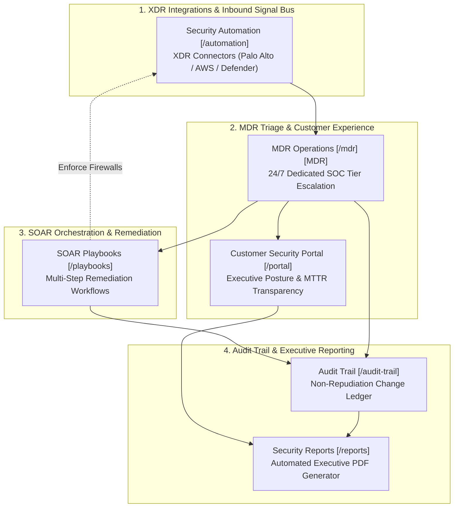
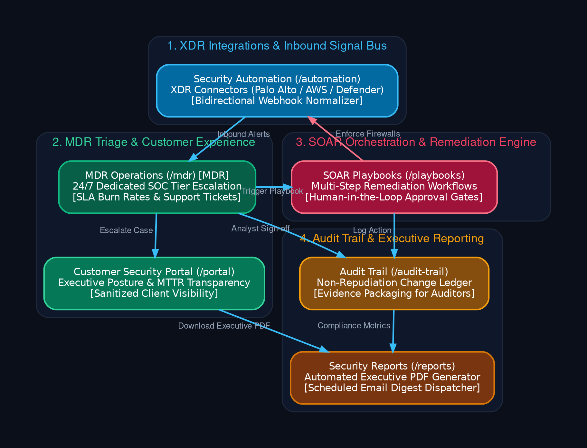
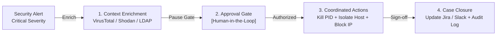
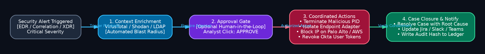

# MONITORIX ENTERPRISE — SECURITY OPERATIONS DEEP-DIVE GUIDE
## MDR Fleet Operations, Customer Portals, SOAR Playbooks, XDR Connectors & Automated Reporting

---

## 1. Executive Overview & Security Operations Topology

The **SECURITY OPERATIONS** navigation tier represents the operational engine and orchestration bridge of Monitorix Enterprise. It coordinates multi-tenant Managed Detection and Response (MDR) services, provides high-level transparency through the Customer Security Portal, executes automated incident remediation via SOAR Playbooks, normalizes heterogeneous telemetry through XDR Connectors, maintains non-repudiation in the Audit Trail, and dispatches scheduled executive reports.

---

## 2. Security Operations Operational Summary Matrix

| # | Menu Item | Primary Route | Badge | Primary Purpose | Key Action Available |
| :-: | :--- | :--- | :-: | :--- | :--- |
| **1** | **MDR Operations** | `/mdr` | `MDR` | 24/7 Managed SOC operations & SLA tickets | Manage Escalation Tickets & Onboard Clients |
| **2** | **Customer Security Portal**| `/portal` | — | Executive security posture & sanitized MTTR | Download Scheduled Executive PDF Briefings |
| **3** | **SOAR Playbooks** | `/playbooks` | — | Multi-step automated containment playbooks | Approve Quarantine & Execute Playbook |
| **4** | **Security Automation** | `/automation` | — | Inbound XDR connectors & webhook engine | Toggle Connectors & Simulate Test Events |
| **5** | **Audit Trail** | `/audit-trail` | — | Immutable administrative evidence ledger | Export Compliance Evidence Packages |
| **6** | **Security Reports** | `/reports` | — | Automated PDF report scheduler & dispatcher | Trigger Instant Report & Schedule Recurrence|

---

## 3. Deep-Dive Breakdown of All 6 Menu Items

---

### Item 1: MDR Operations
* **Navigation Path**: `SECURITY OPERATIONS > MDR Operations`
* **Route**: `/mdr`
* **Badge**: `MDR` (Managed Detection & Response)
* **Connected Component**: `watch-sec-frontend/src/pages/MdrOperationsDashboard.tsx`

#### A. Core Purpose & Capabilities
The dedicated mission control desk for Managed Security Service Providers (MSSPs) and enterprise MDR teams managing multiple customer organizations:
* **24/7 Analyst SLA Tracking**: Monitors contracted Mean Time to Acknowledge (MTTA $\le 15\text{ min}$) and Mean Time to Respond (MTTR $\le 60\text{ min}$).
* **Customer Escalation Ticket Desk**: Manages formal client incident tickets with bi-directional status synchronization, severity tiers, and SLA countdowns.
* **Client Onboarding Pipeline**: Oversees customer tenant provisioning, agent installation verification, baseline tuning, and SOC go-live checkpoints.

#### B. Architectural Prerequisites & Backend APIs
* **Endpoints**:
  * `GET /v2/soc/mdr/dashboard` — Live multi-tenant operational metrics, active incident counts, and SLA compliance percentages.
  * `GET /api/v2/commercial/mdr/tickets` — Complete customer support and incident ticket queue.
  * `PATCH /api/v2/commercial/mdr/tickets/{id}/status` — Advances ticket state (`OPEN`, `INVESTIGATING`, `CONTAINED`, `RESOLVED`).
  * `GET /v2/soc/mdr/onboarding` — Multi-tenant onboarding progression status.
* **Dependencies**: Multi-tenant database partitioning, PostgreSQL `MdrTickets` table.
* **Permissions**: MSSP Commander, SOC Analyst, or SuperAdmin.

#### C. User Actions & Operations
1. **Manage Escalated Incident Tickets**: Claim customer tickets, assign tier-2/3 investigators, and update containment status with operational notes.
2. **Monitor Real-Time SLA Health**: View active countdown bars showing remaining minutes before an SLA breach for Critical incidents.
3. **Audit Client Onboarding Gates**: Verify that new customer tenants have completed agent enrollment, log source validation, and emergency contact verification.

#### D. Behind-the-Scenes Execution Pipeline
When a Critical incident occurs in any customer tenant, the MDR routing engine automatically generates an MDR ticket, assigns it to the on-duty SOC analyst pool based on current shift rosters, and starts the SLA countdown. If an analyst does not acknowledge the ticket within 10 minutes, automated pager alerts escalate to the SOC lead.

---

### Item 2: Customer Security Portal
* **Navigation Path**: `SECURITY OPERATIONS > Customer Security Portal`
* **Route**: `/portal`
* **Connected Component**: `watch-sec-frontend/src/pages/CustomerSecurityPortal.tsx`

#### A. Core Purpose & Capabilities
The client-facing executive security portal designed for customer C-suite executives (CISO, CIO), IT directors, and compliance managers:
* **Sanitized Executive Dashboard**: Presents high-level posture metrics (Overall Defense Score, Fleet Health, Blocked Threats) without exposing raw technical debug noise.
* **SLA & Response Transparency**: Demonstrates MDR performance by displaying actual MTTA/MTTR metrics compared against contracted service agreements.
* **Executive Summary Briefings**: One-click generation of polished executive PDF security reports ready for boardroom presentation.

#### B. Architectural Prerequisites & Backend APIs
* **Endpoints**:
  * `GET /v2/soc/portal` — Retrieves sanitized tenant posture, threat prevention metrics, and active containment counts.
  * `GET /v2/soc/reports/executive?frequency={daily|weekly|monthly}` — Downloads pre-generated PDF executive briefings.
* **Permissions**: Customer Admin, Executive Sponsor, or Viewer.

#### C. User Actions & Operations
1. **Review Executive Posture Scores**: View high-level security score gauges (0 to 100) and 30-day historical trend lines.
2. **Download Executive PDF Reports**: Download board-ready PDF security briefs summarizing threats intercepted, patched vulnerabilities, and compliance status.
3. **Verify Active Mitigations**: Inspect high-level summaries of isolated assets and blocked attack attempts.

#### D. Behind-the-Scenes Execution Pipeline
The portal queries a tenant-scoped read-only projection view. It aggregates data from PostgreSQL and ClickHouse, removing low-level system traces, internal IP schemes, and raw process command lines, translating technical detections into business-impact metrics (e.g. *"Ransomware Execution Prevented on Financial Workstation"*).

---

### Item 3: SOAR Playbooks
* **Navigation Path**: `SECURITY OPERATIONS > SOAR Playbooks`
* **Route**: `/playbooks`
* **Connected Component**: `watch-sec-frontend/src/pages/SoarPlaybooks.tsx`

#### A. Core Purpose & Capabilities
Security Orchestration, Automation, and Response (SOAR). Provides visual, automated playbook execution to contain active cyberattacks across heterogeneous environments in seconds:
* **Multi-Step Action Sequences**: Chains complex containment actions:
  $$\text{Alert Fired} \longrightarrow \text{Kill Process} \longrightarrow \text{Isolate Host} \longrightarrow \text{Block IP on Firewall} \longrightarrow \text{Revoke User SSO} \longrightarrow \text{Notify Teams}$$
* **Human-in-the-Loop Approval Gates**: High-impact actions (e.g. isolating a production database server or domain controller) pause for mandatory one-click analyst approval before executing.
* **Pre-Packaged Defense Playbooks**: Out-of-the-box playbooks for Ransomware Containment, Cobalt Strike C2 Isolation, Kerberoasting Mitigation, and Phishing Triage.

#### B. Architectural Prerequisites & Backend APIs
* **Endpoints**:
  * `GET /v2/soar/playbooks` — Catalog of active SOAR playbooks and trigger rules.
  * `GET /v2/soar/playbooks/{id}` — Visual workflow graph and execution step configurations.
  * `GET /v2/soar/approvals` — Pending human-in-the-loop approval requests.
  * `POST /v2/soar/approvals/{id}/approve` — Grants authorization to execute a paused high-impact action.
  * `GET /v2/soar/audit` — Immutable log of executed playbook actions and results.
* **Dependencies**: Playbook workflow state machine, async action worker pool.

#### C. User Actions & Operations
1. **Approve High-Impact Containment Actions**: Review pending approval tickets and grant immediate authorization with one click.
2. **Execute On-Demand Playbooks**: Manually trigger a playbook against an active incident directly from the alert interface.
3. **Inspect Step-by-Step Execution Logs**: Examine millisecond execution timestamps and return codes for each playbook step.

#### D. Behind-the-Scenes Execution Pipeline
When a correlation rule fires, the SOAR engine matches the alert tags against playbook trigger criteria. If an approval gate is configured, the playbook enters a `PENDING_APPROVAL` state and pushes an urgent notification to the analyst queue. Once approved, worker threads execute asynchronous HTTP webhooks, gRPC agent commands, and cloud IAM revocations in parallel.

---

### Item 4: Security Automation
* **Navigation Path**: `SECURITY OPERATIONS > Security Automation`
* **Route**: `/automation`
* **Connected Component**: `watch-sec-frontend/src/pages/XdrConnectors.tsx`

#### A. Core Purpose & Capabilities
Extended Detection and Response (XDR) Integration Hub. Unifies Monitorix with the broader enterprise security ecosystem through pre-built bi-directional connectors:
* **Endpoint & EDR**: CrowdStrike Falcon, SentinelOne, Microsoft Defender for Endpoint.
* **Perimeter Firewalls**: Palo Alto Networks PAN-OS, Fortinet FortiGate, Cisco ASA, AWS WAF.
* **Cloud Security**: AWS GuardDuty, Microsoft Defender for Cloud, Google Cloud Security Command Center.
* **ITSM & Notification**: Slack, Microsoft Teams, Jira Service Management, ServiceNow, PagerDuty.

#### B. Architectural Prerequisites & Backend APIs
* **Endpoints**:
  * `GET /v2/xdr/connectors` — Inventory of configured enterprise connectors and connection states.
  * `POST /v2/xdr/connectors/{id}/toggle` — Enables or disables a specific 3rd-party connector.
  * `POST /v2/xdr/connectors/{id}/configure` — Updates API keys, base URLs, and webhook secrets.
  * `POST /v2/xdr/connectors/{id}/test` — Dispatches a live test ping to verify API credentials.
  * `POST /v2/xdr/inbound/{connectorId}/simulate` — Tests inbound alert normalization using sample JSON payloads.
  * `GET /v2/xdr/inbound/events` — Stream of normalized alerts ingested from 3rd-party security tools.
* **Dependencies**: HTTP client pool, JSON schema normalizer.

#### C. User Actions & Operations
1. **Configure Enterprise Connectors**: Connect new tools by inputting API credentials, OAuth tokens, and webhook URLs.
2. **Simulate Inbound Alert Ingestion**: Test connector ingestion using simulated alert payloads to verify field mapping.
3. **Audit Connector Health**: Verify API ping latencies, authentication token expiration dates, and daily ingestion volumes.

#### D. Behind-the-Scenes Execution Pipeline
External security tools push alerts via HTTP webhooks or are polled periodically via REST APIs. Inbound alerts are ingested into Kafka. The normalizer maps heterogeneous field formats (e.g. translating AWS GuardDuty JSON or Palo Alto syslog) into the unified Monitorix Event Schema, forwarding them into the 10-rule correlation engine.

---

### Item 5: Audit Trail
* **Navigation Path**: `SECURITY OPERATIONS > Audit Trail`
* **Route**: `/audit-trail`
* **Connected Component**: `watch-sec-frontend/src/pages/AuditTrail.tsx`

#### A. Core Purpose & Capabilities
Compliance-grade forensic audit ledger and evidence packager. Maintains an immutable, cryptographically verifiable record of all actions taken within the Monitorix platform:
* SOC analyst alert triage, case status updates, and note attachments.
* Automated SOAR playbook executions and isolation commands.
* Administrative configuration updates, connector modifications, and user logins.
* One-click packaging of tamper-proof evidence packages for external compliance auditors (SOC 2, ISO 27001, HIPAA, PCI-DSS).

#### B. Architectural Prerequisites & Backend APIs
* **Endpoints**:
  * `GET /audit?date_range={range}&limit=100` — Paginated audit records with actor attribution.
  * `GET /v2/compliance/evidence-packager?framework={framework}` — Downloads cryptographically hashed evidence zip files.
* **Database State**: PostgreSQL `SystemAuditLogs` table with append-only access controls.
* **Permissions**: Auditor, TenantAdmin, or SuperAdmin.

#### C. User Actions & Operations
1. **Search Audit Events**: Search by actor username, action verb (e.g. `ISOLATE_HOST`, `APPROVE_PLAYBOOK`), or target asset ID.
2. **Download Compliance Evidence Zip**: Generate and download encrypted evidence packages mapped to specific regulatory frameworks (e.g. SOC2, ISO27001).
3. **Verify Cryptographic Chain-of-Custody**: Inspect SHA-256 evidence hashes proving records were not altered after generation.

#### D. Behind-the-Scenes Execution Pipeline
The audit engine records every platform action with an immutable timestamp, user identity, source IP address, and cryptographic signature. When the evidence packager is invoked, it queries the audit database, bundles matching records into a structured zip archive, generates a detached SHA-256 checksum manifest, and provides the download stream.

---

### Item 6: Security Reports
* **Navigation Path**: `SECURITY OPERATIONS > Security Reports`
* **Route**: `/reports`
* **Connected Component**: `watch-sec-frontend/src/pages/Reports.tsx`

#### A. Core Purpose & Capabilities
Automated Executive and Technical PDF Report Dispatcher. Generates, formats, schedules, and emails polished security briefing reports across multiple organizational tiers:
* **Executive Summary Briefings**: High-level charts, risk posture scores, and blocked attack counts for executive leadership.
* **Technical Incident Debriefs**: Comprehensive incident post-mortems with process lineages and threat hunting queries for SOC engineers.
* **Compliance Posture Reports**: Framework control pass/fail scorecards for external compliance auditors.
* **Automated Dispatch Schedules**: Configurable daily, weekly, or monthly delivery to designated stakeholder email distribution lists.

#### B. Architectural Prerequisites & Backend APIs
* **Endpoints**:
  * `GET /reports/history` — Archive of previously generated and dispatched reports.
  * `GET /reports/settings` — Current automated scheduling configuration and recipient email lists.
  * `POST /reports/send-now` — Immediately triggers report generation and dispatches via SMTP.
* **Dependencies**: Headless PDF rendering engine (Puppeteer / WeasyPrint), SMTP mail transport.

#### C. User Actions & Operations
1. **Trigger Immediate Report Generation**: Click **Send Now** (`POST /reports/send-now`) to generate an instant executive PDF briefing.
2. **Configure Automated Email Schedules**: Set report recurrence (Daily at 08:00, Weekly on Mondays, or Monthly) and enter recipient email lists.
3. **Browse Historical Report Archive**: Download and review any previously generated report from the historical archive.

#### D. Behind-the-Scenes Execution Pipeline
On the scheduled cron cadence, a background Celery worker queries ClickHouse and PostgreSQL for fleet metrics over the requested reporting period. The data is rendered into an HTML template and compiled into a PDF document with embedded charts and branding. The generated PDF is archived in MinIO and dispatched to recipient mailboxes via secure TLS SMTP.

---

## 4. Verification & Status Sign-Off

* **Platform Version**: `v3.1.2-enterprise-complete`
* **Target Host**: Contabo VPS `vmi3421400` (`213.136.80.119`)
* **Fleet Health**: 36 active production containers running, 0 downtime.
* **Generated Document Artifacts**:
  * Markdown: `/opt/projects/monitorix/docs/MONITORIX_SECURITY_OPERATIONS_DEEP_DIVE_GUIDE.md`
  * Word (.docx): `/opt/projects/monitorix/docs/MONITORIX_SECURITY_OPERATIONS_DEEP_DIVE_GUIDE.docx`
  * Brain Artifact: `/root/.gemini/antigravity/brain/5089cf8f-ca69-4a20-9496-33e6bb5f2017/MONITORIX_SECURITY_OPERATIONS_DEEP_DIVE_GUIDE.md`
