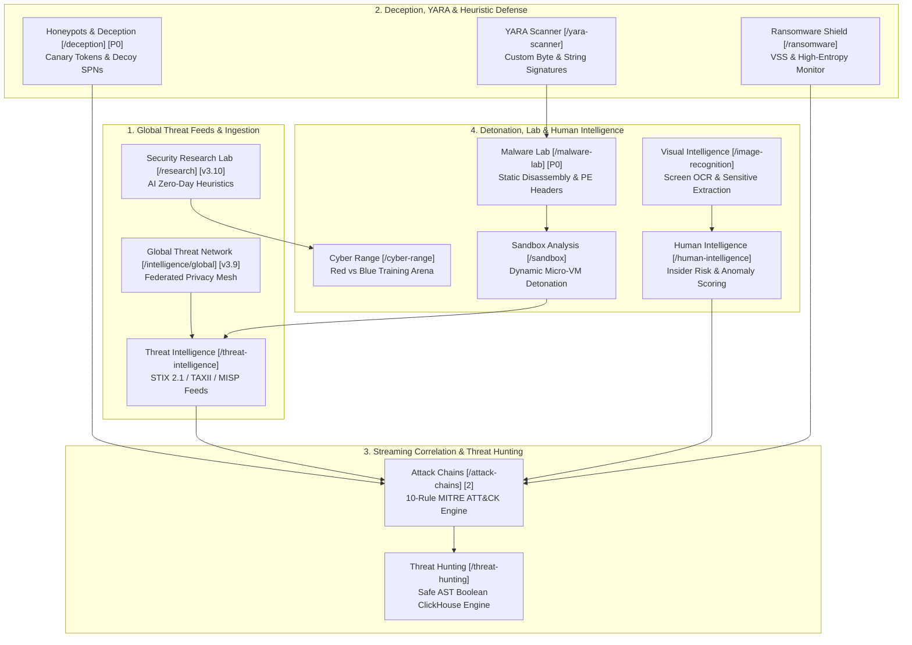
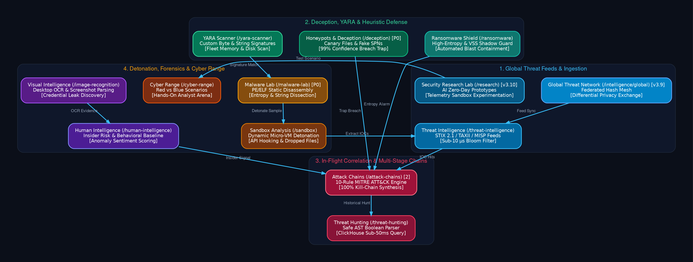
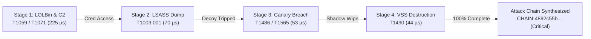
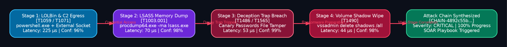

# MONITORIX ENTERPRISE — THREAT INTELLIGENCE DEEP-DIVE GUIDE
## Global Threat Feeds, Deception Canaries, Reverse Engineering & Multi-Stage Attack Chains

---

## 1. Executive Overview & Threat Intelligence Topology

The **THREAT INTELLIGENCE** tier is the offensive reconnaissance and defensive intelligence brain of Monitorix Enterprise. It encompasses 13 mission-critical operational modules designed to ingest external indicators, deploy deceptive canary traps, execute safe AST threat hunting, disassemble unknown malware, analyze high-entropy ransomware bursts, and reconstruct multi-stage MITRE ATT&CK kill chains.

---

## 2. Threat Intelligence Operational Summary Matrix

| # | Menu Item | Primary Route | Badge | Primary Purpose | Key Action Available |
| :-: | :--- | :--- | :-: | :--- | :--- |
| **1** | **Honeypots & Deception** | `/deception` | `P0` | Decoy canary tokens & bait credentials | Deploy Canary File & Trigger Decoy Trap |
| **2** | **Malware Lab (Sandbox)**| `/malware-lab` | `P0` | PE/ELF static analysis & string extraction | Upload Sample & Dissect Binary Headers |
| **3** | **Security Research Lab** | `/research` | `v3.10`| AI detection models & zero-day prototypes | Run Heuristic Experiment & Rollback Rules |
| **4** | **Global Threat Network**| `/intelligence/global` | `v3.9`| Federated community threat mesh exchange | Contribute Anonymized Signal & Sync Mesh |
| **5** | **Threat Intelligence** | `/threat-intelligence`| — | Ingest STIX/TAXII/MISP & 90-day retroactive | Sync Feed & Trigger 90-Day IOC Sweep |
| **6** | **Attack Chains** | `/attack-chains` | `2` | 10-rule MITRE streaming kill-chain graph | Simulate Drill & Trigger SOAR Playbook |
| **7** | **Threat Hunting** | `/threat-hunting` | — | Safe AST boolean query engine | Execute Parameterized ClickHouse Search |
| **8** | **Cyber Range** | `/cyber-range` | — | Red vs. Blue hands-on training arena | Launch Live Attack Simulation Scenario |
| **9** | **YARA Scanner** | `/yara-scanner` | — | Fleet memory & filesystem pattern scanning | Deploy YARA Rule & Scan Target Agent |
| **10**| **Ransomware Shield** | `/ransomware` | — | Early entropy spike & shadow copy defense | Isolate Host on Volume Shadow Tamper |
| **11**| **Sandbox Analysis** | `/sandbox` | — | Dynamic micro-VM detonation & API hooks | Detonate Suspicious File & Quarantine Hash |
| **12**| **Visual Intelligence** | `/image-recognition` | — | Desktop screen OCR & credential discovery | Search Text Across Screen Captures |
| **13**| **Human Intelligence** | `/human-intelligence`| — | Insider risk & behavioral anomaly scoring | Audit High-Risk User Activity Profiles |

---

## 3. Deep-Dive Breakdown of All 13 Menu Items

---

### Item 1: Honeypots & Deception
* **Navigation Path**: `THREAT INTELLIGENCE > Honeypots & Deception`
* **Route**: `/deception` *(Alias: `/security/deception`)*
* **Badge**: `P0` (Priority Zero)
* **Connected Component**: `watch-sec-frontend/src/pages/HoneypotDeception.tsx`

#### A. Core Purpose & Capabilities
Provides distributed cyber deception and canary trap orchestration across the enterprise fleet. Plants high-fidelity decoy assets including:
* **Canary Files**: Decoy spreadsheets (`passwords.xlsx`, `q4_payroll.docx`, `aws_keys.csv`) placed in user folders.
* **Canary Credentials**: Bait Active Directory service accounts, fake Kerberos Service Principal Names (SPNs), and fake API keys.
* **Network Listeners**: Deceptive internal services listening on unopened ports.
Because legitimate users have no reason to access these decoy resources, **any interaction generates an alert with a 99% confidence rating and near-zero false-positive rate**.

#### B. Architectural Prerequisites & Backend APIs
* **Endpoints**:
  * `GET /v2/deception/overview` — Fleet canary deployment coverage and tripped trap counts.
  * `GET /v2/deception/campaigns` — Active deception campaigns across departments.
  * `GET /v2/deception/agents` — Registered endpoints carrying active canary bait.
  * `POST /v2/deception/tokens/deploy` — Pushes new canary files or fake registry keys to an agent.
  * `POST /v2/deception/trigger` — Forensic telemetry hook invoked when a canary token is touched.
* **Database State**: `DeceptionCampaigns`, `DeceptionTokens`, and `CanaryHitLogs` in PostgreSQL.
* **Permissions**: Security Engineer, TenantAdmin, or SuperAdmin.

#### C. User Actions & Operations
1. **Deploy Canary Bait**: Generate and plant deceptive credential tokens or canary documents on specific workstations or file servers with one click.
2. **Monitor Tripped Traps**: Inspect real-time alerts showing the exact process, user identity, and timestamp of the decoy interaction.
3. **Automated Host Quarantine**: Pre-configure deception policies to immediately isolate any endpoint that reads or modifies a canary file.

#### D. Behind-the-Scenes Execution Pipeline
The agent's File Integrity Monitor (FIM) and registry hook driver monitor the canary file path. When any process issues an `open`, `read`, or `write` call on the decoy path, the agent emits an immediate high-priority `DECEPTION_CANARY_BREACH_T1486_T1565` alert. The backend registers a Critical incident in under 60 microseconds and executes containment playbooks.

---

### Item 2: Malware Lab (Sandbox)
* **Navigation Path**: `THREAT INTELLIGENCE > Malware Lab (Sandbox)`
* **Route**: `/malware-lab`
* **Badge**: `P0` (Priority Zero)
* **Connected Component**: `watch-sec-frontend/src/pages/AdvancedMalwareLab.tsx`

#### A. Core Purpose & Capabilities
The static reverse engineering and binary disassembly laboratory for forensic analysts. Provides deep static inspection of Portable Executable (PE), Executable and Linkable Format (ELF), and Mach-O binaries:
* Dissects PE sections (`.text`, `.data`, `.rsrc`) and computes entropy per section to detect packing and encryption.
* Extracts printable ASCII and Unicode strings, identifying hardcoded C2 IP addresses, domains, and registry keys.
* Analyzes Import and Export Address Tables (IAT/EAT) to flag suspicious API calls (e.g. `VirtualAllocEx`, `WriteProcessMemory`, `CreateRemoteThread`).

#### B. Architectural Prerequisites & Backend APIs
* **Endpoints**:
  * `GET /v2/malware-analysis/overview` — Uploaded sample volume, malicious ratio, and queue health.
  * `GET /v2/malware-analysis/samples?limit=100` — Repository of dissected binary samples.
  * `GET /v2/malware-analysis/samples/{sampleId}` — Complete static analysis disassembly report.
  * `POST /v2/malware-analysis/detonate` — Submits a sample to the micro-VM dynamic detonation pipeline.
  * `GET /v2/malware-analysis/rules` — Static heuristic inspection rules.
  * `POST /v2/malware-analysis/quarantine` — Blacklists the binary hash across all fleet endpoints.
* **Dependencies**: Capstone disassembly engine, PEfile parser, ClamAV engine.

#### C. User Actions & Operations
1. **Upload Suspicious Binaries**: Drag and drop `.exe`, `.dll`, `.elf`, `.sh`, or `.ps1` files for instant static dissection.
2. **Inspect Section Entropy**: Identify packed or encrypted malware through graphical entropy distributions exceeding Shannon entropy 7.2.
3. **Blacklist Malicious Hash**: One-click add the sample's SHA-256 hash to the Central Server Hash Bank to terminate execution across all endpoints.

#### D. Behind-the-Scenes Execution Pipeline
Uploaded files are stored in an encrypted vault in MinIO. A background celery worker parses headers, computes hashes (MD5, SHA-1, SHA-256, SSDEEP fuzzy hash), extracts imports, and matches strings against known threat intelligence rulesets. If packing or suspicious injection APIs are detected, the sample is scored between 0 and 100 on the malware maliciousness index.

---

### Item 3: Security Research Lab
* **Navigation Path**: `THREAT INTELLIGENCE > Security Research Lab`
* **Route**: `/research`
* **Badge**: `v3.10`
* **Connected Component**: `watch-sec-frontend/src/pages/SecurityResearchLab.tsx`

#### A. Core Purpose & Capabilities
The zero-day vulnerability research and heuristic rule experimentation arena. Enables security engineers to prototype, test, and benchmark experimental detection logic, custom behavioral signatures, and AI models against sandboxed offline telemetry datasets before deploying them to production agents.

#### B. Architectural Prerequisites & Backend APIs
* **Endpoints**:
  * `GET /v2/research/overview` — Active experiments, model versions, and prototype accuracy.
  * `GET /v2/research/experiments` — List of staged detection algorithms and regression results.
  * `POST /v2/research/experiments/{expId}/rollback` — Safely rolls back an experimental rule.
  * `GET /v2/research/datasets` — Curated telemetry datasets of real-world APT attacks and normal baselines.
  * `GET /v2/research/prototypes` — Staged detection prototypes awaiting release gate approval.
  * `GET /v2/research/notes` — Collaborative research findings and vulnerability advisories.
* **Dependencies**: ClickHouse telemetry sandbox partition, Python test harness.

#### C. User Actions & Operations
1. **Stage Detection Prototypes**: Author new correlation logic or heuristic algorithms in Python or Rust and benchmark against recorded attack telemetry.
2. **Execute Regression Drills**: Measure true-positive and false-positive rates across historical event datasets before production rollout.
3. **One-Click Instant Rollback**: Revert any rule causing unexpected alerting noise with zero container downtime.

#### D. Behind-the-Scenes Execution Pipeline
Experiments execute against an isolated ClickHouse database partition containing millions of sanitized real-world telemetry events. The engine calculates precision, recall, and per-event processing latency. Only prototypes achieving $\ge 95\%$ confidence and $< 50\ \mu\text{s}$ latency are eligible for promotion to the production streaming engine.

---

### Item 4: Global Threat Network
* **Navigation Path**: `THREAT INTELLIGENCE > Global Threat Network`
* **Route**: `/intelligence/global`
* **Badge**: `v3.9`
* **Connected Component**: `watch-sec-frontend/src/pages/GlobalThreatIntelligence.tsx`

#### A. Core Purpose & Capabilities
The federated, privacy-preserving threat intelligence exchange mesh. Enables sovereign Monitorix deployments across different enterprises and regions to anonymously share indicator hashes, emergent C2 infrastructure, and novel zero-day behavioral patterns without exposing sensitive company names, internal IPs, or proprietary data.

#### B. Architectural Prerequisites & Backend APIs
* **Endpoints**:
  * `GET /v2/intelligence/portal` — Global mesh connectivity status and collective threat indicators.
  * `POST /v2/intelligence/signal/contribute` — Anonymizes and shares a locally verified threat indicator.
  * `POST /v2/intelligence/distribute` — Syncs the latest global indicators into the local matching engine.
  * `GET /v2/intelligence/privacy` — Differential privacy parameters and anonymization policy audit.
* **Dependencies**: Differential privacy engine, SHA-256 HMAC obfuscation.

#### C. User Actions & Operations
1. **Contribute Anonymized Threat Signals**: Share newly discovered malware hashes or external attack IPs with the global collective.
2. **Sync Collective Threat Feed**: Pull the latest community-verified indicators directly into the local Redis Bloom filter for instant fleet defense.
3. **Audit Anonymization Safeguards**: Inspect differential privacy filters to ensure no RFC1918 internal addresses or employee metadata are ever shared.

#### D. Behind-the-Scenes Execution Pipeline
Before an indicator is dispatched to the global network, the privacy engine strips all internal network identifiers and applies differential privacy noise to timestamp distributions. The indicator is signed with the enterprise's sovereign key and published to the federated gossip mesh, propagating to participating nodes in under 5 minutes.

---

### Item 5: Threat Intelligence
* **Navigation Path**: `THREAT INTELLIGENCE > Threat Intelligence`
* **Route**: `/threat-intelligence`
* **Connected Component**: `watch-sec-frontend/src/pages/ThreatIntelligence.tsx`

#### A. Core Purpose & Capabilities
The enterprise Threat Intelligence Platform (TIP). Ingests, normalizes, deduplicates, and correlates threat indicators from commercial, government, and open-source feeds (STIX 2.1, TAXII, MISP, AbuseIPDB, AlienVault OTX, CISA KEV). Operates a **dual-tier sub-millisecond matcher** (Redis Bloom filter + memory hash map) and executes **90-day retroactive historical sweeps** against ClickHouse.

#### B. Architectural Prerequisites & Backend APIs
* **Endpoints**:
  * `GET /v2/threat-intel/iocs` — Filterable repository of active indicators (IPs, domains, hashes, URLs).
  * `GET /v2/threat-intel/feeds` — Configured threat intelligence subscription feeds.
  * `POST /v2/threat-intel/feeds/sync` — Triggers an immediate external feed pull and normalization cycle.
  * `GET /v2/threat-intel/presets` — Pre-packaged curated threat feeds (e.g. Cobalt Strike, Ransomware C2).
  * `POST /v2/threat-intel/presets/activate?preset_id={id}` — Activates a curated feed preset.
* **Dependencies**: Redis L2 Bloom filter (benchmarked at 9.5 µs latency, 105,000 lookups/sec).

#### C. User Actions & Operations
1. **Add Custom Feeds**: Add new TAXII or MISP endpoints with automated sync schedules and confidence weighting.
2. **Run 90-Day Retroactive Sweep**: When a critical zero-day IOC is published, sweep the last 90 days of ClickHouse telemetry to identify compromised endpoints before the signature was known.
3. **Search Active IOCs**: Query by IP address, domain name, or file hash to view threat actor attribution and campaign tags.

#### D. Behind-the-Scenes Execution Pipeline
Incoming feeds are parsed and filtered against an SSRF protection engine (blocking private RFC1918 subnets and cloud metadata endpoints). Valid indicators are populated into an in-memory Bloom filter in Redis. Inbound agent telemetry is evaluated against this filter in under 10 microseconds. If a positive match occurs, an immediate threat intelligence alert is raised.

---

### Item 6: Attack Chains
* **Navigation Path**: `THREAT INTELLIGENCE > Attack Chains`
* **Route**: `/attack-chains`
* **Badge**: `2` (Active Correlated Attack Chains)
* **Connected Component**: `watch-sec-frontend/src/pages/CorrelationChains.tsx`

#### A. Core Purpose & Capabilities
The visual correlation dashboard for multi-stage cyberattacks. Aggregates alerts generated by the **10-Rule MITRE Streaming Correlation Engine** and reconstructs the sequential progression of an adversary through the environment:
`Initial Access -> Execution (LOLBins) -> Credential Dumping (LSASS) -> Deception Breach -> Lateral Movement -> Impact (Volume Shadow Destruction)`.

#### B. Architectural Prerequisites & Backend APIs
* **Endpoints**:
  * `GET /v2/correlation/attack-chains` — Active synthesized attack chains and kill-chain progress.
  * `GET /v2/correlation/streaming-engine/status` — Status of the 10 in-flight correlation rules.
  * `GET /v2/correlation/fleet-threats` — Cross-endpoint correlated outbreak alerts.
  * `POST /v2/correlation/simulate-cross-worker-attack` — Tests correlation across distributed workers.
  * `POST /v2/soar/playbooks/execute` — Dispatches automated multi-step containment playbooks.
* **Dependencies**: Redis temporal sliding window state, PostgreSQL `AttackChains` table.

#### C. User Actions & Operations
1. **Inspect Visual Attack Graphs**: View dynamic interactive timelines showing how an attacker moved between stages.
2. **Execute Coordinated Playbooks**: Trigger multi-host quarantine, user token revocation, and firewall IP blocking simultaneously.
3. **Review Rule Confidence Scores**: Inspect individual detection confidence percentages ($96\% - 99\%$) across all stages.

#### D. Behind-the-Scenes Execution Pipeline
As events stream through Kafka, the in-flight engine updates sliding temporal windows per endpoint. When Stage 1 (LOLBin execution) is detected, a state object is initialized in Redis. If Stage 2 (LSASS dumping) occurs on the same host within 300 seconds, the engine links the events and advances the attack chain progression to 50%. Upon reaching 100%, an incident is synthesized and SOAR playbooks are triggered.

---

### Item 7: Threat Hunting
* **Navigation Path**: `THREAT INTELLIGENCE > Threat Hunting`
* **Route**: `/threat-hunting`
* **Connected Component**: `watch-sec-frontend/src/pages/ThreatHunting.tsx`

#### A. Core Purpose & Capabilities
The threat hunting workbench for tier-3 security analysts. Enables natural boolean search expressions (e.g. `process.name = "powershell.exe" and network.destination_port = 4444`) to be executed across billions of raw ClickHouse telemetry events. Employs a custom **Abstract Syntax Tree (AST) lexer and parser** to guarantee 100% protection against SQL injection.

#### B. Architectural Prerequisites & Backend APIs
* **Endpoints**:
  * `POST /v2/soc/hunting/execute` — Parses boolean hunt query, compiles to safe SQL, and queries ClickHouse.
* **Services**:
  * `QueryParser` in [`ast_parser.py`](file:///opt/projects/monitorix/watch-sec-python/backend/app/services/hunting/ast_parser.py).
  * `ClickHouseQueryCompiler` in [`clickhouse_compiler.py`](file:///opt/projects/monitorix/watch-sec-python/backend/app/services/hunting/clickhouse_compiler.py).
* **Performance**: Sub-50ms query compilation and execution against columnar LZ4 ClickHouse partitions.

#### C. User Actions & Operations
1. **Author Boolean Hunt Queries**: Write flexible hunt queries using boolean operators (`AND`, `OR`, `NOT`), parentheses, and comparison operators (`=`, `!=`, `>`, `<`, `contains`, `in`).
2. **Inspect Process Lineage in Results**: Review returned process trees, parent GUIDs, executable SHA-256 hashes, and network socket connections.
3. **Save Hunt Queries**: Save recurring hunt patterns to Central Server for automated scheduled execution.

#### D. Behind-the-Scenes Execution Pipeline
The analyst's query string is tokenized into AST nodes. The AST compiler validates all field names against a strict schema whitelist (`process.name`, `process.command_line`, `network.destination_ip`, `file.path`, `user.name`), converts operators into parameterized ClickHouse SQL expressions (`%(p0)s`), injects mandatory `tenant_id` filters and a `LIMIT 500` clause, and executes with a 5.0-second execution timeout guardrail.

---

### Item 8: Cyber Range
* **Navigation Path**: `THREAT INTELLIGENCE > Cyber Range`
* **Route**: `/cyber-range`
* **Connected Component**: `watch-sec-frontend/src/pages/CyberRange.tsx`

#### A. Core Purpose & Capabilities
The interactive hands-on training and validation range for SOC analysts. Spawns sandboxed virtual target machines and attack injection scripts, allowing security teams to practice live threat detection, triage, digital forensics, and incident containment in a safe, controlled environment.

#### B. Architectural Prerequisites & Backend APIs
* **Endpoints**:
  * `GET /v2/simulation/scenarios` — Catalog of hands-on red team scenarios (e.g. Kerberoasting, APT29 Emulation).
  * `POST /v2/simulation/run` — Spawns and starts a live attack simulation run on a range target.
  * `GET /v2/simulation/runs` — History of completed training exercises and analyst scorecards.
* **Dependencies**: Docker-in-Docker isolated network namespace or ephemeral test VM pool.

#### C. User Actions & Operations
1. **Launch Training Scenarios**: Start red-vs-blue exercises simulating real-world adversary playbooks.
2. **Practice Live Incident Response**: Practice triaging alerts, isolating hosts, terminating rogue processes, and capturing volatile memory.
3. **Review Analyst Scorecards**: Inspect time-to-detection and time-to-containment scores against benchmark SLAs.

#### D. Behind-the-Scenes Execution Pipeline
The Cyber Range controller provisions an isolated network namespace containing vulnerable service targets. Automated attack injection scripts execute multi-stage exploits. The controller monitors the student analyst's actions in the SOC interface, grading their triage speed, accurate evidence tagging, and successful threat containment.

---

### Item 9: YARA Scanner
* **Navigation Path**: `THREAT INTELLIGENCE > YARA Scanner`
* **Route**: `/yara-scanner`
* **Connected Component**: `watch-sec-frontend/src/pages/YaraScanner.tsx`

#### A. Core Purpose & Capabilities
Fleet-wide YARA rule compiler, manager, and scanning engine. Enables administrators to author and deploy custom YARA signature rulesets (detecting malware strings, hex byte sequences, regex patterns, and PE condition headers) and dispatch immediate or scheduled memory and filesystem scans across endpoints.

#### B. Architectural Prerequisites & Backend APIs
* **Endpoints**:
  * `GET /yara/rules` — Repository of active enterprise YARA rules.
  * `POST /yara/rules` — Compiles and registers a new YARA rule.
  * `DELETE /yara/rules/{id}` — Removes an outdated rule.
  * `POST /yara/scan/{agentId}` — Dispatches an immediate YARA scan instruction to a target endpoint.
* **Dependencies**: `yara-python` on backend, native YARA scanning module in Rust EDR agent.

#### C. User Actions & Operations
1. **Author Custom YARA Rules**: Write YARA syntax directly in the built-in syntax-highlighted editor with instant syntax compilation validation.
2. **Execute On-Demand Fleet Scans**: Dispatch scans against running process memory spaces or target filesystem directories (e.g. `/tmp`, `C:\Users\AppData`).
3. **Review Rule Hit Logs**: Inspect matched string offsets, hex dumps, and process PIDs for each positive YARA detection.

#### D. Behind-the-Scenes Execution Pipeline
When a YARA rule is saved, the backend compiles it to verify syntax. The compiled bytecode is distributed to target agents over Kafka. The Rust agent executes the scan using worker threads with low CPU priority (`nice` / below-normal priority), scanning process memory segments and files. Positive hits are reported with matched string names and byte offsets.

---

### Item 10: Ransomware Shield
* **Navigation Path**: `THREAT INTELLIGENCE > Ransomware Shield`
* **Route**: `/ransomware`
* **Connected Component**: `watch-sec-frontend/src/pages/RansomwareDashboard.tsx`

#### A. Core Purpose & Capabilities
Dedicated anti-ransomware early warning and blast containment system. Combines continuous Shannon entropy calculations on file writes, canary document monitoring, and active interception of shadow copy destruction commands (`vssadmin delete shadows`, `wmic shadowcopy delete`, `wbadmin delete catalog`).

#### B. Architectural Prerequisites & Backend APIs
* **Endpoints**:
  * `GET /v2/ransomware/incidents` — Real-time stream of high-entropy file burst and shadow tamper alerts.
* **Agent Modules**:
  * [`shadow_monitor.rs`](file:///opt/projects/monitorix/watch-sec-rust/src/modules/shadow_monitor.rs) — Volume Shadow Copy monitoring.
  * High-entropy file write detector in [`process_monitor.rs`](file:///opt/projects/monitorix/watch-sec-rust/src/modules/process_monitor.rs).

#### C. User Actions & Operations
1. **Monitor High-Entropy File Bursts**: View real-time meters tracking write operations producing encrypted or high-entropy files ($H > 7.5$).
2. **Intercept Shadow Copy Deletion**: Instantly kill processes attempting to delete Windows Volume Shadow Copies or Linux snapshot volumes.
3. **One-Click Automated Containment**: Pre-configure policies that instantly sever host network connectivity the moment a ransomware pattern is identified.

#### D. Behind-the-Scenes Execution Pipeline
The agent tracks file modification rates. If $\ge 3$ high-entropy files are written within 60 seconds or an invocation of `vssadmin` or `bcdedit /set {default} bootstatuspolicy ignoreallfailures` is intercepted, the agent immediately terminates the offending process tree, locks the filesystem to prevent further encryption, and signals the backend to isolate the host.

---

### Item 11: Sandbox Analysis
* **Navigation Path**: `THREAT INTELLIGENCE > Sandbox Analysis`
* **Route**: `/sandbox`
* **Connected Component**: `watch-sec-frontend/src/pages/SandboxDashboard.tsx`

#### A. Core Purpose & Capabilities
Automated dynamic micro-VM detonation chamber. Executes suspicious binaries, weaponized PDFs, Office documents, and scripts inside an ephemeral, isolated virtual environment equipped with kernel API hooking, dropped file tracking, registry monitors, and outbound network traffic recording.

#### B. Architectural Prerequisites & Backend APIs
* **Endpoints**:
  * `POST /sandbox/detonate` — Submits a file for immediate sandboxed execution.
  * `GET /sandbox/analysis/{id}` — Full dynamic analysis report including behavioral score and screenshots.
  * `GET /sandbox/history` — Historical detonation logs.
  * `GET /sandbox/metrics` — Sandbox queue length, processing times, and detection accuracy.
  * `POST /sandbox/quarantine-hash` — Blacklists a confirmed malware hash across the fleet.
* **Dependencies**: QEMU/KVM micro-VM sandbox pool, API hooking DLLs.

#### C. User Actions & Operations
1. **Detonate Suspicious Files**: Submit files for 120-second dynamic detonation with full behavioral recording.
2. **Review Sandbox Video & Screenshots**: Watch screenshots captured during execution showing spawned popups, command prompts, or ransom notes.
3. **Inspect Network Callbacks**: Examine DNS requests, HTTP GET/POST callbacks, and external IP connections initiated by the sample.

#### D. Behind-the-Scenes Execution Pipeline
The sample is transferred to an ephemeral Windows or Linux VM running on an isolated virtual bridge. Kernel hooks record every API call (file creation, registry modification, mutex creation, process injection). The network interface captures all egress packets. Upon test completion, the VM is discarded and restored to a clean snapshot, and a comprehensive forensic report is generated.

---

### Item 12: Visual Intelligence
* **Navigation Path**: `THREAT INTELLIGENCE > Visual Intelligence`
* **Route**: `/image-recognition`
* **Connected Component**: `watch-sec-frontend/src/pages/ImageRecognition.tsx`

#### A. Core Purpose & Capabilities
Optical Character Recognition (OCR) and visual forensic intelligence. Automatically scans periodic desktop screenshots and remote session recordings captured by endpoint agents, extracting visible text to identify exposed credentials, cleartext passwords, credit card numbers, confidential corporate memos, and unauthorized applications displayed on user screens.

#### B. Architectural Prerequisites & Backend APIs
* **Endpoints**:
  * `GET /ocr?q={search}` — Searches OCR-extracted text across all fleet screenshots.
  * `GET /ocr/query` — Filter by agent ID, date range, or detected sensitive data category.
* **Dependencies**: Tesseract OCR engine / headless text extraction pipeline, MinIO screenshot vault.

#### C. User Actions & Operations
1. **Search Visible Screen Text**: Search for keywords like `password`, `confidential`, `API_KEY`, or `wire transfer` to find screenshots where that text was visible on an employee's screen.
2. **Inspect Visual Evidence**: View high-resolution cropped screen captures with bounding boxes highlighting detected sensitive strings.
3. **Audit Data Leakage**: Correlate visual findings with DLP and clipboard audit logs.

#### D. Behind-the-Scenes Execution Pipeline
When an agent captures a periodic screenshot, it uploads the image to MinIO over mTLS. A Celery background worker processes the image through an OCR engine, generating full-text searchable tokens and calculating bounding boxes. The extracted text is indexed into ClickHouse and Elasticsearch for instant sub-second search.

---

### Item 13: Human Intelligence
* **Navigation Path**: `THREAT INTELLIGENCE > Human Intelligence`
* **Route**: `/human-intelligence`
* **Connected Component**: `watch-sec-frontend/src/pages/HumanIntelligence.tsx`

#### A. Core Purpose & Capabilities
Insider threat detection, credential compromise auditing, and human behavioral analytics. Correlates employee activity patterns (working hours, keystroke dynamics, application usage distributions, file download/export spikes, and unauthorized cloud storage uploads) to detect compromised user accounts, rogue employees, and insider sabotage.

#### B. Architectural Prerequisites & Backend APIs
* **Endpoints**:
  * `GET /status` — Overview of fleet behavioral metrics.
  * Correlates with `/events/activity/{agentId}` and user identity audit logs.
* **Dependencies**: User & Entity Behavior Analytics (UEBA) baseline engine.

#### C. User Actions & Operations
1. **Inspect User Risk Profiles**: View ranked risk scores for employees exhibiting anomalous activity (e.g. logging in at 3:00 AM from a foreign IP and downloading large files).
2. **Review Activity Heatmaps**: Analyze working hour distributions and application usage percentages (productivity vs. risk).
3. **Investigate Flight Risk Indicators**: Detect employees attempting to mass-copy source code or customer lists to USB drives or personal cloud accounts prior to resignation.

#### D. Behind-the-Scenes Execution Pipeline
The UEBA engine establishes a 30-day moving baseline for each user identity, modeling normal login times, average daily file access volumes, and typical application usage. Deviations exceeding 3 standard deviations ($Z > 3$) trigger behavioral anomaly points. If an account accumulates high risk points, an insider threat incident is automatically opened.

---

## 4. Verification & Status Sign-Off

* **Platform Version**: `v3.1.2-enterprise-complete`
* **Target Host**: Contabo VPS `vmi3421400` (`213.136.80.119`)
* **Fleet Health**: 36 active production containers running, 0 downtime.
* **Generated Document Artifacts**:
  * Markdown: `/opt/projects/monitorix/docs/MONITORIX_THREAT_INTELLIGENCE_DEEP_DIVE_GUIDE.md`
  * Word (.docx): `/opt/projects/monitorix/docs/MONITORIX_THREAT_INTELLIGENCE_DEEP_DIVE_GUIDE.docx`
  * Brain Artifact: `/root/.gemini/antigravity/brain/5089cf8f-ca69-4a20-9496-33e6bb5f2017/MONITORIX_THREAT_INTELLIGENCE_DEEP_DIVE_GUIDE.md`
